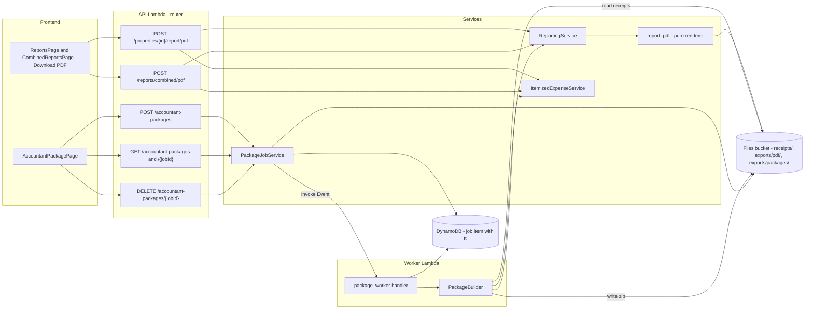
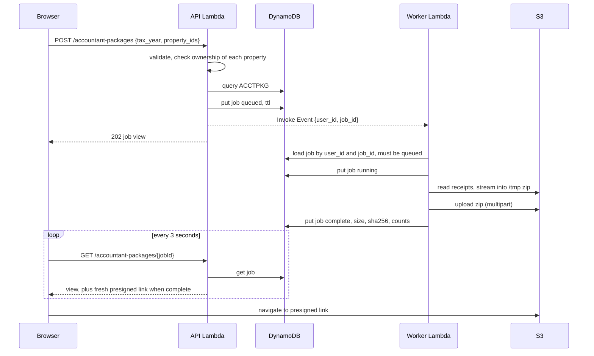
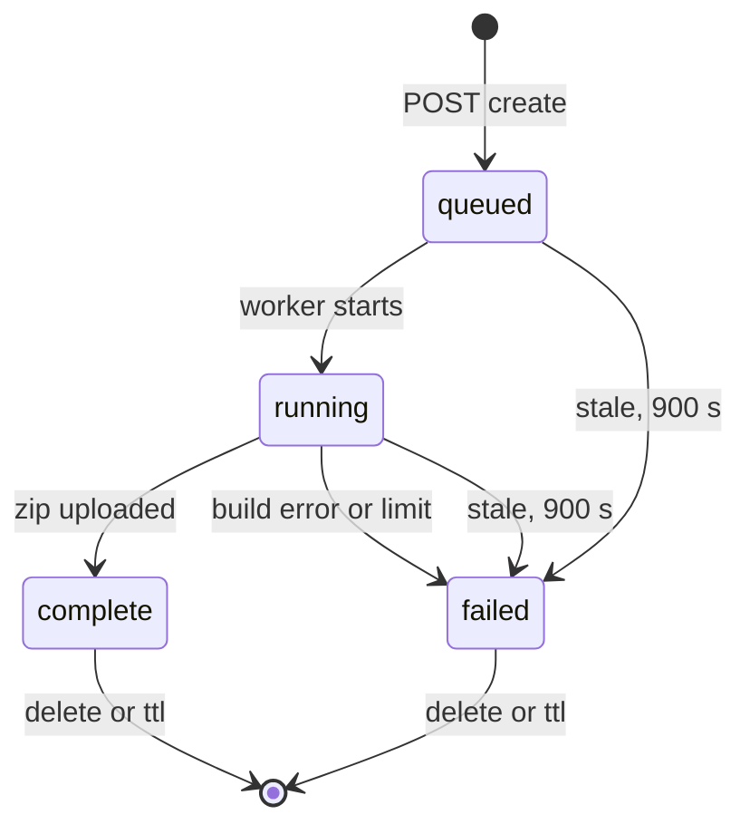

# Design Document

## Overview

The feature gives the user two ways to hand a year to someone else: a **Schedule E PDF** (one property, or the whole portfolio) and an **Accountant package** ZIP for a tax year. Both read data the app already holds and add no figure of their own.

The design rests on four rules.

1. **The report is the only source of figures.** `ReportingService.report_for` and `combined_report` produce every line total, total, Line 12 field, and Line 19 item. The PDF renderer, the CSV and JSON files, and the manifest never sum, subtract, or round money. Repairs detail comes from `ItemizedExpenseService.summary`, which already applies the entered-total versus itemized rule. Nothing restates a precedence rule.
2. **Pure layers around thin I/O.** `report_pdf.py` (renderer), `package_paths.py` (slugs and entry paths), and the CSV and manifest builders are pure functions of data. The package builder and the worker do the S3 and DynamoDB I/O. Property tests run on the pure layers with generated data and need no AWS.
3. **Files never pass through the API response.** Both the PDF and the ZIP are written to S3 and returned as a 15-minute presigned link. This avoids the 6 MB synchronous Lambda response limit and the 30 second HTTP API integration limit.
4. **The package is a background job in its own Lambda.** A package can hold hundreds of megabytes of receipts. A dedicated worker function, started by an asynchronous invoke, builds it. The API function keeps its 30 second timeout and its narrow permissions.

### Design decisions and rationale

1. **ReportLab for PDF, server-side.** See "PDF approach" below for the comparison. The deciding factor is that the ZIP must contain a PDF built on the server.
2. **Synchronous single PDF, asynchronous package.** A single report is a few kilobytes and renders in milliseconds. The package reads receipts of up to 25 MiB each and is bounded only by a 400 MiB cap. Putting both behind the same pattern would add a job to every PDF download for no gain.
3. **A separate worker Lambda, not a longer API timeout.** Raising the API function timeout would not help because API Gateway cuts the request at 30 seconds, and it would let any request run for minutes. A worker function has its own timeout (600 seconds), memory (1024 MB), ephemeral storage (1024 MB), reserved concurrency (2), and IAM role. The API function only gains `lambda:InvokeFunction` on the worker.
4. **Asynchronous invoke with no retry.** The API calls `Invoke` with `InvocationType=Event`. The worker's event invoke config sets `MaximumRetryAttempts: 0` so one request is at most one run. A queued event that cannot start within 300 seconds is dropped, and the job then ages into `failed` by the stale rule.
5. **The job record reuses the extraction-job pattern.** A transient item under `USER#<userId>` with `SK = ACCTPKG#<jobId>` and a `ttl`. Ownership is the partition key, so another user's job id is `not_found` by construction, byte-identical to a missing id.
6. **Stale detection happens at read time.** A worker can die without writing a final state (timeout, out of memory). A job that has been `queued` or `running` for longer than `JOB_STALE_SECONDS` (900) is reported as `failed` and no longer blocks a new job. A `queued` job whose event was dropped after 300 seconds, and a `running` job that was killed at the 600 second timeout, both pass the 900 second threshold with margin.
7. **One active job per user.** The repository has no conditional write primitive, so the check is read-then-write. Two simultaneous create requests could both pass. The throttle on the route (1 request per second, burst 2) and the single-user nature of the app make that window negligible, and a duplicate would write to a different object key (the key includes the job id), so the outcome is two valid packages and no corruption.
8. **Receipts are read by S3 key from the document rows.** The builder reads `#DOC#` rows without presigning and without the oversize purge that `TransactionService.list_receipts` performs. A new read method returns document metadata only. That keeps the builder from deleting a user's S3 object as a side effect of a read.
9. **The ZIP is written to `/tmp` and uploaded with a managed multipart upload.** Memory use stays flat. `zipfile` streams each receipt through a 1 MiB buffer. The size cap is checked after each entry against the temp file size.
10. **Slugs and entry paths are computed, not trusted.** Property names and receipt filenames are user text. Every ZIP entry path is built from a slug and `sanitize_filename`, then validated by one function that rejects anything outside `[A-Za-z0-9._/-]`, any `..` segment, a leading slash, a backslash, and more than 200 characters.
11. **PDF text goes in as plain strings, never as markup.** ReportLab `Paragraph` parses an XML-like mini language, including `` and `<font>`. Early ReportLab versions had a remote-code issue in that parser (CVE-2023-33733, fixed in 3.6.13). The renderer escapes every user value before it reaches a `Paragraph` and pins a version above that fix. A property test feeds markup and asserts it appears literally.
12. **Neutralize spreadsheet formulas.** The accountant opens these CSV files in a spreadsheet. Text cells beginning with `=`, `+`, `-`, `@`, tab, or carriage return get an apostrophe prefix. The existing server serializers get the same treatment because the package reuses them.
13. **The checklist is an optional hook.** `import_module("logstead.services.checklist")` inside a `try`. The spec for the year-end checklist exists, but the code may not. The builder takes a provider object with `checklist_for`, so tests inject present, absent, and failing providers without the real module.
14. **Download from the browser by navigation.** The UI sets `window.location` (or clicks an anchor) to the presigned URL, whose response carries `Content-Disposition: attachment`. No `fetch` of the S3 URL happens, so neither CORS nor `connect-src` is involved.
15. **The page lives at `/accountant-package` under the Tax group.** The package spans properties, so it is not a property tab. The per-property and combined report pages gain a PDF button and a link.

### PDF approach

| Option | Fits the Lambda zip | Output in ZIP | License | Testable from Python | Notes |
| --- | --- | --- | --- | --- | --- |
| **ReportLab 5.1.0** (chosen) | Pure-Python wheel, 1.9 MB. Needs Pillow and charset-normalizer, which the existing `pdfplumber` dependency already installs (verified in task 1.1 with a dry-run install). | Yes | BSD | Yes: `pypdf` or `pdfplumber` (already dependencies) extract text | Standard Helvetica needs no font embedding. Text outside Windows-1252 renders as `?`. `Paragraph` markup must be escaped (decision 11). |
| fpdf2 2.9.0 | 352 KB wheel. Needs Pillow and fonttools. | Yes | LGPL-3.0 | Yes | Smaller, but the LGPL license needs a separate review for a bundled dependency, and its table layout is more manual. |
| Browser print stylesheet only | No new dependency | **No**: the server cannot print a page | n/a | No: needs a browser | The Reports pages already carry `print:hidden` rules. It remains available for the user's own printing and is left unchanged. |
| WeasyPrint | Needs Pango and Cairo shared libraries, not in the Lambda Python runtime | Yes | BSD | Yes | Would need a Lambda layer or a container image. |
| Headless Chromium | Hundreds of MB, needs a layer or image | Yes | BSD | Heavy | Over-sized for a table. |

Choice: **ReportLab**. Tradeoff accepted: a new pinned dependency (about 2 MB, plus the Pillow already present) and a Latin-1-range character limit, in return for a PDF that can sit inside the server-built ZIP and be tested without a browser.

**Dependency policy and packaging impact** (`docs/dependency-policy.md`):

- `backend/requirements.txt` pins `reportlab==5.1.0`. `backend/pyproject.toml` also lists `reportlab`, because `backend/Makefile` builds the Lambda with `pip install . --target`, which reads `pyproject.toml` and not `requirements.txt`. Both files must change.
- Audit with `pip-audit` as the policy states. Renovate already tracks `requirements.txt`.
- The API function and the worker use the same source and the same dependency set. Task 1.1 measures the unzipped package before and after and records it in `docs/deployment.md`. The Lambda limit is 250 MB unzipped.
- No CSP or CORS change. The PDF is downloaded by navigation, not fetched.

### Research notes (grounded in the codebase)

- **Report data.** `ScheduleEReport.lines` holds lines 3 to 19 in ascending order (`_ALL_LINES`), each with `label` from `SCHEDULE_E_LINE_LABELS`, `kind`, `total`, and `includes_imported`. `other_items` holds the Line 19 descriptions. `totals.total_expenses` includes line 18. `line12` holds `source` and the superseded manual interest. Reading `_build_report` (`report.py` lines 768 to 880) confirms the precedence logic lives there only.
- **Existing server export.** `ReportingService.export_report` and `export_combined_report` serialize and store reports under `exports/<propertyId>/<year>/` and `exports/combined/<year>/`, and return a presigned link. No router entry calls them. The combined key has no user id, so two users exporting the same year would overwrite one object. That path is unreachable today. This design does not route it, but fixes the key. The new routes use `exports/pdf/<userId>/<random id>/`. The key defect is fixed by this work (Requirement 24 and "Combined export key scoping" below), and the new routes still use `exports/pdf/<userId>/<random id>/`.
- **Existing CSV serializers are private** (`_report_to_csv` and the others). The browser CSV differs from them in the `Schedule E Report` title row and in the line ending. The design adds public wrappers in `report.py` and keeps both layouts.
- **Receipts.** `Document(id, property_id, transaction_id, s3_key, content_type, original_filename, uploaded_at)` rows sit at `PROPERTY#<id>` / `TXN#<invDate>#<txnId>#DOC#<docId>` and are not in the GSI2 year listing. `list_receipts` calls S3 (`purge_if_oversized`) and presigns, so the builder cannot use it. Keys follow `receipts/<transactionId>/<filename>`.
- **Itemized detail.** `ItemizedExpenseService.summary(property_id, "repairs", year)` returns `entries`, `entered_total`, `itemized_sum`, `line_total`, and `line_source`. Report line 14 and `line_total` must match because the report builder resolves line 14 through the same `LineAccumulator`.
- **Job pattern.** `ExtractionService` stores a job under `USER#<userId>` with `SEEXTRACT#<jobId>` and a `ttl`, and the SAM table enables TTL on `ttl`. `keys.py` documents entity keys in its module docstring and exposes `extraction_job_sk` and `extraction_job_list_prefix`.
- **Wiring.** `handler._wiring()` builds the repository and adapters from `TABLE_NAME` and `FILES_BUCKET`. The worker reuses it through two new public aliases in `handler.py`. `configure(...)` injects fakes in tests.
- **Limits.** HTTP API integrations time out at 30 seconds ([quotas](https://docs.aws.amazon.com/apigateway/latest/developerguide/http-api-quotas.html)). A synchronous Lambda invocation carries at most 6 MB and an asynchronous one at most 1 MB ([Invoke API](https://docs.aws.amazon.com/goto/WebAPI/lambda/Invoke)). The async payload here is two ids, well under 1 MB. Receipts can be 25 MiB each (`MAX_DOCUMENT_BYTES`), so one receipt already exceeds the synchronous response limit.
- **Template.** `FilesBucket` has versioning enabled and lifecycle rules for `exports/` (30 days) and `imports/schedule-e/` (1 day) with no `NoncurrentVersionExpiration`. Expiring a current version in a versioned bucket leaves the object bytes as a noncurrent version. The new lifecycle rules add noncurrent expiry. The existing rules are left alone (see Decisions recorded, "Existing lifecycle rules").
- **IAM.** The API function may `GetObject` and `PutObject` on `exports/*` and may not delete there ("exports/ expire via lifecycle and are never deleted by the app" in the template). The explicit delete of a finished package needs `DeleteObject` on `exports/packages/*` and `exports/pdf/*` only.
- **Frontend.** `useExtractionJob` is the polling pattern (2 second default interval, injectable fetcher). `usePortfolioYearRange` supplies the year list for portfolio pages. `ReportsPage` and `CombinedReportsPage` hold the CSV and JSON buttons. `pageConformance.test.ts` scans `pages/` for `PageHeader`, a document title, `useFirstLoad`, and `StateBlock`.

## Architecture



### Request flow for one package



### Job states



## Components and Interfaces

### Backend

**`services/package_config.py`** (new). Frozen module constants, the only place holding the numbers.

```python
PACKAGE_MAX_BYTES = 400 * 1024 * 1024
PACKAGE_MAX_RECEIPTS = 2000
DOWNLOAD_LINK_SECONDS = 900
JOB_TTL_SECONDS = 24 * 60 * 60
JOB_STALE_SECONDS = 900
JOB_LIST_LIMIT = 10
COPY_CHUNK_BYTES = 1024 * 1024
```

**`services/csv_safe.py`** (new, pure).

```python
def neutralize_cell(value: str) -> str:
    """Prefix an apostrophe when value starts with = + - @ tab or CR."""
```

**`services/package_paths.py`** (new, pure).

```python
def slugify(text: str, fallback: str) -> str          # ascii [a-z0-9-], collapsed, trimmed, max 40
def unique_slugs(items: Sequence[tuple[str, str]]) -> dict[str, str]   # (id, name) -> slug, suffix "-" + id[:6] on collision
def receipt_entry_path(property_slug, category_slug, date, transaction_id, filename) -> str
def is_safe_entry_path(path: str) -> bool             # character set, no "..", no leading "/", no "\\", <= 200
def dedupe_entry_path(path: str, taken: set[str]) -> str   # "-2", "-3" before the extension
```

**`services/report_pdf.py`** (new, pure, ReportLab). No I/O, no clock, no money arithmetic.

```python
@dataclass(frozen=True)
class RepairsDetail:                    # copied from ItemizedSummary by the caller
    entries: tuple[RepairsEntry, ...]   # id, date, description, amount (Decimal)
    entered_total: Decimal | None
    itemized_sum: Decimal
    line_total: Decimal
    line_source: str

def format_money(value: Decimal) -> str           # "$1,234.50", "($1,234.50)" for negatives
def pdf_text(value: str | None) -> str            # cp1252 replace, control chars removed, XML-escaped for Paragraph
def chunk_columns(properties: Sequence[T], size: int = 3) -> list[list[T]]
def render_property_pdf(report: ScheduleEReport, repairs: RepairsDetail | None, generated_on: date) -> bytes
def render_combined_pdf(combined: CombinedScheduleEReport,
                        repairs: Mapping[str, RepairsDetail | None], generated_on: date) -> bytes
```

Layout of `render_property_pdf` (US Letter, Helvetica, `invariant=1` so the file has no timestamp or random id):

1. Title: "Schedule E, Part I worksheet" and the property name. Subtitle: "Laid out like Schedule E Part I. Not an IRS form."
2. Header table: address, property type, tax year, fair rental days, personal use days.
3. Line table, columns `Line | Description | Amount`. Section rows "Income" and "Expenses". A line with `includes_imported` carries a dagger after its label. Line 20 "Total expenses" and line 21 "Net income or (loss)" come from `totals`. The final row of income is "Total income" from `totals`.
4. Footnote for the dagger, printed only when at least one line has the marker.
5. Line 12 note: "Line 12 comes from the loan schedule." or "Line 12 comes from transactions you entered." When `superseded_manual_interest.count > 0`: "N hand-entered mortgage interest transaction(s) totaling $X were not used because loan interest took precedence."
6. "Line 19, Other expenses": table of description and amount (omitted when there are none, with the text "No other expenses itemized").
7. Appendix A, "Repairs detail (line 14)", when `repairs is not None and repairs.entries`: entered total or "No total entered", itemized sum, the line 14 amount from the report line with the source sentence, and the entries table. The paragraph "You decide whether each entry is a repair or an improvement" closes it.
8. Page footer on every page: disclaimer line, property name, tax year, "Page N of M" (two-pass `NumberedCanvas`), and the generation date text from `generated_on`.

`render_combined_pdf` follows the same pieces: a title page header, then for each chunk of up to three properties a table with columns A, B, C (header cells carry the property name and a shortened address) and rows for lines 3 to 19 and totals; then the portfolio totals table and the portfolio Line 12 note (total, superseded count and amount); then per property a Line 19 table and, when present, its Repairs appendix.

User text enters ReportLab only through `pdf_text`, and table cells that hold user text are `Paragraph(pdf_text(...))` with a fixed style, so wrapping works and markup cannot be interpreted.

**`services/report.py`** (modified, additive).

```python
def serialize_report(report: ScheduleEReport, format: Literal["csv", "json"]) -> bytes
def serialize_combined(report: CombinedScheduleEReport, format: Literal["csv", "json"]) -> bytes
```

Thin public wrappers over the private functions. `_report_to_csv` and `_combined_to_csv` pass text cells (property name, address, type, other-item descriptions) through `neutralize_cell`. `export_report` and `export_combined_report` are unchanged in signature. `export_report` keeps its key scheme (`exports/<propertyId>/<year>/...`, a property id is globally unique). `export_combined_report` changes its key as described next.

**Combined export key scoping** (`services/report.py`, `services/property.py`, `adapters/s3_files.py`). The defect: `export_combined_report` built `export_key("combined", str(tax_year), filename)`, with no user id, so two users exporting the same year write the same object. The fix:

```python
# adapters/s3_files.py (pure, next to export_key)
def combined_export_key(user_id: str, tax_year: int, filename: str) -> str:
    """exports/combined/<user_id>/<tax_year>/<filename>"""
    return export_key("combined", user_id, str(tax_year), filename)

# services/property.py: a read-only accessor on PropertyService
@property
def user_id(self) -> str: ...

# services/report.py, inside export_combined_report
key = combined_export_key(self._properties.user_id, tax_year, filename)
```

`ReportingService` already holds the user-scoped `PropertyService`, so no constructor change is needed and every existing construction (`ReportingService(transactions, depreciation, properties, files)`) keeps working. `build_key` already rejects unsafe segments, and the user id comes from the authenticated context, never from the client. The package does not call `export_combined_report`: its combined files are ZIP entries built with `serialize_combined`, so the package's write set (Property 13) never includes a key under `exports/combined/`. Property 16 and a write-set assertion pin both facts. No object can exist under the old `exports/combined/<year>/` shape, because no route calls the method, so no migration is needed. The existing 30-day `exports/` lifecycle covers the new prefix.

**`services/transaction.py`** (modified, additive).

```python
def receipt_documents(self, property_id: str, transaction: Transaction) -> list[Document]:
    """Receipt metadata rows only. No S3 call, no presigned URL, no purge, no write."""
```

It queries the same `#DOC#` prefix `_receipt_items` uses.

**`adapters/s3_files.py`** (modified, additive).

```python
def presigned_get_url(self, key, *, expires_in=DEFAULT_EXPIRY_SECONDS, download_filename: str | None = None) -> str
def open_stream(self, key: str) -> tuple[IO[bytes], int] | None     # body stream and ContentLength; None when absent
def upload_file(self, path: str, key: str, content_type: str) -> None   # managed multipart
def package_key(user_id: str, job_id: str, year: int) -> str            # exports/packages/<user>/<job>/logstead-accountant-package-<year>.zip
def pdf_key(user_id: str, random_id: str, filename: str) -> str         # exports/pdf/<user>/<id>/<filename>
```

`download_filename` becomes `ResponseContentDisposition=attachment; filename="..."` (filename sanitized and quoted). Existing callers pass nothing and are unchanged. `EXPORT_PREFIX` stays `exports`; the two key helpers build on `export_key`.

**`services/accountant_package.py`** (new). The builder.

```python
@dataclass(frozen=True)
class PackageResult:
    size_bytes: int
    sha256: str
    file_count: int
    receipt_count: int
    skipped_receipt_count: int

class PackageTooLarge(Exception): ...        # message names the limit

class PackageBuilder:
    def __init__(self, reports: ReportingService, itemized: ItemizedExpenseService,
                 transactions: TransactionService, properties: PropertyService,
                 files: S3FileAdapter, checklist: ChecklistProvider | None,
                 clock: Callable[[], datetime]) -> None: ...

    def build(self, tax_year: int, property_ids: Sequence[str], zip_path: str) -> PackageResult
```

`ChecklistProvider` is a `Protocol` with one method, `checklist_for(property_id: str, tax_year: int) -> Result[Any]`, returning a JSON-serializable checklist. It is the object that `logstead.services.checklist.provider_for(wiring, user)` returns (the signature is defined in the year-end-checklist spec, Requirement 24, and matches this design). `user` is a `UserContext` or a user id string, as for the other services. `build` runs these steps in order:

1. Read `generated_at` once from the clock.
2. For each property id in the job: `reports.report_for` (a failed `Result` raises a `PackageBuildError` with the report's message), `itemized.summary(..., "repairs", year)` copied into `RepairsDetail`. With two or more properties, `reports.combined_report(property_ids, year)`.
3. Compute `unique_slugs` for properties and the category slug map from `category_by_id`.
4. For each property, list the year's transactions and, per transaction, `receipt_documents`. Count receipts first and fail with `PackageTooLarge` when the count exceeds `PACKAGE_MAX_RECEIPTS`.
5. Open the ZIP with `zipfile.ZipFile(zip_path, "w", allowZip64=True)`. Write, in ascending entry path order, each report file (PDF, CSV, JSON), the transactions CSV, the checklist file when available, each receipt, `README.txt`, and last `manifest.json`. Every write goes through one `_add(entry_path, kind, data_or_stream)` helper that computes the SHA-256 and size from the bytes it writes, appends a manifest entry, and checks `os.path.getsize(zip_path) <= PACKAGE_MAX_BYTES` after the entry (the manifest and README are written last and are small).
6. Receipts stream with `files.open_stream(key)` in `COPY_CHUNK_BYTES` chunks. `None` yields a `missing` Skipped_Receipt. A `ContentLength` over `MAX_DOCUMENT_BYTES` yields `oversized` without reading the body.
7. Compute the file SHA-256 of the finished ZIP by reading it in chunks.

The transactions CSV columns, ordering, and `neutralize_cell` application are as in Requirement 9. The `document_paths` cell is filled after the receipts are placed, so the CSV is built from the placed-path map and written after the receipts are known. The ZIP order is by entry path, so the builder collects entries in a list of `(path, kind, producer)` and writes them sorted. Receipts are placed before the CSV is rendered, so the receipt pass runs first into a temporary path map, and the ZIP writer then walks the sorted list.

The checklist step imports lazily:

```python
def default_checklist_provider(wiring, user) -> ChecklistProvider | None:
    try:
        module = importlib.import_module("logstead.services.checklist")
    except ModuleNotFoundError:
        return None
    return module.provider_for(wiring, user)   # only called when the module exists
```

The `provider_for` hook is implemented by the year-end-checklist spec (a thin wrapper over `ChecklistService`). This spec does not implement it. When the checklist module exists without `provider_for`, or `provider_for` raises, the builder treats the checklist as absent. The manifest reason is `not available in this release` for an absent module or hook and `could not be generated` when the provider returns a failure. `developer-guide.md` documents the hook. A contract test (task 5.7) pins the import contract: with a stub `logstead.services.checklist` module on `sys.modules` exposing `provider_for`, the builder writes the checklist file, and with the module absent it completes without it.

**`services/package_jobs.py`** (new). `PackageJobService(repo, user, files, invoker, clock)`.

```python
def create(self, tax_year: int, property_ids: list[str] | None) -> Result[PackageJobView]
def list(self) -> Result[list[PackageJobView]]
def get(self, job_id: str) -> Result[PackageJobView]
def delete(self, job_id: str) -> Result[None]

def effective_status(job: Mapping, now: datetime) -> str         # pure; applies the stale rule
def is_active(job: Mapping, now: datetime) -> bool               # queued or running, not stale
def is_expired(job: Mapping, now: datetime) -> bool              # ttl passed
```

`create` validates `tax_year` (the router has already checked bounds), resolves `property_ids` (all of the user's properties when omitted, each id checked through `PropertyService.get` when given, failing with the same `not_found` for missing and foreign ids), rejects an empty set (`validation`, field `property_ids`), lists `ACCTPKG#` items and returns `conflict` when one is active, writes the job `queued`, then calls `invoker.invoke(user_id, job_id)`. A raised invoke error marks the job `failed` and returns `unavailable`.

`get` and `list` apply `is_expired` (a past `ttl` is `not_found` and is skipped), apply `effective_status`, and issue `presigned_get_url(..., download_filename=...)` for `complete` jobs only. `delete` returns `conflict` for an active job, deletes the S3 object first, then the item.

**`adapters/package_invoker.py`** (new). `PackageInvoker(lambda_client, function_name)` with `invoke(user_id, job_id)` calling `invoke(FunctionName, InvocationType="Event", Payload=json)`. `_Wiring` gains `package_invoker: PackageInvoker | None`, built from `PACKAGE_WORKER_FUNCTION`. `configure(...)` accepts it for tests.

**`worker/package_worker.py`** (new), handler `logstead.worker.package_worker.handler`.

```python
def handler(event, context=None) -> dict:
    user_id, job_id = event.get("user_id"), event.get("job_id")     # lookup keys only
    wiring = get_wiring()
    job = load_job(wiring.repo, user_id, job_id)
    if job is None or job["status"] != "queued":
        return {"status": "ignored"}
    mark_running(...)
    with tempfile.TemporaryDirectory(dir="/tmp") as tmp:
        try:
            result = build_package_service(wiring, user_id).build(job["taxYear"], job["propertyIds"], zip_path)
            wiring.files.upload_file(zip_path, package_key(user_id, job_id, year), "application/zip")
            mark_complete(..., result)
        except PackageTooLarge as exc: mark_failed(..., str(exc))
        except PropertyGone: mark_failed(..., "A selected property no longer exists.")
        except Exception as exc: log error type and location; mark_failed(..., GENERIC_MESSAGE)
    return {"status": ...}
```

The `TemporaryDirectory` removes the file on every path. `build_package_service(wiring, user_id)` is a new public function in `router/handler.py` that wires `ReportingService`, `ItemizedExpenseService`, `TransactionService`, `PropertyService` for the user exactly as the report routes do. `get_wiring` and `to_jsonable` become public aliases of `_wiring` and `_to_jsonable`. The worker imports those three names and nothing private.

**`repository/keys.py`** (modified). Add `package_job_sk(job_id) -> "ACCTPKG#<jobId>"`, `PACKAGE_JOB_PREFIX`, and the entity line in the module docstring. The partition key is the existing `USER#<userId>` helper.

**`router/handler.py`** (modified).

| Method and path | Handler | Guard | Success |
| --- | --- | --- | --- |
| `POST /properties/{propertyId}/report/pdf?taxYear=` | `_property_report_pdf` | `_property_scoped` | 200 `PdfDownload` |
| `POST /reports/combined/pdf?taxYear=&propertyIds=` | `_combined_report_pdf` | ownership through `ReportingService.combined_report` | 200 `PdfDownload` |
| `POST /accountant-packages` | `_create_package` | user scope through `PropertyService` | 202 `PackageJobView` |
| `GET /accountant-packages` | `_list_packages` | partition key | 200 `{jobs: [...]}` |
| `GET /accountant-packages/{jobId}` | `_get_package` | partition key | 200 `PackageJobView` |
| `DELETE /accountant-packages/{jobId}` | `_delete_package` | partition key | 200 `{}` |

Routing notes: `/reports/combined/pdf` has three segments and does not collide with `/reports/combined` (two). `/properties/{propertyId}/report/pdf` has four segments and does not collide with `/properties/{propertyId}/report` (three). `/accountant-packages/{jobId}` and `/accountant-packages` differ by segment count. `_result_response` already accepts `success_status`, so `202` needs no new mechanism. The body of the create route uses the existing dual snake_case and camelCase tolerance (`tax_year` or `taxYear`).

The PDF handlers build the PDF in the request: `report_for` (or `combined_report`), `ItemizedExpenseService.summary` per property for the appendix, `render_*_pdf`, `files.put_object(pdf_key(...))`, `presigned_get_url(..., download_filename=...)`.

**Not changed:** the DynamoDB table definition and keys apart from the new SK prefix, `LineAccumulator`, the report builder, the loan and carryforward services, CSP, CORS, Cognito.

### Infrastructure (`infra/template.yaml`)

```yaml
PackageWorkerFunction:
  Type: AWS::Serverless::Function
  Metadata: { BuildMethod: makefile }
  Properties:
    FunctionName: logstead-package-worker
    CodeUri: ../backend/
    Handler: logstead.worker.package_worker.handler
    Timeout: 600
    MemorySize: 1024
    EphemeralStorage: { Size: 1024 }
    ReservedConcurrentExecutions: 2
    Environment: { Variables: { TABLE_NAME: !Ref LogsteadTable, FILES_BUCKET: !Ref FilesBucket } }
    EventInvokeConfig: { MaximumRetryAttempts: 0, MaximumEventAgeInSeconds: 300 }
    Policies:
      - Statement:
          - Effect: Allow
            Action: [dynamodb:GetItem, dynamodb:Query, dynamodb:PutItem]
            Resource: [table arn, table arn/index/*]
          - Effect: Allow
            Action: s3:GetObject
            Resource: !Sub "${FilesBucket.Arn}/receipts/*"
          - Effect: Allow
            Action: [s3:PutObject, s3:AbortMultipartUpload]
            Resource: !Sub "${FilesBucket.Arn}/exports/packages/*"
```

Other template changes:

- `backend/Makefile` gains `build-PackageWorkerFunction` with the same recipe as `build-ApiFunction`.
- `ApiFunction`: environment `PACKAGE_WORKER_FUNCTION: !Ref PackageWorkerFunction`; a policy statement `lambda:InvokeFunction` on `!GetAtt PackageWorkerFunction.Arn`; `FilesBucketDelete` gains `exports/packages/*` and `exports/pdf/*`; the comment "exports/ expire via lifecycle and are never deleted by the app" is updated to name the exception.
- `FilesBucket` lifecycle: two rules, `ExpireAccountantPackages` (prefix `exports/packages/`) and `ExpireGeneratedPdfs` (prefix `exports/pdf/`), each with `ExpirationInDays: 1` and `NoncurrentVersionExpiration: { NoncurrentDays: 1 }`. The existing 30-day `exports/` rule also matches these prefixes; the shorter rule governs.
- `HttpApi.RouteSettings` and `ApiFunction.Events` gain throttled entries for `POST /accountant-packages` (rate 1, burst 2), `POST /properties/{propertyId}/report/pdf` (2, 5), and `POST /reports/combined/pdf` (2, 5).
- A `PackageWorkerErrorsAlarm` on the worker's `Errors` metric, like `LambdaErrorsAlarm`.
- The template description and the comments around the S3 grants are updated. No change to the CSP resource, the CORS rules, or the table.

### Frontend

**API modules.** `api/accountantPackage.ts` (new): `AccountantPackageApi` with an injectable `ApiClient` (like `ItemizedApi`): `createPackage(taxYear, propertyIds?)`, `listPackages(signal?)`, `getPackage(jobId, signal?)`, `deletePackage(jobId)`, and the wire types `PackageJobView` and `PackageStatus`. `api/reports.ts` (modified): `createReportPdf(propertyId, taxYear)` and `createCombinedReportPdf(taxYear, propertyIds?)` returning `PdfDownload`.

**Pure helpers** `lib/packageJob.ts` (new): `isTerminal(status)`, `statusLabel(status)`, `formatBytes(n)`, `linkMinutes(seconds)`, `pollDelayMs(attempt)` (fixed 3000, kept as a function so tests can inject), and `startDownload(url)` (sets `window.location.assign(url)`; wrapped so tests can stub it).

**Hook** `components/accountant-package/usePackageJob.ts` (new), modeled on `useExtractionJob`: creates, polls every 3 seconds with an injectable interval, resumes on mount from `listPackages`, stops on unmount, surfaces `{ job, error, busy, start, remove, refresh }`.

**Components** in `components/accountant-package/` (new): `PackageDisclaimer` (`role="note"`, wording consistent with the carryforward `DisclaimerNotice`), `PackageContentsList` (plain-language contents), `PropertyPicker` (`fieldset` and `legend`, a checkbox per property), `PackageStatusPanel` (progress, completion details, skipped receipts note, download link, delete button), and `index.ts`.

**Page** `pages/AccountantPackagePage.tsx` (new): `PageHeader` title "Accountant package", document title "Accountant package", year `Select` from `usePortfolioYearRange` defaulting to `latestCompletedTaxYear()`, `PropertyPicker`, "Prepare package" `Button`, `PackageStatusPanel`, an error `StateBlock` with retry, and a `ConfirmDialog` for delete. `useFirstLoad` covers the initial job list load.

**Navigation and routing.** `navConfig.ts`: add `{ to: "/accountant-package", label: "Accountant package", icon: "reports" }` to the Tax group. `routes.tsx`: add `{ path: "accountant-package", element: <AccountantPackagePage /> }` and the route comment. Update `navConfig.test.ts`, `MainNav.test.tsx`, and `routes.test.tsx` where they enumerate entries.

**Report pages.** `ReportsPage.tsx` and `CombinedReportsPage.tsx` gain a "Download PDF" `Button` (busy state while the request runs, error toast on failure). `CombinedReportsPage` also links to `/accountant-package`. The new buttons carry `print:hidden` like their neighbors.

## Data Models

### Stored data

One new transient item type.

| Attribute | Value |
| --- | --- |
| `PK` | `USER#<userId>` |
| `SK` | `ACCTPKG#<jobId>` |
| `id` | job id (uuid4) |
| `status` | `queued`, `running`, `complete`, or `failed` |
| `taxYear` | integer |
| `propertyIds` | list of property ids |
| `createdAt`, `startedAt`, `finishedAt` | ISO-8601 UTC strings or null |
| `message` | string or null (failure text, no internal detail) |
| `objectKey` | S3 key of the ZIP, set on `complete` |
| `sizeBytes`, `sha256`, `fileCount`, `receiptCount`, `skippedReceiptCount` | set on `complete` |
| `ttl` | epoch seconds, creation time plus `JOB_TTL_SECONDS` |

No GSI attributes. Reads are `get_item` and a `query` on `PK` with `SK` begins with `ACCTPKG#`. The item holds no money. The existing sparse TTL on `ttl` reaps it. Backup export, restore, and clear do not touch it, like the extraction job. `docs/data-model.md` gets the item and a statement that the feature stores nothing else.

S3 objects (not stored in DynamoDB): `exports/pdf/<userId>/<random id>/<filename>.pdf`, `exports/packages/<userId>/<jobId>/logstead-accountant-package-<year>.zip`, and, from the key fix, `exports/combined/<userId>/<year>/schedule-e-combined-<year>.<format>` (written only by `export_combined_report`, not by the package).

### Response shapes (wire)

```json
// POST /properties/{id}/report/pdf  and  POST /reports/combined/pdf   (200)
{ "download_url": "https://...", "filename": "schedule-e-oak-street-2024.pdf",
  "content_type": "application/pdf", "size_bytes": 14231, "expires_in_seconds": 900 }

// POST /accountant-packages (202), GET /accountant-packages/{jobId} (200)
{ "id": "…", "status": "complete", "tax_year": 2024, "property_ids": ["…"],
  "created_at": "2025-01-15T14:03:22+00:00", "finished_at": "2025-01-15T14:04:01+00:00",
  "message": null, "size_bytes": 18340211, "sha256": "…64 hex…",
  "file_count": 41, "receipt_count": 33, "skipped_receipt_count": 1,
  "download_url": "https://...", "download_expires_in_seconds": 900 }

// GET /accountant-packages (200)
{ "jobs": [ /* PackageJobView, newest first, at most 10 */ ] }
```

`download_url` and `download_expires_in_seconds` are `null` unless the status is `complete`. The wire carries no money. `size_bytes` is an integer count of bytes.

### `manifest.json` (v1)

```json
{
  "schema_version": 1,
  "app": "Logstead",
  "tax_year": 2024,
  "generated_at": "2025-01-15T14:03:22+00:00",
  "disclaimer": "Built from your own records. An organizing aid, not tax advice.",
  "properties": [{ "property_id": "…", "name": "Oak Street" }],
  "files": [
    { "path": "reports/schedule-e-oak-street-2024.pdf", "kind": "report_pdf",
      "size_bytes": 14231, "sha256": "…" }
  ],
  "receipts_skipped": [
    { "transaction_id": "…", "document_id": "…", "original_filename": "roof.pdf", "reason": "missing" }
  ],
  "sections": { "checklist": { "included": false, "reason": "not available in this release" } },
  "totals": { "files": 41, "receipts_included": 33, "receipts_skipped": 1, "bytes": 18340211 }
}
```

`totals.bytes` sums `size_bytes` of `files`. `manifest.json` is not in its own `files` list. The ZIP's SHA-256 is on the job record and in the job view.

### Entry path layout

```
README.txt
manifest.json
reports/schedule-e-<slug>-<year>.{pdf,csv,json}
reports/schedule-e-combined-<year>.{pdf,csv,json}      (two or more properties)
transactions/transactions-<year>.csv
receipts/<property slug>/<category slug>/<YYYY-MM-DD>_<txn8>_<filename>
checklist/year-end-checklist-<year>.json               (when available)
```

## Correctness Properties

*A property is a characteristic or behavior that should hold true across all valid executions of a system-essentially, a formal statement about what the system should do. Properties serve as the bridge between human-readable specifications and machine-verifiable correctness guarantees.*

Reflection note: the prework produced about forty criteria that are testable by example (route wiring, template contents, UI states, fixed texts) and a smaller set that vary meaningfully with input. Criteria 1.2 to 1.9 became one property about the content of the extracted PDF text, because each states that part of the report appears in the PDF. Criteria 2.3, 16.2, and 16.4 collapsed into the money format round trip. Criteria 5.1 to 5.4 became one text-safety property. Criteria 5.6 and 1.9 became the determinism property. Criteria 3.1 to 3.6 became one appendix property. Criteria 4.2, 4.3, and 4.6 became the combined layout property. Criteria 2.4 and 8.3 became the agreement property that runs the real services over moto. Criteria 7.5, 7.8, 7.10, and 14.4 share one pure job-state function and became one property. Criteria 8.5, 8.6, 8.8, 10.2, and 15.6 became the entry path property. Criteria 9.1 to 9.5 and 9.7 became the transactions CSV round trip, and 9.6 stays separate because it states the neutralizing rule across arbitrary text. Criteria 12.1 to 12.5 and 12.7 became the manifest property. Criterion 10.7 became the write-set property. Criterion 13.9 became the message-leak property. Criterion 16.1 became the wire-form property. The other criteria (routes, worker states, template, UI, accessibility, documentation) are covered by example, smoke, and integration tests in the Testing Strategy.

### Property 1: The PDF text carries every report figure

For any `ScheduleEReport` (arbitrary two-decimal line totals including negatives for net, arbitrary header text, other items, `includes_imported` flags, and Line 12 details) and any date, the text extracted from the rendered Property_Pdf contains, in ascending line order, each line's label and `format_money` amount; the total income, total expenses, and net values; each other item description and amount in order; the header fields; a footnote marker if and only if some line has `includes_imported`; the Line 12 source sentence, and the superseded count and amount if and only if the count is above zero; and, on every page, the worksheet disclaimer.

**Validates: Requirements 1.2, 1.3, 1.4, 1.5, 1.6, 1.7, 1.8, 2.4, 21.1, 21.2**

### Property 2: Money format round trip

For any `Decimal` with two decimal places in the range of exact report values, parsing `format_money(value)` (removing the dollar sign and separators and reading parentheses as a negative sign) returns the original value, a negative value is wrapped in parentheses, and a non-negative value has no parentheses.

**Validates: Requirements 2.3, 16.2, 16.4**

### Property 3: PDF text safety

For any property name, address, description, and note drawn from arbitrary text (including `<`, `>`, `&`, ``, `<font color="red">`, `<a href>`, control characters, characters outside Windows-1252, and strings of several thousand characters), rendering a report that contains them returns a PDF that `pypdf` reads, whose extracted text contains each value with the characters outside Windows-1252 replaced by `?`, and the render makes no network call and opens no file other than the bundled fonts.

**Validates: Requirements 5.1, 5.2, 5.3, 5.4**

### Property 4: PDF determinism

For any report, repairs detail, and date, two renders return byte-identical output.

**Validates: Requirements 1.9, 5.6**

### Property 5: Repairs appendix

For any Repairs summary and any report, the rendered PDF contains the Repairs appendix if and only if the summary has at least one itemized entry. When present, the appendix text lists the entries in date-then-id order with their amounts, shows the entered total or "No total entered", shows the itemized sum, and shows a line 14 amount equal to the report's line 14 and to the summary's `line_total`. The review sentence is present and no sentence calls an entry a capital improvement.

**Validates: Requirements 3.1, 3.2, 3.3, 3.4, 3.5, 3.6, 3.7**

### Property 6: Combined layout and totals

For any combined report with N properties (N from 1 to 10), `chunk_columns` returns `ceil(N / 3)` groups of at most three, in the original order, and the Combined_Pdf text contains the column letters A, B, and C where a group has that many members, the portfolio totals equal to the combined report's `totals`, and the Line 12 total with the summed superseded count and amount.

**Validates: Requirements 4.2, 4.3, 4.6**

### Property 7: Package files agree with the report

For any small generated state (properties, transactions, itemized Repairs entries, loans, and assets) stored in moto, the amounts extracted from the Property_Pdf, parsed from the CSV, and read from the JSON of the same property and year all equal the `ReportingService.report_for` line totals, totals, and Line 12 fields, and the Repairs appendix line 14 equals report line 14.

**Validates: Requirements 2.1, 2.2, 8.3, 3.6**

### Property 8: Job state classification

For any job item (any status, any `createdAt` and `startedAt`, any `ttl`) and any `now`, `effective_status` returns `failed` when the status is `queued` or `running` and `now` is more than `JOB_STALE_SECONDS` after the last state change, otherwise it returns the stored status; `is_active` is true if and only if the stored status is `queued` or `running` and the job is not stale; `is_expired` is true if and only if `ttl <= now`. A create request is accepted if and only if no job of the user is active, and a delete request is accepted if and only if the job is not active.

**Validates: Requirements 7.5, 7.8, 7.10, 14.4**

### Property 9: Entry paths are safe and unique

For any list of properties (arbitrary names including empty strings, non-ASCII text, `..`, slashes, and backslashes, and duplicate names), any category labels, and any receipt filenames, every Entry_Path built by the package paths module is relative, unique within the list, made only of `[A-Za-z0-9._/-]`, free of `..` segments and backslashes, at most 200 characters, and every receipt path contains the property slug, the category slug, the date, and the first eight characters of the transaction id. Every S3 key built by `package_key` and `pdf_key` matches `exports/(packages|pdf)/<user id>/<id>/<server-built filename>` with no client-supplied segment.

**Validates: Requirements 8.5, 8.6, 8.8, 10.2, 15.6**

### Property 10: Spreadsheet formula neutralization

For any text, `neutralize_cell(text)` equals `"'" + text` when the text starts with `=`, `+`, `-`, `@`, a tab, or a carriage return, and equals `text` otherwise. Applying it twice gives the same result as applying it once.

**Validates: Requirements 9.6**

### Property 11: Transactions CSV round trip

For any set of transactions across several properties (arbitrary two-decimal amounts, text with commas, quotes, newlines, and non-ASCII characters, any `imported` and `itemized` flags, and any receipt counts), parsing the CSV with the standard `csv` module returns one row per transaction, ordered by property name, then date, then transaction id; each `amount` equals the stored amount as a two-decimal string; `imported` and `itemized` are `true` or `false`; `document_count` equals the receipt count; and each text value equals the stored text apart from the apostrophe prefix of Property 10.

**Validates: Requirements 9.1, 9.2, 9.3, 9.4, 9.5, 9.7**

### Property 12: Manifest matches the ZIP

For any generated package (arbitrary properties, transactions, receipts of arbitrary bytes and sizes, skipped receipts, and checklist present or absent), reading the ZIP back yields an entry set equal to the Manifest `files` plus `manifest.json`; for each listed file the SHA-256 of the entry bytes equals the Manifest checksum and the entry size equals `size_bytes`; `totals.files`, `totals.receipts_included`, `totals.receipts_skipped`, and `totals.bytes` equal the counts and sums of the lists; `receipts_skipped` lists exactly the skipped receipts; and the job's `sha256` equals the SHA-256 of the uploaded object.

**Validates: Requirements 12.1, 12.2, 12.3, 12.4, 12.5, 12.7, 12.8**

### Property 13: The build writes only the ZIP and the job

For any generated state, running the worker over a recording repository and a recording S3 adapter performs reads only, plus exactly these writes: job item puts for the one job, and one S3 object under `exports/packages/<userId>/<jobId>/`. No receipt object is deleted or overwritten, and no transaction, document, or property item changes.

**Validates: Requirements 10.7, 10.8, 15.7**

### Property 14: Messages never leak internals

For any injected failure whose exception text contains an S3 key, a bucket name, a table name, or a stack trace, the stored job `message` and the API error body contain none of those strings.

**Validates: Requirements 13.9**

### Property 15: Wire form of money and counts

For any generated package, every money value in the manifest, the JSON report files, the transactions CSV, and the checklist file is a string matching `^-?\d+\.\d{2}$`, and every count and size is an integer.

**Validates: Requirements 16.1, 9.4**

### Property 16: Combined export keys are user-scoped

For any two distinct user ids, any tax year, and any export format, the keys that `export_combined_report` writes for the two users differ, each key starts with `exports/combined/<user_id>/<tax_year>/`, and no key of the form `exports/combined/<tax_year>/...` is written.

**Validates: Requirements 24.1, 24.2, 24.4**

## Error Handling

| Condition | Where | Result |
| --- | --- | --- |
| `taxYear` or `tax_year` missing, non-numeric, or outside 1900 to 2200 | router `_int_param` | `400`, `field: "taxYear"` or `"tax_year"` |
| `property_ids` not a list of at most 100 valid ids | router | `400`, `field: "property_ids"` |
| `propertyIds` query invalid | router (existing check) | `400`, `field: "propertyIds"` |
| Property missing or owned by another user | `_property_scoped`, `PropertyService.get` | `404`, byte-identical |
| Job id missing, expired, or owned by another user | `PackageJobService` | `404`, byte-identical |
| User owns no property (combined PDF or package) | service | `400` validation |
| Active job exists | `PackageJobService.create` | `409` with the active job's tax year |
| Delete of an active job | `PackageJobService.delete` | `409` |
| Report build fails (for example a corrupt stored loan) | `ReportingService` | existing `409` conflict passes through; in the worker the job fails with that message |
| Files bucket not configured | router `_require_files` | `503` |
| Worker function not configured | router | `503` |
| Async invoke raises | `PackageJobService.create` | job `failed`, `503` |
| Receipt object missing or over 25 MiB | builder | skipped and listed, build continues |
| Receipt count or ZIP size over the limit | builder | job `failed` with the limit message |
| Property deleted before the worker runs | worker | job `failed`: "A selected property no longer exists." |
| Any other worker exception | worker | job `failed`: "The package could not be built. Try again." Error type and location logged |
| Worker dies or times out | read-time stale rule | reported `failed`: "The package did not finish. Try again." |
| S3 delete of a finished job's object fails | `delete` | `503`, job item kept |
| PDF render raises | PDF routes | existing generic `500`, no internal detail |

Frontend: a failed create, poll, or delete shows the API message in an error `StateBlock` with retry (page) or an error toast (PDF buttons). A poll that fails once does not end polling until three consecutive failures. A `failed` job is a normal response, not an error.

## Testing Strategy

PBT applies to the pure layers: the PDF renderer (text content, money format, safety, determinism), entry paths, CSV neutralization, the transactions CSV, the manifest and checksums, job state classification, and the write set. It also applies at service level with moto and small generated state (agreement with the report, manifest against the ZIP). Route wiring, the worker's state transitions, the SAM template, UI states, accessibility, and documentation use example, smoke, and integration tests.

Libraries: Hypothesis on the backend (`max_examples=100` through the profile in `tests/conftest.py`), fast-check on the frontend where a frontend property exists (`numRuns: 100`). `pypdf` and `pdfplumber`, both existing dependencies, extract PDF text. No property-based testing is hand-rolled. Each property is one test, tagged `# Feature: accountant-package, Property N: <title>`.

### Property-based tests (backend)

| Property | File | Notes |
| --- | --- | --- |
| 1 | `tests/services/test_report_pdf_text_property.py` | Strategies build `ScheduleEReport`s directly. A report with many other items forces several pages. |
| 2 | `tests/services/test_report_pdf_money_property.py` | Pure `format_money` and a small parser. |
| 3 | `tests/services/test_report_pdf_safety_property.py` | Network is blocked with a patched `socket.socket`. |
| 4 | `tests/services/test_report_pdf_determinism_property.py` | Renders twice and compares bytes. |
| 5 | `tests/services/test_report_pdf_repairs_property.py` | `RepairsDetail` generated, plus one case through the real `ItemizedExpenseService`. |
| 6 | `tests/services/test_report_pdf_combined_property.py` | N from 1 to 10 properties. |
| 7 | `tests/services/test_package_agreement_property.py` | Real services over moto, small state. |
| 8 | `tests/services/test_package_job_state_property.py` | Pure functions, generated timestamps around the boundaries. |
| 9 | `tests/services/test_package_paths_property.py` | Adversarial names; also the S3 key helpers. |
| 10 | `tests/services/test_csv_safe_property.py` | Includes strings that start with each trigger character. |
| 11 | `tests/services/test_package_transactions_csv_property.py` | Round trip through the standard `csv` module. |
| 12, 15 | `tests/services/test_package_manifest_property.py` | Builds a real ZIP in a temp dir from moto S3 receipts, reads it back. |
| 13 | `tests/services/test_package_write_set_property.py` | Recording repository and S3 adapter. |
| 14 | `tests/services/test_package_messages_property.py` | Injected failures with secret-looking strings. |
| 16 | `tests/services/test_report_combined_export_key_property.py` | Generated pairs of distinct user ids, years, and formats, over moto; asserts the stored keys differ and carry the user id. |

### Unit and example tests

- **Routes** (`tests/router/test_package_routes.py`): create returns `202` and calls a fake invoker once; list order and limit; `409` for an active job and for a delete of an active job; the stale job; `400` with the right `field`; `503` with no worker configured; the PDF routes return a link with an attachment disposition and the expected key prefix; `PUT` and `PATCH` resolve to no route; route resolution of `/reports/combined` and `/properties/{propertyId}/report` is unchanged.
- **Cross-user** (`tests/router/test_cross_user_authorization.py`): user B requests user A's job, deletes it, requests a PDF for user A's property, and creates a package naming user A's property; every response is byte-identical to the one for a missing id, with no S3 read and no Download_Link.
- **Builder over moto** (`tests/services/test_accountant_package.py`): one property and several properties, receipts included at the layout path, a missing receipt, an oversized receipt, the receipt limit and the size limit with lowered constants (and no ZIP object left), a checklist provider that is absent, failing, and present, deterministic output for a fixed clock, ZIP entry order and compression types, chunked copy (a fake stream that records read sizes).
- **Worker** (`tests/services/test_package_worker.py`): missing job and non-`queued` job ignored; success path; `PackageTooLarge`; property gone; unexpected exception; the temporary file is gone in every case; the job `ttl`.
- **Job service** (`tests/services/test_package_jobs.py`): create, list, get, delete order of operations (S3 first), S3 failure keeps the item, expired job, fresh link on each read, no link stored on the item.
- **Renderer examples** (`tests/services/test_report_pdf.py`): a zero report is a valid PDF; Line 12 note wording for each source; the dagger footnote; the Repairs appendix with and without an entered total; a source scan finding no money arithmetic and no precedence terms in `report_pdf.py`; the disclaimer text.
- **Serializer changes** (`tests/integration/test_report_export.py`): existing assertions still pass; new cases for the apostrophe prefix on descriptions, property names, and addresses.
- **Combined export key** (`tests/integration/test_report_export.py`, `tests/services/test_report.py`): the existing combined export tests assert `export.key.startswith(f"exports/combined/{USER}/")` instead of the bare `exports/combined/` prefix and still assert the year and the object's presence; a new test builds two `ReportingService` instances for two user ids over the same bucket, exports the same year, and asserts the two keys differ and both objects exist with their own bytes. The builder test asserts that a built package leaves no object under `exports/combined/`.
- **Checklist import contract** (`tests/services/test_accountant_package_checklist_contract.py`): with a stub `logstead.services.checklist` module whose `provider_for(wiring, user)` returns an object with `checklist_for(property_id, tax_year)`, the builder writes `checklist/year-end-checklist-<year>.json`; with the module absent (or present without `provider_for`) the package completes and the manifest records the reason; when the real module exists in the repository, the same contract is asserted against it.
- **S3 adapter** (`tests/adapters/test_s3_files.py`): `presigned_get_url` with and without `download_filename`, `open_stream` present and absent, `upload_file`, the key helpers.
- **Template** (`tests/infra/test_template_accountant_package.py`, in the style of `test_template_schedule_e_extraction.py`): the worker function and its limits, the narrow policy, the API invoke grant and delete grant, the lifecycle rules with noncurrent expiry, the throttled routes, the event invoke config, and that the CSP resource has no new source.
- **Frontend**:
  - `AccountantPackagePage`: idle, preparing (polling with a fake timer and a progress live region, button disabled), complete (link, size, checksum, counts, skipped note), failed with retry, resumed active job, resumed finished job, delete with confirm, year change, property selection, the disclaimer in every state.
  - `usePackageJob`: polling cadence, stop on terminal state, stop on unmount, three-failure tolerance.
  - `packageJob.ts` helpers.
  - `ReportsPage` and `CombinedReportsPage`: "Download PDF" busy state, success starts the download with the returned link, failure toast.
  - Navigation: `NAV_GROUPS` contains the entry, the route is in `APP_ROUTES`, `pageConformance.test.ts` passes with no allowlist entry.
- **Accessibility and end to end**: add `["accountant package", "/accountant-package"]` to `ROUTES` in `e2e/a11y.spec.ts` and the API stubs to `e2e/fixtures.ts` (a list response with one complete job); the page passes axe in light and dark themes with one `h1`. A Playwright smoke test prepares a package against stubs and asserts the download link.

### Done criteria

Backend `pytest`, frontend `vitest`, `npm run lint`, `npm run build`, and the type check pass. The docs listed in Requirement 23 are updated. `sam validate` or `cfn-lint` passes on the template. No deploy is part of this work.

## Decisions recorded

The review defaults were accepted. Each item below was an open point and is now decided.

1. **A new worker Lambda, not a longer API timeout.** Decided. A synchronous build cannot carry receipts. Reserved concurrency is 2. If the account's Lambda concurrency limit blocks that reservation, request a Lambda concurrency quota increase through Service Quotas. `docs/deployment.md` carries this note (task 12.5), and the template test does not assume a particular account limit.
2. **Limits.** Decided: 400 MiB ZIP, 2000 receipts, 15-minute links, 24-hour job and object life, worker 600 seconds, 1024 MB memory, reserved concurrency 2. The numeric limits live only in `services/package_config.py`; the template holds the infrastructure numbers (timeout, memory, concurrency, lifecycle days).
3. **Delete of a finished package.** Decided: keep `DELETE /accountant-packages/{jobId}`. The API role gains `s3:DeleteObject` on `exports/packages/*` and `exports/pdf/*` only.
4. **CSV formula prefix applies to the server CSV too.** Decided. The change alters existing server CSV output for the rare value that starts with `=`, `+`, `-`, or `@`. `CHANGELOG.md` and `docs/api.md` record it (tasks 12.1 and 12.7). The browser download is unchanged.
5. **Findings outside this feature.**
   - *Combined export key (fixed here).* `export_combined_report` is scoped by user id (Requirement 24, "Combined export key scoping").
   - *Existing lifecycle rules.* The rules on `exports/` and `imports/schedule-e/` have no `NoncurrentVersionExpiration`. Not changed here. Recorded in `docs/future-improvements.md`. The new package and PDF rules include noncurrent expiry.
6. **Characters outside Windows-1252 print as `?` in the PDF.** Decided and recorded as a known limitation. A Unicode font (about 0.5 MB bundled) is a future improvement listed in `docs/future-improvements.md` (task 12.6).
7. **The checklist hook.** Decided: `logstead.services.checklist.provider_for(wiring, user)` returns an object with `checklist_for(property_id, tax_year)`. The year-end-checklist spec now defines it (its Requirement 24 and task 5.4). Until that code exists the package omits the file and says so in the manifest. A contract test pins the import contract.
8. **Two simultaneous create requests could both pass the active-job check.** Accepted. The route throttle and single-user use bound the window, and the outcome is two valid packages.
9. **Local development.** Accepted. Without `PACKAGE_WORKER_FUNCTION` the create route returns `503`. Local runs can call the worker handler directly, and tests inject a fake invoker.
10. **Schedule E Part I line labels.** Decided. The PDF labels line 20 "Total expenses" and line 21 "Net income or (loss)". Lines 22 and 23 are not shown.
