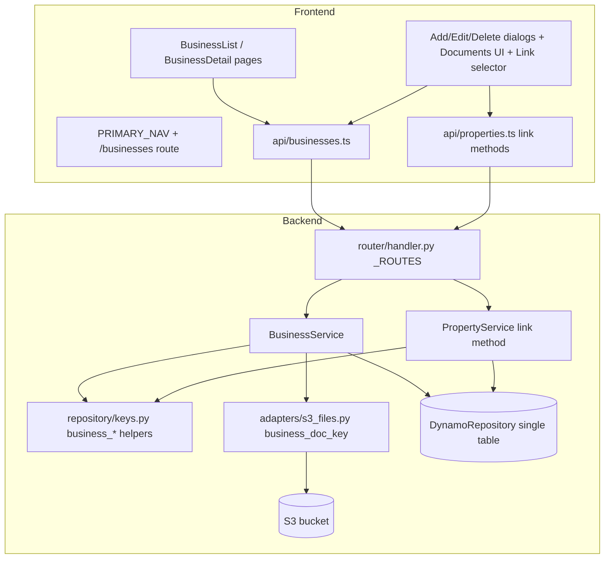

# Design Document: Business Entities

## Overview

This feature adds a user-scoped **Business entities** capability to Logstead: a
collection of business entities (such as LLCs) under which a user holds rental
property, per-entity document uploads, and an optional property↔business link
viewable from both sides. It introduces no change to authentication, identity,
tenancy, or Schedule E report output (per the requirements' Non-Goals).

The design reuses Logstead's established patterns rather than inventing new
ones:

- **Single-table key scheme** (`repository/keys.py`): businesses mirror the
  property two-row pattern (a user-view list row + a meta mirror). New
  `business_*` key helpers are added; services never build raw keys.
- **Document uploads** reuse the photo pattern (`services/photo.py` +
  `adapters/s3_files.py`): a metadata row plus pre-signed PUT/GET URLs, with the
  bytes flowing browser↔S3 directly.
- **Guarded delete** mirrors `PropertyService.delete` — a `conflict` `Result`
  blocks deletion when the entity still owns properties.
- **Routing/wiring** follows `router/handler.py` (`_ROUTES`, per-request service
  constructors, `_require_files` → 503, `_result_response`/`_to_jsonable`).
- **Frontend** adds a primary-nav entry and a Business section reusing shared
  primitives (Button, Card, ConfirmDialog, useToast), the add/edit dialog
  pattern, the photos/receipts upload UI, and a typed `api/businesses.ts` module.

### Resolved Decisions (previously Open Questions)

The requirements left four decisions open; they are resolved here and baked into
the design:

1. **EIN** — free text, stored exactly as entered (Req 1.6, 4.5). No strict
   validation server-side. The UI shows a light placeholder hint (`NN-NNNNNNN`)
   but never rejects other input. The system never stores an SSN (Req 1.7).
2. **entity_type** — a fixed, stable enum of six values stored verbatim:
   `llc`, `sole_proprietorship`, `partnership`, `s_corporation`,
   `c_corporation`, `individual_other`. The UI renders human labels (LLC, Sole
   proprietorship, Partnership, S-corporation, C-corporation, Individual/Other).
   LLC is an option, **not** a default — the user must explicitly select a type
   (an unset/invalid value is a validation error, Req 1.5, 4.3).
3. **tax_year_end** — a simple `MM-DD` string (no year), defaulting to `"12-31"`
   when omitted on create (Req 1.3). The UI offers a basic month/day input;
   storage remains the `MM-DD` string.
4. **formation_date / formation_state** — `formation_date` is an optional ISO
   `YYYY-MM-DD` date string (native `<input type="date">`). `formation_state` is
   an optional US state stored as a **two-letter uppercase code** (e.g. `"CA"`),
   chosen from a fixed 50-states + DC dropdown. Both are optional and omitted
   when blank.

## Architecture

The feature adds one backend service and one frontend section; everything else
is additive to existing modules.



**Key architectural decisions:**

- **Business↔properties mechanism (decision: filtered property-list, option b).**
  To find the properties linked to a business, `BusinessService` lists the
  user's own properties (already a cheap `begins_with "PROP#"` query on the user
  partition) and filters by `businessId`. This avoids a second, conflicting use
  of GSI1 (which is already keyed `USER#<id> → PROP#<id>` for property reverse
  lookups) and adds no new index. For a single user with a modest property
  count, a full in-memory filter is negligible and keeps the key scheme simple.
  This same filtered list powers both the business→properties view (Req 10.2)
  and the delete-guard (Req 5.2). If a future workload makes this expensive, a
  dedicated GSI can be introduced without changing the service contract.

- **Link ownership (decision: on `PropertyService`).** Setting/changing/clearing
  a property's `businessId` is an update to the property's own rows, so it
  belongs on `PropertyService` (which already owns and atomically rewrites those
  rows via `transact_write`). `PropertyService` gains a `set_business` method;
  `BusinessService` is injected so it can validate the target business exists
  and is owned by the user before the link is written. This keeps the property's
  two rows the single source of truth for the link and avoids `BusinessService`
  reaching into property rows.

- **Business meta mirror (decision: yes).** Like properties, a business is stored
  as two rows: a user-view list row (`USER#<id> / BUSINESS#<id>`) so a user's
  businesses list with one `begins_with` query, and a meta mirror
  (`BUSINESS#<id> / META`) so a business is looked up by id (and its documents
  co-locate under the same `BUSINESS#<id>` partition). Ownership is enforced on
  the meta row's `userId`, exactly as `PropertyService._owned_meta` does.

## Components and Interfaces

### `repository/keys.py` — new `business_*` helpers

Added analogously to the property/photo helpers (standard-library only, no raw
keys in services):

```python
BUSINESS_PREFIX = "BUSINESS#"
DOC_ONLY_PREFIX = "DOC#"  # reuse existing DOC_PREFIX ("DOC#")

def business_scoped_pk(business_id: str) -> str:
    """PK for a business's child items (meta, documents)."""
    return f"{BUSINESS_PREFIX}{business_id}"

def business_meta_sk() -> str:
    """SK of the mirrored BUSINESS#<id> / META item."""
    return META_SK

def business_user_sk(business_id: str) -> str:
    """SK of the USER#<id> / BUSINESS#<businessId> list item."""
    return f"{BUSINESS_PREFIX}{business_id}"

def business_list_prefix() -> str:
    """SK begins_with prefix to list a user's businesses."""
    return BUSINESS_PREFIX

def business_document_sk(document_id: str) -> str:
    """SK BUSINESS#<id> / DOC#<documentId> for one business document."""
    return f"{DOC_PREFIX}{document_id}"

def business_document_list_prefix() -> str:
    """SK begins_with prefix to list a business's documents."""
    return DOC_PREFIX
```

### `adapters/s3_files.py` — new `business_doc_key`

Added alongside `photo_key`/`receipt_key`, using the existing `build_key`:

```python
BUSINESS_DOC_PREFIX = "business-docs"

def business_doc_key(business_id: str, filename: str) -> str:
    """Build a key: business-docs/<businessId>/<filename>."""
    return build_key(BUSINESS_DOC_PREFIX, business_id, filename)
```

As with photos, the service namespaces the filename segment by document id
(`<docId>/<name>`) so distinct uploads never collide.

### `services/business.py` — `BusinessService` (new)

Constructed per request from the wiring with the resolved user, the repo, and
(for document routes) the S3 adapter. Scopes every operation to the user's
Cognito `sub`.

```python
class BusinessService:
    def __init__(self, repo, user, files=None, property_service=None): ...

    # Entity CRUD
    def create(self, data: BusinessInput) -> Result[Business]: ...
    def list(self) -> list[Business]: ...
    def get(self, business_id: str) -> Result[Business]: ...
    def update(self, business_id: str, data: BusinessInput) -> Result[Business]: ...
    def delete(self, business_id: str) -> Result[None]: ...   # guarded + cascade

    # Documents (require S3 adapter; 503 upstream when no bucket)
    def request_document_upload(
        self, business_id, filename, content_type
    ) -> Result[PresignedDocumentUpload]: ...
    def list_documents(self, business_id) -> Result[list[DocumentWithUrl]]: ...
    def delete_document(self, business_id, document_id) -> Result[None]: ...

    # Both-sides viewing helpers
    def linked_properties(self, business_id) -> Result[list[LinkedPropertyRef]]: ...

    # Ownership check used by PropertyService.set_business
    def owns(self, business_id: str) -> bool: ...
```

Behavior mirrors existing services:

- `create` validates `legal_name` non-blank (Req 1.4) and `entity_type` in the
  enum (Req 1.5); defaults `tax_year_end` to `"12-31"` when omitted (Req 1.3);
  stores `ein` verbatim (Req 1.6); writes the list row + meta mirror via
  `transact_write` (Req 2.2/13.1).
- `get`/`update`/`delete` resolve the owned meta row first (`not_found` when
  missing or owned by another user — Req 3.2, 3.3, 4.4, 5.3).
- `delete` is **guarded**: it computes `linked_properties(business_id)`; if any
  exist, returns `Result.failure("conflict", <reassign-first message>)` and
  mutates nothing (Req 5.2). When none exist, it lists the business's documents,
  best-effort deletes each S3 object, then removes the document metadata rows
  and the business's two rows (Req 5.1, 5.4).
- Document methods mirror `PhotoService` exactly, except the allow-list is
  broader (see Data Models / Error Handling).

### `services/property.py` — `PropertyService.set_business` (new)

```python
def set_business(self, property_id: str, business_id: str | None) -> Result[Property]:
    """Set, change, or clear a property's owning business (Req 9).

    Confirms property ownership (not_found otherwise). When business_id is
    provided, validates it is an owned business via the injected
    BusinessService.owns (else validation/not_found, Req 9.5). Rewrites the
    property's two rows atomically with businessId set (set/change) or removed
    (clear), refreshing updated_at. Replacing an existing link is a plain
    overwrite, so a property is linked to at most one business (Req 9.1-9.3).
    """
```

The `businessId` attribute is added to both property rows in `property_to_rows`
(carried verbatim like the other fields) so it survives update/restore and is
readable from the META mirror for property→business viewing (Req 10.1).

### `router/handler.py` — new routes (all `public=False`)

New per-request constructors `_business_service(wiring, user)` (document routes
pass `_require_files(wiring)`), reusing `_result_response`/`_response`.

| Method & path | Handler | Notes |
|---|---|---|
| `POST /businesses` | create | 201 |
| `GET /businesses` | list | 200 |
| `GET /businesses/{businessId}` | get | includes linked property names |
| `PUT /businesses/{businessId}` | update | |
| `DELETE /businesses/{businessId}` | delete | 409 via guard |
| `POST /businesses/{businessId}/documents` | request upload | `_require_files` → 503 |
| `GET /businesses/{businessId}/documents` | list documents | `_require_files` → 503 |
| `DELETE /businesses/{businessId}/documents/{documentId}` | delete document | `_require_files` → 503 |
| `PUT /properties/{propertyId}/business` | set/clear link | body `{ "business_id": "<id>" \| null }` |

**Link route decision:** a dedicated `PUT /properties/{propertyId}/business`
(rather than folding into property update) is recommended. It keeps the link a
small, explicit operation the business page and the property UI can both call,
avoids coupling the link to the full property-edit payload, and reads cleanly
from both sides. It routes to `PropertyService.set_business`.

Routes are inserted in `_ROUTES` with the more-specific document paths before
the single-id path (same segment-count disambiguation the table already relies
on). `/businesses/{businessId}` has a different literal first segment than
`/properties/...`, so no ordering conflict with existing routes.

### Frontend components

- `components/navConfig.ts` — add `{ to: "/businesses", label: "Businesses" }`
  to `PRIMARY_NAV` (Req 11.1).
- `api/businesses.ts` — typed, injectable module mirroring `api/properties.ts`
  and `api/photos.ts`: `listBusinesses`, `createBusiness`, `getBusiness`,
  `updateBusiness`, `deleteBusiness`, document functions
  (`listDocuments`/`requestDocumentUpload`/`deleteDocument`/`uploadToPresignedUrl`),
  and `setPropertyBusiness(propertyId, businessId | null)`. Wire shapes use the
  backend snake_case names.
- `components/businesses/` — `BusinessListPage` (list with legal_name +
  entity_type, Req 11.2), `AddBusinessDialog`/`EditBusinessDialog` (Radix Dialog,
  mirroring `AddPropertyDialog`; entity_type `<select>`, EIN placeholder hint,
  state `<select>`, native date input, month/day input for tax_year_end),
  `DeleteBusinessConfirm` (shared `ConfirmDialog`, surfacing the 409 conflict
  message, Req 11.3/11.6), `BusinessDocuments` (upload/list/download/delete,
  reusing the photos upload UI, Req 11.4), and a `PropertyBusinessSelector`
  usable on both the property edit/detail UI and the business detail page
  (Req 11.5, 10). The business detail page lists linked properties by name
  (Req 10.2); never surface raw ids where a name exists (Req 10.3, 13.* money/
  identity invariant).

## Data Models

### Backend `models/business.py` (new)

```python
ENTITY_TYPES = frozenset({
    "llc", "sole_proprietorship", "partnership",
    "s_corporation", "c_corporation", "individual_other",
})
DEFAULT_TAX_YEAR_END = "12-31"

@dataclass
class BusinessInput:
    legal_name: str
    entity_type: str
    ein: str | None = None
    formation_state: str | None = None      # two-letter US code, e.g. "CA"
    formation_date: str | None = None        # ISO YYYY-MM-DD
    business_address: str | None = None
    tax_year_end: str | None = None          # MM-DD; defaults to "12-31"
    note: str | None = None

@dataclass
class Business:
    id: str
    user_id: str
    legal_name: str
    entity_type: str
    ein: str | None = None
    formation_state: str | None = None
    formation_date: str | None = None
    business_address: str | None = None
    tax_year_end: str = "12-31"
    note: str | None = None
    created_at: str | None = None
    updated_at: str | None = None

@dataclass
class BusinessDocument:    # mirrors PropertyPhoto
    id: str
    business_id: str
    s3_key: str
    content_type: str
    original_filename: str
    uploaded_at: str | None = None
```

There are no money fields on a business; the money-as-two-decimal-string
invariant (Req 13.2) is preserved because the feature introduces none.

### Stored item shapes (camelCase attributes)

**Business — list row** `PK=USER#<userId>`, `SK=BUSINESS#<businessId>`
**Business — meta mirror** `PK=BUSINESS#<businessId>`, `SK=META`
Both rows carry identical attributes:

```
id, userId, legalName, entityType, ein, formationState, formationDate,
businessAddress, taxYearEnd, note, createdAt, updatedAt
```

Optional fields are omitted from the item when unset (sparse, like
`PropertyDetails`). Both rows are written/rewritten together via
`transact_write` so they stay consistent.

**BusinessDocument** `PK=BUSINESS#<businessId>`, `SK=DOC#<documentId>`
(co-located under the business partition, mirroring `PHOTO#` under a property):

```
id, businessId, s3Key, contentType, originalFilename, uploadedAt
```

**Property `businessId` addition** — the optional link is a single attribute
added to **both** existing property rows (`USER#<id> / PROP#<id>` and
`PROPERTY#<id> / META`):

```
businessId   (string; present only when linked, removed when cleared)
```

No new GSI keys are added for the link (see Architecture: filtered-list
mechanism). The S3 object key is `business-docs/<businessId>/<docId>/<filename>`.

## Correctness Properties

*A property is a characteristic or behavior that should hold true across all
valid executions of a system — essentially, a formal statement about what the
system should do. Properties serve as the bridge between human-readable
specifications and machine-verifiable correctness guarantees.*

These properties are implemented with Hypothesis property-based tests
(`@settings(max_examples>=100)`), consistent with the rest of the backend. The
set is deliberately tight and non-redundant: user-scoping, the delete-guard, and
at-most-one-link are the correctness-critical invariants; a create→get
round-trip property is included because it is cheap and catches
serialization/attribute-mapping regressions that the others do not.

### Property 1: User scoping isolates all business data

*For any* two distinct users A and B and any sequence of business, document, and
link operations performed as A, no `BusinessService`/`PropertyService` read or
mutation performed as B ever returns, modifies, or deletes a business, document,
or property-business link created by A: B's `get`/`list_documents`/`get`
(property) return `not_found` or exclude A's records, and B's `update`/`delete`/
`set_business` against A's ids return `not_found` and leave A's data unchanged.

**Validates: Requirements 2.2, 3.3, 6.4, 13.1**

### Property 2: Guarded delete is all-or-nothing with cascade

*For any* owned business and any set of the user's properties, deleting that
business when one or more of those properties are linked to it is always
rejected with a `conflict` `Result` and mutates nothing (the business, its
documents, and all property links are unchanged); deleting it when zero
properties are linked always succeeds and removes the business's two rows and
every one of its document metadata rows (with best-effort S3 object deletion).

**Validates: Requirements 5.1, 5.2, 5.4**

### Property 3: A property links to at most one business, consistent both ways

*For any* property owned by the user and *any* finite sequence of set / change /
clear link operations (each target business owned by the user), after the
sequence the property's `businessId` reflects exactly the last successful
operation (absent after a clear, otherwise the last set/changed business id) and
is never linked to more than one business; and the two viewing directions agree
— the property reports that single business id, and that business's
`linked_properties` includes the property iff the property's current
`businessId` equals that business.

**Validates: Requirements 9.1, 9.2, 9.3, 9.4, 10**

### Property 4: Business create → get round-trip preserves fields

*For any* valid `BusinessInput` (non-blank legal_name, enum entity_type,
arbitrary optional fields), creating a business and then getting it by id
returns a `Business` whose stored fields equal the submitted values, with
`tax_year_end` defaulting to `"12-31"` exactly when it was omitted, and `ein`
stored byte-for-byte as entered.

**Validates: Requirements 1.1, 1.3, 1.6**

## Error Handling

Error handling follows the existing `Result`→HTTP mapping in the router
(`validation`→400 with `field`, `not_found`→404, `conflict`→409,
`unavailable`→503, `unauthorized`→401). No business rules live in the router.

- **Validation (400):** blank/whitespace `legal_name` (field `legal_name`,
  Req 1.4, 4.2); `entity_type` missing or outside `ENTITY_TYPES` (field
  `entity_type`, Req 1.5, 4.3); unsupported document content type (field
  `content_type`). `ein`, `formation_state`, `formation_date`, `tax_year_end`
  are stored as provided with no strict server-side format enforcement
  (resolved decisions 1, 3, 4); the UI supplies hints/pickers.
- **Not found (404):** get/update/delete/document-ops on a business id that does
  not exist for the user or is owned by another user (Req 3.2, 3.3, 4.4, 5.3,
  6.3, 7.4, 8.2); `set_business` on an unknown property; a document id absent for
  the given business (Req 8.2).
- **Conflict (409):** delete of a business with ≥1 linked property (Req 5.2) —
  the message instructs the user to reassign or unlink those properties first;
  surfaced in the UI via the `ConfirmDialog` delete-guard pattern (Req 11.6).
- **Unavailable (503):** any document route when no S3 bucket is configured, via
  `_require_files` (same as photos/receipts).
- **Link validation (Req 9.5):** `set_business` with a non-owned/unknown target
  business returns `not_found` (the target does not exist for the user).

**Document content-type allow-list (policy, not copied from photos).** Business
documents accept a broader set than the image-only photo list, because formation
paperwork is typically PDFs and scans:

```python
ALLOWED_DOCUMENT_TYPES = frozenset({
    "application/pdf",
    "image/jpeg", "image/png", "image/webp", "image/heic", "image/heif",
})
```

An unaccepted type is rejected with a `validation` `Result` (field
`content_type`) naming the accepted types, before any S3 URL is issued or
metadata written — exactly the `PhotoService.request_upload` ordering. This
list is deliberately specified rather than silently reusing the image-only set.

## Testing Strategy

**Dual approach:** property-based tests for the universal invariants above, plus
example/edge unit and integration tests for concrete behavior. Property tests
are complementary to example tests, not a replacement.

### Backend — pytest + moto + Hypothesis

- **Property tests** (Hypothesis, `@settings(max_examples=100)` or more), each
  tagged `# Feature: business-entities, Property N: <text>` and referencing the
  design property:
  - Property 1 — user scoping across businesses/documents/links.
  - Property 2 — guarded delete all-or-nothing + document cascade.
  - Property 3 — at-most-one link, both-direction consistency.
  - Property 4 — create→get round-trip (incl. `tax_year_end` default, verbatim
    `ein`).
  Repository is moto-DynamoDB-backed; S3 is moto-backed; no live AWS.
- **Example / edge tests:**
  - Validation errors: blank `legal_name`; `entity_type` omitted/invalid;
    unsupported document `content_type`.
  - `not_found` and cross-user `404` for get/update/delete/document ops and
    `set_business`.
  - `409` delete-guard message when a property is linked; success after
    unlinking.
  - Document upload → list (with presigned GET URL) → delete via moto S3;
    cascade delete removes all document rows and attempts S3 object deletion.
  - Link set / change / clear through `PropertyService.set_business`, including
    the overwrite-on-change path and clear removing the attribute.
  - `tax_year_end` defaulting to `"12-31"` on create; `ein` stored verbatim.

### Frontend — vitest + React Testing Library + vitest-axe

- Business list renders legal_name + entity_type and an empty state when none
  (Req 11.2).
- Add/Edit dialogs: entity_type select requires explicit selection; EIN
  placeholder hint present but non-blocking; state dropdown and native date
  input; month/day input for tax_year_end; server 400 field errors rendered
  adjacent to the field (mirrors `AddPropertyDialog`).
- Delete via `ConfirmDialog`; a 409 conflict surfaces the backend message
  (Req 11.6).
- Documents UI: upload (client-side type check against the broader allow-list),
  list with download links, delete; empty state.
- `PropertyBusinessSelector` on both the property side and the business side;
  property view shows the linked business's name, business view lists linked
  property names; never a raw id where a name exists (Req 10.3).
- Every Business-section view, form, dialog, and upload UI passes `vitest-axe`
  with no violations (Req 12.4).

### Money / identity invariants

The feature introduces no money fields, so the two-decimal-string money
convention (Req 13.2) is trivially upheld. The identity invariant (Req 10.3) is
enforced in the UI by always resolving a business/property **name** before
rendering, and by API responses that include linked names (the business `get`
response carries linked property names; the property view resolves the business
name) so the UI never has to show a raw identifier.
