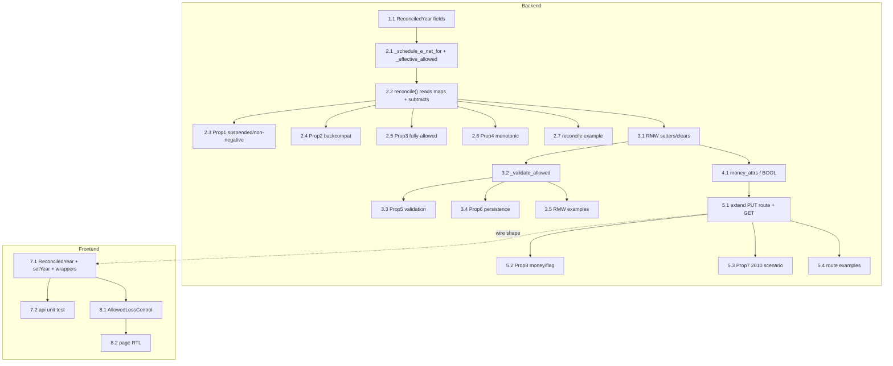

# Implementation Plan: Carryforward Allowed-Loss

## Overview

This plan extends the existing passive-loss carryforward reconciliation so that the **allowed** portion of a year's rental loss (transcribed by the user from Form 8582 Part II line 10) no longer inflates the running suspended-loss balance. It adds two independent optional attributes — `allowedLoss` (a two-decimal money string) and `fullyAllowed` (a DynamoDB `BOOL`) — to the **existing** `PLCF#<year>` per-year item, a per-year `Effective_Allowed_Amount` step in `reconcile()`'s running-balance loop, a shared net-derivation helper reused by `reconcile()` and a new allowed-data validator, and new partial-update setters/clears. `set_reported` / `clear_reported` switch from a full `put_item` to read-modify-write so they stop clobbering sibling attributes. On the frontend, `ReconciliationRow` gains an allowed-loss control (amount input + fully-allowed toggle) rendered **only on loss rows**. No new keys, item types, or routes; the §469 limitation is never computed.

The language is **Python 3.12** (backend) and **React 19 + TypeScript** (frontend) — the design builds on the real codebase, so no language selection is needed. Money stays an exact two-decimal `Decimal` in Python and a fixed two-decimal **string** over the wire; `fullyAllowed` is the one added non-money field, a boolean. The feature is additive and backward compatible by construction: absent `allowedLoss` reads as `0.00`, absent `fullyAllowed` reads as `False`, so a year with no allowed data reconciles byte-for-byte as today.

**Dependency shape.** The backend precedes the frontend because the frontend types and control depend on the GET-response/body-contract settled in the route task (5.1). Within the backend, the `ReconciledYear` dataclass fields (task 1.1) come first; the service engine, setters, and per-year persistence (tasks 2–4) all write `backend/src/logstead/services/carryforward.py`, so they are placed in **distinct waves** so no two writes to that module ever run concurrently. The route task (5.1) writes `router/handler.py` and follows the service work. The frontend API types (6.1) depend on the route's wire shape; the page control (7.1) depends on the API.

Testing reuses the project's stack: backend `pytest` + `Hypothesis` + `moto` with the real composed `CarryforwardService` / `PropertyService` / `ReportingService` stack (mirroring `test_carryforward_running_balance_property.py` and `test_carryforward_persistence_property.py`); frontend `vitest` + `fast-check` + RTL (mirroring `api/carryforward.test.ts` and `pages/CarryforwardPage.test.tsx`). Every property-based test runs ≥100 iterations (`@settings(max_examples=100)` / `numRuns: 100`) and is tagged `# Feature: carryforward-allowed-loss, Property N: ...` (`//` in TS).

## Tasks

- [x] 1. Backend: extend the `ReconciledYear` dataclass
  - [x] 1.1 Add `allowed_loss` and `fully_allowed` fields to `ReconciledYear` in `backend/src/logstead/services/carryforward.py`
    - Add `allowed_loss: Money` (non-negative; `0.00` when none stored) and `fully_allowed: bool` (whole loss allowed for the year) to the frozen `ReconciledYear` dataclass, after `reported_carryforward` and before `status`
    - Keep `ReconciliationSummary` and all other `ReconciledYear` fields (`tax_year`, `schedule_e_net`, `expected_carryforward`, `reported_carryforward`, `status`) unchanged so the existing router serialization and frontend fields keep working
    - Keep every money field as `util.money.Money`; the router's `_to_jsonable` already renders `Money`/`Decimal` as a two-decimal string and `bool` as a JSON boolean
    - _Requirements: 7.4, 1.6_
    - _Design: Data Models (backend transport dataclasses)_

- [x] 2. Backend: shared net derivation and the effective-allowed engine step
  - [x] 2.1 Factor out `_schedule_e_net_for` and implement `_effective_allowed` in `backend/src/logstead/services/carryforward.py`
    - Extract the existing per-year net derivation (the exact-cent sum across the user's properties of `report_for(pid, tax_year).value.totals.net`, where a non-ok report contributes `0.00`) into `_schedule_e_net_for(self, tax_year, properties)`; call it from `reconcile()` so behavior is unchanged (refactor-only — existing carryforward tests stay green)
    - Add `@staticmethod _effective_allowed(net, allowed_loss, fully_allowed) -> Money`: `0.00` when `net >= 0` (Non_Loss_Year); `-net` (current `Loss_Magnitude`) when `fully_allowed`, taking precedence over any stored amount; else `allowed_loss` or `0.00`
    - Keep both helpers importable for direct property testing; all arithmetic exact two-decimal `Decimal`, no float
    - _Requirements: 3.2, 3.6, 4.2, 4.3, 4.4, 4.5, 4.6, 5.2_
    - _Design: Running-balance algorithm (Req 3, 4); Components and Interfaces (backend)_

  - [x] 2.2 Read per-year allowed maps and subtract the effective allowed in `reconcile()`'s loop
    - Extend the `PLCF#` enumeration to `query(..., money_attrs={"amount", "allowedLoss"})` and collect three independently-optional per-year maps: `reported[year]` (from `amount`), `allowed_loss[year]` (from `allowedLoss`, absent → `0.00`), `fully_allowed[year]` (from `bool(item.get("fullyAllowed"))`, absent → `False`); keep skipping items lacking `taxYear`
    - Change the loss branch to `suspended = max(-net - effective_allowed, 0.00); balance += suspended` using `_effective_allowed(net, allowed_loss.get(year), fully_allowed.get(year, False))`; leave the gain branch (`balance = max(balance - net, 0.00)`) unchanged; carry each year's post-apply balance forward as its `Expected_Carryforward`
    - Populate the new `ReconciledYear.allowed_loss` (the stored amount, `0.00` when absent) and `ReconciledYear.fully_allowed` fields; balance and every expected stay non-negative
    - _Requirements: 3.1, 3.3, 3.4, 3.5, 3.7, 3.8, 4.2, 7.1, 7.2, 7.3, 8.1, 8.3, 9.2_
    - _Design: Running-balance algorithm (Req 3, 4); Read path (Req 1.5, 2.2-2.5, 7.2)_

  - [x]* 2.3 Property test — suspended is the floored unallowed portion; balance stays non-negative
    - **Property 1: Suspended loss is the floored unallowed portion and the balance stays non-negative**
    - **Validates: Requirements 3.1, 3.2, 3.4, 3.5, 9.2**
    - New `backend/tests/services/test_carryforward_allowed_balance_property.py`; moto-backed composed stack; generator of mixed per-year losses/gains, opening balances, and per-year allowed data (non-negative two-decimal amounts, arbitrary fully-allowed flags); run the real `reconcile()` and compare against an independent `Decimal`-cents recurrence applying `effective_allowed`; assert `suspended == max(-net - effective_allowed, 0.00)` on loss years, the gain-branch relation, and that every expected and the balance are `>= 0.00`

  - [x]* 2.4 Property test — backward compatibility reproduces today's series exactly
    - **Property 2: Backward compatibility — no allowed data reproduces today's series exactly**
    - **Validates: Requirements 7.1, 7.2, 7.3, 9.3**
    - Add to `backend/tests/services/test_carryforward_allowed_balance_property.py`; with no `allowedLoss` and no `fullyAllowed` on any year, assert the `Expected_Carryforward` series and every `Reconciliation_Status` are byte-for-byte identical to the pre-feature recurrence over the same returned nets and opening balance

  - [x]* 2.5 Property test — fully-allowed contributes zero and equals the explicit-full-amount case
    - **Property 3: Fully-allowed contributes zero and equals the explicit-full-amount case**
    - **Validates: Requirements 3.7, 4.2, 4.3, 4.4, 8.3**
    - New `backend/tests/services/test_carryforward_fully_allowed_property.py`; for a generated Loss_Year, assert `fully_allowed` makes `suspended == 0.00` and yields the same `Expected_Carryforward` as storing an explicit `allowedLoss == Loss_Magnitude`; include a net change between runs to prove the flag tracks the current magnitude dynamically and takes precedence over any stored amount

  - [x]* 2.6 Property test — monotonic roll-forward of a year's allowed amount
    - **Property 4: Monotonic roll-forward of a year's allowed amount**
    - **Validates: Requirements 3.1, 3.3**
    - Add to `backend/tests/services/test_carryforward_fully_allowed_property.py`; perturb a single Loss_Year's `Effective_Allowed_Amount` (up to its `Loss_Magnitude`) and assert that increasing it never increases — and strictly decreases while that year's `suspended` is positive — that year's and every later year's `Expected_Carryforward`, and decreasing it never decreases them

  - [x]* 2.7 Unit example — reconcile over a hand-built mixed fixture
    - New `backend/tests/services/test_carryforward_allowed_examples.py`: a partially-allowed loss year, a fully-allowed loss year, a year with allowed data but no reported value (and vice versa), a non-contiguous gap year, and a non-zero opening balance; assert exact `Expected_Carryforward`, `allowed_loss`, `fully_allowed`, and statuses, including the delta rolling onto later years
    - _Requirements: 3.1, 3.3, 3.7, 4.5, 7.1_
    - _Design: Running-balance algorithm (Req 3, 4); Unit / example tests (backend)_

- [x] 3. Backend: read-modify-write setters/clears for reported and allowed data
  - [x] 3.1 Switch `set_reported` / `clear_reported` to read-modify-write and add allowed-data setters in `backend/src/logstead/services/carryforward.py`
    - Change `set_reported(tax_year, amount)` to `get_item` (with `money_attrs={"amount", "allowedLoss"}`) → merge the validated `amount` → `put_item` the full merged item, preserving `allowedLoss`/`fullyAllowed`; change `clear_reported(tax_year)` to drop only `amount`, preserve siblings, and **delete** the item when no `allowedLoss` and not `fullyAllowed` remain (idempotent when absent)
    - Add `set_allowed_loss(tax_year, amount)` and `clear_allowed_loss(tax_year)`: set/replace or drop only `allowedLoss`, preserving `amount`/`fullyAllowed`; clear deletes the item when nothing else remains (idempotent); every merged write sets `taxYear` and passes `money_attrs={"amount", "allowedLoss"}` so both money fields are strings and `fullyAllowed` stays a `BOOL`
    - Add `set_fully_allowed(tax_year, on)`: turning on merges `fullyAllowed=True` preserving `amount`/`allowedLoss` (never snapshotting the loss into `allowedLoss`); turning off drops the `fullyAllowed` attribute (sparse — never store `false`) and deletes the item when nothing else remains; all operations confined to `user_pk(userId)`
    - _Requirements: 1.1, 1.3, 1.4, 2.2, 2.3, 2.4, 2.5, 2.6, 4.1, 4.6, 9.6_
    - _Design: Per-year item lifecycle (Req 1, 2); Components and Interfaces (backend)_

  - [x] 3.2 Implement allowed-data validation in `backend/src/logstead/services/carryforward.py`
    - Add `_validate_allowed(tax_year, amount, properties)`: normalize via the existing `_validate_amount` shape and reject negative / non-two-decimal with `field="allowedLoss"`; derive the year's net via `_schedule_e_net_for`; reject `amount > 0.00` on a Non_Loss_Year and `amount > Loss_Magnitude` with `field="allowedLoss"`; accept `0.00 <= amount <= Loss_Magnitude` on a Loss_Year
    - Have `set_allowed_loss` call `_validate_allowed`, and `set_fully_allowed(year, True)` derive the net and reject a Non_Loss_Year with `field="fullyAllowed"`; every rejection persists nothing and returns `Result.failure("validation", message, field=...)`; deriving the net lists the user's properties and calls `report_for` for that year (kept user-scoped)
    - _Requirements: 5.1, 5.2, 5.3, 5.4, 5.5, 5.6_
    - _Design: Components and Interfaces (backend — validation helpers); Error Handling_

  - [x]* 3.3 Property test — validation rejects impossible allowed data and persists nothing
    - **Property 5: Validation rejects impossible allowed data and persists nothing**
    - **Validates: Requirements 5.1, 5.2, 5.3, 5.4, 5.5, 5.6**
    - New `backend/tests/services/test_carryforward_allowed_validation_property.py`; invalid-allowed strategy producing each unsatisfiable case (negative, non-two-decimal, `> loss_magnitude`, `> 0.00` or `fully_allowed=true` on a Non_Loss_Year) driven through `set_allowed_loss` / `set_fully_allowed`; assert a `validation` failure whose `field` is `allowedLoss` or `fullyAllowed`, and that the per-year item is byte-identical before and after (query over moto); a valid-allowed strategy in `[0, loss_magnitude]` on a Loss_Year is accepted and persisted

  - [x]* 3.4 Property test — persistence round-trip; independence; siblings never clobbered
    - **Property 6: Persistence round-trip — allowed data and reported value are independent, siblings never clobbered**
    - **Validates: Requirements 1.1, 1.2, 1.3, 1.4, 2.2, 2.3, 2.4, 2.5, 4.1, 7.2**
    - New `backend/tests/services/test_carryforward_allowed_persistence_property.py`; write/read per-year items with every subset of `{amount, allowedLoss, fullyAllowed}`; assert each reads back as its normalized written value (two-decimal money for the amounts, boolean for the flag), setting/clearing any one attribute preserves the other two, clearing the last attribute deletes the item, and a pre-feature `{amount, taxYear}` item reads back with `allowed_loss == 0.00` and `fully_allowed == false`

  - [x]* 3.5 Unit example — read-modify-write sibling preservation and delete-when-empty
    - Add to `backend/tests/services/test_carryforward_allowed_examples.py`: set `allowedLoss` then `set_reported` and assert both persist; `clear_reported` on a year with allowed data preserves `allowedLoss`/`fullyAllowed` and does not delete; `clear_allowed_loss` / `set_fully_allowed(..., False)` on the last remaining attribute deletes the item; idempotent clear of an absent attribute succeeds; two-user partition isolation
    - _Requirements: 2.2, 2.3, 2.4, 2.5, 4.6, 9.6_
    - _Design: Per-year item lifecycle (Req 1, 2); Error Handling_

- [x] 4. Backend: per-year item money-attrs / BOOL serialization
  - [x] 4.1 Ensure `allowedLoss` is money and `fullyAllowed` is a BOOL on every per-year put/get/query
    - Audit the per-year `put_item` / `get_item` / `query` call sites in `backend/src/logstead/services/carryforward.py` so each passes `money_attrs={"amount", "allowedLoss"}` (so `allowedLoss` round-trips as a two-decimal string via `money_to_str`/`to_money`, never a DynamoDB `Number`) and `fullyAllowed` is left out of `money_attrs` so boto3 serializes the Python `bool` as a DynamoDB `BOOL`
    - Confirm `_prepare_item` drops `None` so a merged write with `fullyAllowed=None` omits the attribute (sparse); a pre-feature `{amount, taxYear}` item's stored shape stays byte-for-byte unchanged when untouched
    - _Requirements: 1.2, 1.6, 2.1, 4.1, 7.2_
    - _Design: Data Models (Per_Year_Item); Research notes (Repository money handling)_

- [x] 5. Backend: extend the per-year PUT route and GET serialization
  - [x] 5.1 Extend `_set_carryforward_reported` and confirm GET serialization in `backend/src/logstead/router/handler.py`
    - Extend `_set_carryforward_reported` (`PUT /carryforward/years/{taxYear}`) to read three independently-optional body fields and route each to the right setter: `amount` (string) → `set_reported`; `allowed_loss` (string sets via `set_allowed_loss`, JSON `null` clears via `clear_allowed_loss`); `fully_allowed` (bool) → `set_fully_allowed`; omitted fields are left untouched; the first validation failure short-circuits via `_result_response` (maps `validation` → 400 with its `field`) so nothing persists on a bad submission
    - Add **no new routes**; keep `_int_param` guarding non-integer `{taxYear}` → 400 before the service runs; keep `DELETE /carryforward/years/{taxYear}` clearing **only** the reported value (`clear_reported`, allowed data preserved); confirm `GET /carryforward` serializes the new `allowed_loss` (two-decimal string, `"0.00"` when none) and `fully_allowed` (JSON boolean) via `_to_jsonable`
    - _Requirements: 2.1, 2.4, 5.6, 6.5, 1.6_
    - _Design: Components and Interfaces (Routes — body contract); Research notes (Routes)_

  - [x]* 5.2 Property test — serialization is two-decimal strings + boolean flag; §469 independence
    - **Property 8: Every figure is a two-decimal money string; the flag is a boolean**
    - **Validates: Requirements 1.6, 3.5, 3.6, 9.4, 9.5**
    - New `backend/tests/router/test_carryforward_allowed_money_property.py`; drive the real handler over moto; assert `schedule_e_net`, `expected_carryforward`, every non-null `reported_carryforward`, and `allowed_loss` match `^-?\d+\.\d{2}$`, `fully_allowed` is a JSON boolean, `tax_year` is an int, `status` a known literal, and that the `Expected_Carryforward` depends only on the nets + opening balance + user-entered allowed data (no §469 allowance/phase-out logic)

  - [x]* 5.3 Property test — the 2010 acceptance scenario reconciles to ok, both ways
    - **Property 7: The 2010 acceptance scenario reconciles to ok, both ways**
    - **Validates: Requirements 8.1, 8.2, 8.3**
    - Add to `backend/tests/services/test_carryforward_allowed_examples.py` (or a focused property file): for a Loss_Year with `schedule_e_net == -758.00` carried in from `0.00`, assert recording `allowed_loss == 758.00` yields `expected == 0.00`, turning on `fully_allowed` (no explicit amount) also yields `expected == 0.00`, and recording `reported_carryforward == 0.00` assigns `ok` in either case

  - [x]* 5.4 Route example tests — extended PUT field subsets, null-clear, DELETE, GET body
    - Add to `backend/tests/router/test_carryforward_route.py`: `PUT /carryforward/years/{taxYear}` with each field subset (200 shapes), 400 on a bad `allowed_loss`/`fully_allowed` with the right `field`, `allowed_loss: null` clears allowed while preserving reported, `DELETE` clears only reported (allowed preserved), non-integer `{taxYear}` → 400, and `GET /carryforward` body carries `allowed_loss` (money string) and `fully_allowed` (boolean)
    - _Requirements: 2.1, 2.4, 5.6, 6.5_
    - _Design: Components and Interfaces (Routes — body contract)_

- [x] 6. Checkpoint — backend allowed-loss feature
  - Ensure the backend compiles and the new allowed-loss engine, setter/validation, persistence, and route property/example tests pass, and that the existing `test_carryforward_running_balance_property.py`, `test_carryforward_persistence_property.py`, `test_carryforward_status_property.py`, `test_carryforward_money_property.py`, and `test_carryforward_route.py` stay green; ask the user if questions arise.

- [x] 7. Frontend: carryforward API transport (depends on backend wire shape)
  - [x] 7.1 Extend `ReconciledYear` and add `setYear` + wrappers in `frontend/src/api/carryforward.ts`
    - Add `allowed_loss: string` (Money_String, `"0.00"` when none) and `fully_allowed: boolean` to the `ReconciledYear` wire interface; keep the existing fields unchanged
    - Add `setYear(taxYear, patch: { amount?: string; allowed_loss?: string | null; fully_allowed?: boolean }, signal?)` → `PUT /carryforward/years/{taxYear}` with only the present fields (`allowed_loss: null` clears); keep `setReported`/`clearReported`/`setOpeningBalance` signatures (make `setReported` a thin wrapper over `setYear(year, { amount })`); add thin wrappers `setAllowedLoss(year, amount)`, `clearAllowedLoss(year)` → `setYear(year, { allowed_loss: null })`, and `setFullyAllowed(year, on)`, all hitting the existing PUT route (no new route). Money values are strings, never numbers
    - _Requirements: 1.6, 6.4_
    - _Design: Components and Interfaces (frontend Carryforward_API); Data Models_

  - [x]* 7.2 Unit test — `setYear`/wrappers hit the PUT route with the expected body
    - Add to `frontend/src/api/carryforward.test.ts` with an injected fake `ApiClient`: `setYear` sends only the present fields; `setAllowedLoss` → `{ allowed_loss }`, `clearAllowedLoss` → `{ allowed_loss: null }`, `setFullyAllowed` → `{ fully_allowed }`, `setReported` → `{ amount }`; all hit `PUT /carryforward/years/{taxYear}` with no new route; signals pass through; `allowed_loss` typed as `string` and `fully_allowed` as `boolean`
    - _Requirements: 1.6, 6.4_
    - _Design: Components and Interfaces (frontend Carryforward_API)_

- [x] 8. Frontend: the allowed-loss control on loss rows
  - [x] 8.1 Add `AllowedLossControl` to `ReconciliationRow` in `frontend/src/pages/CarryforwardPage.tsx`
    - Render the control **only when `isLoss(year.schedule_e_net)`**; non-loss rows render no control. The control holds a fully-allowed toggle bound to `year.fully_allowed` (while on, indicate the full loss is allowed and make the amount input moot — disabled/hidden) and an allowed-amount input + Save/Clear validated client-side with the existing `isNonNegativeAmount`
    - On save/clear/toggle call `setAllowedLoss`/`clearAllowedLoss`/`setFullyAllowed` then trigger the page's existing `load()` so expected and status refresh in place for that year and every later year (no full reload); surface the server's 400 `allowed_loss`/`allowedLoss` field error inline (`role="alert"`, `aria-describedby`) next to the offending control, leaving the displayed reconciliation unchanged
    - Keep the existing reported editor, `ok`/`mismatch`/`unreported` status, opening-balance control, disclaimer, and empty state intact; render money via `formatMoneyWholeDollars` and echo the stored two-decimal string in the input — no float
    - _Requirements: 6.1, 6.2, 6.3, 6.4, 6.5, 6.6, 6.7, 9.4_
    - _Design: Components and Interfaces (frontend Carryforward_Page)_

  - [x]* 8.2 RTL — loss-row-only render, moot-while-on, save/clear/toggle + reload, inline error
    - Add to `frontend/src/pages/CarryforwardPage.test.tsx` with an injected fake API: the allowed control renders on a loss row and not on a gain/break-even row (Req 6.1, 6.2); while fully-allowed is on, the amount input is moot (Req 6.3); save/clear/toggle calls the extended API and reloads so expected/status update for the year and later years (Req 6.4); a 400 `allowed_loss` error renders inline next to the control and leaves the reconciliation unchanged (Req 6.5); the reported editor, status labels, opening-balance control, disclaimer, and empty state remain intact (Req 6.6); money renders via `formatMoneyWholeDollars` (Req 6.7)
    - _Requirements: 6.1, 6.2, 6.3, 6.4, 6.5, 6.6, 6.7_
    - _Design: Components and Interfaces (frontend Carryforward_Page); Error Handling_

- [x] 9. Final verification — suites green, no new float, §469 not computed (no deploy)
  - Backend: if the venv is missing or stale, recreate it (`python3 -m venv .venv && .venv/bin/python -m pip install -q -e ".[dev]"` from `backend/`), then run `.venv/bin/python -m pytest -q -p no:cacheprovider -n auto` from `backend/` — the full suite including the existing carryforward running-balance / persistence / status / money-string / route tests staying green and the new allowed-loss properties (P1–P8) must all be green (Req 9.1, 9.2, 9.3)
  - Frontend: run `npm run build` (the real gate — `tsc -b && vite build`, which catches type errors `--noEmit` can miss) and the frontend tests (`npx vitest --run`) from `frontend/`; both must be green (Req 9.1)
  - Confirm no floating-point arithmetic was introduced (all allowed/suspended math is exact two-decimal `Decimal` / integer cents) and that the §469 limitation is never computed (expected depends only on nets + opening balance + user-entered allowed data) (Req 9.4, 9.5)
  - Do NOT run any deploy (`make deploy`) — the user runs deploys. Ask the user if anything is unclear.
  - _Requirements: 9.1, 9.2, 9.3, 9.4, 9.5_

## Task Dependency Graph



```json
{
  "waves": [
    { "id": 0, "tasks": ["1.1"] },
    { "id": 1, "tasks": ["2.1"] },
    { "id": 2, "tasks": ["2.2"] },
    { "id": 3, "tasks": ["2.3", "2.5", "2.7", "3.1"] },
    { "id": 4, "tasks": ["2.4", "2.6", "3.2"] },
    { "id": 5, "tasks": ["3.3", "3.4", "3.5", "4.1"] },
    { "id": 6, "tasks": ["5.1"] },
    { "id": 7, "tasks": ["5.2", "5.4", "7.1"] },
    { "id": 8, "tasks": ["5.3", "7.2", "8.1"] },
    { "id": 9, "tasks": ["8.2"] }
  ]
}
```

> Wave ordering note: tasks 1.1, 2.1, 2.2, 3.1, 3.2, and 4.1 all write `backend/src/logstead/services/carryforward.py`, and 5.1 writes `router/handler.py`; each occupies a distinct wave so no two writes to the same module ever run concurrently. 3.1 (the setters/persistence seams) precedes both 3.2 (validation on those setters) and 4.1 (the per-year call-site audit). The `*` test tasks that share a new test file are kept in different waves too: 2.3 and 2.4 both extend the balance-property file (waves 3 and 4), and 2.5 and 2.6 both extend the fully-allowed-property file (waves 3 and 4), so no wave writes the same test file twice; 5.3 and 2.7 both extend the examples file but land in waves 8 and 3 respectively. 7.1 waits on the route wire shape (5.1) — the dotted `wire shape` edge.

## Notes

- **Backend-before-frontend.** Task 7.1 (frontend `ReconciledYear` + `setYear`) depends on the GET-response / PUT-body contract settled in task 5.1; 8.1 depends on 7.1 — hence the dotted `wire shape` edge in the graph.
- **The service module is written serially.** Tasks 2.1, 2.2, 3.1, 3.2, and 4.1 all edit `backend/src/logstead/services/carryforward.py`; they occupy distinct waves so no two ever write it concurrently. 5.1 (the only writer of `router/handler.py`) follows them.
- **Optional tests** are marked `[ ]*` (every property-based, RTL, and unit/example test task). They are not auto-run by "run all tasks"; dispatch them explicitly after the implementation task they validate. Each realizes a design Property (P1–P8) tagged `# Feature: carryforward-allowed-loss, Property N: ...` (`//` in TS) at ≥100 iterations.
- **Backward compatibility is a hard invariant, not a soft note.** Property 2 (task 2.4) re-proves that no allowed data reproduces today's series byte-for-byte, and the existing carryforward property/route suites must stay green (checkpoint task 6, final task 9). Absent `allowedLoss` → `0.00`; absent `fullyAllowed` → `False`.
- **No new data model, no new routes.** The feature adds two optional attributes (`allowedLoss` money string, `fullyAllowed` BOOL) to the existing `PLCF#<year>` item and extends the existing `PUT /carryforward/years/{taxYear}` body; every per-year write is read-modify-write so siblings are never clobbered, and an item carrying none of `amount`/`allowedLoss`/`fullyAllowed` is deleted (never a bare `{taxYear}` tombstone).
- **Money contract:** `Decimal` two-decimal in Python, two-decimal strings over the wire and in the stored `allowedLoss`, `string` in TypeScript; `fullyAllowed` is the one added boolean. Never a float, never a DynamoDB `Number`. The §469 limitation is never computed — expected depends only on the nets, the opening balance, and the user-entered allowed data (Property 8, task 5.2).
- **No deploy.** Task 9 is the real gate: recreate the backend venv if needed, run backend `pytest` and frontend `npm run build` + `npx vitest --run`, and confirm no new float and §469 not computed. It deliberately excludes any `make deploy` — the user runs deploys. The frontend build step is part of done because `tsc -b` surfaces type errors `--noEmit` can miss.
- **Checkpoints (task 6) and the final task (9)** are stop-and-verify gates, not code tasks. Waves are sized for a 5-concurrent orchestrator limit.
