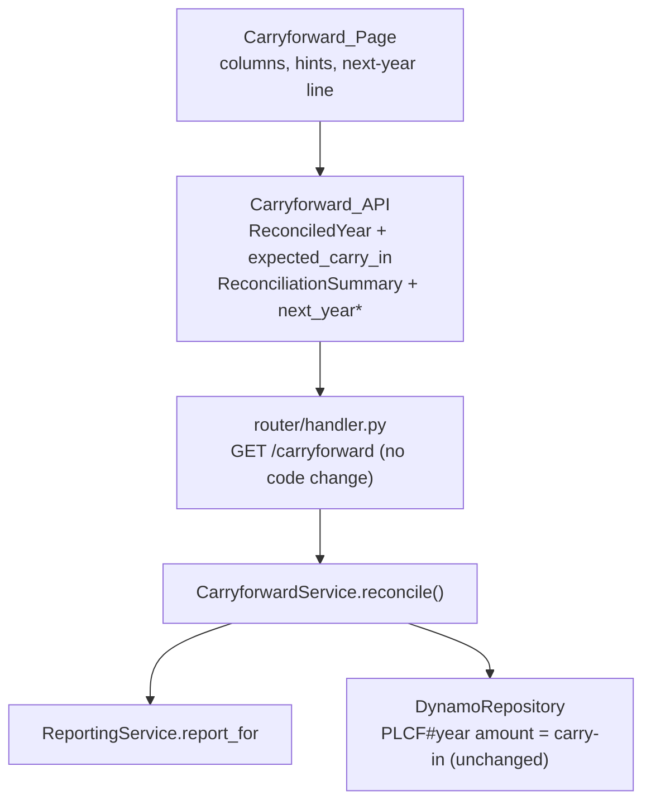

# Design Document

## Overview

The carryforward page compares each year's user-entered figure with the wrong year. The user enters, per year, the Form 8582 line **"Prior years unallowed losses"**, which is the passive loss balance carried **into** that year. The service treats the stored value as the balance carried **out of** that year and compares it with the expected end-of-year balance. This design re-points the comparison, adds the missing per-year figures, and updates the copy. It changes semantics, not storage.

Core idea, in one table (year Y, previous reconciled year P):

| Figure | Meaning | Where it comes from |
|--------|---------|---------------------|
| `expected_carry_in` (new) | Balance expected to enter Y | Opening_Balance for the first year, else P's `expected_carryforward` |
| `expected_carryforward` (existing) | Balance expected to leave Y (carry-out) | Existing running balance, unchanged |
| `reported_carryforward` (existing) | Form 8582 "Prior years unallowed losses" on Y's return (carry-in) | Stored `PLCF#<Y>` attribute `amount`, unchanged |
| `drift` (existing) | `reported_carryforward - expected_carry_in` | Re-pointed |
| `chain_carry_in` (internal) | What Y's carry-in should be if Y's return faithfully carried P's figure | P's year step applied to P's **reported** carry-in |

The app remains a reconciliation aid. Nothing here computes the IRC §469 limitation.

### Design decisions and rationale

- **Reinterpret the stored value; do not migrate.** The user already typed each figure as the carry-in on the same year row, so the stored `amount` is already correct under the new meaning. No item is rewritten, no key changes, no setter or route changes.
- **Keep `reported_carryforward` and `expected_carryforward` as wire names; add `expected_carry_in`.** This is the backward-safe choice. A stale client or an old test that reads `expected_carryforward` still sees the same running-balance number, so the many running-balance, net-reconciliation, balance-edge and allowed-loss tests that assert that number stay valid. The cost is a naming asymmetry on the wire: `reported_carryforward` is a carry-in and `expected_carryforward` is a carry-out. This is documented in the dataclass docstring and the TypeScript doc comment, and the page only ever reads the new `expected_carry_in` for comparison. A later cleanup spec may rename the fields. The alternative (making `expected_carryforward` mean carry-in and adding `expected_carry_out`) was rejected because it silently changes the meaning of an existing numeric field and would break every running-balance assertion without a compile error.
- **Derive carry-in from the existing loop, not a second computation.** `expected_carry_in` is simply the balance before the step. The loop already holds it. Backward compatibility of `expected_carryforward` is provable by construction.
- **Chain value uses the previous year's step.** Under the old semantics the chain value for year Y was Y's own step applied to Y-1's reported figure. Under carry-in semantics, Y-1's form reports its carry-in, so the faithful carry-out is Y-1's step applied to Y-1's reported carry-in, and that is what Y's form should show as its carry-in. The loop therefore remembers the previous year's net and effective allowed amount.
- **Status precedence is unchanged, only re-pointed.** `unreported`, then `ok` (equals expected carry-in), then `carried` (equals chain), else `mismatch`. When the previous year is `ok`, the chain value equals the expected carry-in by construction, so `carried` can only follow a `mismatch` or `carried` year. This keeps `carried_from_year` non-null in practice.
- **Which year is blamed.** `carried_from_year` is the most recent earlier `mismatch` year M: the year whose carry-in is the first in the run that matches neither the app nor the previous return's carry-out. The break lies between the previous return's carry-out (year before M) and M's carry-in, so the UI tells the user to review **the return for the year before M** (the return whose carry-out line produced the wrong carry-in), and to check M's own line. The row for M shows that hint directly (Requirement 10.2). A `carried` row reads "Carried from M" with the same explanation in its tooltip text.
- **Blank years are useful, not noise.** An unreported year still shows its expected carry-in, so the user can read the right figure off the page and fill in the blank form. The first reported year after a gap is compared with the expected figure only (fallback), and its hint says the prior return is not reported. Chain attribution resumes one year later.
- **Next-year figure is a summary field.** `next_year` and `next_year_expected_carry_in` are additive summary fields. The page shows "Expected to carry into 2021" below the table, so the user can check the return they are about to file. The value equals the last row's `expected_carryforward`, or the opening balance when the series is empty.
- **Allowed-loss controls stay where they are.** The allowed amount on a loss row changes that year's carry-out and therefore the **next** row's expected carry-in. The control copy says so. No behaviour change.
- **Exact money everywhere.** All new values are two-decimal `Decimal` in Python and Money_String over the wire. Drift sign is read from the string text in the UI.

### Research notes (grounded in the codebase)

- `reconcile()` lists properties once, reads the opening balance and every `PLCF#` item, derives Data_Years, then loops ascending. The loop holds `balance` before the step (the carry-in) and assigns the stepped value to `expected` (the carry-out). The current status block compares `reported` with `expected` and uses `chain_expected = step(prior_reported, net, effective_allowed)` with the **current** year's net, which is the out-of-year semantics to fix.
- `_to_jsonable` serializes dataclasses field by field and `Decimal` as an exact string, so new dataclass fields reach the wire without handler changes. Route tests verify this.
- `ReconciledYear` and `ReconciliationSummary` are frozen dataclasses with defaults on trailing fields, so new fields with defaults keep existing constructor call sites valid. The frontend types are hand-written and fixtures must gain the new required fields or `tsc -b` fails.
- Existing tests that read `expected_carryforward` for balance math (running balance, net reconciliation, balance edges, allowed validation and persistence) remain valid. Tests that derive status, drift or chain values from `expected_carryforward` must change (see "Existing test impact").
- Calendar gaps between Data_Years are preserved. A gap year has net `0.00`, and the step with net `0.00` leaves the balance unchanged, so using the previous **Data_Year** as the previous return is equivalent for the economics. "Next year" in the summary is the latest Data_Year plus one.

## Architecture



### Classification algorithm

All values are exact two-decimal `Decimal` (`Money`). `reported`, `allowed_loss`, `fully_allowed`, `opening`, `years` and `net` are produced exactly as today.

```python
balance = opening
prev_reported: Money | None = None   # P's reported carry-in
prev_net: Money | None = None
prev_allowed: Money | None = None
last_mismatch_year: int | None = None

for index, year in enumerate(years):
    net = schedule_e_net(year)
    allowed = _effective_allowed(net, allowed_loss.get(year), fully_allowed.get(year, False))

    expected_in = balance                                   # NEW: balance entering the year
    expected_out = _apply_year_step(expected_in, net, allowed)   # existing running balance
    balance = expected_out

    reported_in = reported.get(year)                        # Form 8582 carry-in
    drift = None if reported_in is None else to_money(reported_in - expected_in)

    chain_in = None
    if index > 0 and prev_reported is not None:
        chain_in = to_money(_apply_year_step(prev_reported, prev_net, prev_allowed))

    carried_from = None
    if reported_in is None:
        status = "unreported"
    elif reported_in == expected_in:
        status = "ok"
    elif chain_in is not None and reported_in == chain_in:
        status = "carried"
        carried_from = last_mismatch_year
    else:
        status = "mismatch"
        last_mismatch_year = year

    prev_reported, prev_net, prev_allowed = reported_in, net, allowed
    # append ReconciledYear(..., expected_carry_in=expected_in,
    #                       expected_carryforward=expected_out, ...)

next_year = years[-1] + 1 if years else None
next_year_expected_carry_in = balance        # == opening when years is empty
```

Properties of the algorithm:

- `expected_carry_in` of year Y equals `expected_carryforward` of the previous year, and the first year's equals `opening`.
- `expected_carryforward` is byte-for-byte today's value.
- If the previous year is `ok` (its reported carry-in equals its expected carry-in), then `chain_in == expected_in` for this year, so `carried` cannot fire. A `carried` year therefore always follows a `mismatch` or `carried` year.
- A user who enters the previous year's expected carry-out as each year's carry-in gets `ok` for every year, including the first when it equals the opening balance.

### Worked example (the user's 2014-2019 shape, plus 2020)

Opening balance `0.00`. 2016 is a loss year that was fully allowed (so it adds nothing). 2018 had a loss of 1,000 of which 400 was allowed. The user left 2016, 2017 and 2018 blank, entered 107 on the 2019 form, and 307 on the 2020 form.

| Year | Net | Allowed | Expected carry-in | Expected carry-out | Reported carry-in | Chain carry-in | Status | carried_from_year | Drift |
|------|-----|---------|-------------------|--------------------|-------------------|----------------|--------|-------------------|-------|
| 2014 | -837 | 0 | 0 | 837 | 0 | n/a (first year) | `ok` | null | 0 |
| 2015 | -1,615 | 0 | 837 | 2,452 | 837 | 0 + 837 = 837 | `ok` | null | 0 |
| 2016 | -500 | 500 (fully) | 2,452 | 2,452 | blank | n/a | `unreported` | null | null |
| 2017 | +300 | 0 | 2,452 | 2,152 | blank | n/a | `unreported` | null | null |
| 2018 | -1,000 | 400 | 2,152 | 2,752 | blank | n/a | `unreported` | null | null |
| 2019 | -200 | 0 | 2,752 | 2,952 | 107 | n/a (2018 blank) | `mismatch` | null | -2,645 |
| 2020 | -300 | 0 | 2,952 | 3,252 | 307 | 107 + 200 = 307 | `carried` | 2019 | -2,645 |

`next_year` is 2021 and `next_year_expected_carry_in` is 3,252.

Reading the table: the old app compared 2015's 837 with 2,452 and raised a false mismatch. Under the new rules 2015 is `ok`. The blank years 2016 to 2018 show their expected carry-in (2,452, 2,452, 2,152) so the user can see what the forms should have said. 2019 is the first reported year after a gap and differs from the expected 2,752 by -2,645, so it is a `mismatch` and its hint reads "The 2018 return is not reported, so this was compared with the expected figure only." 2020 faithfully carries 2019's figure (107 plus 2019's 200 unallowed loss), so it is `carried` from 2019 with the same -2,645 drift, which is the steady gap the user observed.

### Edge cases

- **First year.** Compared with the Opening_Balance, no chain rule. A wrong first-year carry-in is always `mismatch` with the hint "Compared with your opening balance."
- **Unreported previous year.** Fallback (`ok` or `mismatch` only). Attribution resumes one year later.
- **Gain-year floor.** The `0.00` floor can erase drift. When both the reported chain and the expected balance floor to `0.00`, the next year's reported carry-in equals the expected carry-in and the status is `ok`.
- **Second independent error.** Reported differs from both expected and chain, so `mismatch`, and `last_mismatch_year` moves to that year.
- **Allowed-loss years.** `effective_allowed` of a year feeds that year's carry-out and, through the previous-year step, the next year's chain value. A fully allowed loss adds `0.00`.
- **Rounding.** All comparisons are exact `Decimal` equality on two-decimal values; there is no tolerance.
- **Empty series.** `years` empty gives `next_year = None` and `next_year_expected_carry_in = opening_balance`. `has_data` is unchanged.

## Components and Interfaces

### Backend (`backend/src/logstead/services/carryforward.py`)

```python
@dataclass(frozen=True)
class ReconciledYear:
    tax_year: int
    schedule_e_net: Money
    expected_carryforward: Money          # carry-OUT: balance expected to leave the year (unchanged value)
    reported_carryforward: Money | None   # carry-IN: Form 8582 "Prior years unallowed losses"
    allowed_loss: Money = Decimal("0.00")
    fully_allowed: bool = False
    status: Literal["ok", "mismatch", "carried", "unreported"] = "unreported"
    drift: Money | None = None            # reported_carryforward - expected_carry_in
    carried_from_year: int | None = None
    expected_carry_in: Money = Decimal("0.00")   # NEW: balance expected to enter the year

@dataclass(frozen=True)
class ReconciliationSummary:
    years: tuple[ReconciledYear, ...]
    opening_balance: Money
    has_data: bool
    next_year: int | None = None                           # NEW: latest Data_Year + 1
    next_year_expected_carry_in: Money = Decimal("0.00")   # NEW: latest carry-out or opening
```

- New fields have defaults and sit last, so existing constructor call sites stay valid.
- `reconcile()` is rewritten per the algorithm above. `_apply_year_step`, `_effective_allowed`, `_schedule_e_net_for`, all setters, validators and storage are untouched.
- The module docstring, the `ReconciledYear` docstring and the `reconcile()` docstring are rewritten for carry-in semantics, including the asymmetric field names.

### Router (`backend/src/logstead/router/handler.py`)

No code change expected. `_to_jsonable` emits the new fields. Route tests verify it. The comment above `_carryforward_reconcile` may be refreshed.

### Frontend

**`frontend/src/api/carryforward.ts`**: extend the types and doc comments.

```ts
export interface ReconciledYear {
  // ...existing fields...
  /** Carry-OUT: balance expected to leave the year. */
  readonly expected_carryforward: string;
  /** Carry-IN: the Form 8582 "Prior years unallowed losses" the user reported. */
  readonly reported_carryforward: string | null;
  /** Balance expected to enter the year (what reported_carryforward is compared with). */
  readonly expected_carry_in: string;
}
export interface ReconciliationSummary {
  // ...existing fields...
  /** Latest Data_Year + 1, or null when there are no years. */
  readonly next_year: number | null;
  /** Fixed two-decimal string: what the next return's prior-years line should show. */
  readonly next_year_expected_carry_in: string;
}
```

No request signature changes.

**`frontend/src/pages/CarryforwardPage.tsx`**:

- `ReconciliationTable` headers, in order: Year, Schedule E net, **Expected entering year**, **Prior years' unallowed losses (Form 8582)**, Drift, Allowed loss, **Expected to carry out**, Status. Every row renders eight cells.
- The "Expected entering year" cell shows `formatMoneyWholeDollars(year.expected_carry_in)`. The "Expected to carry out" cell shows `formatMoneyWholeDollars(year.expected_carryforward)`.
- A short helper paragraph above the table: "Enter the 'Prior years unallowed losses' line from each year's Form 8582. That is the loss balance carried into that year from earlier years."
- `ReportedEditor` label becomes "Prior years' unallowed losses for {tax_year}" and its error strings use "prior years' unallowed losses".
- `StatusCell` gains an optional `hint` line. `ReconciliationTable` computes the hint for a `mismatch` row from the previous row in the series (first row, previous row unreported, or previous row reported), so the wire needs no extra field.
- `AllowedLossControl` gets helper text: "Changes the amount expected to carry into the next year."
- A summary line below the table: "Expected to carry into {next_year}: {formatted value}" or "Expected to carry into the next year: ..." when `next_year` is null.
- Introduction paragraph and `DisclaimerNotice` copy are rewritten for carry-in and carry-out. The disclaimer keeps its non-advice framing and the §469 statement.
- The mismatch-only danger highlight, the `DriftCell` and the save/clear/reload flow are unchanged.

## Data Models

No storage changes. `PLCF#<year>` keeps `{taxYear, amount, allowedLoss?, fullyAllowed?}`; `amount` is now documented as the carry-in. The only data-model changes are the additive transport shapes.

Wire shape for one year (the 2020 row from the worked example):

```json
{
  "tax_year": 2020,
  "schedule_e_net": "-300.00",
  "expected_carry_in": "2952.00",
  "expected_carryforward": "3252.00",
  "reported_carryforward": "307.00",
  "allowed_loss": "0.00",
  "fully_allowed": false,
  "status": "carried",
  "drift": "-2645.00",
  "carried_from_year": 2019
}
```

Summary additions: `"next_year": 2021, "next_year_expected_carry_in": "3252.00"`. An unreported year serializes `"reported_carryforward": null`, `"drift": null`, `"carried_from_year": null`, `"status": "unreported"`, and still carries a non-null `expected_carry_in`.

## Error Handling

- The change adds no write path and no new failure mode. `reconcile()` already tolerates missing reports (they contribute `0.00`).
- A `carried` year with no earlier `mismatch` year yields `carried_from_year = null`; the UI renders "Carried from earlier year".
- A `mismatch` hint falls back gracefully when the previous row is missing or unreported (first-year and gap wording).
- A stale client that ignores the new fields keeps working: existing fields keep their names and types.

## Existing test impact

Requirement 13 is a hard gate. Every test below is a **required** update because the suites fail otherwise.

**Backend, oracles that compare reported with `expected_carryforward` or build chain values from the current year's step (rewrite to carry-in rules):**

- `tests/services/test_carryforward_status_property.py` (status oracle)
- `tests/services/test_carryforward_chain_status_property.py` (Properties 1, 4, 5 oracle)
- `tests/services/test_carryforward_chain_status_compat_property.py` (the "same as the old rule" claims no longer hold for status; keep the `expected_carryforward` unchanged property and re-state the status relationship)
- `tests/services/test_carryforward_chain_status_injection_property.py` (reported series built via the old chain step)
- `tests/services/test_carryforward_chain_status_drift_property.py` (drift is now `reported - expected_carry_in`)
- `tests/services/test_carryforward_chain_status_examples.py` (worked example and edge cases)
- `tests/services/test_carryforward_allowed_balance_property.py`, `test_carryforward_fully_allowed_property.py`, `test_carryforward_allowed_examples.py` (status/drift assertions near the grep hits)
- `tests/services/test_carryforward_persistence_property.py`, `test_carryforward_running_balance_property.py` (audit: assertions on status or reported-vs-expected comparisons)

**Backend router tests:** `tests/router/test_carryforward_route.py`, `test_carryforward_money_property.py`, `test_carryforward_allowed_money_property.py`, `test_carryforward_chain_status_route.py` (assert the new `expected_carry_in`, `next_year`, `next_year_expected_carry_in` fields, money format, and updated examples).

**Frontend:** fixtures in `src/api/carryforward.test.ts`, `src/pages/CarryforwardPage.test.tsx`, `CarryforwardPage.chainStatus.test.tsx`, `CarryforwardPage.driftCue.property.test.tsx`, `CarryforwardPage.labelHighlight.property.test.tsx` gain `expected_carry_in` and the summary fields; header, label, aria-label and helper-copy assertions change to the new strings.

Tests that only assert the running balance (`expected_carryforward`) and validation (`test_carryforward_running_balance_property.py`, `test_carryforward_balance_edges_property.py`, `test_carryforward_net_reconciliation_property.py`, `test_carryforward_allowed_validation_property.py`, `test_carryforward_allowed_persistence_property.py`) keep passing unchanged; the final run confirms it.

## Correctness Properties

*A property is a characteristic or behavior that should hold true across all valid executions of a system — essentially, a formal statement about what the system should do. Properties serve as the bridge between human-readable specifications and machine-verifiable correctness guarantees.*

Reflection note: the carry-in/carry-out relation (1.1 to 1.4) is one property. Status precedence, the first-year rule and the gap fallback (3.1 to 3.7, 4.1 to 4.3) are validated by one oracle comparison (Property 2), with the gap case also stated separately because it is a key user scenario (Property 6). The drift criteria are combined into Property 7. The wire and Decimal criteria are combined into Property 9.

### Property 1: Carry-in follows the previous carry-out and carry-out is unchanged

*For any* Opening_Balance, sequence of per-year nets, allowed data and reported data, the first year's `expected_carry_in` equals the Opening_Balance, every later year's `expected_carry_in` equals the previous year's `expected_carryforward`, and each year's `expected_carryforward` equals the independent running-balance recurrence over the same inputs (a loss adds `max(-net - effective_allowed, 0.00)`, a gain subtracts and floors at `0.00`), regardless of reported data.

**Validates: Requirements 1.1, 1.2, 1.3, 1.4, 1.5**

### Property 2: Status follows the re-pointed four-rule precedence and is total

*For any* Opening_Balance, nets, allowed data and reported data (any subset of years reported), the status of every year equals the status from an independent oracle that recomputes expected carry-in and chain carry-in in exact `Decimal` cents and applies the rules in order: `unreported` when no reported value; `ok` when reported equals expected carry-in; `carried` when the year is not the first, the previous year is reported, and reported equals the previous year's step applied to the previous year's reported value (using the previous year's net and effective allowed amount); otherwise `mismatch`. Every status is one of exactly `ok`, `mismatch`, `carried`, `unreported`.

**Validates: Requirements 2.1, 3.1, 3.2, 3.3, 3.4, 3.5, 3.6, 3.7, 4.1, 4.2, 4.3**

### Property 3: Faithful entry is all ok

*For any* Opening_Balance, nets and allowed data, if every Data_Year's reported value equals that year's `expected_carry_in` (the previous year's expected carry-out, and the Opening_Balance for the first year), then every year has status `ok` and drift `0.00`.

**Validates: Requirements 3.8, 6.1**

### Property 4: Carried implies the chain relation

*For any* input and any year with status `carried`, the year is not the first, the previous year has a reported value, the year's reported value differs from its `expected_carry_in`, and it equals the previous year's step applied to the previous year's reported value. The previous year's status is `mismatch` or `carried`.

**Validates: Requirements 3.3, 4.1, 4.2**

### Property 5: Root-cause attribution

*For any* input, every `carried` year has `carried_from_year` equal to the tax year of the most recent earlier `mismatch` year (strictly less than the year's own `tax_year`), and every non-`carried` year has `carried_from_year` null.

**Validates: Requirements 5.1, 5.2, 5.3, 5.4**

### Property 6: Injected errors and unreported gaps

*For any* correct series (every reported carry-in equals `expected_carry_in`), any year N whose reported value is replaced by a different non-negative two-decimal value that also differs from the expected carry-in, with every later year reported by applying the previous year's step to the previous reported value, the series has exactly one `mismatch` (year N); years before N are `ok`; later years are `carried` while their reported value differs from expected and `ok` once the floor makes them equal. A second such injected error is `mismatch` for its own year, and later `carried` years name it. The year immediately after an unreported year is classified by the fallback rules only (`ok` if equal to expected carry-in, otherwise `mismatch`), and chain attribution resumes for the year after that.

**Validates: Requirements 3.6, 4.4, 5.1**

### Property 7: Drift is exact and null iff unreported

*For any* input, each year's `drift` is null exactly when `reported_carryforward` is null, and otherwise equals `reported_carryforward - expected_carry_in` exactly as a signed two-decimal `Decimal`. Status equals the Property 2 oracle, which never reads drift.

**Validates: Requirements 6.1, 6.2, 6.3, 12.1**

### Property 8: Next-year expectation

*For any* input, `next_year_expected_carry_in` equals the latest year's `expected_carryforward` and `next_year` equals the latest `tax_year` plus one when the series is non-empty; when the series is empty `next_year` is null and `next_year_expected_carry_in` equals the Opening_Balance.

**Validates: Requirements 7.3, 7.4, 7.5**

### Property 9: Wire figures are fixed-format and never float

*For any* input served through `GET /carryforward`, every year's `expected_carry_in`, every non-null `drift` and `next_year_expected_carry_in` match `^-?\d+\.\d{2}$`, `next_year` and `carried_from_year` are JSON integers or null, `status` is one of the four values, all existing year fields are still present, and all in-service figures are `Decimal` quantized to two places.

**Validates: Requirements 7.1, 7.2, 7.6, 12.1**

### Property 10: Drift cell shows direction in text

*For any* signed two-decimal drift string, the rendered drift cell contains the Whole_Dollar_Formatter output of that value; contains a leading "+" and the word "over" when positive; contains a minus sign and the word "under" when negative; and contains neither word when `0.00`. A null drift renders an em dash.

**Validates: Requirements 10.9, 12.3**

### Property 11: Status label and highlight depend only on status and root-cause year

*For any* status and any `carried_from_year` (integer or null), the status cell reads "OK", "Needs review", "Not reported", "Carried from {year}" (non-null year) or "Carried from earlier year" (null year) according to the status, and the danger highlight appears on a row exactly when the status is `mismatch`.

**Validates: Requirements 10.1, 10.5, 10.6, 10.7, 10.8**

### Property 12: Rows show carry-in and carry-out and have a constant cell count

*For any* list of years with arbitrary status, drift, expected and reported values, every table row renders the same number of cells as the header row, the "Expected entering year" cell contains the formatted `expected_carry_in`, and the "Expected to carry out" cell contains the formatted `expected_carryforward`.

**Validates: Requirements 8.1, 8.3, 8.6, 8.7**

## Testing Strategy

**Dual approach.** Property tests cover universal behaviour; example tests cover the worked scenario and copy.

**Backend (Hypothesis, moto, real composed stack).** Mirror the existing carryforward property tests: `reconcile()` once to learn nets and expected values, set reported values (drawn from the expected carry-in, the oracle's chain value, and off-by-one-cent variants, with some years unreported), `reconcile()` again, and compare with an independent `Decimal`-cents oracle that recomputes everything from the returned `schedule_e_net`, `allowed_loss`, `fully_allowed` and the opening balance. At least 100 examples per property (`@settings(max_examples=100, deadline=None)`), tagged `# Feature: carryforward-carry-in-semantics, Property N: ...`.

New backend files:

- `backend/tests/services/test_carryforward_carry_in_property.py` (Properties 1, 3, 8)
- `backend/tests/services/test_carryforward_carry_in_examples.py` (the 2014 to 2020 worked example from this document, first-year and gap edge cases)

Updated existing files carry Properties 2, 4, 5, 6, 7, and the route file carries Property 9.

**Frontend (vitest, fast-check, RTL).** Properties 10 to 12 render `CarryforwardPage` with an injected fake API and generated rows; `numRuns: 100`, tagged `// Feature: carryforward-carry-in-semantics, Property N: ...`. Example tests cover headings, helper text, the aria-label, mismatch hints (first year, unreported previous year, reported previous year), the next-year line, and a reload after a save.

**Final gate.** Backend `cd backend && .venv/bin/python -m pytest -q -p no:cacheprovider -n auto`; frontend `cd frontend && npm run build` then `npx vitest --run`. No deploy.

## Housekeeping notes

- The backend venv may need recreating: `python3 -m venv .venv && .venv/bin/python -m pip install -q -e ".[dev]"` from `backend/`.
- iCloud duplicate files (`* 2.*`) can appear in the workspace. Delete them; never commit them.
