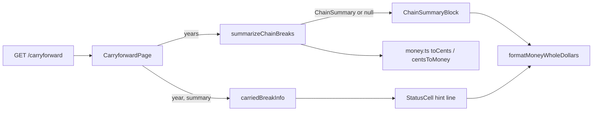

# Design Document

## Overview

The carryforward page already shows per-row status, drift and a mismatch hint. This feature adds a derived reading of that same data: a **chain summary block** above the table and a **hint on `carried` rows**. Everything is computed in the browser from the `ReconciledYear` rows and `status_tolerance` the page already holds.

The work splits into two pieces:

- `frontend/src/lib/carryforwardChain.ts`: pure functions that find the break runs, the exact break amounts and the total gap, in integer cents.
- `frontend/src/pages/CarryforwardPage.tsx`: a `ChainSummaryBlock` component, a `carriedHint` line in `StatusCell`, and the wording.

Language: TypeScript (React 19, vitest, React Testing Library, fast-check), matching the workspace.

Nothing on the backend changes. `expected_carry_in`, `expected_carryforward`, `drift`, `status`, `carried_from_year` and `status_tolerance` are consumed as received.

### Decisions

- **A break is a run, not a row.** Real data has mismatch years 2016, 2017 and 2018 (all lines `0.00`) that are one cause: the 2015 carry-out was never carried in. Listing them as three breaks would repeat one cause. A `Break_Run` is a maximal sequence of consecutive `mismatch` rows. The summary names the run's first year as the break year. When the run is longer, it also states the amount at the run's end year.
- **Amounts are drift differences.** The amount for a run is `drift(end year) - Baseline_Drift`, where the baseline is the `drift` of the nearest earlier row that has one (otherwise `0.00`). A carried year keeps the earlier drift (within the tolerance), so a later break reports only what it added. On the real data this yields about $3,422 for 2016 to 2018 and about $902 for 2021.
- **First-break amount in the sentence.** The sentence uses the same wording as the existing hint (previous year's `expected_carryforward` versus this year's reported line), so the headline number is the one the reader will find in the 2016 row's hint. The run's total at its end year is stated separately.
- **Total gap = latest non-null drift.** That is what the issue asks for ("the latest reported year's drift"). When it is within the tolerance, the block says so instead of stating "$0 under".
- **Per-year hint uses the row's own drift and `carried_from_year`.** `carried_from_year` is the most recent earlier mismatch year, so on the real data 2019 to 2020 point at 2018 and 2022 to 2025 point at 2021. When the first break year differs, the hint also names it, so the reader can connect a 2023 row to the 2016 start.
- **Tolerance rounding.** Carried rows can differ from each other by up to the tolerance, so whole-dollar figures may differ by $1 between the sum of breaks and the total gap (for example $3,422 + $902 against $4,323). Wording uses "about" and the total is stated separately.
- **No new wire fields.** The backend already provides everything. A backend field would duplicate the derivation and need a contract change.

## Architecture



## Components and Interfaces

### `frontend/src/lib/carryforwardChain.ts`

```ts
import type { ReconciledYear } from "../api/carryforward";
import { centsToMoney, toCents } from "./money";

/** One maximal run of consecutive `mismatch` rows. */
export interface ChainBreak {
  /** First mismatch year of the run (the break year). */
  readonly startYear: number;
  /** Last mismatch year of the run; equals startYear for a single year. */
  readonly endYear: number;
  /** Signed Money_String: drift(start) - baseline drift. Negative = dropped. */
  readonly startAmount: string;
  /** Signed Money_String: drift(end) - baseline drift. Negative = dropped. */
  readonly endAmount: string;
  /** The start row's reported line (Money_String). */
  readonly reported: string;
  /** The start row's expected carry-in (Money_String). */
  readonly expectedCarryIn: string;
  /**
   * The preceding row's year and expected carry-out when that row exists and
   * has a reported value; both null for the first row or an unreported prior
   * row (the page then compares with the expected carry-in only).
   */
  readonly priorYear: number | null;
  readonly priorCarryOut: string | null;
}

export interface ChainSummary {
  readonly firstBreak: ChainBreak;
  /** Later runs, ascending by startYear. Empty when there is one run. */
  readonly furtherBreaks: readonly ChainBreak[];
  /** Latest row with a non-null drift. */
  readonly totalGap: { readonly year: number; readonly drift: string };
}

/** Null when no row is `mismatch`. Pure; does not mutate `years`. */
export function summarizeChainBreaks(
  years: readonly ReconciledYear[],
): ChainSummary | null;

export interface CarriedBreakInfo {
  /** The row's `carried_from_year`. */
  readonly breakYear: number;
  /** The row's own drift (Money_String). */
  readonly drift: string;
  /** The first break year when it differs from `breakYear`, else null. */
  readonly firstBreakYear: number | null;
}

/** Null unless the row is `carried` with non-null `carried_from_year` and `drift`. */
export function carriedBreakInfo(
  year: ReconciledYear,
  summary: ChainSummary | null,
): CarriedBreakInfo | null;
```

Algorithm for `summarizeChainBreaks`:

1. Walk `years` (ascending) keeping `lastDriftCents` (starts at `0`, updated for every row whose `drift` is not null) and the current open run.
2. When a row is `mismatch`: if no run is open, open one with `baselineCents = lastDriftCents`, record the start row, its `startAmount = toCents(drift) - baselineCents`, and the prior-row data (`priorYear`/`priorCarryOut` set only when the previous row in the array has non-null `reported_carryforward`). Update the run's end year and `endAmount = toCents(drift) - baselineCents`.
3. When a row is not `mismatch`, close any open run.
4. After each row, if `drift` is not null, set `lastDriftCents = toCents(drift)` and remember `{ year, drift }` for the total gap.
5. Return `null` when there were no runs. Otherwise `firstBreak = runs[0]`, `furtherBreaks = runs.slice(1)`, and `totalGap` from step 4.

All amounts are produced with `centsToMoney` from integer-cent subtraction. There is no floating-point arithmetic on money.

`carriedBreakInfo` returns `{ breakYear: carried_from_year, drift, firstBreakYear }` where `firstBreakYear` is `summary.firstBreak.startYear` when it differs from `carried_from_year`, otherwise `null`.

Real-data walk-through (figures rounded as the page shows them):

| Year | status | reported | drift | Break_Run |
| --- | --- | --- | --- | --- |
| 2015 | ok | n/a | about 0 | |
| 2016 | mismatch | 0.00 | -2,452.00 | start, baseline 0.00, startAmount -2,452.00 |
| 2017 | mismatch | 0.00 | -2,710.00 | |
| 2018 | mismatch | 0.00 | -3,422.00 | end, endAmount -3,422.00 |
| 2019 to 2020 | carried | | about -3,422 | |
| 2021 | mismatch | | about -4,324 | start and end, baseline about -3,422, amount about -902 |
| 2022 to 2025 | carried | | about -4,323 | |

### `frontend/src/pages/CarryforwardPage.tsx`

- `ChainSummaryBlock({ summary, tolerance })`: renders when the page's `summarizeChainBreaks(years)` is non-null. It sits between `ToleranceNote` and `ReconciliationTable`.
- `StatusCell` gets a second optional prop `carriedHint?: string | null` shown beneath the label in the same muted style as the existing `hint`. `ReconciliationRow` receives a `carriedHint` and passes it on; `ReconciliationTable` computes it per row.
- Helpers in the page: `describeAmount(amount)` (below) and `absMoney(amount)` (`centsToMoney(Math.abs(toCents(amount)))`).

Markup (structure):

```tsx
<section aria-labelledby={headingId} className="rounded-md border border-border bg-surface-muted px-4 py-3 text-sm text-fg">
  <h2 id={headingId} className="font-medium">Where the chain breaks</h2>
  <p>{firstBreakSentence}</p>
  {continues ? <p>{continuesSentence}</p> : null}
  {further.length > 0 ? (
    <>
      <p>Further breaks:</p>
      <ul className="list-disc pl-5">
        {further.map((b) => <li key={b.startYear}>{furtherBreakText(b)}</li>)}
      </ul>
    </>
  ) : null}
  <p>{totalGapSentence}</p>
</section>
```

Styling is neutral (the same `border-border bg-surface-muted` as the disclaimer), because meaning is carried by text.

### Wording

Let `$` denote `formatMoneyWholeDollars`, and `abs` the magnitude.

- First break, prior row reported: `The chain first breaks in {start}: the {priorYear} return carried out about {$ priorCarryOut}, but the {start} line shows {$ reported}.`
- First break, first row or prior unreported: `The chain first breaks in {start}: the {start} line shows {$ reported}, where about {$ expectedCarryIn} was expected.`
- Continuation (only when `endYear > startYear`): `The mismatch continues through {end}, where about {$ abs(endAmount)} appears {dropped|extra} in total.`
- Further break item: `{start}` or `{start} to {end}`, then `: about {$ abs(amount)} {dropped|extra}.` where `amount` is `endAmount`.
- Total gap, beyond tolerance: `As of {year}, the reported line is about {$ abs(drift)} {under|over} the expected carry-in.`
- Total gap, within tolerance: `As of {year}, the reported line is within {$ tolerance} of the expected carry-in.`
- Closing line (always): `Check the return for each break year; this summary is a reconciliation aid, not tax advice.`

`describeAmount`: negative gives "dropped"; positive gives "extra"; a zero amount cannot arise for a mismatch start (the row is outside the tolerance of the expected carry-in), but a run's `endAmount` could net to zero in theory, in which case the continuation and further-break text uses "no net change" in place of "{amount} dropped".

### Carried hint wording

`Inherits the {breakYear} break: this line is about {$ abs(drift)} {under|over} the expected carry-in.` When `firstBreakYear` is non-null, append ` The chain first broke in {firstBreakYear}.`

None of the new strings contain "Carried from", "Needs review", "Not reported", or the phrase "this return's line shows", so they do not collide with existing label and hint queries. The first-break sentence does include "carried out about", which the existing hint also contains; tests that query the exact existing hint text are unaffected, but a negative regex on that phrase must be scoped to a row (see Testing Strategy).

## Data Models

No new stored or wire data. The two interfaces above (`ChainBreak`, `ChainSummary`, `CarriedBreakInfo`) are derived values that live only in render.

Money handling: every amount in the new types is a Money_String. Arithmetic is `toCents`/`centsToMoney` integer math on safe integers; display is `formatMoneyWholeDollars` of a Money_String.

## Error Handling

- **Empty or no-mismatch series:** `summarizeChainBreaks` returns `null`, so the page renders nothing new.
- **Null drift:** rows with `drift === null` (unreported) do not change the baseline or the total gap. A `mismatch` row always has a reported value; if a malformed row arrives with `drift === null`, it is treated as `0.00` for the amount so that rendering never throws.
- **Unparseable Money_String:** `toCents` returns `0` for unrecognizable input, so malformed data degrades to `$0` rather than raising.
- **Carried row without a break year or drift:** no hint is rendered.
- **Tolerance string:** `status_tolerance` is parsed with `toCents`; an unparseable value reads as `0`, so only an exactly-zero gap reads as within tolerance.

## Correctness Properties

*A property is a characteristic or behavior that should hold true across all valid executions of a system-essentially, a formal statement about what the system should do. Properties serve as the bridge between human-readable specifications and machine-verifiable correctness guarantees.*

Reflection: the prework merged the null/non-null, run, amount, total-gap, carried-info and rendering criteria into the properties below. The break-amount exactness (2.3, 5.2) is one property; the "dropped/extra" and "under/over" wording and the within-tolerance branch are folded into the rendering property; the 1.2/4.4 negatives are folded into their positive counterparts.

### Property 1: A summary exists exactly when a mismatch row exists

For any series of reconciled years, `summarizeChainBreaks` returns `null` if and only if no row has `status` `mismatch`, and otherwise `firstBreak.startYear` equals the earliest `mismatch` `tax_year`.

**Validates: Requirements 1.1, 1.2**

### Property 2: Breaks are the maximal runs of consecutive mismatch rows

For any series with at least one mismatch row, the breaks (`firstBreak` followed by `furtherBreaks`) are ascending by `startYear`, do not overlap, and each break's `[startYear, endYear]` covers exactly one maximal run of consecutive `mismatch` rows: every year in it is `mismatch`, and the rows immediately before and after it (if any) are not.

**Validates: Requirements 1.5, 2.1, 2.2, 2.4**

### Property 3: Break amounts are exact drift differences

For any series, each break's `startAmount` equals `drift(start row) - baseline` and `endAmount` equals `drift(end row) - baseline` as exact integer-cent subtraction, where `baseline` is the `drift` of the nearest earlier row with a non-null `drift`, or `0.00` when none exists. Each amount is a well-formed two-decimal Money_String.

**Validates: Requirements 2.3, 5.2**

### Property 4: Total gap is the latest non-null drift

For any series with at least one mismatch row, `totalGap` equals the year and `drift` of the latest row whose `drift` is not null.

**Validates: Requirements 3.4**

### Property 5: Break amounts account for the total gap

For any series in which every non-mismatch row with a `drift` carries the same `drift` as the nearest earlier row with a `drift` (and the baseline starts at zero), the sum of all breaks' `endAmount` equals `totalGap.drift` in exact cents.

**Validates: Requirements 2.3, 3.1**

### Property 6: Carried-row info reflects the row and the first break

For any series and any row, `carriedBreakInfo` returns `null` unless the row's `status` is `carried` with non-null `carried_from_year` and `drift`. Otherwise it returns the row's `carried_from_year` as `breakYear`, the row's own `drift`, and `firstBreakYear` equal to the first break's start year when that differs from `breakYear`, else `null`.

**Validates: Requirements 4.1, 4.2, 4.3, 4.4**

### Property 7: The derivation does not modify its input

For any series, calling `summarizeChainBreaks` and `carriedBreakInfo` leaves the input array and every row structurally equal to a prior deep copy, and repeated calls return equal results.

**Validates: Requirements 5.3**

### Property 8: The summary block states the derived facts

For any series with at least one mismatch row and any tolerance, the rendered Chain_Summary_Block contains the first break year, the `formatMoneyWholeDollars` figure of the prior carry-out (or expected carry-in) and of the reported line, "dropped" or "extra" according to the sign of each stated amount, one list item per further break showing its years and `formatMoneyWholeDollars` of its absolute `endAmount`, and the total gap year with `formatMoneyWholeDollars` of its absolute value described as "under" or "over" when it exceeds the tolerance and as within the tolerance otherwise. For a series with no mismatch row, no such region is rendered.

**Validates: Requirements 1.1, 1.2, 1.3, 1.4, 1.5, 1.6, 2.1, 2.2, 3.1, 3.2, 3.3**

### Property 9: Carried rows show the inherited-break hint

For any series, each `carried` row with a `carried_from_year` and a `drift` renders a hint that contains the break year, `formatMoneyWholeDollars` of the absolute drift, and "under" or "over" matching the sign, plus the first break year when it differs; rows with any other status render no such hint, and the "Carried from {year}" label is still present.

**Validates: Requirements 4.1, 4.2, 4.3, 4.4, 4.5**

## Testing Strategy

Dual approach, vitest + RTL + fast-check. Every property test runs `numRuns: 100` or more and carries the tag `// Feature: carryforward-chain-break-summary, Property N: ...`.

**Generators.** A `seriesArb` builds an ascending run of 1 to 12 years with a random status sequence (`ok`, `mismatch`, `carried`, `unreported`), integer-cent amounts for `expected_carry_in`, `expected_carryforward`, `reported_carryforward` and `drift` (signed, converted with `centsToMoney`), and `carried_from_year` set to the most recent earlier mismatch year for `carried` rows. Unreported rows have `reported_carryforward` and `drift` of `null`. A separate "telescoping" generator holds `drift` constant across non-mismatch reported rows for Property 5.

**Oracles.** An independent test oracle recomputes runs and amounts with plain loops over `BigInt` cents, so the property tests do not reuse the code under test.

**Unit tests (`carryforwardChain.test.ts`).** The real-data shape (2016 to 2018 mismatch, 2019 to 2020 carried, 2021 mismatch, 2022 to 2025 carried) yields `firstBreak` 2016 to 2018 with `startAmount` `-2452.00`, `endAmount` `-3422.00`, one further break at 2021 with about `-902.00`, and a `totalGap` of 2025 `-4323.00`. Also: first-row mismatch (no prior), mismatch after an unreported row, a mismatch with a positive drift, a series without mismatch, an empty series, and a run whose rows are separated by an unreported row.

**Page tests (RTL).** `CarryforwardPage.chainSummary.test.tsx` renders the real-data fixture and checks: the region is found by role and name ("Where the chain breaks"), the first-break sentence, the continuation line, the further-break list item, the total gap, the closing line, the carried hint text on 2019 and 2022, the unchanged "Carried from 2018" label and disclaimer, no block for an all-OK or carried-only series, no block in the empty state, and no extra API call. A tolerance-boundary example covers a gap exactly equal to, and one cent above, the tolerance.

**Existing tests.** Run the existing `CarryforwardPage*.test.tsx` files after wiring. The negative regex in `CarryforwardPage.carryIn.test.tsx` that includes `carried out about` must be scoped to the table (`within` the row or table) because the summary block now also contains that phrase. Any other query that finds more than one element is scoped the same way; assertions are not weakened.

**Not property-tested.** Layout and styling, the region role and semantic list (example tests), and the §469 non-computation.
