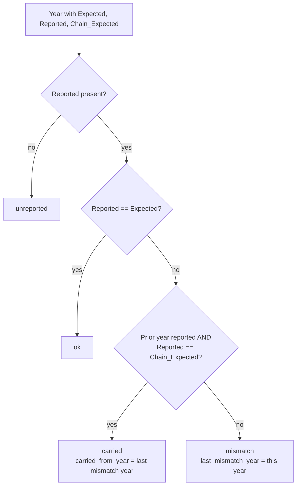

# Design Document

## Overview

Today every year after a filed-return mistake reads "Needs review", because `Expected_Carryforward` is a running balance built from the app's own numbers while each later return correctly carried forward its own (wrong) prior figure. This design adds a **chain check** to status classification so the root-cause year is distinguishable from the years that merely inherited its error.

The change is small and additive:

- **Backend**: `reconcile()` computes, per year, a `chain_expected` (this year's step applied to the prior year's **reported** value). The status block gains one rule that yields a new status `carried`. `ReconciledYear` gains `drift` and `carried_from_year`. `expected_carryforward` and its math are untouched.
- **Wire**: `GET /carryforward` gains `drift`, `carried_from_year` and the status value `carried` per year. `_to_jsonable` already serializes dataclasses field by field, so no handler change is required. No new routes, storage keys or write routes.
- **Frontend**: a "Drift" column, a `carried` status label ("Carried from {year}" / "Carried from earlier year"), and the mismatch danger highlight stays exclusive to `mismatch`.

The app remains a reconciliation aid: nothing here computes the IRC §469 limitation.

### Design decisions and rationale

- **Keep `expected_carryforward` exactly as is.** It is the true economic balance, including allowed-loss handling. Chain checking is a second, independent computation used only for classification. This makes backward compatibility provable: `unreported` and `ok` depend only on reported and expected, and `mismatch` plus `carried` together equal today's `mismatch`.
- **One shared step function.** The loss and gain branches in the loop become a single static helper, `_apply_year_step(prior, net, effective_allowed)`. The expected balance and the chain value both call it, so they cannot diverge, and the allowed-loss logic (`_effective_allowed`) is reused for both. `_effective_allowed` already returns `0.00` for a Non_Loss_Year, so calling it unconditionally is behaviour-identical to today's `if net < 0` guard.
- **Chain base is the prior year's reported value, never an inferred one.** If the prior year is unreported there is nothing to chain from, so classification falls back to today's rules (unreported, ok, mismatch). The first year has no prior reconciled year, so the chain rule does not apply (and its chain value would equal expected anyway, since the prior value is the Opening_Balance in both).
- **Root cause is "most recent earlier `mismatch`".** A single running variable `last_mismatch_year` is enough. It is updated only when a year is classified `mismatch`.
- **Drift is informational.** `drift = reported - expected` is computed from the already-built values and never feeds back into status.
- **UI cues are textual.** Drift direction uses "+" / "over" and "under" text, derived from the Money_String text (no float arithmetic). `carried` rows use the neutral muted style; only `mismatch` rows keep `bg-danger-subtle`.

### Research notes (grounded in the codebase)

- `reconcile()` lists properties once, reads the opening balance and every `PLCF#` item up front, derives Data_Years, then loops ascending with the loss branch `balance + max(-net - effective_allowed, 0)` and the gain branch `max(balance - net, 0)`. Status is currently a three-way block (`unreported` / `ok` / `mismatch`).
- `ReconciledYear` is a frozen dataclass whose later fields have defaults (`allowed_loss`, `fully_allowed`, `status`), so new fields with defaults keep every existing `ReconciledYear(...)` call site valid.
- `_carryforward_reconcile` returns the `ReconciliationSummary`; `_to_jsonable` renders `Money`/`Decimal` as two-decimal strings, `None` as null, ints as ints, and dataclasses field by field.
- Frontend: `STATUS_LABEL` is a `Record<ReconciledYear["status"], string>`, so adding `carried` to the union forces a label entry at compile time. `StatusCell` currently takes only `status`; `ReconciliationRow` highlights with `status === "mismatch"`.
- Existing backend tests that encode the pre-feature rule (see "Existing test impact") will fail without an oracle update, so Requirement 11.3 and task 6 cover them explicitly.

## Architecture



### Classification algorithm (Req 1, 2, 3, 4)

All values are exact two-decimal `Decimal` (`Money`). `reported`, `allowed_loss`, `fully_allowed`, `opening`, `years` and the per-year `net` are produced exactly as today.

```python
@staticmethod
def _apply_year_step(prior: Money, net: Money, effective_allowed: Money) -> Money:
    """One year's balance step (Req 1.2, 1.3). Exact Decimal; no float."""
    if net < 0:
        suspended = max((-net) - effective_allowed, Decimal("0.00"))
        return to_money(prior + suspended)
    return to_money(max(prior - net, Decimal("0.00")))

balance = opening                         # running EXPECTED balance (unchanged semantics)
prior_reported: Money | None = None       # prior reconciled year's reported value
last_mismatch_year: int | None = None
reconciled = []

for index, year in enumerate(years):
    net = self._schedule_e_net_for(year, properties)
    effective_allowed = self._effective_allowed(
        net, allowed_loss.get(year), fully_allowed.get(year, False)
    )

    expected = self._apply_year_step(balance, net, effective_allowed)
    balance = expected

    reported_value = reported.get(year)
    drift = None if reported_value is None else to_money(reported_value - expected)

    # Chain check input: only when a prior reconciled year exists AND reported.
    chain_expected = None
    if index > 0 and prior_reported is not None:
        chain_expected = self._apply_year_step(prior_reported, net, effective_allowed)

    carried_from = None
    if reported_value is None:
        status = "unreported"
    elif reported_value == expected:
        status = "ok"
    elif chain_expected is not None and reported_value == chain_expected:
        status = "carried"
        carried_from = last_mismatch_year      # may be None only defensively
    else:
        status = "mismatch"
        last_mismatch_year = year

    reconciled.append(ReconciledYear(..., status=status,
                                     drift=drift, carried_from_year=carried_from))
    prior_reported = reported_value            # None when unreported -> next year falls back
```

Properties of the algorithm worth stating:

- Status rules are evaluated in the order unreported, ok, carried, mismatch, and exactly one applies.
- When `prior_reported == prior expected` (the prior year is `ok`), `chain_expected == expected` by construction, so rule `carried` cannot fire for a year whose prior year is `ok`. Therefore a `carried` year always follows a `mismatch` or `carried` year, and `carried_from_year` is always non-null in practice. The null branch is kept as a defensive rule (Req 3.2) so the UI never depends on that reasoning.
- For any year, `status in {mismatch, carried}` exactly when today's rule would give `mismatch`. The chain rule only relabels.

### Worked example

Opening balance `0.00`. Nets and allowed data are chosen so the economic balances are as shown. The 2015 return dropped 5,000 of carryover and every later return carried its own prior figure correctly.

| Year | Net | Expected | Reported | chain_expected | Status | carried_from_year | Drift |
|------|-----|----------|----------|----------------|--------|-------------------|-------|
| 2014 | -10,000 | 10,000 | 10,000 | n/a (first year) | `ok` | null | 0 |
| 2015 | -2,000 | 12,000 | 7,000 | 10,000 + 2,000 = 12,000 | `mismatch` | null | -5,000 |
| 2016 | -1,000 | 13,000 | 8,000 | 7,000 + 1,000 = 8,000 | `carried` | 2015 | -5,000 |
| 2017 | +1,500 | 11,500 | 6,500 | max(8,000 - 1,500, 0) = 6,500 | `carried` | 2015 | -5,000 |
| 2018 | -500 | 12,000 | 7,000 | 6,500 + 500 = 7,000 | `carried` | 2015 | -5,000 |

Reading the table: only 2015 fails both checks, so only 2015 is a `mismatch` with the danger highlight. 2016 through 2018 are consistent with the return before them and show "Carried from 2015" and a drift of -5,000 ("under").

### Edge cases

- **First year uses Opening_Balance.** The first year's expected is `step(opening, ...)`. It has no prior reconciled year, so the chain rule is skipped; classification is unreported / ok / mismatch. A wrong first-year return is always `mismatch`.
- **Unreported prior year falls back.** If 2016 above were unreported, 2017 has no prior reported value and is classified by the three-rule fallback: 6,500 vs expected 11,500 gives `mismatch`. 2018 then chains from 2017's reported value and is `carried` from 2017. This is the decided behaviour: an unreported gap restarts attribution.
- **Gain-year floor.** The floor at `0.00` can shrink or erase drift. With a 2017 gain of 9,000: expected `max(13,000 - 9,000, 0) = 4,000`, chain `max(8,000 - 9,000, 0) = 0`, reported 0 equals chain, so `carried` with drift -4,000. With a gain of 20,000 both are `0.00`: reported equals expected, so `ok` with drift 0, and the inherited error disappears from later years. The floor can therefore hide drift (status `ok`) or reproduce a smaller drift (status `carried`).
- **Second independent error.** If 2018's return reported 6,000 instead of 7,000, chain is 7,000, reported differs from both expected (12,000) and chain, so 2018 is `mismatch` and `last_mismatch_year` becomes 2018. Later carried years name 2018. The earlier error does not hide it.
- **Second error that cancels drift.** If a later return coincidentally reports exactly the economic expected value, it is `ok` (rule 2 wins). This is correct: the return agrees with the economic balance.
- **Allowed-loss years.** `effective_allowed` (explicit amount or dynamic Fully_Allowed) is used in both the expected and the chain step. A fully allowed loss year adds `0.00` to either base, so a correct return is not misread as an error. Changing allowed data reloads the series, and chain results recompute with it.
- **Rounding.** All comparisons are exact `Decimal` equality on two-decimal values; there is no tolerance.

## Components and Interfaces

### Backend (`backend/src/logstead/services/carryforward.py`)

```python
@dataclass(frozen=True)
class ReconciledYear:
    tax_year: int
    schedule_e_net: Money
    expected_carryforward: Money
    reported_carryforward: Money | None
    allowed_loss: Money = Decimal("0.00")
    fully_allowed: bool = False
    status: Literal["ok", "mismatch", "carried", "unreported"] = "unreported"
    drift: Money | None = None
    carried_from_year: int | None = None
```

- New fields sit after `status` with defaults, so existing constructor call sites stay valid.
- `CarryforwardService._apply_year_step` is a new static helper (above). `reconcile()` uses it for expected and for chain, and adds the `prior_reported` / `last_mismatch_year` bookkeeping and status block shown above. No other method changes; setters, validators and storage are untouched.
- Module docstring and the `ReconciledYear` docstring are updated to describe `carried`, `drift` and `carried_from_year`.

### Router (`backend/src/logstead/router/handler.py`)

No code change is expected. `_carryforward_reconcile` returns the summary and `_to_jsonable` emits `drift` as a two-decimal string or null, `carried_from_year` as an int or null, and `status` as a string. This is verified by route tests rather than assumed (task 5.x).

### Frontend

**`frontend/src/api/carryforward.ts`**: extend `ReconciledYear`.

```ts
export interface ReconciledYear {
  // ...existing fields...
  /** Reconciliation state for the year. */
  readonly status: "ok" | "mismatch" | "carried" | "unreported";
  /** Signed two-decimal string (reported - expected), or null when unreported. */
  readonly drift: string | null;
  /** For a `carried` year, the root-cause tax year; otherwise null. */
  readonly carried_from_year: number | null;
}
```

The doc comment on the type is updated. No request signatures change.

**`frontend/src/pages/CarryforwardPage.tsx`**:

- `STATUS_LABEL` gains `carried: "Carried from earlier year"` (the generic label).
- `StatusCell` takes `status` and `carriedFromYear`. For `carried` it renders `Carried from ${carriedFromYear}` when the year is non-null, else the generic label. Only `mismatch` uses the `font-semibold text-danger` style; `carried` uses the neutral muted style.
- New `DriftCell({ drift })`, derived from the string only (no arithmetic):
  - `null` renders an em dash.
  - Negative (leading `-`): `{formatMoneyWholeDollars(drift)} under`, for example `-$5,000 under`.
  - Positive (no leading `-` and a non-zero digit): `+{formatMoneyWholeDollars(drift)} over`, for example `+$1,200 over`.
  - Zero (`0.00`): `{formatMoneyWholeDollars(drift)}` with no cue, for example `$0`.
  - Sub-dollar drifts follow the exact sign (for example `0.30` renders `+$0 over`), which is accurate because the sign is taken from the exact value, not the rounded display.
  - The cell uses `tabular-nums text-fg` with no danger colour, so meaning never rests on colour.
- `ReconciliationTable` adds a `Drift` header (`scope="col"`, right-aligned) after "Reported carryforward"; `ReconciliationRow` adds the matching cell, giving 7 cells per row: Year, Schedule E net, Expected, Reported, Drift, Allowed loss, Status.
- `ReconciliationRow` keeps `const mismatch = year.status === "mismatch"` for the row highlight, so `carried` rows are not highlighted. The reported editor, allowed-loss control, opening balance control, disclaimer and empty state are unchanged. The page's existing `load()` after every write refreshes status, drift and labels together.

## Data Models

No storage changes. No new keys, items or attributes. The only data-model changes are the transport shapes.

Wire shape for one year (additions in bold in the description, shown here as the full object):

```json
{
  "tax_year": 2016,
  "schedule_e_net": "-1000.00",
  "expected_carryforward": "13000.00",
  "reported_carryforward": "8000.00",
  "allowed_loss": "0.00",
  "fully_allowed": false,
  "status": "carried",
  "drift": "-5000.00",
  "carried_from_year": 2015
}
```

An unreported year serializes `"reported_carryforward": null`, `"drift": null`, `"carried_from_year": null`, `"status": "unreported"`.

## Error Handling

- The change adds no write path and no new failure mode. `reconcile()` already tolerates missing reports (they contribute `0.00`).
- A `carried` year with no earlier `mismatch` yields `carried_from_year = null`; the UI renders "Carried from earlier year" and never errors.
- An unknown status value from a future backend would fail `STATUS_LABEL` lookup at compile time (the union is exhaustive), not at runtime.

## Existing test impact

Requirement 11 is a hard gate. Two kinds of existing test change:

1. **Oracles that encode the three-way rule must adopt the four-way rule.** These tests can produce `carried` years, for example two adjacent years both reported one cent above expected, where chain equals reported:
   - `backend/tests/services/test_carryforward_status_property.py` (the status oracle near lines 217-231 and the `{"ok","mismatch","unreported"}` membership check).
   - `backend/tests/services/test_carryforward_allowed_balance_property.py` (the backward-compatibility oracle near lines 472-479). Its intent (no allowed data gives today's series) is kept: it should assert `expected_carryforward` equals the old recurrence and that `status in {"mismatch","carried"}` exactly where the old rule gave `mismatch`.
2. **Status-set membership checks must include `carried`:** `tests/router/test_carryforward_route.py` (line ~254), `tests/router/test_carryforward_money_property.py` (`_STATUSES`), `tests/router/test_carryforward_allowed_money_property.py` (line ~384).

Examples such as the 2010 mismatch, the 2021 `mismatch` with reported `999.00` after a 2020 reported `750.00`, and the 2019 reported `0.00` case have no matching chain value and stay `mismatch`; they are re-checked by the final run.

Frontend fixtures in `carryforward.test.ts` and `CarryforwardPage.test.tsx` that build `ReconciledYear` objects gain `drift` and `carried_from_year`, otherwise `npm run build` (`tsc -b`) fails. The page tests that assert column counts or header lists, if any, are updated for the new Drift column.

## Correctness Properties

*A property is a characteristic or behavior that should hold true across all valid executions of a system — essentially, a formal statement about what the system should do. Properties serve as the bridge between human-readable specifications and machine-verifiable correctness guarantees.*

Reflection note: the chain-derivation criteria (1.1 to 1.6) and the per-rule status criteria (2.1 to 2.5) are validated by one oracle comparison (Property 1) rather than several overlapping properties. The "single injected error" and "independent second error" criteria are combined into Property 6. The drift criteria are combined into Property 8.

### Property 1: Status follows the four-rule precedence and is total

*For any* Opening_Balance, sequence of per-year nets, allowed data and reported data (any subset of years reported), the status of every year equals the status given by an independent oracle that recomputes expected and chain values in exact `Decimal` cents and applies the rules in order: `unreported` when no reported value; `ok` when reported equals expected; `carried` when the year is not the first, the prior year is reported, and reported equals the chain value; otherwise `mismatch`. Every status is one of exactly `ok`, `mismatch`, `carried`, `unreported`. The first year and any year whose prior year is unreported are classified without the chain rule.

**Validates: Requirements 1.1, 1.2, 1.3, 1.4, 1.5, 2.1, 2.2, 2.3, 2.4, 2.5, 2.6, 2.7**

### Property 2: Expected carryforward is unchanged

*For any* input, each year's `expected_carryforward` equals the value from the pre-feature running-balance recurrence (a loss adds `max(-net - effective_allowed, 0.00)`, a gain subtracts and floors at `0.00`) over the same nets, allowed data and opening balance, regardless of reported data.

**Validates: Requirements 5.1**

### Property 3: Backward compatibility of statuses

*For any* input, a year is `unreported` or `ok` exactly when the pre-feature rule says so, and a year is `mismatch` or `carried` exactly when the pre-feature rule says `mismatch`. When no year has a reported prior year, every status equals the pre-feature status.

**Validates: Requirements 5.2, 5.3, 5.4**

### Property 4: Carried implies the chain relation

*For any* input and any year with status `carried`, the year is not the first, the prior year has a reported value, the year's reported value is not equal to its expected value, and it equals the year step applied to the prior year's reported value.

**Validates: Requirements 2.3**

### Property 5: Root-cause attribution

*For any* input, every `carried` year has `carried_from_year` equal to the tax year of the most recent earlier `mismatch` year (and that year is strictly less than the year's own `tax_year`), every non-`carried` year has `carried_from_year` null, and a `carried` year's `carried_from_year` is never null in the generated series.

**Validates: Requirements 3.1, 3.2, 3.3, 3.4**

### Property 6: Injected errors produce mismatch at the error year and carried afterwards

*For any* correct series in which reported values equal expected, and any single year N whose reported value is replaced by a different non-negative two-decimal value that also differs from expected, with every later year reported by applying its own year step to the prior reported value, the series has exactly one `mismatch` (year N); the years before N are `ok`; each later year before the first unreported year is `carried` while its reported value differs from expected and `ok` once the floor makes it equal (and `ok` thereafter until another error); and a second such injected error in a later year is `mismatch` for that year, with later `carried` years naming it.

**Validates: Requirements 2.3, 2.4, 2.8, 3.1**

### Property 7: Unreported gap restarts attribution

*For any* series with an unreported year U, the year immediately after U is classified using the fallback rules only (`ok` if reported equals expected, otherwise `mismatch`), and chain attribution resumes for the year after that.

**Validates: Requirements 2.6**

### Property 8: Drift is exact and null iff unreported

*For any* input, each year's `drift` is null exactly when `reported_carryforward` is null, and otherwise equals `reported_carryforward - expected_carryforward` exactly as a signed two-decimal `Decimal`. Changing `drift` has no effect on `status` (status equals the Property 1 oracle, which never reads drift).

**Validates: Requirements 4.1, 4.2, 4.3**

### Property 9: Wire figures are fixed-format and never float

*For any* input served through `GET /carryforward`, every non-null `drift` matches `^-?\d+\.\d{2}$`, `carried_from_year` is a JSON integer or null, `status` is one of the four values, and all in-service figures are `Decimal` quantized to two places (no `float` instances).

**Validates: Requirements 1.6, 6.2, 6.3, 6.4, 10.1**

### Property 10: Drift cell shows direction in text

*For any* signed two-decimal drift string, the rendered drift cell contains the Whole_Dollar_Formatter output of that value; contains a leading "+" and the word "over" when the value is positive; contains a minus sign and the word "under" when the value is negative; and contains neither word when the value is `0.00`. A null drift renders an em dash.

**Validates: Requirements 7.2, 7.3, 7.4, 7.5, 7.6**

### Property 11: Status label and highlight depend only on status and root-cause year

*For any* status and any `carried_from_year` (integer or null), the status cell reads "OK", "Needs review", "Not reported", "Carried from {year}" (non-null year) or "Carried from earlier year" (null year) according to the status, and the danger highlight appears on a row exactly when the status is `mismatch`.

**Validates: Requirements 8.1, 8.2, 8.3, 8.4, 8.5**

### Property 12: Rows have a constant cell count

*For any* list of years with arbitrary status, drift and root-cause values, every table row renders the same number of cells as the header row.

**Validates: Requirements 7.1, 7.7**

## Testing Strategy

**Dual approach.** Property tests cover universal behaviour; example tests cover the worked scenarios and integration points.

**Backend (Hypothesis, moto, real composed stack).** Mirror `test_carryforward_status_property.py` and `test_carryforward_allowed_balance_property.py`: `reconcile()` once to learn nets and expected, set reported values, `reconcile()` again, and compare to an independent `Decimal`-cents oracle. The returned `ReconciledYear` already carries `schedule_e_net`, `allowed_loss` and `fully_allowed`, so the oracle recomputes the chain from the response without private access. Strategies pick each reported value from `expected`, the oracle's `chain`, and off-by-one-cent variants of each, and leave some years unreported, so every branch is hit. At least 100 examples per property (`@settings(max_examples=100, deadline=None)`), tagged `# Feature: carryforward-chain-status, Property N: ...`.

Backend files:
- `backend/tests/services/test_carryforward_chain_status_property.py` (Properties 1 to 8)
- `backend/tests/services/test_carryforward_chain_status_examples.py` (worked example, first year, unreported prior, gain floor hide and reproduce, second error, allowed-loss years)
- `backend/tests/router/test_carryforward_chain_status_route.py` (Property 9 and route body examples)

**Frontend (vitest, fast-check, RTL).** Properties 10 to 12 render `CarryforwardPage` with an injected fake API (as in `CarryforwardPage.test.tsx`) and generated `ReconciledYear` rows; `numRuns: 100`, tagged `// Feature: carryforward-chain-status, Property N: ...`. Example tests cover the Drift header, em dash, "Carried from earlier year", and a reload after a save changing a row from `mismatch` to `carried` labels. The existing tests keep passing with updated fixtures.

**Final gate.** Backend full suite (after recreating the venv if stale), frontend `npm run build` (`tsc -b && vite build`) and `npx vitest --run`. No deploy.

## Housekeeping notes

- The backend venv may need recreating: `python3 -m venv .venv && .venv/bin/python -m pip install -q -e ".[dev]"` from `backend/`.
- iCloud duplicate files (`* 2.*`) can appear in the workspace. Delete them; never commit them.
