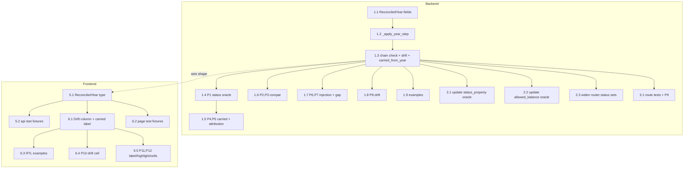

# Implementation Plan: Carryforward Chain Status

## Overview

This plan adds a **chain check** to the passive-loss carryforward reconciliation so the one year whose filed return mishandled a carryover is distinguishable from the later years that merely inherited its error. In `reconcile()`, each year with a reported value is also compared to `chain_expected` (this year's step applied to the **prior reconciled year's reported** value). A match yields a new status `carried`; otherwise the year stays `mismatch`. Each year also gains `drift` (`reported - expected`, informational) and `carried_from_year` (the most recent earlier `mismatch` year). `expected_carryforward`, the §469 stance, allowed-loss behaviour, storage keys and write routes are all unchanged.

The language is **Python 3.12** (backend) and **React 19 + TypeScript** (frontend). The router needs no code change because `_to_jsonable` serializes the dataclass field by field; this is verified by route tests. Money stays an exact two-decimal `Decimal` in Python and a fixed two-decimal string over the wire.

**Dependency shape.** Tasks 1.1, 1.2 and 1.3 all write `backend/src/logstead/services/carryforward.py`, so they sit in distinct waves. The existing backend tests that encode the old three-way status rule (task 2) must be updated or they will fail. The frontend `ReconciledYear` type (5.1) follows the settled backend wire shape; the page work (6.1) depends on it. Frontend fixtures in `carryforward.test.ts` (5.2) and `CarryforwardPage.test.tsx` (6.2) **must** gain `drift` and `carried_from_year` because `npm run build` (`tsc -b`) otherwise fails.

Testing reuses the project stack: backend `pytest` + `Hypothesis` + `moto` with the real composed service stack (mirroring `test_carryforward_status_property.py`); frontend `vitest` + `fast-check` + RTL. Every property test runs at least 100 iterations and is tagged `# Feature: carryforward-chain-status, Property N: ...` (`//` in TS).

Housekeeping: the backend venv may need recreating (`python3 -m venv .venv && .venv/bin/python -m pip install -q -e ".[dev]"` from `backend/`). iCloud duplicate files (`* 2.*`) must be deleted, never committed.

## Tasks

- [x] 1. Backend: chain check, drift and root-cause attribution in `CarryforwardService`
  - [x] 1.1 Extend `ReconciledYear` in `backend/src/logstead/services/carryforward.py`
    - Widen `status` to `Literal["ok", "mismatch", "carried", "unreported"]` (default stays `"unreported"`)
    - Add `drift: Money | None = None` and `carried_from_year: int | None = None` after `status`, with defaults so existing constructor call sites stay valid
    - Update the `ReconciledYear` and module docstrings to describe `carried`, `drift` and `carried_from_year`; keep `ReconciliationSummary` unchanged
    - _Requirements: 6.4, 4.1, 3.1_
    - _Design: Components and Interfaces (Backend)_

  - [x] 1.2 Factor the balance step into `_apply_year_step` in `backend/src/logstead/services/carryforward.py`
    - Add `@staticmethod _apply_year_step(prior, net, effective_allowed) -> Money`: loss year `prior + max(-net - effective_allowed, 0.00)`, non-loss year `max(prior - net, 0.00)`, exact two-decimal `Decimal`, no float
    - Replace the inline loss/gain branches in `reconcile()` with a call to it, calling `_effective_allowed` unconditionally (it already returns `0.00` for a non-loss year); behaviour must be byte-for-byte identical, so existing carryforward tests stay green
    - _Requirements: 1.2, 1.3, 1.4, 1.6, 5.1, 10.1_
    - _Design: Classification algorithm_

  - [x] 1.3 Implement the chain check, `drift` and `carried_from_year` in `reconcile()` in `backend/src/logstead/services/carryforward.py`
    - Track `prior_reported` (the prior reconciled year's reported value, `None` when unreported) and `last_mismatch_year`
    - For every year after the first with a non-null `prior_reported`, compute `chain_expected = _apply_year_step(prior_reported, net, effective_allowed)`; the first year uses no chain rule
    - Replace the status block with the ordered rules: no reported value gives `unreported`; reported equals expected gives `ok`; chain_expected present and reported equals it gives `carried` with `carried_from_year = last_mismatch_year`; otherwise `mismatch` and set `last_mismatch_year = year`
    - Set `drift = to_money(reported - expected)` when reported is present, else `None`; `carried_from_year` is `None` for every non-`carried` year; pass both into `ReconciledYear`
    - Do not change `expected_carryforward`, setters, validators or storage
    - _Requirements: 1.1, 1.5, 2.1, 2.2, 2.3, 2.4, 2.5, 2.6, 2.7, 2.8, 3.1, 3.2, 3.3, 3.4, 4.1, 4.2, 4.3, 5.1, 5.2, 5.3, 5.4, 10.1, 10.2, 10.3_
    - _Design: Classification algorithm; Edge cases_

  - [x]* 1.4 Property test: status precedence and totality
    - **Property 1: Status follows the four-rule precedence and is total**
    - **Validates: Requirements 1.1, 1.2, 1.3, 1.4, 1.5, 2.1, 2.2, 2.3, 2.4, 2.5, 2.6, 2.7**
    - New `backend/tests/services/test_carryforward_chain_status_property.py`; moto-backed composed stack; reconcile once to learn nets and expected, set reported values drawn from expected, the oracle's chain value, and off-by-one-cent variants (some years unreported, some allowed data and fully-allowed flags), reconcile again, compare every status to an independent `Decimal`-cents oracle

  - [x]* 1.5 Property tests: carried implies chain relation; root-cause attribution
    - **Property 4: Carried implies the chain relation**
    - **Property 5: Root-cause attribution**
    - **Validates: Requirements 2.3, 3.1, 3.2, 3.3, 3.4**
    - Append to `backend/tests/services/test_carryforward_chain_status_property.py`; for every `carried` year assert it is not first, prior is reported, reported differs from expected and equals the step on the prior reported value; assert `carried_from_year` equals the most recent earlier `mismatch` year, is less than `tax_year`, is non-null for carried years, and is null for all other statuses

  - [x]* 1.6 Property tests: expected unchanged and backward-compatible statuses
    - **Property 2: Expected carryforward is unchanged**
    - **Property 3: Backward compatibility of statuses**
    - **Validates: Requirements 5.1, 5.2, 5.3, 5.4**
    - New `backend/tests/services/test_carryforward_chain_status_compat_property.py`; compare `expected_carryforward` to the pre-feature recurrence for any input; assert `unreported` and `ok` match the old rule and `status in {"mismatch", "carried"}` exactly where the old rule gave `mismatch`; include a generator with only non-adjacent reported years, where every status equals the old one

  - [x]* 1.7 Property tests: injected errors and unreported gaps
    - **Property 6: Injected errors produce mismatch at the error year and carried afterwards**
    - **Property 7: Unreported gap restarts attribution**
    - **Validates: Requirements 2.3, 2.4, 2.6, 2.8, 3.1**
    - New `backend/tests/services/test_carryforward_chain_status_injection_property.py`; build a correct reported series, replace year N with a different non-negative value that also differs from expected, chain later years via the oracle step, and assert exactly one `mismatch` at N, `ok` before N, `carried` (or `ok` once the floor equalises) after N up to an unreported year; a second injected error is `mismatch` for its own year and later carried years name it; the year after an unreported year uses fallback rules only

  - [x]* 1.8 Property test: drift is exact and null iff unreported
    - **Property 8: Drift is exact and null iff unreported**
    - **Validates: Requirements 4.1, 4.2, 4.3**
    - New `backend/tests/services/test_carryforward_chain_status_drift_property.py`; for any input assert `drift is None` iff `reported_carryforward is None`, otherwise `drift == reported - expected` as a two-decimal `Decimal` (no float), and that statuses equal the Property 1 oracle that never reads drift

  - [x]* 1.9 Unit examples: worked example and edge cases
    - New `backend/tests/services/test_carryforward_chain_status_examples.py`; the design's worked example (2014 ok, 2015 mismatch with drift -5,000, 2016-2018 `carried` from 2015, drift -5,000 each); first year uses Opening_Balance; unreported prior year falls back to `mismatch`, then chains from the next year; gain-year floor hiding drift (`ok`) and reproducing a smaller drift (`carried`); second independent error names the later year; fully allowed and partly allowed loss years are not misread as errors
    - _Requirements: 1.5, 2.2, 2.3, 2.4, 2.6, 2.7, 2.8, 3.1, 4.1_
    - _Design: Worked example; Edge cases_

- [x] 2. Backend: update existing tests that encode the three-way status rule
  - [x] 2.1 Update the status oracle in `backend/tests/services/test_carryforward_status_property.py`
    - Replace the three-way oracle (near lines 217-231) with the four-way rule (adding the chain relation using the returned `schedule_e_net`, `allowed_loss`, `fully_allowed`), widen the `{"ok","mismatch","unreported"}` membership check to include `carried`, and update the module docstring; keep the test's original intent and strategies; confirm the 2019 reported `0.00` example still classifies `mismatch`
    - _Requirements: 11.2, 11.3, 2.5_
    - _Design: Existing test impact_

  - [x] 2.2 Update the backward-compatibility oracle in `backend/tests/services/test_carryforward_allowed_balance_property.py`
    - Where the old expected status is `mismatch`, accept `mismatch` or `carried`; keep `unreported` and `ok` exact; keep the `expected_carryforward` assertions unchanged
    - _Requirements: 11.2, 11.3, 5.1, 5.3_
    - _Design: Existing test impact_

  - [x] 2.3 Widen the status-set checks in the router tests
    - Add `carried` to the status literal sets in `backend/tests/router/test_carryforward_route.py`, `backend/tests/router/test_carryforward_money_property.py` (`_STATUSES`) and `backend/tests/router/test_carryforward_allowed_money_property.py`; no other assertion changes
    - _Requirements: 11.2, 11.3, 6.4_
    - _Design: Existing test impact_

- [x] 3. Backend: verify the wire contract
  - [x]* 3.1 Route tests and wire property
    - **Property 9: Wire figures are fixed-format and never float**
    - **Validates: Requirements 1.6, 6.2, 6.3, 6.4, 10.1**
    - New `backend/tests/router/test_carryforward_chain_status_route.py`; drive the real handler over moto; assert every year carries `drift` (matches `^-?\d+\.\d{2}$` or null) and `carried_from_year` (int or null), status is one of the four values, existing fields are unchanged; example: the worked-example data returns `carried` with `carried_from_year` 2015 and `drift` `"-5000.00"`; an unreported year returns null drift and null `carried_from_year`
    - _Requirements: 6.1, 6.2, 6.3, 6.4, 6.5_
    - _Design: Router; Data Models_

- [x] 4. Checkpoint - backend chain status
  - Ensure the backend compiles and the new tests pass, and that the existing `tests/services/test_carryforward_*.py` and `tests/router/test_carryforward_*.py` suites are green (including the oracles updated in task 2); ask the user if questions arise.

- [x] 5. Frontend: API types
  - [x] 5.1 Extend `ReconciledYear` in `frontend/src/api/carryforward.ts`
    - Widen `status` to `"ok" | "mismatch" | "carried" | "unreported"`; add `readonly drift: string | null` and `readonly carried_from_year: number | null`; update the type's doc comment; no request signature changes
    - _Requirements: 6.6_
    - _Design: Components and Interfaces (Frontend)_

  - [x] 5.2 Update `ReconciledYear` fixtures in `frontend/src/api/carryforward.test.ts`
    - Add `drift` and `carried_from_year` to every fixture object (for example the `"unreported"` and `"ok"` fixtures) so `tsc -b` succeeds; add one assertion that a `carried` year with `drift` and `carried_from_year` round-trips through `getReconciliation`
    - _Requirements: 11.1, 6.6_
    - _Design: Existing test impact_

- [x] 6. Frontend: Drift column and carried status on the page
  - [x] 6.1 Add the Drift column and `carried` label in `frontend/src/pages/CarryforwardPage.tsx`
    - Add `carried: "Carried from earlier year"` to `STATUS_LABEL`; make `StatusCell` accept `carriedFromYear` and render `Carried from {year}` when non-null; only `mismatch` keeps the `font-semibold text-danger` style and the row's `bg-danger-subtle`
    - Add `DriftCell`: em dash when null; negative gives `formatMoneyWholeDollars(drift)` plus "under"; positive gives "+" plus the formatted value plus "over"; zero gives the formatted value only; sign from the string text, no float arithmetic
    - Add a `Drift` header (`scope="col"`, right-aligned) after "Reported carryforward" and the matching cell in `ReconciliationRow` (7 cells per row); pass `year.carried_from_year` to `StatusCell`
    - Keep the reported editor, allowed-loss control, opening balance control, disclaimer, empty state and reload behaviour intact; update the component docs
    - _Requirements: 7.1, 7.2, 7.3, 7.4, 7.5, 7.6, 7.7, 8.1, 8.2, 8.3, 8.4, 8.5, 9.1, 9.2, 10.4_
    - _Design: Components and Interfaces (Frontend)_

  - [x] 6.2 Update fixtures and column assertions in `frontend/src/pages/CarryforwardPage.test.tsx`
    - Add `drift` and `carried_from_year` to the row builder and every `ReconciledYear` literal so `tsc -b` succeeds; update any header-count or cell-count assertions for the new Drift column; existing assertions otherwise unchanged
    - _Requirements: 11.1, 9.1_
    - _Design: Existing test impact_

  - [x]* 6.3 RTL examples for the new column and labels
    - New `frontend/src/pages/CarryforwardPage.chainStatus.test.tsx`; "Drift" column header present; null drift shows an em dash; `carried` row with year 2015 reads "Carried from 2015" and has no `bg-danger-subtle`; `carried` with null year reads "Carried from earlier year"; `mismatch` row keeps "Needs review" and the highlight; a reload after a save changes a row's labels
    - _Requirements: 7.1, 7.5, 8.1, 8.2, 8.3, 8.4, 8.5, 9.2_
    - _Design: Testing Strategy_

  - [x]* 6.4 Property test: drift cell text cue
    - **Property 10: Drift cell shows direction in text**
    - **Validates: Requirements 7.2, 7.3, 7.4, 7.5, 7.6**
    - New `frontend/src/pages/CarryforwardPage.drift.property.test.tsx`; fast-check over signed cents rendered as two-decimal strings (including `0.00` and sub-dollar values); assert formatter output present, "+" and "over" for positive, minus and "under" for negative, neither word for zero; `numRuns: 100`

  - [x]* 6.5 Property tests: label, highlight and cell count
    - **Property 11: Status label and highlight depend only on status and root-cause year**
    - **Property 12: Rows have a constant cell count**
    - **Validates: Requirements 7.1, 7.7, 8.1, 8.2, 8.3, 8.4, 8.5**
    - New `frontend/src/pages/CarryforwardPage.status.property.test.tsx`; fast-check over status, `carried_from_year` and drift combinations; assert the label per status, the danger highlight exactly on `mismatch` rows, and every row has the same cell count as the header; `numRuns: 100`

- [x] 7. Final verification - suites green, no float, no deploy
  - Backend: if the venv is missing or stale, recreate it (`python3 -m venv .venv && .venv/bin/python -m pip install -q -e ".[dev]"` from `backend/`), then run `.venv/bin/python -m pytest -q -p no:cacheprovider -n auto` from `backend/`; the full suite, including `tests/services/test_carryforward_*.py` and `tests/router/test_carryforward_*.py`, must be green
  - Frontend: from `frontend/`, run `npm run build` (the real gate: `tsc -b && vite build`) and `npx vitest --run`; both must be green
  - Confirm `expected_carryforward` math is unchanged, no floating-point arithmetic was introduced for chain or drift values, and the §469 limitation is not computed
  - Delete any iCloud duplicate files (`* 2.*`); never commit them
  - Do NOT run any deploy (`make deploy`); the user runs deploys. Ask the user if anything is unclear.
  - _Requirements: 5.1, 10.1, 10.2, 11.1, 11.2_

## Task Dependency Graph



```json
{
  "waves": [
    { "id": 0, "tasks": ["1.1"] },
    { "id": 1, "tasks": ["1.2"] },
    { "id": 2, "tasks": ["1.3"] },
    { "id": 3, "tasks": ["1.4", "2.1", "2.2", "2.3", "5.1"] },
    { "id": 4, "tasks": ["1.5", "1.6", "1.7", "1.8", "1.9"] },
    { "id": 5, "tasks": ["3.1", "5.2", "6.1", "6.2"] },
    { "id": 6, "tasks": ["6.3", "6.4", "6.5"] }
  ]
}
```

> Wave ordering note: tasks 1.1, 1.2 and 1.3 all write `backend/src/logstead/services/carryforward.py` and occupy distinct waves. 1.4 and 1.5 both write `test_carryforward_chain_status_property.py` and sit in waves 3 and 4. 2.1, 2.2 and 2.3 each touch different test files (2.3 touches three separate router test files, one edit each). 5.1 writes `carryforward.ts`; 5.2 writes `carryforward.test.ts`; 6.1 writes `CarryforwardPage.tsx`; 6.2 writes `CarryforwardPage.test.tsx`; 6.3, 6.4 and 6.5 each write their own new test file, so no two tasks in a wave write the same file. The dotted `wire shape` edge records that the frontend type follows the settled backend contract.

## Notes

- **Spec only.** This spec describes the change; implementation happens when tasks are run. Tasks marked `[ ]*` are optional tests and can be skipped for a faster MVP, but tasks 2, 5.2 and 6.2 are **not** optional: they keep the existing suites and `tsc -b` green.
- **Backward compatibility is a hard invariant.** `expected_carryforward` and the `ok`/`unreported` classifications are identical to today; `mismatch` plus `carried` together equal today's `mismatch` (Properties 2 and 3).
- **Existing tests that encode the old three-way rule** (`test_carryforward_status_property.py`, `test_carryforward_allowed_balance_property.py`, and the status-set checks in three router tests) must adopt the four-way rule, otherwise adjacent reported years that inherit an error can produce `carried` and fail them.
- **No new routes, storage keys or write routes.** The router needs no code change; task 3.1 verifies the serialization.
- **No deploy.** Task 7 is the real gate and explicitly excludes `make deploy`.
- Checkpoints (4) and the final task (7) are stop-and-verify gates, not code tasks, so they are not in the wave graph. Waves are sized for a 5-concurrent orchestrator limit.
