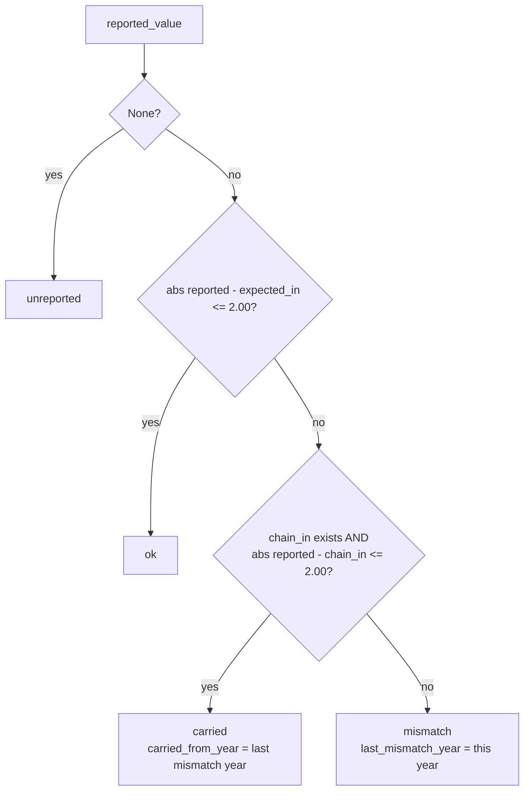
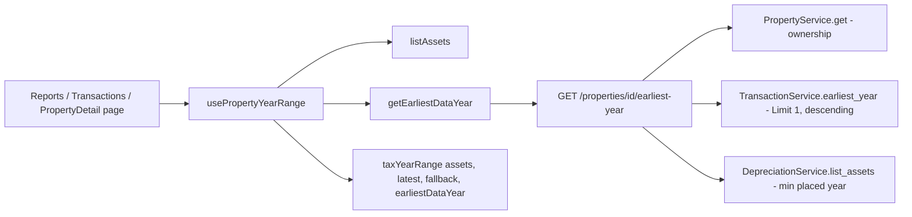

# Design Document

## Overview

Three small changes, all additive on the wire:

1. **Tolerance comparison (backend).** `reconcile()` compares reported against expected carry-in and against the chain value with `abs(a - b) <= STATUS_TOLERANCE` instead of exact equality. `STATUS_TOLERANCE = Decimal("2.00")` lives in one module-level constant. The summary exposes it as `status_tolerance`.
2. **Hint rewording and copy (frontend).** `mismatchHint` tells the user which line to check and shows both whole-dollar figures. A new sentence on the page explains the tolerance using the wire field.
3. **Year range (backend and frontend).** A read-only route `GET /properties/{propertyId}/earliest-year` returns the earliest year with any activity. One shared frontend hook and an extended `taxYearRange` build the pickers for Reports, Transactions and Property Detail.

`expected_carry_in`, `expected_carryforward`, `drift`, status precedence, `carried_from_year`, storage keys and write routes are untouched. The app still never computes the §469 limitation.

### Design decisions and rationale

- **A flat, per-comparison tolerance of $2.00.** Each return line is rounded to whole dollars independently, so the error on one line is at most $0.50. A $2 band absorbs rounding on a line or two without hiding a real dropped carryover. The band is applied to each comparison separately and never accumulated: a year's chain value is built from the prior year's *reported* figure, which is a fresh base each year, so tolerance cannot drift across years.
- **`drift` stays exact.** It is informational. A year can be `ok` with a nonzero drift (for example `+0.27` or `+1.09`). The page already shows the Drift column, so the user sees the real difference and the tolerance sentence explains why it is still OK.
- **Precedence is unchanged.** `unreported`, `ok`, `carried`, `mismatch`. Because `ok` is tested first, a value within tolerance of both expected and chain is `ok`. Making the `ok` band wider can only turn `carried` or `mismatch` years into `ok` and `mismatch` years into `carried`; it never turns an exact `ok` or exact `carried` year into something worse.
- **Tolerance on the wire, not hard-coded in the UI.** The constant is a single backend value. The page reads `status_tolerance` and formats it, so a future change needs one edit.
- **A new route for the earliest year, not a bigger property payload.** The property record carries no activity date. Loading all transactions into the browser to find the minimum would scale with history. Transaction sort keys use inverted dates, so ascending key order is newest-first and the earliest transaction is the last item. A descending query with `Limit=1` reads one item.
- **Depreciation-schedule years add nothing.** A schedule starts in the asset's placed-in-service year, so the earliest schedule year equals the earliest asset year. Reading assets alone is enough and cheaper than materializing schedules.
- **One shared range helper.** `PropertyDetailPage.tsx` currently keeps a private duplicate of `taxYearRange`. It moves to the shared module so all three pages behave the same.

### Research notes (grounded in the codebase)

- `reconcile()` currently has `elif reported_value == expected_in: status = "ok"` and `elif chain_in is not None and reported_value == chain_in: status = "carried"`; `drift` is `to_money(reported_value - expected_in)`.
- `ReconciliationSummary` is a frozen dataclass with defaults on its later fields; `_to_jsonable` serializes dataclasses field by field and renders `Decimal` as a two-decimal string, so a new defaulted field flows to the wire with no handler change.
- `TransactionService.list_for_property` queries `keys.property_scoped_pk(property_id)` with the `TXN#` prefix and returns every item; `DynamoRepository.query` paginates internally and has an `ascending` flag but no `limit`. `keys.date_from_inverted` recovers the date from the inverted token in the sort key. Receipt rows share the `TXN#<inv>#<id>` prefix, with the same date token, so the year read from the sort key is correct whichever row comes last.
- `DepreciationService.list_assets(property_id)` returns the (small) asset list.
- `latest_tax_year()` in `dashboard.py` and `latestCompletedTaxYear()` in `taxYears.ts` are the existing caps.
- `ReportsPage` and `TransactionsPage` already call `taxYearRange(assets, latestCompletedTaxYear())`; `PropertyDetailPage` has its own copy with a `loadAssets` test seam. Existing tests mock `../api/assets` (`listAssets`) in `ReportsPage.test.tsx` and `TransactionsPage.test.tsx`, and pass `loadAssets` to `PropertyDetailPage`.

## Architecture





## Components and Interfaces

### Backend: tolerance (`backend/src/logstead/services/carryforward.py`)

```python
#: Largest absolute difference (in dollars) between a reported figure and an
#: expected or chain figure that still counts as a match. Returns are filed in
#: whole dollars, each line rounded on its own, while the app keeps cents, so a
#: faithful return can sit a few dollars from the app's figure. Change it here
#: only; the value is also sent to the UI as ``status_tolerance``.
STATUS_TOLERANCE: Decimal = Decimal("2.00")


def _within_tolerance(a: Money, b: Money) -> bool:
    """True when ``a`` and ``b`` differ by at most STATUS_TOLERANCE (exact Decimal)."""
    return abs(a - b) <= STATUS_TOLERANCE
```

The status block in `reconcile()` becomes:

```python
carried_from: int | None = None
if reported_value is None:
    status = "unreported"
elif _within_tolerance(reported_value, expected_in):
    status = "ok"
elif chain_in is not None and _within_tolerance(reported_value, chain_in):
    status = "carried"
    carried_from = last_mismatch_year
else:
    status = "mismatch"
    last_mismatch_year = year
```

`drift`, `expected_in`, `expected_out`, `chain_in` (built from `prev_reported`, `prev_net`, `prev_allowed`) and the setters are unchanged. `ReconciliationSummary` gains one defaulted field:

```python
@dataclass(frozen=True)
class ReconciliationSummary:
    years: tuple[ReconciledYear, ...]
    opening_balance: Money
    has_data: bool
    next_year: int | None = None
    next_year_expected_carry_in: Money = Decimal("0.00")
    status_tolerance: Money = STATUS_TOLERANCE   # new; two-decimal on the wire
```

`reconcile()` passes `status_tolerance=to_money(STATUS_TOLERANCE)`. Docstrings for `ReconciledYear.status`, `ReconciledYear.drift` and the module header are updated to say "within the status tolerance" rather than "to the cent".

### Backend: earliest year

`DynamoRepository.query` gains an optional keyword `limit: int | None = None`. When set, the query passes `Limit` and stops paginating once `limit` items are collected. Default behaviour is unchanged.

```python
# TransactionService
def earliest_year(self, property_id: str) -> int | None:
    """Year of the property's earliest transaction, or None when it has none.

    Sort keys are TXN#<invDate>#..., newest first in ascending order, so the
    last item in key order is the earliest. A descending query with Limit=1
    reads one item; the year comes from the inverted-date token in the SK.
    """
    items = self._repo.query(
        keys.property_scoped_pk(property_id),
        sk_begins_with=keys.transaction_list_prefix(),
        ascending=False,
        limit=1,
    )
    if not items:
        return None
    token = str(items[0]["SK"]).split("#")[1]
    return keys.date_from_inverted(token).year
```

```python
# services/dashboard.py (next to derive_data_years)
def earliest_data_year(
    property_id: str,
    transactions: "TransactionService",
    depreciation: "DepreciationService",
) -> int | None:
    """Smaller of the earliest transaction year and earliest asset in-service year."""
    candidates: list[int] = []
    txn_year = transactions.earliest_year(property_id)
    if txn_year is not None:
        candidates.append(txn_year)
    for asset in depreciation.list_assets(property_id):
        candidates.append(int(asset.placed_in_service_date[:4]))
    return min(candidates) if candidates else None
```

Router (`handler.py`), registered with the other `/properties/{propertyId}/...` routes:

```python
def _earliest_year(wiring, user, params, body, query) -> dict[str, Any]:
    # Ownership first: a property the user does not own is a 404, like the other sub-routes.
    got = _property_service(wiring, user).get(params["propertyId"])
    if not got.is_ok:
        return _result_response(got)
    year = earliest_data_year(
        params["propertyId"],
        _transaction_service(wiring),
        _depreciation_service(wiring),
    )
    return _response(200, {"earliest_year": year})

("GET", "/properties/{propertyId}/earliest-year", _earliest_year, False),
```

The literal `earliest-year` segment cannot collide with `/properties/{propertyId}/{usage,notes,photos,...}`.

### Frontend: carryforward API (`frontend/src/api/carryforward.ts`)

`ReconciliationSummary` gains `readonly status_tolerance: string;` (fixed two-decimal string, for example `"2.00"`), documented as the largest difference still treated as a match.

### Frontend: page (`frontend/src/pages/CarryforwardPage.tsx`)

```ts
function mismatchHint(
  year: ReconciledYear,
  previous: ReconciledYear | undefined,
): string | null {
  if (year.status !== "mismatch") return null;
  if (!previous) return "Compared with your opening balance.";
  if (previous.reported_carryforward === null) {
    return `The ${previous.tax_year} return is not reported, so this was compared with the expected figure only.`;
  }
  const carriedOut = formatMoneyWholeDollars(previous.expected_carryforward);
  const shown = formatMoneyWholeDollars(year.reported_carryforward ?? "0.00");
  return (
    `The ${previous.tax_year} return carried out about ${carriedOut}, ` +
    `but this return's line shows ${shown}. ` +
    `Check this year's Form 8582 line and the ${previous.tax_year} return's carry-out.`
  );
}
```

`year.reported_carryforward` is non-null for a `mismatch` row (a `mismatch` requires a reported value); the `?? "0.00"` only satisfies the type checker. Both figures are Money_String text passed to `formatMoneyWholeDollars`, so no float arithmetic is used.

A `ToleranceNote` paragraph near the table renders, for example, "Matches within $2 count as OK because returns are filed in whole dollars." The dollar figure is `formatMoneyWholeDollars(summary.status_tolerance)`. It sits with the table (shown whenever the table is shown) and does not change the disclaimer, editors or empty state.

### Frontend: year range

`frontend/src/api/properties.ts` gains:

```ts
export interface EarliestYearResponse { readonly earliest_year: number | null }

export function getEarliestDataYear(propertyId: string, signal?: AbortSignal): Promise<number | null> {
  // GET /properties/{id}/earliest-year -> earliest_year
}
```

`frontend/src/lib/taxYears.ts` keeps its signature and adds one optional trailing parameter:

```ts
export function taxYearRange(
  assets: readonly AssetLike[],
  latest: number,
  fallbackCount = 6,
  earliestDataYear: number | null = null,   // new, optional
): number[]
```

The earliest year is the minimum of the fallback-window start, every valid asset year, and `earliestDataYear` (when it is an integer of at least 1900), then clamped to `latest` so the range is never empty. Existing two-argument callers behave exactly as before.

A new hook in `frontend/src/lib/usePropertyYearRange.ts`:

```ts
export function usePropertyYearRange(
  propertyId: string | undefined,
  assets: readonly AssetLike[],
  load: (id: string, signal?: AbortSignal) => Promise<number | null> = getEarliestDataYear,
): number[]
```

It fetches the earliest year once per `propertyId`, ignores a stale response after unmount or property change, treats any failure as `null`, and returns `useMemo(() => taxYearRange(assets, latestCompletedTaxYear(), 6, earliest), [assets, earliest])`.

Page wiring:

- `ReportsPage`: `years ?? usePropertyYearRange(...)` (the injected `years` prop still overrides; the hook is called unconditionally to respect hook rules).
- `TransactionsPage`: replaces the `useMemo(() => taxYearRange(...))`; "All years" is unaffected.
- `PropertyDetailPage`: deletes the private `taxYearRange`, adds a `loadEarliestYear` test seam (default `getEarliestDataYear`), and uses the hook.

### Worked examples

Tolerance, with Opening_Balance `0.00`:

| Year | Expected carry-in | Chain value | Reported | abs diff vs expected | abs diff vs chain | Status | Drift |
|------|------------------|-------------|----------|----------------------|-------------------|--------|-------|
| 2018 | 10,056.73 | n/a (first year) | 10,057.00 | 0.27 | n/a | `ok` | +0.27 |
| 2019 | 8,691.91 | 8,691.91 | 8,692.00 | 0.09 | 0.09 | `ok` | +0.09 |
| 2020 | 11,830.40 | 11,837.00 | 11,837.00 | 6.60 | 0.00 | `carried` | +6.60 |
| 2021 | 9,000.00 | 9,000.00 | 8,098.00 | 902.00 | 902.00 | `mismatch` | -902.00 |

2021 omitted 902 of carried loss, so the hint for 2021 reads "The 2020 return carried out about $9,000, but this return's line shows $8,098. Check this year's Form 8582 line and the 2020 return's carry-out."

Boundary: a difference of exactly `2.00` is `ok`; `2.01` is not.

### Edge cases

- **Within tolerance, nonzero drift.** `ok` with the exact drift displayed.
- **Per-comparison, not cumulative.** Year N's chain base is the Previous_Row's reported figure. Reporting 2.00 high every year yields `ok` every year, with each year's drift growing only if the economic balance diverges.
- **Both bands match.** `ok` wins by precedence.
- **Gain-year floor.** Expected and chain are each floored at `0.00` before comparison; a reported `0.00` or a few dollars is `ok` or `carried` as before.
- **First year and unreported prior year.** Fallback rules only, with the tolerance applied to the `ok` rule.
- **Tolerance `0.00`.** Reproduces the pre-feature statuses exactly (used by tests to prove compatibility).
- **Year range.** A property with only 2010-2018 transactions and no assets yields a range from the Latest_Completed_Year down to 2010. A property with a future-dated first transaction clamps to the Latest_Completed_Year. A failed route call falls back to assets alone. A property with no data shows the six-year window.

## Data Models

Wire additions only:

- `GET /carryforward` summary: `"status_tolerance": "2.00"` (Money_String).
- `GET /properties/{propertyId}/earliest-year`: `{"earliest_year": 2010}` or `{"earliest_year": null}`; 404 `not_found` for a property the user does not own.

No stored attribute, key or item changes.

## Error Handling

- Unknown or not-owned property on the new route: the standard 404 from `PropertyService.get` via `_result_response`.
- A malformed transaction sort key is not expected; if the token cannot be parsed the route returns 500 through the router's standard unexpected-error path rather than a wrong year.
- Frontend: any failure of `getEarliestDataYear` is swallowed by the hook and yields the assets-only range; pages stay usable.
- Money text that cannot be formatted follows the existing `formatMoneyWholeDollars` behaviour.

## Correctness Properties

*A property is a characteristic or behavior that should hold true across all valid executions of a system-essentially, a formal statement about what the system should do. Properties serve as the bridge between human-readable specifications and machine-verifiable correctness guarantees.*

### Property 1: Status follows the tolerant four-rule precedence

For any Opening_Balance, nets, allowed data and reported values (some years unreported), every year's status equals an independent `Decimal` oracle: `unreported` when absent; `ok` when `abs(reported - expected_carry_in) <= 2.00`; `carried` when a Chain_In exists and `abs(reported - chain) <= 2.00`; otherwise `mismatch`.

**Validates: Requirements 1.2, 1.3, 1.4, 1.5, 1.6, 2.7, 2.8**

### Property 2: Values within tolerance classify as ok or carried

For any generated series where each reported value is the expected carry-in (first rule) or the chain value (second rule) offset by any signed amount with absolute value at most `2.00`, with the offset chosen so the year is not within tolerance of the expected value when testing `carried`, the statuses are `ok` and `carried` respectively.

**Validates: Requirements 1.2, 1.3, 1.9, 2.3**

### Property 3: Values just outside tolerance classify as mismatch

For any generated series where a reported value differs from both the expected carry-in and the chain value by at least `2.01` (tolerance plus `0.01`), that year's status is `mismatch`.

**Validates: Requirements 1.4, 1.10**

### Property 4: Tolerance never changes values, drift or attribution inputs

For any input, `expected_carry_in`, `expected_carryforward` and `next_year_expected_carry_in` equal the pre-feature recurrence, and `drift` equals `reported - expected_carry_in` to the cent (null iff unreported) regardless of status.

**Validates: Requirements 2.1, 2.2, 2.3, 2.4**

### Property 5: Root-cause attribution is unchanged

For any input, `carried_from_year` equals the most recent earlier `mismatch` year for a `carried` year, is strictly less than `tax_year`, and is null for every other status.

**Validates: Requirements 2.5, 2.6**

### Property 6: Backward compatibility of exact matches

For any input, a year whose reported value equals the expected carry-in to the cent is `ok`; a year that was `carried` under exact equality and is not within tolerance of the expected value is still `carried`; and with the tolerance set to `0.00` every status equals the pre-feature status.

**Validates: Requirements 3.1, 3.2, 3.3, 3.4**

### Property 7: Real-data shape yields carried

For any series with a root-cause `mismatch` year followed by years whose reported values are the chain value plus any offset of absolute value at most `2.00` (and more than `2.00` from the expected value), every later year is `carried` from the root-cause year.

**Validates: Requirements 1.3, 1.7, 2.5**

### Property 8: Tolerance is exposed as a fixed-format string

For any user data, including none, the serialized `GET /carryforward` summary contains `status_tolerance` matching `^\d+\.\d{2}$` equal to the service constant, and all existing fields are unchanged.

**Validates: Requirements 4.1, 4.2, 4.3, 4.4**

### Property 9: Mismatch hint content

For any series, the hint is rendered only for `mismatch` rows; for a row with a reported Previous_Row it contains the Previous_Row's tax year, the whole-dollar `expected_carryforward` of the Previous_Row and the whole-dollar `reported_carryforward` of the row, derived from Money_String text.

**Validates: Requirements 5.1, 5.2, 5.3, 5.4, 5.5, 5.6**

### Property 10: Earliest data year is the minimum activity year

For any property with a set of transaction dates and asset in-service dates, the route returns the minimum year across both sets, or null when both are empty; no other user's data influences the result.

**Validates: Requirements 7.2, 7.3, 7.4, 7.5, 7.6, 7.9**

### Property 11: Year range spans the earliest known year to the latest completed year

For any assets, any `earliestDataYear` (including null, below 1900, or in the future) and any `latest`, the range is strictly descending, starts at `latest`, is never empty, ends at the minimum of the fallback-window start, every valid asset year and a valid `earliestDataYear` (clamped to `latest`), and contains every integer year in between.

**Validates: Requirements 8.1, 8.2, 8.3, 8.4, 8.5**

## Testing Strategy

- **Backend property tests (Hypothesis, moto, composed service stack)** mirror `test_carryforward_chain_status_property.py`. Each property runs at least 100 examples and is tagged `# Feature: carryforward-tolerance-and-year-range, Property N: ...`. Oracles use `Decimal` cents; no float.
- **Existing backend tests are updated, not skipped.** Status oracles in `test_carryforward_status_property.py`, `test_carryforward_chain_status_property.py`, `test_carryforward_chain_status_drift_property.py`, `test_carryforward_chain_status_compat_property.py` (`_status_vs_carry_in`), `test_carryforward_chain_status_injection_property.py`, `test_carryforward_chain_status_examples.py`, `test_carryforward_carry_in_property.py`, `test_carryforward_carry_in_examples.py`, `test_carryforward_allowed_balance_property.py` and the router tests adopt the tolerance rule. Generators that build a "mismatch" or "off by a cent" value now offset by more than `STATUS_TOLERANCE`. Assertions on `drift` and expected values stay exact-cent.
- **Backend example tests:** the worked example above; boundary values `2.00` (ok) and `2.01` (mismatch); route tests for the earliest year (transactions only, assets only, both, neither, other user's property 404) and for `status_tolerance` in `GET /carryforward`; a repository test for `limit`.
- **Frontend (vitest, fast-check, RTL):** `taxYears.test.ts` for the range property and examples; a hook test with a stubbed loader (success, failure, property change); page tests for the new hint wording and the tolerance sentence; updated fixtures with `status_tolerance`; year-picker page tests stub `getEarliestDataYear`. Property tests run with `numRuns: 100`.
- **Not property-tested:** page copy layout and the route wiring itself (example and integration tests).
