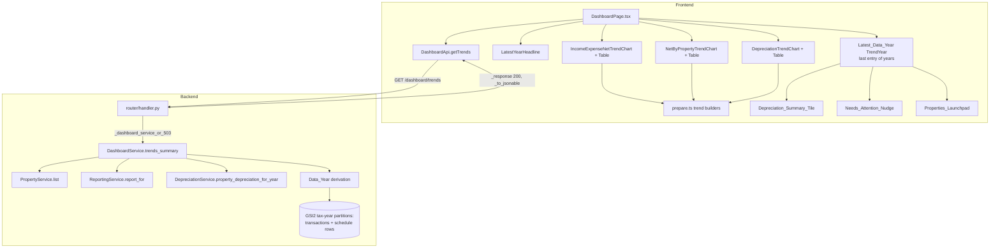

# Design Document

## Overview

This feature converts the Logstead main dashboard from a single-year, per-property view into a **portfolio-level, multi-year trends** view. It adds one new read-only backend endpoint (`GET /dashboard/trends`) and redesigns `DashboardPage.tsx` around a latest-year headline plus three multi-year trend charts, while preserving the empty state, the exact two-decimal-string money contract, and the code-split charting pattern.

The guiding constraint from the requirements is **reuse, not re-aggregation** (Req 6, 11): every figure the trends endpoint returns must be derived from the same per-(property, year) building blocks the existing `DashboardService` already uses — `ReportingService.report_for(property_id, year)` for income/expense/net and `DepreciationService.property_depreciation_for_year(property_id, year)` for Schedule E Line 18 depreciation — so trends always reconcile to the cent with the per-property Schedule E reports. The new logic lives as new method(s) on the existing `DashboardService`, not a parallel aggregation path.

The one genuinely new backend concern is deriving the **set of Data_Years** — the years that actually have Schedule E data — from persisted data (Req 2). Everything else is a deliberate loop over (property, Data_Year) reusing existing derivations (Req 11).

### Design decisions and rationale

| Decision | Rationale | Requirements |
|---|---|---|
| Add `trends_summary()` to the existing `DashboardService`; do not create a new service | Reuses the per-(property, year) derivations the service already performs; keeps dashboard/report reconciliation by construction | 6.2, 6.3, 11.1 |
| Register `GET /dashboard/trends` using the existing `_dashboard_service_or_503` + `_response(200, ...)` pattern | Matches the three existing dashboard routes exactly (lazy import, 503-when-unavailable, user scoping via injected `PropertyService`) | 6.1, 6.6, 8 |
| Derive Data_Years from years that have **Schedule E data** (transactions + depreciation schedule rows), unioned across the user's properties | Req 2 defines Data_Year as "a Tax_Year for which the user has any Schedule E data" — distinct from the frontend's asset-in-service year range used for the (now-dropped) selector | 2.1, 2.2, 2.4 |
| Keep money as `util.money.Money` (two-decimal `Decimal`) in the service; serialize via the router's `_to_jsonable` which renders every `Decimal` as a two-decimal string | Preserves the existing exact-money contract end-to-end; no float, no DynamoDB `Number` | 7.1, 7.2 |
| Drop the `TaxYearSelector` and the duplicative single-year **data** tiles (PortfolioSnapshot, CombinedScheduleE, ranked NetByProperty, the full DepreciableAssets table) and all RentCast attributes, BUT keep the Latest_Data_Year `Depreciation_Summary_Tile` and the lightweight `Needs_Attention_Nudge` + `Properties_Launchpad` navigation tiles | The dashboard must stop duplicating property-detail content and become a trends view (Req 9); the span is now all years, not one selected year (Req 2). The retained tiles are portfolio-level or navigation-only — the latest-year Line 18 summary (Req 12) and link-list nudges (Req 9.5, 9.6) — adding at-a-glance and navigation value without re-introducing per-property per-line detail | 2, 9, 12 |
| New trend charts reuse `ChartCard` + `LazyChart` + `ChartErrorBoundary` + a Recharts-free data-table fallback | Keeps Recharts code-split out of the initial paint and the data always present | 3, 4, 5, 10 |

### Research notes (grounded in the existing codebase)

- `ReportingService.report_for(property_id, tax_year)` returns `Result[ScheduleEReport]`; `report.value.totals` carries `total_income`, `total_expenses`, `net` as two-decimal `Decimal`. A missing/unowned property yields a non-ok `Result` (`not_found`). `combined_report` already sums per-property totals into portfolio totals — the trends endpoint mirrors that summation per year rather than calling it, so it can skip missing property-years the same way `DashboardService` already does.
- `DashboardService.per_property_summary()` already loops `PropertyService.list()`, calls `report_for`, and **`continue`s past a non-ok report** rather than failing. The trends logic reuses this exact skip semantics (Req 6.7).
- `DepreciationService.property_depreciation_for_year(property_id, tax_year)` returns the two-decimal `Money` that feeds Schedule E Line 18, and returns `0.00` when there is no depreciation that year.
- Transaction tax year is derivable from a transaction's `date` (`YYYY-MM-DD`); the repo also exposes a GSI2 tax-year partition (`gsi2_year_pk(property_id, year)`). Depreciation schedule rows are persisted per (asset, tax_year) and are queryable by the same GSI2 tax-year partition (`gsi2_schedule_prefix`).
- The router's `_to_jsonable` already renders every `Decimal` as a plain decimal string and dataclasses field-by-field — so returning a dataclass tree of `Money` values yields the required two-decimal-string JSON with no new serialization code.
- Frontend: `formatMoney`/`isLoss` from `lib/money`; charts plot **integer cents** via `toCents` at the `prepare.ts` boundary; `ChartCard` keeps the `dataTable` always in the DOM and hides the chart below the `sm` breakpoint; `LazyChart` wraps the lazy chart in `ChartErrorBoundary` + `Suspense`.

## Architecture



Request flow:

1. `DashboardPage` calls `DashboardApi.getTrends()` on mount (no year argument — the span is all Data_Years, Req 2).
2. The router matches `GET /dashboard/trends`, constructs the user-scoped `DashboardService` via `_dashboard_service_or_503(wiring, user)` (503 if the service is unavailable, Req 6.1), calls `trends_summary()`, and returns `_response(200, result)`.
3. `trends_summary()` derives the ordered set of Data_Years, lists the user's properties once, and loops (property × Data_Year) reusing `report_for` and `property_depreciation_for_year` to build the `TrendsSeries` (Req 11.1).
4. `_to_jsonable` serializes every `Money`/`Decimal` as a two-decimal string (Req 7.1, 7.2).
5. The page renders the latest-year headline from the series' last entry and the three trend charts (each `ChartCard` + `LazyChart` + always-present data table).
6. The `Depreciation_Summary_Tile` (Req 12), `Needs_Attention_Nudge` (Req 9.5/9.6), and `Properties_Launchpad` (Req 9.5/9.6) are all derived from the **last (Latest_Data_Year) `TrendYear`** of the same single `getTrends()` fetch — no extra endpoint and no extra fetch. The summary tile reconciles exactly with that year's `depreciation_total` (so it equals the depreciation trend's last point), and the nudge/launchpad read that year's per-property points.

### Data_Year derivation (Req 2)

Data_Years are the tax years for which the authenticated user has **any Schedule E data**, unioned across all owned properties. Schedule E data for a property-year exists when either:

- the property has one or more **transactions** in that tax year (income lines 3–4, expense lines 5–17, 19), or
- the property has one or more **depreciation schedule rows** in that tax year (which feed Line 18).

Derivation algorithm (one pass per property, reusing existing query paths):

```
data_years: set[int] = {}
for prop in PropertyService.list():
    # transaction years: list the property's transactions (all years) and
    # collect int(txn.date[:4]); or scan GSI2 tax-year partitions.
    for txn in TransactionService.list_for_property(prop.id).value:
        data_years.add(int(txn.date[:4]))
    # depreciation years: collect tax_year from the property's materialized
    # schedule rows (DepreciationService.schedule_for per asset, or a
    # year-scoped scan).
    for asset in DepreciationService.list_assets(prop.id):
        for row in DepreciationService.schedule_for(prop.id, asset.id):
            data_years.add(row.tax_year)
ordered = sorted(data_years)   # ascending, no gaps inserted, no cap
```

Key properties of this derivation, tied to requirements:

- The result is the **union** of per-property data years, sorted ascending (Req 2.3), with each Data_Year present exactly once (Req 2.2).
- Non-contiguous years are preserved as-is — gap years with no data are **not** filled in (Req 2.4).
- No fixed window or cap is applied; the series ranges from one Data_Year up to the full count (Req 2.5).
- When the user owns no properties, the loop never runs, so the set is empty and the series is empty (Req 11.4).
- This is deliberately distinct from the frontend's current `taxYearRange()` (earliest depreciable-asset in-service year → current year), which produced a *selectable* range for the dropped selector; Data_Years come strictly from years with actual Schedule E data.

> Assumption to confirm: a year that has **only** depreciation schedule rows (an asset in service, but no income/expense transactions yet) counts as a Data_Year, because Line 18 is Schedule E data. The design includes depreciation-schedule years in the union on that basis. If the user prefers Data_Years to be transaction-years only, the depreciation branch is removed from the union (depreciation still contributes `0.00`/its value within whatever years the transaction set defines).

### N-properties × M-years loop (Req 11)

`trends_summary()` performs the derivation deliberately and exactly once per (property, Data_Year) pair:

```
properties = PropertyService.list()
if not properties:
    return TrendsSummary(series=())          # Req 11.4
data_years = derive_data_years(properties)   # ascending ints
series = []
for year in data_years:                      # M years
    port_income = port_expenses = port_net = Decimal("0.00")
    port_depreciation = Decimal("0.00")
    per_property = []
    for prop in properties:                   # N properties
        report = reports.report_for(prop.id, year)
        if not report.is_ok:                  # Req 6.7 skip, no persistence change
            zero = Decimal("0.00")            # contributes 0.00 (Req 11.3)
            per_property.append(
                PropertyYearPoint(prop.id, prop.name, zero, zero, zero))
            continue
        totals = report.value.totals
        port_income    += totals.total_income
        port_expenses  += totals.total_expenses
        port_net       += totals.net
        per_property.append(PropertyYearPoint(
            prop.id, prop.name,
            totals.total_income, totals.total_expenses, totals.net))
        port_depreciation += depreciation.property_depreciation_for_year(prop.id, year)
    series.append(TrendYear(year, port_income, port_expenses, port_net,
                            per_property, port_depreciation))
return TrendsSummary(series=tuple(series))
```

- Each (property, Data_Year) pair reuses `report_for` once and `property_depreciation_for_year` once (Req 11.1).
- A property with no data for a Data_Year yields `report_for` totals of `0.00` (empty report) — or, if `report_for` is non-ok for that property-year, the skip path still contributes `0.00` net — so the property remains a series with `0.00` (Req 4.2, 11.3) and the portfolio totals are unaffected by it.
- Portfolio net for a year is accumulated as the exact sum of per-property nets (Req 6.5, 7.5); because each per-property net is `report_for(...).totals.net`, the per-property figures equal the Schedule E report to the cent (Req 6.3, 7.4).
- Depreciation per year is the sum across properties of `property_depreciation_for_year` (Req 6.4).

At single-user scale this O(N×M) loop is intentional and predictable; no caching or materialized aggregate is introduced (Req 6.2).

## Components and Interfaces

### Backend

**`DashboardService.trends_summary()` (new method, `backend/src/logstead/services/dashboard.py`)**

```python
def trends_summary(self) -> TrendsSummary:
    """Portfolio-level, multi-year trends across every Data_Year (Req 2, 6, 11).

    Reuses report_for / property_depreciation_for_year per (property, year),
    skips a non-ok report-year like the existing summaries (Req 6.7), and
    returns an empty series when the user owns no properties (Req 11.4).
    """
```

- No new write path, no data-model change (Req 6.1, 6.2).
- User scoping is inherited from the injected `PropertyService` (Req 6.6), exactly like `portfolio_summary`/`asset_summary`.
- A small private helper `_derive_data_years(properties) -> list[int]` encapsulates the union-and-sort described above.

**Router (`backend/src/logstead/router/handler.py`)**

- New handler `_dashboard_trends(wiring, user, params, body, query)` mirroring `_dashboard_portfolio`:
  ```python
  def _dashboard_trends(wiring, user, params, body, query) -> dict[str, Any]:
      service = _dashboard_service_or_503(wiring, user)
      return _response(200, service.trends_summary())
  ```
  No `taxYear` query param — the span is all Data_Years (Req 2).
- Route-table registration alongside the existing dashboard routes:
  ```python
  ("GET", "/dashboard/trends", _dashboard_trends, False),
  ```
  Placed in the `# Dashboard` block with the other three `GET /dashboard/*` routes (segment count 2, distinct literal `trends`, so no collision under `_match_path`).
- Serialization is handled by the existing `_to_jsonable`: the `TrendsSummary` dataclass tree is rendered field-by-field with every `Money`/`Decimal` as a two-decimal string (Req 7.1, 7.2). No bespoke serializer.

### Frontend

**`DashboardApi.getTrends()` (new, `frontend/src/api/dashboard.ts`)**

```ts
export interface PropertyYearPoint {
  readonly property_id: string;
  readonly property_name: string;
  /** All fixed two-decimal strings (Req 7.3); net negative denotes a loss. */
  readonly total_income: string;
  readonly total_expenses: string;
  readonly net: string;
}

export interface TrendYear {
  readonly tax_year: number;
  readonly total_income: string;      // fixed two-decimal strings (Req 7.3)
  readonly total_expenses: string;
  readonly net: string;
  readonly properties: readonly PropertyYearPoint[];
  readonly depreciation_total: string;
}

export interface TrendsSeries {
  /** Ascending by tax_year; exactly the Data_Years, no gaps, no cap. */
  readonly years: readonly TrendYear[];
}

class DashboardApi {
  getTrends(signal?: AbortSignal): Promise<TrendsSeries> {
    return this.client.get<TrendsSeries>("/dashboard/trends", { signal });
  }
}
```

Every monetary field is typed as a fixed two-decimal `string` (Req 7.3); no field is a number except `tax_year`.

**`DashboardPage.tsx` (redesigned)**

The page fetches `getTrends()` once on mount and renders, in order:

1. **LatestYearHeadline** — the `net` of the last entry in `years` (the Latest_Data_Year), labeled with that four-digit year, formatted via `formatMoney`, with loss styling via `isLoss` (Req 1). Rendered only when the user owns properties *and* `years` is non-empty (Req 8.3, 8.5).
2. **Trends section** — three `ChartCard`s, each with a `LazyChart` (lazy Recharts chunk) and an always-present data-table fallback:
   - `IncomeExpenseNetTrendChart` + `IncomeExpenseNetTrendTable` (Req 3)
   - `NetByPropertyTrendChart` + `NetByPropertyTrendTable` (Req 4)
   - `DepreciationTrendChart` + `DepreciationTrendTable` (Req 5)
3. **Depreciation_Summary_Tile** — the Latest_Data_Year's `depreciation_total` formatted via `formatMoney`, plus a count of that year's per-property points with a non-zero depreciation contribution; derived from the last `TrendYear` so it reconciles exactly with the depreciation trend's last point (Req 12).
4. **Needs_Attention_Nudge** — a link list of the Latest_Data_Year's properties with no income recorded (`total_income == "0.00"`), each a navigation link into that property's detail page; shows a positive confirmation when none need attention (Req 9.5, 9.6).
5. **Properties_Launchpad** — one navigation link per owned property into its detail page, optionally annotated with that property's Latest_Data_Year `net`; a link list, not a per-line table (Req 9.5, 9.6).
6. **QuickActions** — the retained quick-actions tile (Req 9.5).

   Items 3–6 are all derived from the single `getTrends()` series — specifically its last (Latest_Data_Year) entry — and are shown only when the user owns properties *and* `years` is non-empty; all four are suppressed in the zero-Data_Years state (Req 12.5, 8).
7. **Empty / no-data states**:
   - zero properties → `DashboardEmptyState` only (Req 8.1, 8.2, 8.3)
   - properties but zero Data_Years → a no-data indication for the trends section, no headline, no charts, no error (Req 8.4, 8.5, 8.6)

**Dashboard tile disposition**

Each tile the current single-year dashboard renders is dispositioned as follows. KEEP = retained as-is; KEEP-AS-LINK = retained but reduced to a navigation link-list (no per-property per-line data table); CONVERT-TO-TREND = replaced by a multi-year trend chart; DROP = removed.

| Current tile | Disposition | Rationale |
|---|---|---|
| `TaxYearSelector` | DROP | Span is all Data_Years, not one selected year (Req 2) |
| `PortfolioSnapshotTile` (single-year totals + chart) | DROP | Superseded by the latest-year headline + the income/expense/net trend (Req 9.2, 1, 3) |
| `CombinedScheduleETile` (single-year totals) | DROP | Duplicative single-year combined totals (Req 9.2) |
| `NetByPropertyTile` (ranked single-year) | CONVERT-TO-TREND | Becomes the multi-year `Net_By_Property_Trend_Chart` (Req 4) |
| `DepreciationTile` (single-year Line 18) | KEEP | Retained as the `Depreciation_Summary_Tile` for the Latest_Data_Year, now paired with the new `Depreciation_Trend_Chart` (Req 12, 5) |
| `DepreciableAssetsTile` (full per-property table) | DROP | Per-property per-line detail is owned by the property pages (Req 9.1) |
| `NeedsAttentionTile` | KEEP-AS-LINK | Becomes the `Needs_Attention_Nudge` (Latest_Data_Year, link list) (Req 9.5, 9.6) |
| `PropertiesLaunchpadTile` | KEEP-AS-LINK | Becomes the `Properties_Launchpad` (Latest_Data_Year, link list) (Req 9.5, 9.6) |
| `QuickActionsTile` | KEEP | Allowed non-chart tile (Req 9.5) |
| `DashboardEmptyState` | KEEP | Empty-state guidance preserved (Req 8) |

**New chart + table modules (`frontend/src/components/charts/`)**

Three new lazy chart components (default-exported so they can be `React.lazy`-imported, keeping Recharts in the lazy chunk) and three new Recharts-free table modules, each following the existing `IncomeExpenseNetChart`/`NetByPropertyTable` pattern exactly:

| Chart (lazy) | Table (eager, Recharts-free) | X axis | Series |
|---|---|---|---|
| `IncomeExpenseNetTrendChart` | `IncomeExpenseNetTrendTable` | Data_Year (ascending) | income, expenses, net |
| `NetByPropertyTrendChart` | `NetByPropertyTrendTable` | Data_Year (ascending) | one line per property |
| `DepreciationTrendChart` | `DepreciationTrendTable` | Data_Year (ascending) | portfolio Line 18 total |

Each is wrapped by the page in `ChartCard` (accessible `title` + `ariaLabel`, Req 10.1) and `LazyChart` (`ChartErrorBoundary` + `Suspense`, Req 10.3), with the data table passed as both `ChartCard.dataTable` and `LazyChart.fallbackTable` so it is always in the DOM (Req 3.3, 4.4, 5.3) and the fallback on error (Req 10.3) or below `sm` (Req 10.5).

**New `prepare.ts` trend builders**

Add trend builders alongside the existing ones, all crossing the Money_String → integer-cents boundary via `toCents` (no float, Req 10.4):

```ts
export interface TrendPointDatum { year: number; income: number; expenses: number; net: number; } // cents
export function incomeExpenseNetTrend(series: TrendsSeries): TrendPointDatum[];

export interface PropertyTrendSeries { label: string; propertyId: string; points: { year: number; cents: number }[]; }
export function netByPropertyTrend(series: TrendsSeries): PropertyTrendSeries[]; // one series per property, 0.00→0 cents for missing years

export interface DepreciationTrendDatum { year: number; cents: number; }
export function depreciationTrend(series: TrendsSeries): DepreciationTrendDatum[];
```

The net-by-property builder emits exactly one series per property across all Data_Years, filling a property's missing year with `0` cents (from the backend's `0.00`, Req 4.2). For duplicate display names, the builder derives a unique label by suffixing a disambiguator (e.g. the property id / a running index) so each series is distinct (Req 4.5).

## Data Models

No persisted data model changes (Req 6.2). The feature adds in-memory/transport shapes only.

**Backend dataclasses (new, in `dashboard.py`)** — all money fields are `Money` (two-decimal `Decimal`), serialized as two-decimal strings by `_to_jsonable`:

```python
@dataclass(frozen=True)
class PropertyYearPoint:
    property_id: str
    property_name: str
    total_income: Money        # == report_for(...).totals.total_income
    total_expenses: Money      # == report_for(...).totals.total_expenses
    net: Money                 # negative denotes a loss

@dataclass(frozen=True)
class TrendYear:
    tax_year: int
    total_income: Money
    total_expenses: Money
    net: Money                 # == sum of per-property nets for the year
    properties: tuple[PropertyYearPoint, ...]
    depreciation_total: Money  # portfolio Schedule E Line 18 total

@dataclass(frozen=True)
class TrendsSummary:
    years: tuple[TrendYear, ...]   # ascending by tax_year; exactly the Data_Years
```

JSON shape returned by `GET /dashboard/trends` (money as fixed two-decimal strings):

```json
{
  "years": [
    {
      "tax_year": 2022,
      "total_income": "32000.00",
      "total_expenses": "28500.00",
      "net": "3500.00",
      "properties": [
        { "property_id": "p1", "property_name": "Maple St", "total_income": "20000.00", "total_expenses": "18000.00", "net": "2000.00" },
        { "property_id": "p2", "property_name": "Oak Ave", "total_income": "12000.00", "total_expenses": "10500.00", "net": "1500.00" }
      ],
      "depreciation_total": "4100.00"
    },
    {
      "tax_year": 2024,
      "total_income": "35000.00",
      "total_expenses": "40000.00",
      "net": "-5000.00",
      "properties": [
        { "property_id": "p1", "property_name": "Maple St", "total_income": "35000.00", "total_expenses": "40000.00", "net": "-5000.00" },
        { "property_id": "p2", "property_name": "Oak Ave", "total_income": "0.00", "total_expenses": "0.00", "net": "0.00" }
      ],
      "depreciation_total": "4100.00"
    }
  ]
}
```

(Note the 2023 gap is omitted — non-contiguous Data_Years are preserved, Req 2.4 — and a property with no data in a year appears with all three figures `"0.00"`, Req 4.2/11.3.)

Each per-property point now carries `total_income`, `total_expenses`, and `net` (renamed `PropertyYearPoint`), not net alone. This is cheap — all three already exist on `report_for(...).totals` inside the loop — and lets the `Needs_Attention_Nudge` key off "no income recorded" (`total_income == "0.00"`) correctly, rather than off `net == "0.00"` which is ambiguous (a property can record income and still net exactly zero). Carrying income and expenses alongside net does not change the money contract (still exact two-decimal strings) or any reconciliation property: per-property `net` still equals `total_income − total_expenses` from the same report, and the portfolio totals are still the exact-cent sums.

**Frontend TypeScript types**: `TrendsSeries`, `TrendYear`, `PropertyYearPoint` as shown under Components, every money field typed as `string` (Req 7.3).

## Correctness Properties

*A property is a characteristic or behavior that should hold true across all valid executions of a system — essentially, a formal statement about what the system should do. Properties serve as the bridge between human-readable specifications and machine-verifiable correctness guarantees.*

We apply property-based testing here because the trends endpoint is a **pure aggregation** over persisted per-(property, year) data with clear input/output behavior and strong universal invariants (reconciliation to the cent, exact sums, series shape, exact-money serialization). These are tested with Hypothesis on the backend and fast-check on the frontend data-preparation layer. The chart/headline/empty-state *rendering* branches are example/edge-case concerns and are covered by RTL unit tests in the Testing Strategy, not as properties.

The prework classified each criterion, and after reflection the overlapping reconciliation, exact-sum, series-shape, and money-string criteria were each consolidated into a single comprehensive property so that every property below carries unique validation value.

### Property 1: Per-property figures reconcile to the Schedule E report, to the cent

*For any* authenticated user, set of properties, transactions, and depreciation schedules, and *for any* Data_Year and property, the per-property `total_income`, `total_expenses`, and `net` returned in that year's Trends_Series entry equal the corresponding totals from `ReportingService.report_for(property_id, year)` for the same property and year with zero cent difference.

**Validates: Requirements 6.3, 7.4**

### Property 2: Portfolio net is the exact-cent sum of per-property nets

*For any* Data_Year, the Trends_Series entry's portfolio `net` equals the exact-cent sum of that year's per-property nets, with zero rounding difference across all properties.

**Validates: Requirements 6.5, 7.5**

### Property 3: Portfolio depreciation is the exact sum across properties

*For any* Data_Year, the Trends_Series entry's `depreciation_total` equals the exact-cent sum over the user's properties of `DepreciationService.property_depreciation_for_year(property_id, year)`.

**Validates: Requirements 6.4**

### Property 4: The series contains exactly the Data_Years, ascending, no gaps, no cap

*For any* persisted data, the set of `tax_year` values in the Trends_Series equals the set of Data_Years (years with any Schedule E data) for the user, contains no duplicates, is in strictly ascending order, inserts no entry for a gap year that has no data, and is subject to no fixed window or cap (one Data_Year up to the full count).

**Validates: Requirements 2.1, 2.2, 2.3, 2.4, 2.5**

### Property 5: A property with no data in a Data_Year contributes 0.00 and still appears

*For any* Data_Year in which a given property has no Schedule E data (or whose report is non-ok), that property contributes `0.00` to the year's income, expenses, net, and depreciation totals, and still appears as a point (`net == "0.00"`) in that year's per-property list.

**Validates: Requirements 4.2, 11.3, 6.7**

### Property 6: Every figure is a two-decimal money string — never a float or Number

*For any* generated Trends_Series, every monetary field in the serialized JSON (`total_income`, `total_expenses`, `net`, each property `net`, `depreciation_total`) is a JSON string matching `^-?\d+\.\d{2}$`, and no monetary field is serialized as a floating-point value or a DynamoDB `Number`.

**Validates: Requirements 7.1, 7.2**

### Property 7: Every series year is total — all figures present, non-null, two-decimal

*For any* Trends_Series entry, every one of portfolio income, portfolio expenses, portfolio net, each property's net, and the portfolio depreciation total carries a defined, non-null two-decimal money value (no missing or null figure).

**Validates: Requirements 11.2**

### Property 8: User scoping — no cross-user leakage

*For any* two users with their own properties and data, the Trends_Series derived for one user contains only that user's property-years and never includes any property or figure belonging to the other user.

**Validates: Requirements 6.6**

### Property 9: Each per-(property, year) derivation runs exactly once per pair

*For any* set of properties and Data_Years, building the Trends_Series invokes `report_for` exactly once and `property_depreciation_for_year` exactly once for each (property, Data_Year) pair — no more, no fewer.

**Validates: Requirements 11.1**

### Property 10: No properties yields an empty series

*For any* user who owns zero properties, the Trends_Series is empty (`years == ()`).

**Validates: Requirements 11.4**

### Property 11: Net-by-property preparation yields one full series per property with unique labels

*For any* Trends_Series, `netByPropertyTrend` produces exactly one series per owned property, each series carrying one point per Data_Year (a missing year rendered as `0` cents from the backend's `0.00`), and where two or more properties share a display name the resulting series labels are all distinct.

**Validates: Requirements 4.1, 4.2, 4.5**

### Property 12: Chart and data-table render identical money for the same datum

*For any* integer-cents value, the string a trend chart renders (`formatMoney(centsToMoney(cents))`) is identical to the string its Data_Table_Fallback renders for the same datum — same numeric value, precision, and currency formatting.

**Validates: Requirements 10.4**

### Property 13: Depreciation summary reconciles exactly with the depreciation trend's last point

*For any* Trends_Series with at least one Data_Year, the `Depreciation_Summary_Tile`'s total equals the `depreciation_total` of the Latest_Data_Year (last) Trends_Series entry to the exact cent, and its property count equals the number of that entry's per-property points with a non-zero depreciation contribution for the Latest_Data_Year — so the summary is derived from, and reconciles exactly with, the depreciation trend's final point.

**Validates: Requirements 12.1, 12.3, 12.4**

## Error Handling

The feature introduces no new error surface beyond the existing dashboard pattern.

- **Service unavailable**: if `DashboardService` cannot be constructed, `_dashboard_service_or_503` raises a `_RouterError(503, ...)` and the route returns `503` — identical to the existing `GET /dashboard`, `GET /dashboard/properties`, `GET /dashboard/assets` behavior (Req 6.1 parity).
- **Missing / unowned property-year**: `report_for` returning a non-ok `Result` is handled inside `trends_summary()` by contributing `0.00` for that property-year and continuing, mirroring the existing `per_property_summary` skip (`continue`) semantics. The request never fails and no persisted data is created or modified (Req 6.7).
- **Auth**: the route is protected (`public=False`); a missing/invalid identity maps to `401` via the existing `current_user`/`AuthError` path. No new logic.
- **No `taxYear` param**: the trends route takes no `taxYear` (span is all Data_Years), so there is no integer-parse error path to add.
- **Frontend fetch failure**: `DashboardPage` catches a failed `getTrends()` (ignoring `AbortError`) and shows the existing dashboard error indication, leaving the empty-state and no-data paths untouched.
- **Chart render failure**: each trend chart is wrapped in `ChartErrorBoundary` via `LazyChart`; a failing chart falls back to its always-present data table plus a visible "chart unavailable" notice, and the other charts and the rest of the page stay rendered (Req 10.3).
- **No-data vs. error distinction**: a user with properties but zero Data_Years renders a calm no-data indication, explicitly **not** an error indication (Req 8.4).

## Testing Strategy

The project's existing stack is reused: **backend** pytest + Hypothesis + moto with injected collaborators; **frontend** vitest + fast-check + React Testing Library (RTL). Property tests follow the existing conventions in `backend/.hypothesis/` and the `*.property.test.ts(x)` files in `frontend/src/components/charts/`.

### Property-based tests (reuse Hypothesis / fast-check)

- A property-based testing library is used for every property above; properties are **not** reimplemented from scratch.
- Each property test runs a **minimum of 100 iterations**.
- Each property test is tagged with a comment referencing its design property, format:
  `# Feature: dashboard-year-over-year-trends, Property {number}: {property_text}`
  (JS/TS uses `//`).
- Each correctness property is implemented by a **single** property-based test.

Backend (pytest + Hypothesis + moto), using injected fake/counting collaborators the way `ReportingService`/`DashboardService` already accept injected services:

- Property 1, 2, 3, 5, 7, 8, 9, 10 — Hypothesis strategies generate users, properties (including duplicate names and a property with no data), transactions across random (possibly non-contiguous) tax years, and depreciation schedule rows; the trends summary is built against moto-backed repositories and compared to `report_for` / `property_depreciation_for_year` directly. Property 9 injects counting fakes to assert exactly-once invocation per (property, Data_Year) pair.
- Property 4 — a generator that deliberately produces gap years asserts the series years equal the sorted Data_Year set with no gaps, no duplicates, no cap.
- Property 6 — the handler serializes the summary through `_to_jsonable`; the test asserts every money field in the resulting JSON is a string matching `^-?\d+\.\d{2}$` and no field is a float/number.

Frontend (vitest + fast-check):

- Property 11 — fast-check generates `TrendsSeries` values (including duplicate property names and properties missing some years) and asserts `netByPropertyTrend` yields one full, uniquely-labeled series per property.
- Property 12 — fast-check over integer cents asserts the shared `formatMoney(centsToMoney(cents))` path renders identical strings for chart and table.

### Unit / example tests

Backend router (pytest + moto), mirroring the existing dashboard route tests:

- `GET /dashboard/trends` returns `200` with the documented year-indexed shape and ascending years (Req 2.6).
- Money fields in the response are two-decimal strings (Req 7.1–7.2 spot check).
- User scoping: a second user's data never appears (Req 6.6 example alongside Property 8).
- `503` parity when the dashboard service is unavailable, matching the sibling routes (Req 6.1).
- Read-only: the request mutates nothing in the moto-backed table (Req 6.1, 6.2 smoke).

Frontend `DashboardPage` (RTL), covering the UI branches classified EXAMPLE/EDGE_CASE in the prework:

- Headline: exactly one figure, labeled with the latest Data_Year, formatted via `formatMoney`, with loss styling for a negative net and none for a non-negative net (Req 1.1–1.5).
- Three trend charts present, each inside a `ChartCard` with an accessible `role="img"` + `aria-label` (Req 10.1), each behind a `React.lazy` boundary with its data-table fallback always in the DOM (Req 3.2/3.3, 4.3/4.4, 5.2/5.3, 10.2).
- Each data-table fallback has one row per Data_Year in ascending order with the correct figures (Req 2.6, 3.1, 3.3, 4.4, 5.1, 5.3); a negative year shows a textual loss cue (Req 3.4).
- Empty state: zero properties → `DashboardEmptyState` only, no headline, no charts (Req 8.1–8.3).
- No-data state: properties but zero Data_Years → calm no-data indication, no headline, no charts, **no** error (Req 8.4–8.6).
- Dropped content: the single-year per-property breakdown and its children, single-property-single-year tiles/charts, and RentCast attributes are all absent (Req 9.1–9.5).
- `Depreciation_Summary_Tile`: renders the Latest_Data_Year's Line 18 total (formatted via `formatMoney`) and the count of properties with a non-zero depreciation contribution that year; the value matches the depreciation trend's last point; the tile is suppressed in the zero-Data_Years state (Req 12.1–12.5).
- `Needs_Attention_Nudge`: for the Latest_Data_Year, renders one navigation link per property with `total_income == "0.00"` into that property's detail page, and shows the positive confirmation when none need attention (Req 9.5, 9.6).
- `Properties_Launchpad`: renders exactly one navigation link per owned property into its detail page, optionally annotated with that property's Latest_Data_Year net (Req 9.5, 9.6).
- `ChartErrorBoundary`: forcing a chart to throw renders its data-table fallback plus a visible notice while the other charts and the page remain (Req 10.3).
- Charts stay code-split: the initial render shows the data tables without pulling Recharts; the lazy boundary / fallback is asserted present (Req 10.2, 10.5 via the `ChartCard` below-`sm` fallback pattern).

Frontend `DashboardApi` (vitest):

- `getTrends()` calls `GET /dashboard/trends` (no `taxYear` query) and returns the typed `TrendsSeries`; money fields are strings at runtime and typed as fixed two-decimal strings (Req 7.3).

### Balance

The property-based tests carry the universal correctness load (reconciliation, exact sums, series shape, money strings, totality, scoping, exactly-once derivation). Unit/example tests cover the concrete UI states, the route contract, and the resilience/accessibility branches that are not universally quantified. This keeps the dashboard reconciled to the per-property Schedule E reports to the cent, money exact as two-decimal strings end-to-end, the empty state preserved, and the charts code-split.
