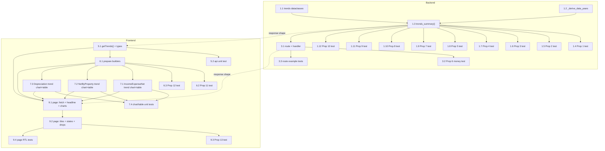

# Implementation Plan: Dashboard Year-over-Year Trends

## Overview

This plan converts the Logstead main dashboard from a single-year, per-property
view into a portfolio-level, multi-year trends view. It adds one read-only
backend endpoint (`GET /dashboard/trends`) built as new method(s) on the
existing `DashboardService`, and redesigns `DashboardPage.tsx` around a
latest-year headline plus three code-split trend charts, preserving the exact
two-decimal-string money contract and the existing `ChartCard` / `LazyChart` /
`ChartErrorBoundary` + data-table-fallback pattern.

The language is **Python 3.12** (backend) and **React 19 + TypeScript**
(frontend) — the design uses the real codebase, not pseudocode, so no language
selection is needed. The backend and frontend tracks proceed in parallel; only
the final page-wiring task depends on the real response shape being settled.

Testing reuses the project's existing stack: backend `pytest` + `Hypothesis` +
`moto` with injected collaborators (service tests in
`backend/tests/services/test_*_property.py`, route tests in
`backend/tests/router/test_*_route.py`); frontend `vitest` + `fast-check` + RTL
(`frontend/src/components/charts/*.property.test.ts(x)` and page tests). Run via
`make test` (or `cd backend && pytest`, `cd frontend && npx vitest --run`).
Every property-based test runs ≥100 iterations and is tagged
`# Feature: dashboard-year-over-year-trends, Property N: ...` (`//` in TS).

## Tasks

- [x] 1. Backend: trends dataclasses and `trends_summary()` on `DashboardService`
  - [x] 1.1 Add the trends transport dataclasses to `backend/src/logstead/services/dashboard.py`
    - Add frozen dataclasses `PropertyYearPoint` (`property_id: str`, `property_name: str`, `total_income: Money`, `total_expenses: Money`, `net: Money`), `TrendYear` (`tax_year: int`, `total_income: Money`, `total_expenses: Money`, `net: Money`, `properties: tuple[PropertyYearPoint, ...]`, `depreciation_total: Money`), and `TrendsSummary` (`years: tuple[TrendYear, ...]`)
    - Keep every money field as `util.money.Money` (two-decimal `Decimal`), mirroring the existing `PropertySummary` dataclass
    - Export the three names in `__all__`
    - _Requirements: 6.2, 7.1, 11.2_
    - _Design: Data Models (backend dataclasses)_

  - [x] 1.2 Implement `_derive_data_years(properties)` private helper on `DashboardService`
    - Build the ascending list of Data_Years as the union across the user's properties of (a) tax years with transactions (`int(txn.date[:4])` over the property's transactions) and (b) tax years with depreciation schedule rows (`row.tax_year` across the property's assets/schedules), reusing the existing transaction and depreciation query paths
    - Sort ascending, de-duplicate, insert no gap years, apply no cap; empty when the user owns no properties
    - _Requirements: 2.1, 2.2, 2.3, 2.4, 2.5, 11.4_
    - _Design: Data_Year derivation (Req 2)_

  - [x] 1.3 Implement `trends_summary()` on `DashboardService`
    - List the user's properties once (user-scoped via the injected `PropertyService`); return `TrendsSummary(years=())` immediately when there are no properties
    - For each Data_Year, loop properties: call `self._reports.report_for(prop.id, year)` once and `self._depreciation.property_depreciation_for_year(prop.id, year)` once per (property, Data_Year); on a non-ok report, contribute `0.00` and still append a `PropertyYearPoint` with `net == "0.00"` (mirror the existing `per_property_summary` skip), never mutating persisted data
    - Accumulate portfolio `total_income`/`total_expenses`/`net` as exact-cent sums of the per-property report totals, and `depreciation_total` as the exact-cent sum of per-property depreciation; carry each via `to_money`
    - _Requirements: 6.1, 6.3, 6.4, 6.5, 6.6, 6.7, 11.1, 11.3_
    - _Design: N-properties × M-years loop (Req 11); Components and Interfaces (backend)_

  - [x]* 1.4 Property test — per-property figures reconcile to the Schedule E report
    - **Property 1: Per-property figures reconcile to the Schedule E report, to the cent**
    - **Validates: Requirements 6.3, 7.4**
    - New `backend/tests/services/test_trends_reconciliation_property.py`; Hypothesis generates properties/transactions/depreciation against moto-backed repos; assert each `PropertyYearPoint`'s income/expenses/net equals `report_for(prop.id, year).value.totals` to the cent

  - [x]* 1.5 Property test — portfolio net is the exact-cent sum of per-property nets
    - **Property 2: Portfolio net is the exact-cent sum of per-property nets**
    - **Validates: Requirements 6.5, 7.5**
    - New `backend/tests/services/test_trends_portfolio_net_property.py`

  - [x]* 1.6 Property test — portfolio depreciation is the exact sum across properties
    - **Property 3: Portfolio depreciation is the exact sum across properties**
    - **Validates: Requirements 6.4**
    - New `backend/tests/services/test_trends_depreciation_sum_property.py`; assert each year's `depreciation_total` equals the summed `property_depreciation_for_year`

  - [x]* 1.7 Property test — series contains exactly the Data_Years, ascending, no gaps, no cap
    - **Property 4: The series contains exactly the Data_Years, ascending, no gaps, no cap**
    - **Validates: Requirements 2.1, 2.2, 2.3, 2.4, 2.5**
    - New `backend/tests/services/test_trends_data_years_property.py`; generator deliberately produces non-contiguous years

  - [x]* 1.8 Property test — a property with no data in a Data_Year contributes 0.00 and still appears
    - **Property 5: A property with no data in a Data_Year contributes 0.00 and still appears**
    - **Validates: Requirements 4.2, 11.3, 6.7**
    - New `backend/tests/services/test_trends_zero_contribution_property.py`

  - [x]* 1.9 Property test — every series year is total (all figures present, non-null, two-decimal)
    - **Property 7: Every series year is total — all figures present, non-null, two-decimal**
    - **Validates: Requirements 11.2**
    - New `backend/tests/services/test_trends_totality_property.py`

  - [x]* 1.10 Property test — user scoping, no cross-user leakage
    - **Property 8: User scoping — no cross-user leakage**
    - **Validates: Requirements 6.6**
    - New `backend/tests/services/test_trends_scoping_property.py`; build two users' data; assert one user's series contains only that user's property-years

  - [x]* 1.11 Property test — each per-(property, year) derivation runs exactly once per pair
    - **Property 9: Each per-(property, year) derivation runs exactly once per pair**
    - **Validates: Requirements 11.1**
    - New `backend/tests/services/test_trends_exactly_once_property.py`; inject counting fakes for `report_for` and `property_depreciation_for_year` and assert exactly-once invocation per (property, Data_Year) pair

  - [x]* 1.12 Property test — no properties yields an empty series
    - **Property 10: No properties yields an empty series**
    - **Validates: Requirements 11.4**
    - New `backend/tests/services/test_trends_empty_series_property.py`; assert `trends_summary().years == ()`

- [x] 2. Checkpoint — backend service
  - Ensure all tests pass, ask the user if questions arise.

- [x] 3. Backend: register the `GET /dashboard/trends` route
  - [x] 3.1 Add the `_dashboard_trends` handler and route registration in `backend/src/logstead/router/handler.py`
    - Add `_dashboard_trends(wiring, user, params, body, query)` mirroring `_dashboard_portfolio`: `service = _dashboard_service_or_503(wiring, user); return _response(200, service.trends_summary())` — no `taxYear` param
    - Register `("GET", "/dashboard/trends", _dashboard_trends, False)` in the `# Dashboard` block alongside the three existing `GET /dashboard/*` routes; rely on the existing `_to_jsonable` to serialize every `Money`/`Decimal` as a two-decimal string
    - _Requirements: 6.1, 6.6, 7.1, 7.2_
    - _Design: Components and Interfaces (router)_

  - [x]* 3.2 Property test — every figure is a two-decimal money string, never a float/Number
    - **Property 6: Every figure is a two-decimal money string — never a float or Number**
    - **Validates: Requirements 7.1, 7.2**
    - New `backend/tests/router/test_trends_money_property.py`; serialize the summary through the handler / `_to_jsonable` and assert every money field matches `^-?\d+\.\d{2}$` and no money field is a float or `Number`

  - [x]* 3.3 Route example tests for `GET /dashboard/trends`
    - New `backend/tests/router/test_dashboard_trends_route.py` mirroring `test_dashboard_assets_route.py`: 200 with the documented year-indexed shape and ascending years (Req 2.6); money fields are two-decimal strings (Req 7.1/7.2 spot check); a second user's data never appears (Req 6.6); 503 parity when the dashboard service is unavailable (Req 6.1); read-only — the moto-backed table is unchanged (Req 6.1/6.2)
    - _Requirements: 2.6, 6.1, 6.2, 6.6, 7.1, 7.2_

- [x] 4. Checkpoint — backend endpoint
  - Ensure all tests pass, ask the user if questions arise.

- [x] 5. Frontend: trends API types and `getTrends()`
  - [x] 5.1 Add trends types and `getTrends()` to `frontend/src/api/dashboard.ts`
    - Add interfaces `PropertyYearPoint` (`property_id`, `property_name`, `total_income`, `total_expenses`, `net` — money fields as fixed two-decimal `string`), `TrendYear` (`tax_year: number`, money strings, `properties: readonly PropertyYearPoint[]`, `depreciation_total: string`), and `TrendsSeries` (`years: readonly TrendYear[]`)
    - Add `getTrends(signal?)` on `DashboardApi` calling `this.client.get<TrendsSeries>("/dashboard/trends", { signal })` with no `taxYear` query
    - _Requirements: 7.3_
    - _Design: Components and Interfaces (frontend DashboardApi)_

  - [x]* 5.2 Unit test — `getTrends()` calls the route and types money as strings
    - Extend/create the dashboard API vitest spec: assert `getTrends()` requests `GET /dashboard/trends` (no `taxYear` query) and returns a `TrendsSeries` whose money fields are strings at runtime
    - _Requirements: 7.3_

- [x] 6. Frontend: `prepare.ts` trend builders
  - [x] 6.1 Add the three trend builders to `frontend/src/components/charts/prepare.ts`
    - Add `incomeExpenseNetTrend(series): TrendPointDatum[]` (`{ year, income, expenses, net }` in cents), `netByPropertyTrend(series): PropertyTrendSeries[]` (one series per property; one point per Data_Year; a property's missing year → `0` cents from `0.00`; unique label per property, suffixing a disambiguator when display names collide), and `depreciationTrend(series): DepreciationTrendDatum[]` (`{ year, cents }`)
    - Cross the Money_String → integer-cents boundary exclusively via the existing `toCents` (no float)
    - _Requirements: 3.1, 4.1, 4.2, 4.5, 5.1, 10.4_
    - _Design: New prepare.ts trend builders_

  - [x]* 6.2 Property test — net-by-property preparation yields one full series per property with unique labels
    - **Property 11: Net-by-property preparation yields one full series per property with unique labels**
    - **Validates: Requirements 4.1, 4.2, 4.5**
    - Extend `frontend/src/components/charts/prepare.property.test.ts`; fast-check generates series with duplicate names and properties missing years

  - [x]* 6.3 Property test — chart and data-table render identical money for the same datum
    - **Property 12: Chart and data-table render identical money for the same datum**
    - **Validates: Requirements 10.4**
    - Extend `prepare.property.test.ts`; fast-check over integer cents asserts `formatMoney(centsToMoney(cents))` is identical for the chart and table paths

- [x] 7. Frontend: trend chart components and Recharts-free table fallbacks
  - [x] 7.1 Add `IncomeExpenseNetTrendTable` and `IncomeExpenseNetTrendChart`
    - `frontend/src/components/charts/IncomeExpenseNetTrendTable.tsx`: Recharts-free table, one row per Data_Year (ascending) with income/expenses/net via `formatMoney(centsToMoney(...))`, a textual loss cue for negative net — following `IncomeExpenseNetTable.tsx`
    - `frontend/src/components/charts/IncomeExpenseNetTrendChart.tsx`: default-exported Recharts line/area chart over Data_Years using `useChartColors`; re-export the table
    - _Requirements: 3.1, 3.3, 3.4, 10.1, 10.4_
    - _Design: New chart + table modules_

  - [x] 7.2 Add `NetByPropertyTrendTable` and `NetByPropertyTrendChart`
    - `NetByPropertyTrendTable.tsx`: Recharts-free table, one row per Data_Year with one column per property series (unique labels), amounts via `formatMoney(centsToMoney(...))`
    - `NetByPropertyTrendChart.tsx`: default-exported Recharts multi-line chart, one line per property series across Data_Years; re-export the table — following the `NetByPropertyChart`/`NetByPropertyTable` pattern
    - _Requirements: 4.1, 4.2, 4.4, 4.5, 10.1, 10.4_
    - _Design: New chart + table modules_

  - [x] 7.3 Add `DepreciationTrendTable` and `DepreciationTrendChart`
    - `DepreciationTrendTable.tsx`: Recharts-free table, one row per Data_Year with the portfolio Line 18 total via `formatMoney(centsToMoney(...))`
    - `DepreciationTrendChart.tsx`: default-exported Recharts chart of the portfolio depreciation total across Data_Years; re-export the table
    - _Requirements: 5.1, 5.3, 10.1, 10.4_
    - _Design: New chart + table modules_

  - [x]* 7.4 Unit tests for the three trend chart/table modules
    - RTL/vitest specs mirroring `IncomeExpenseNetChart.test.tsx` / `NetByPropertyChart.test.tsx`: each table renders one row per Data_Year ascending with correct figures; negative net shows a textual loss cue; charts are default-exported (lazy-importable)
    - _Requirements: 3.1, 3.3, 3.4, 4.1, 4.2, 4.4, 5.1, 5.3_

- [x] 8. Checkpoint — frontend data + chart layer
  - Ensure all tests pass, ask the user if questions arise.

- [x] 9. Frontend: redesign `DashboardPage.tsx` and wire the trends view
  - [x] 9.1 Fetch trends and render the headline + three code-split charts
    - In `frontend/src/pages/DashboardPage.tsx`, fetch `dashboardApi.getTrends()` once on mount (ignore `AbortError`, show the existing error indication on failure); derive Latest_Data_Year as the last entry of `years`
    - Render `LatestYearHeadline` (Latest_Data_Year `net` via `formatMoney`, loss styling via `isLoss`, labeled with the four-digit year) only when properties exist and `years` is non-empty
    - Render the three trends inside `ChartCard` + `LazyChart`, each chart `React.lazy(() => import("./..."))` with its table passed as both `ChartCard.dataTable` and `LazyChart.fallbackTable` (data table always in the DOM; Recharts stays code-split), feeding `incomeExpenseNetTrend` / `netByPropertyTrend` / `depreciationTrend`
    - _Requirements: 1.1, 1.2, 1.3, 1.4, 1.5, 2.6, 3.1, 3.2, 3.3, 4.1, 4.3, 4.4, 5.1, 5.2, 5.3, 10.1, 10.2, 10.3, 10.5_
    - _Design: DashboardPage.tsx (redesigned); Architecture_

  - [x] 9.2 Render the retained portfolio/navigation tiles and the empty/no-data states; drop superseded tiles
    - From the Latest_Data_Year `TrendYear`: `Depreciation_Summary_Tile` (`depreciation_total` via `formatMoney` + count of per-property points with non-zero depreciation that year), `Needs_Attention_Nudge` (link per property with `total_income == "0.00"` into its detail page, positive confirmation when none), `Properties_Launchpad` (one detail-page link per property, optionally annotated with Latest_Data_Year `net`); keep `QuickActions`
    - Preserve `DashboardEmptyState` for zero properties (no headline, no charts); render a calm no-data indication (not an error) for properties-but-zero-Data_Years, suppressing headline, charts, and all four tiles
    - DROP `TaxYearSelector`, `PortfolioSnapshotTile`, `CombinedScheduleETile`, the single-year `NetByPropertyTile`, `DepreciableAssetsTile`, the per-property single-year breakdown table, and all RentCast attributes
    - _Requirements: 8.1, 8.2, 8.3, 8.4, 8.5, 8.6, 9.1, 9.2, 9.3, 9.4, 9.5, 9.6, 12.1, 12.2, 12.3, 12.4, 12.5_
    - _Design: Dashboard tile disposition_

  - [x]* 9.3 Property test — depreciation summary reconciles exactly with the depreciation trend's last point
    - **Property 13: Depreciation summary reconciles exactly with the depreciation trend's last point**
    - **Validates: Requirements 12.1, 12.3, 12.4**
    - New `frontend/src/pages/DashboardPage.property.test.tsx` (or a page-helper property spec); fast-check asserts the summary tile's total equals the last `TrendYear.depreciation_total` and its count equals that year's non-zero-depreciation property points

  - [x]* 9.4 RTL tests for all page states, error boundary, and code-splitting
    - Headline states (one figure, four-digit label, loss vs non-loss styling); three charts each in a `ChartCard` with accessible label and a `React.lazy` boundary with the data table always present; data tables one row per Data_Year ascending; zero-properties → `DashboardEmptyState` only; properties-but-zero-Data_Years → calm no-data, no error; dropped content absent; `Depreciation_Summary_Tile`, `Needs_Attention_Nudge`, `Properties_Launchpad` behaviors; `ChartErrorBoundary` forces a chart to throw and shows its table + visible notice while the rest of the page remains; initial render shows tables without pulling Recharts
    - _Requirements: 1.1-1.5, 2.6, 3.2-3.4, 4.3-4.5, 5.2-5.3, 8.1-8.6, 9.1-9.6, 10.1-10.3, 10.5, 12.1-12.5_

- [x] 10. Final checkpoint — full suite
  - Ensure all tests pass (`make test`), ask the user if questions arise.

## Notes

- Tasks marked with `*` are optional test sub-tasks and can be skipped for a faster MVP; core implementation and wiring tasks are never optional.
- Each correctness Property 1–13 is covered by exactly one property-based test task (1.4–1.12, 3.2, 6.2, 6.3, 9.3).
- Every task references the real files it touches and the requirement/criterion and design-property numbers it satisfies.
- The backend and frontend tracks run in parallel; only task 9 (page wiring) depends on the settled response shape from tasks 1, 3, and 5.
- Money stays exact two-decimal strings end-to-end; charts stay code-split (Recharts only in lazy chunks). These are acceptance conditions of tasks 1.1/3.1 (money) and 7.x/9.1 (code-split).
- No task requires manual steps beyond the existing `make test` / `pytest` / `vitest --run` commands.

## Task Dependency Graph



```json
{
  "waves": [
    { "id": 0, "tasks": ["1.1", "1.2", "5.1"] },
    { "id": 1, "tasks": ["1.3", "5.2", "6.1"] },
    { "id": 2, "tasks": ["1.4", "1.5", "1.6", "1.7", "1.8", "1.9", "1.10", "1.11", "1.12", "3.1", "6.2", "6.3", "7.1", "7.2", "7.3"] },
    { "id": 3, "tasks": ["3.2", "3.3", "7.4", "9.1"] },
    { "id": 4, "tasks": ["9.2"] },
    { "id": 5, "tasks": ["9.3", "9.4"] }
  ]
}
```
