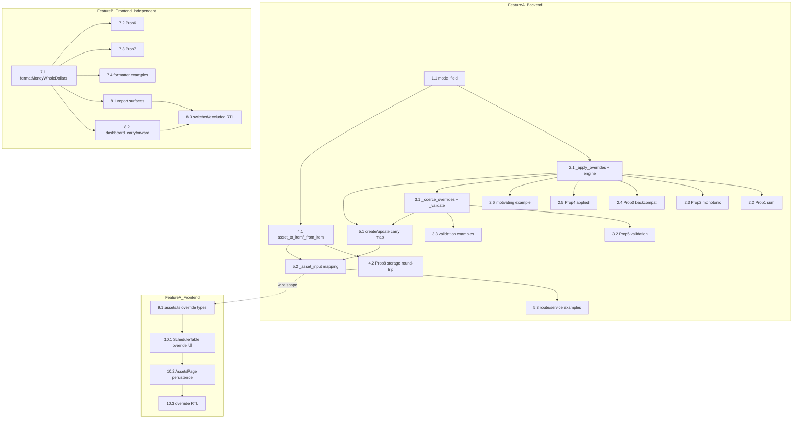

# Implementation Plan: Depreciation Override and Whole-Dollar Display

## Overview

This plan implements two additive, independent changes to Logstead's depreciation handling.

- **Feature A — per-year depreciation override.** An optional `depreciation_overrides` map (`tax_year -> two-decimal Decimal`) is added to `DepreciableAsset` / `AssetInput`. A pure helper `_apply_overrides(base_rows, overrides)` is called at the end of `compute_schedule_rows`, replacing each overridden year's `amount` and rolling the delta into the tail year so the engine's two invariants (amounts sum to `cost_basis`; `remaining_basis` non-increasing to exactly `0.00`) still hold by construction. A `_coerce_overrides` validator rejects the unsatisfiable cases with a field-identifying `Result` failure and persists nothing. Overrides round-trip as a single DynamoDB Map of strings on the asset item (no new items, keys, routes, or tables). The schedule UI (`ScheduleTable` + `AssetsPage`) gains per-year override entry/clear, a textual override marker, and inline dotted-field error mapping.

- **Feature B — whole-dollar display rounding.** A new `formatMoneyWholeDollars` helper in `frontend/src/lib/money.ts` rounds a money string to the nearest whole dollar (IRS half-up by magnitude, sign-preserving, exact integer cents, no float), swapped in at the tax-oriented display surfaces only. Display-only: nothing stored, computed, or sent over the wire changes.

The language is **Python 3.12** (backend) and **React 19 + TypeScript** (frontend) — the design builds on the real codebase, so no language selection is needed. Money stays an exact two-decimal `Decimal` in Python and a two-decimal **string** over the wire; the UI does integer-cents only, never float.

**Dependency shape.** The two features are independent of each other. Feature B (tasks 7–8) is fully independent of Feature A and can run in parallel from the start. Within Feature A the backend is implemented before the frontend, because the schedule UI and `AssetsPage` persistence depend on the override map's wire shape (`Record<string,string>` keyed by year) and the dotted-field error contract settled in the route task.

Testing reuses the project's stack: backend `pytest` + `Hypothesis` + `moto`, with the real `DepreciationService` over a moto-backed single table with GSI2 (mirroring `test_depreciation_schedule_property.py`, `test_property_year_depreciation_property.py`, `test_depreciation_sum_property.py`); frontend `vitest` + `fast-check` + RTL (mirroring `money.property.test.ts`, `ScheduleTable.test.tsx`, `AssetsPage.test.tsx`). Every property-based test runs ≥100 iterations (`@settings(max_examples=100)` / `numRuns: 100`) and is tagged `# Feature: depreciation-override-and-whole-dollar-display, Property N: ...` (`//` in TS).

## Tasks

- [x] 1. Backend: asset model — add the override map
  - [x] 1.1 Add `depreciation_overrides` to `AssetInput` and `DepreciableAsset` in `backend/src/logstead/models/depreciation.py`
    - Add `depreciation_overrides: dict[int, Decimal] | None = None` to `AssetInput` (optional, default `None`)
    - Add `depreciation_overrides: dict[int, Decimal] = field(default_factory=dict)` to `DepreciableAsset` (empty == no overrides)
    - Keep all other fields and defaults unchanged so every existing construction site compiles and behaves identically
    - _Requirements: 1.1, 5.2_
    - _Design: Components and Interfaces (backend) — models/depreciation.py_

- [x] 2. Backend: override-and-reconcile engine
  - [x] 2.1 Implement the `_apply_overrides` pure helper in `backend/src/logstead/services/depreciation.py`
    - Add `_apply_overrides(base_rows, overrides) -> list[DepreciationScheduleRow]`: replace each overridden year's `amount`; compute `delta = sum(base_amount[y] for y in overrides) - sum(overrides.values())`; when the tail year is not overridden add `delta` to the tail; rebuild each row's `remaining_basis` as `cost_basis - cumulative` over the ascending rows; all `Decimal` quantized to two places, no float
    - Call it at the end of `compute_schedule_rows(asset)` as `return _apply_overrides(base_rows, asset.depreciation_overrides)`; an empty map returns the base rows unchanged
    - Keep `_apply_overrides` module-importable for direct property testing
    - _Requirements: 2.1, 2.2, 2.3, 2.4, 2.5, 2.6, 5.1_
    - _Design: Override-and-reconcile algorithm (Req 2, 3); Components and Interfaces (backend)_

  - [ ]* 2.2 Property test — Invariant_Sum holds for arbitrary valid override maps
    - **Property 1: Invariant_Sum holds for arbitrary valid override maps**
    - **Validates: Requirements 2.3, 2.6, 4.4**
    - New `backend/tests/services/test_override_sum_property.py`; Hypothesis valid-override strategy (subset of computed years, non-negative two-decimal amounts, sum ≤ `cost_basis`, tail reconcilable, composed from the base schedule); assert the Effective_Schedule amounts sum to exactly `cost_basis` as two-decimal `Decimal`; run once through the real `create_asset` → `schedule_for` / `property_depreciation_for_year` moto path to cover materialization (Req 4.4)

  - [ ]* 2.3 Property test — Invariant_Monotonic holds for arbitrary valid override maps
    - **Property 2: Invariant_Monotonic holds for arbitrary valid override maps**
    - **Validates: Requirements 2.4, 2.6**
    - New `backend/tests/services/test_override_monotonic_property.py`; assert every effective `amount` ≥ `0.00`, each `remaining_basis == cost_basis - cumulative`, `remaining_basis` non-increasing across the ascending schedule, final row `remaining_basis == 0.00`, all exact two-decimal `Decimal`

  - [ ]* 2.4 Property test — a no-override asset is identical to today
    - **Property 3: A no-override asset is identical to today**
    - **Validates: Requirements 1.3, 5.1**
    - New `backend/tests/services/test_override_backcompat_property.py`; compare `compute_schedule_rows` with an empty map against a reference computation with the override step disabled; assert identical row for row and value for value (tax year, amount, remaining basis, method, convention)

  - [ ]* 2.5 Property test — an overridden year's amount equals the override exactly
    - **Property 4: An overridden year's amount equals the override exactly**
    - **Validates: Requirements 2.1, 2.2, 2.5**
    - New `backend/tests/services/test_override_applied_property.py`; assert each overridden Tax_Year's effective `amount` equals its Override_Amount exactly, including the tail-year-overridden case that reconciles to `cost_basis`

  - [ ]* 2.6 Unit example — the motivating filed-value case
    - New `backend/tests/services/test_override_examples.py`: June-2010, $140,000, 27.5-year asset with `{2010: "1952.00"}` → 2010 amount `1952.00`, tail absorbs the delta, amounts sum to `140000.00`, `remaining_basis` monotone to `0.00`
    - _Requirements: 2.1, 2.2, 2.3, 2.4_
    - _Design: Unit / example tests (backend)_

- [x] 3. Backend: override validation
  - [x] 3.1 Implement `_coerce_overrides` and wire it into `_validate` in `backend/src/logstead/services/depreciation.py`
    - Add `_coerce_overrides(raw, placed_in_service_date, recovery_period_years, cost_basis) -> Result[dict[int, Decimal]]`: `None`/absent → success with `{}` (Req 5.2); parse each value with `to_money`, reject negative / non-two-decimal with `field="depreciation_overrides.<year>"` (Req 3.1); derive the year span (`first_year = year(placed_in_service_date)`, `num_years = ceil(recovery_period_years) + 1`) and reject out-of-span years with `field="depreciation_overrides.<year>"` (Req 3.2); reject `sum(overrides) > cost_basis` with `field="depreciation_overrides"` (Req 3.3); compute the tail reconciliation and reject a negative tail / tail-overridden-with-no-absorber (unless the map already sums to `cost_basis`) with `field="depreciation_overrides"` / `"depreciation_overrides.<tailYear>"` (Req 3.4, 3.5)
    - Wire into `DepreciationService._validate` as a new normalized `depreciation_overrides` field, returning the first field-identifying `Result.failure("validation", ...)` on rejection (Req 3.6)
    - _Requirements: 3.1, 3.2, 3.3, 3.4, 3.5, 3.6_
    - _Design: Validation placement (Req 3); Error Handling_

  - [ ]* 3.2 Property test — validation rejects every unsatisfiable override and persists nothing
    - **Property 5: Validation rejects every unsatisfiable override and persists nothing**
    - **Validates: Requirements 3.1, 3.2, 3.3, 3.4, 3.5, 3.6**
    - New `backend/tests/services/test_override_validation_property.py`; Hypothesis invalid-override strategy producing each unsatisfiable case (negative/non-two-decimal amount, out-of-span year, sum > basis, negative tail, tail-overridden with no absorber); assert a `validation` failure whose `field` is `depreciation_overrides` or `depreciation_overrides.<year>`, and that the asset item + schedule rows are byte-identical before and after (query over moto)

  - [ ]* 3.3 Unit examples — each validation branch and its exact field name
    - Add to `backend/tests/services/test_override_examples.py`: one example per branch (negative, out-of-span, sum-exceeds, negative-tail, tail-no-absorber) asserting the exact `field` value
    - _Requirements: 3.1, 3.2, 3.3, 3.4, 3.5_
    - _Design: Validation placement (Req 3); Error Handling_

- [x] 4. Backend: override persistence (serialization round-trip)
  - [x] 4.1 Add override serialization to `asset_to_item` / `_from_item` in `backend/src/logstead/services/depreciation.py`
    - `asset_to_item(asset)`: render `depreciationOverrides` as a DynamoDB Map of two-decimal strings (each value via `money_to_str`); omit the attribute entirely when the map is empty so an override-free asset's stored shape is byte-for-byte unchanged (Req 5.3). Leave the top-level `money_attrs={"costBasis"}` unchanged — do NOT add `depreciationOverrides` to it
    - `_from_item(item)`: parse `item.get("depreciationOverrides", {})` into `dict[int, Decimal]` with `int` keys and `to_money` values; absent → `{}` (Req 5.2)
    - _Requirements: 1.2, 1.3, 5.2, 5.3_
    - _Design: Data Models; Research notes (Money/attr handling)_

  - [ ]* 4.2 Property test — overrides survive persistence unchanged
    - **Property 8: overrides survive persistence unchanged**
    - **Validates: Requirements 1.3, 5.2, 5.3**
    - New `backend/tests/services/test_override_storage_roundtrip_property.py`; moto-backed repo; write an asset with any valid override map and read it back, asserting the map equals the normalized (two-decimal) written map with `int` keys and `Decimal` values; an asset written with no map reads back `{}` with a stored item shape identical to a pre-feature asset (no `depreciationOverrides` attribute)

- [x] 5. Backend: wire overrides through service CRUD and the route
  - [x] 5.1 Carry the validated map through `create_asset` / `update_asset`
    - In `create_asset` and `update_asset`, set the validated `depreciation_overrides` on the constructed `DepreciableAsset` so `_materialize_schedule` → `compute_schedule_rows` picks it up in the existing single transaction; `_materialize_schedule` and `delete_asset` need no change (cascade is unchanged)
    - _Requirements: 4.1, 4.2, 4.3, 4.5_
    - _Design: Validation placement (Req 3) — create/update unchanged except carrying the map_

  - [x] 5.2 Map the override map in `_asset_input` in `backend/src/logstead/router/handler.py`
    - Read `depreciation_overrides` (snake_case) or `depreciationOverrides` (camelCase) from the body; coerce `{ "<year>": "<string>" }` into `{int: Decimal}`; pass as `AssetInput.depreciation_overrides` (`None` when empty). No new routes (Req 1.2); reads/writes stay scoped to the authenticated user's property path (Req 1.5). Rely on existing `_to_jsonable` to serialize the response map as `{ "<year>": "<two-decimal string>" }` (Req 1.4)
    - _Requirements: 1.2, 1.4, 1.5_
    - _Design: Components and Interfaces (Route); Research notes (Router serialization)_

  - [ ]* 5.3 Route / service example tests — CRUD, clear, delete, mapping, serialization
    - Add to `backend/tests/services/test_depreciation_service.py` (and a route example in `backend/tests/router/`): `create_asset` / `update_asset` / clear (empty map) / `delete_asset` over moto persist rows equal to the Effective_Schedule and cascade on delete (Req 4.1–4.3, 4.5); `_asset_input` maps both snake_case and camelCase bodies; `_to_jsonable` serializes the override map as `{ "<year>": "<two-decimal string>" }` (Req 1.4); an override-free asset item has no `depreciationOverrides` attribute (Req 5.3)
    - _Requirements: 1.4, 4.1, 4.2, 4.3, 4.5, 5.3_

- [x] 6. Checkpoint — backend override feature
  - Ensure the backend compiles and the override service + route property/example tests pass, and that the existing `test_depreciation_sum_property.py`, `test_remaining_basis_property.py`, and `test_depreciation_schedule_property.py` stay green; ask the user if questions arise.

- [x] 7. Frontend: whole-dollar formatter (independent of Feature A)
  - [x] 7.1 Add `formatMoneyWholeDollars` to `frontend/src/lib/money.ts`
    - Signature `formatMoneyWholeDollars(amount: string | null | undefined): string`; empty/null/undefined → `""`, non-numeric → passthrough (mirror `formatMoney`); compute `toCents(amount)`, round the magnitude (`floor(abs/100)`, +1 when `remainder >= 50`), reapply sign, format `en-US` USD with `minimum/maximumFractionDigits: 0`; exact integer cents only, no float
    - _Requirements: 8.1, 8.2, 8.3, 8.4, 8.5, 8.6, 12.5_
    - _Design: Whole-dollar formatter algorithm (Req 8); Components and Interfaces (frontend lib/money.ts)_

  - [ ]* 7.2 Property test — formatter rounds half-up by magnitude, sign-preserving, integer-cents only
    - **Property 6: Whole-dollar formatter rounds to the nearest dollar, half-up by magnitude, sign-preserving, integer-cents only**
    - **Validates: Requirements 8.1, 8.2, 8.3, 8.5, 8.6**
    - Add to `frontend/src/lib/money.property.test.ts`; reuse the `moneyString` arbitrary extended to negatives and zero; compare against an independent integer-cents oracle; assert no decimal point in the output and correct `$`/grouping; `numRuns: 100`

  - [ ]* 7.3 Property test — formatter passthrough for empty, null, and non-numeric input
    - **Property 7: Formatter passthrough for empty, null, and non-numeric input**
    - **Validates: Requirements 8.4**
    - Add to `frontend/src/lib/money.property.test.ts`; assert `""` for empty/null/undefined and passthrough for non-numeric strings; `numRuns: 100`

  - [ ]* 7.4 Unit examples for the formatter
    - Add to `frontend/src/lib/money.test.ts`: `"5090.91"`→`$5,091`, `"5090.10"`→`$5,090`, `"5090.50"`→`$5,091`, `"-125.50"`→`-$126`, `""`/`null`/`undefined`→`""`, `"abc"`→`"abc"`
    - _Requirements: 8.1, 8.2, 8.5, 8.6_

- [x] 8. Frontend: swap whole-dollar formatter into the tax-oriented surfaces
  - [x] 8.1 Swap the report surfaces to `formatMoneyWholeDollars`
    - In `frontend/src/components/reports/ReportView.tsx`, `ScheduleELineTable.tsx`, and `OtherItemsList.tsx`, render monetary line figures through `formatMoneyWholeDollars`; preserve the existing `tabular-nums` alignment and the `isLoss` textual loss cue
    - _Requirements: 10.1, 10.2, 11.1_
    - _Design: Architecture (Feature B display boundary); Backward Compatibility_

  - [x] 8.2 Swap the dashboard and carryforward surfaces to `formatMoneyWholeDollars`
    - In `frontend/src/pages/DashboardPage.tsx` (depreciation tile, net headline) and `frontend/src/components/dashboard/PropertyBreakdownTable.tsx` (net-by-property), and `frontend/src/pages/CarryforwardPage.tsx` money cells, render through `formatMoneyWholeDollars`; preserve `tabular-nums` + `isLoss` cues
    - _Requirements: 10.1, 10.2, 11.3, 11.4_
    - _Design: Architecture (Feature B display boundary)_

  - [x]* 8.3 RTL — switched surfaces round and keep alignment + loss cues; excluded surfaces keep cents
    - Add/extend RTL in `ReportView.test.tsx`, `ScheduleELineTable.test.tsx`, `OtherItemsList.test.tsx`, `DashboardPage.test.tsx`, `PropertyBreakdownTable.test.tsx`, `CarryforwardPage.test.tsx`: assert whole-dollar output plus retained `tabular-nums` and `isLoss` cues (Req 10.1, 10.2, 11.1–11.4); assert `TransactionsPage.test.tsx` transaction amounts and `AssetList.test.tsx` cost-basis echo still render cents via `formatMoney` (Req 11.5)
    - _Requirements: 10.1, 10.2, 11.1, 11.3, 11.4, 11.5_

- [x] 9. Frontend: override transport types (depends on backend wire shape)
  - [x] 9.1 Add the override map to `frontend/src/api/assets.ts`
    - Add `export type DepreciationOverrides = Record<string, string>` (year string → two-decimal money string); add optional `depreciation_overrides?: DepreciationOverrides` to `DepreciableAsset`, `CreateAssetInput`, and `UpdateAssetInput`; include it in the create/update request bodies when present. Values are strings, never numbers
    - _Requirements: 1.1, 1.4, 6.5_
    - _Design: Components and Interfaces (frontend api/assets.ts)_

- [x] 10. Frontend: override UI and persistence
  - [x] 10.1 Add override affordances and the override marker to `frontend/src/components/assets/ScheduleTable.tsx`
    - Add props `overrides?`, `onOverrideChange?(taxYear, amount|null)`, `overrideErrors?`, `editable?`; when `editable`, render a per-year override input and a Clear control (Req 6.1, 6.3); for a year whose amount comes from an override show a textual `Override_Marker` ("Filed value", never color alone) plus a one-line pinned-to-filed-return note (Req 7.1, 7.2); with no overrides render exactly as today (Req 7.3); handle amounts as strings through `toMoneyString`/`toCents`, no float (Req 6.5); render `overrideErrors[year]` inline next to the year's control and do not present the override as saved (Req 6.4)
    - _Requirements: 6.1, 6.3, 6.4, 6.5, 7.1, 7.2, 7.3_
    - _Design: Components and Interfaces (frontend ScheduleTable.tsx)_

  - [x] 10.2 Wire override persistence + dotted-field error mapping in `frontend/src/pages/AssetsPage.tsx`
    - Build the updated override map and send it via `updateAsset`, then reload the schedule without a full page reload (Req 6.2, 6.3); on a 400 with field `depreciation_overrides.<year>`, split the dotted field into `{ year, message }` and feed it into `ScheduleTable`'s `overrideErrors` for the offending year (Req 6.4), extending the existing `toFieldErrors` pattern
    - _Requirements: 6.2, 6.3, 6.4_
    - _Design: Components and Interfaces (frontend AssetsPage.tsx); Error Handling_

  - [x]* 10.3 RTL — override entry, clear, marker, inline error, no-float handling
    - Extend `frontend/src/components/assets/ScheduleTable.test.tsx` and `frontend/src/pages/AssetsPage.test.tsx`: per-year input + Clear render when `editable`; overridden year shows the textual marker + note (Req 7.1, 7.2); no marker with an empty map (Req 7.3); `overrideErrors[year]` renders inline (Req 6.4); submitting/clearing calls `updateAsset` with the updated map and reloads (Req 6.2, 6.3); a 400 `depreciation_overrides.<year>` maps to the year's inline error; amounts handled as strings (Req 6.5)
    - _Requirements: 6.1, 6.2, 6.3, 6.4, 6.5, 7.1, 7.2, 7.3_

- [x] 11. Final verification — suites green, invariants preserved, no new float (no deploy)
  - Backend: if the venv is missing or stale, recreate it (`python3 -m venv .venv && .venv/bin/python -m pip install -q -e ".[dev]"` from `backend/`), then run `.venv/bin/python -m pytest -q -p no:cacheprovider -n auto` from `backend/` — the full suite including the existing Invariant_Sum / Invariant_Monotonic property tests and the new override properties must be green (Req 12.1, 12.2, 12.3)
  - Frontend: run `npm run build` (the real gate — `tsc -b && vite build`, which caught a prior type error that `--noEmit` did not) and the frontend tests (`npx vitest --run`) from `frontend/`; both must be green (Req 12.4)
  - Confirm no floating-point arithmetic was introduced into the money pipeline; all override and rounding math is exact `Decimal` / integer cents (Req 12.5)
  - Do NOT run any deploy — the user runs deploys. Ask the user if anything is unclear.
  - _Requirements: 12.1, 12.2, 12.3, 12.4, 12.5_

## Task Dependency Graph



```json
{
  "waves": [
    { "id": 0, "tasks": ["1.1", "7.1"] },
    { "id": 1, "tasks": ["2.1", "7.2", "7.4", "8.1", "8.2"] },
    { "id": 2, "tasks": ["2.2", "2.3", "2.4", "2.5", "2.6", "3.1", "7.3", "8.3"] },
    { "id": 3, "tasks": ["3.2", "3.3", "4.1"] },
    { "id": 4, "tasks": ["4.2", "5.1"] },
    { "id": 5, "tasks": ["5.2"] },
    { "id": 6, "tasks": ["5.3", "9.1"] },
    { "id": 7, "tasks": ["10.1"] },
    { "id": 8, "tasks": ["10.2"] },
    { "id": 9, "tasks": ["10.3"] }
  ]
}
```

> Wave ordering note: the four tasks that write `backend/src/logstead/services/depreciation.py` (2.1, 3.1, 4.1, 5.1) are placed in distinct waves so no two file-writes to that module ever run concurrently; 5.2 writes `router/handler.py` and follows 5.1. Each `*` test task adds a new test file (or extends a distinct existing test file) and never shares a write target with another task in its wave.

## Notes

- **Feature B is fully independent of Feature A.** Tasks 7–8 (the `formatMoneyWholeDollars` helper, its property/unit tests, and the per-surface swaps) touch only `frontend/src/lib/money.ts` and the tax-oriented display components; they share no file with Feature A and can run from wave 0 in parallel with the backend.
- **Backend-before-frontend inside Feature A.** Task 9.1 (frontend override types) depends on the wire shape settled in task 5.2 (`_asset_input` mapping + `_to_jsonable` response), and 10.1/10.2 depend on 9.1 — hence the dotted `wire shape` edge in the graph.
- **Optional tests** are marked `[ ]*` (every property-based, RTL, and unit/example test task). They are not auto-run by "run all tasks"; dispatch them explicitly after the implementation task they validate.
- **Invariants are preserved by construction, and proven.** Properties 1–2 (tasks 2.2, 2.3) re-prove Invariant_Sum / Invariant_Monotonic under arbitrary valid overrides; Property 3 (task 2.4) proves byte-for-byte backward compatibility for override-free assets (Req 12.2, 12.3). The existing `test_depreciation_sum_property.py` / `test_remaining_basis_property.py` must also stay green (checkpoint task 6, final task 11).
- **No new data model, no new routes.** Overrides are one optional DynamoDB Map attribute (`depreciationOverrides`) on the existing asset item, omitted when empty so override-free assets are byte-for-byte unchanged. Money stays a two-decimal string on the wire and in the Map; never a float, never a DynamoDB `Number`.
- **Money contract:** `Decimal` two-decimal in Python, two-decimal strings over the wire and inside the stored Map, `Record<string,string>` in TypeScript. Whole-dollar rounding is display-only (Req 9.1–9.3) — nothing stored, computed, or transported is rounded.
- **No deploy.** Task 11 is the real gate (backend `pytest`, frontend `npm run build` + `vitest`); it deliberately excludes any `make deploy`. The frontend build step is part of done because `tsc -b` surfaces type errors that `tsc --noEmit` can miss. The user runs deploys.
- **Checkpoints (tasks 6, 11)** are stop-and-verify gates, not code tasks. Waves are sized for a 5-concurrent orchestrator limit.
