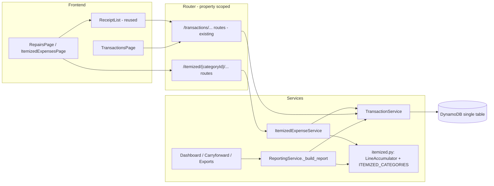
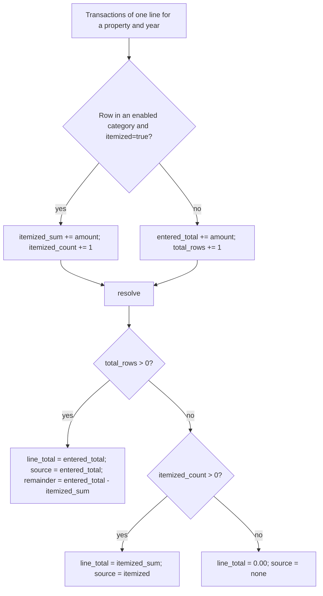

# Design Document

## Overview

Itemized expenses lets a user keep per-entry detail (date, amount, description/vendor, notes, receipts) behind a year's Schedule E expense total, starting with Repairs (line 14). A new **Repairs** tab under each property hosts the page. The existing way of entering or importing one total per line per year is untouched.

The central rule is deliberately explicit and not automatic:

| Entered total present? | Line total | Line source |
| --- | --- | --- |
| Yes | the entered total | `entered_total` |
| No, itemized entries exist | the itemized sum | `itemized` |
| No, no entries | `0.00` | `none` |

The itemized sum is never added to an entered total.

### Design decisions and rationale

1. **A boolean `itemized` marker on the existing transaction, not a separate "total" item.** An itemized entry is a transaction with `itemized = true`. A transaction without the marker is an *entered total row*. This keeps the data model additive and makes every existing row correct without migration, because every existing row already means "a total" (the app's year-end model is one entry per line per year). The alternatives are compared below.
2. **One pure precedence function owns the rule.** `services/itemized.py` holds `LineAccumulator`, used by `ReportingService._build_report` and by the new `ItemizedExpenseService.summary`. Dashboard, trends, carryforward, the combined report and the exports already read `ReportingService.report_for`, so they inherit the rule with no change. A source-scan test keeps it that way.
3. **Configuration-driven categories.** `ITEMIZED_CATEGORIES` in `services/itemized.py` lists enabled categories (`repairs` only). Routes take `{categoryId}`. The frontend page component takes a small definition object. Enabling Supplies later is one config entry plus one nav definition.
4. **Dedicated routes for the page, existing routes for receipts.** The page needs a summary read and "set/remove total" operations that preserve row identity, so it gets `/properties/{propertyId}/itemized/{categoryId}/...`. Receipts reuse `/properties/{propertyId}/transactions/{id}/receipts`, because an entry is a transaction. No receipt code is duplicated.
5. **Itemized rows stay visible on the Transactions page**, badged and read-only there, so the list matches the data behind the report.
6. **Cent precision on the Repairs page.** The page reconciles raw entries to a total, so it uses `formatMoney` (cents), the same as the Transactions page. The report keeps its whole-dollar display.
7. **No automatic combination, no hidden writes.** Creating an entry never edits the total. Setting the total never edits entries. The only coupling is the user-confirmed "Update total to $X (itemized)" action.

### How a total row is distinguished: options considered

| Option | Description | Existing data | Imported totals and re-import | Backup | Verdict |
| --- | --- | --- | --- | --- | --- |
| A. `itemized` marker on detail rows (chosen) | Detail rows carry `itemized=true`; unmarked rows are totals. | Correct as is. Default `false` means "total". | Imported rows are unmarked, so they are totals. Re-import deletes only `imported` rows and never touches itemized rows. | Additive optional field; `schema_version` stays `"1"`. | Chosen. |
| B. Separate per-(property, year, category) total item | New item type holding the total. | Existing and imported totals are transactions, so two total sources would coexist. A migration or a dual-source rule would be required. | Import would need to write the new item type and re-import semantics would change. | New entity in backup, schema change. | Rejected: breaks "enter or import a total keeps working" without a migration. |
| C. `is_total` marker on total rows | Total rows carry the marker; unmarked rows are detail. | Every existing total would need to be backfilled, or all existing rows would read as detail and the report would change. | Import must set the marker. | Same additive field, but wrong default. | Rejected: wrong default, needs backfill. |

Consequences of A that the design handles explicitly:

- The Entered_Total is the **sum** of all unmarked rows in the category for the year. By convention there is one such row, but a user may have several. Set, edit, remove and sync require exactly zero or one row and return `conflict` for several (the UI explains and links to the Transactions page). The report still sums them, so existing multi-row years keep their current figure.
- Editing the single total row in place keeps its `imported` flag. A later Schedule E re-import for that year replaces the row with the filed figure, which is the documented import behavior; the page says so next to the "Imported" badge.
- Generic `PUT /transactions/{id}` resets `imported` to false today, because `_transaction_input` never reads it and `TransactionService.update` writes `imported=data.imported`. Left alone, editing an imported total and then re-importing would leave two total rows (the edited, now unmarked row survives the re-import, and the import adds a new one), double counting line 14. This feature fixes it: updates take `imported` from the stored row (see "Marker preservation on update").
- Multiple unmarked rows, the zero-total case and the date-in-year rule are accepted as designed. A year with no total and no entries reports `0.00` with source `none` and needs no stored zero row.

### Research notes (grounded in the codebase)

- **All consumers share one path.** `DashboardService`, `CarryforwardService`, and the exports call `ReportingService.report_for` (`dashboard.py` lines near 457 and 553, `carryforward.py` near 323). `derive_data_years` only reads transaction dates and does not sum amounts. `line12_impact` reads only line 12. Therefore changing `_build_report` is sufficient.
- **Precedent for a precedence rule.** Line 12 already lets loan-generated interest replace manual transactions (`MORTGAGE_INTEREST_LINE`, `Line12Detail`). The Line_Resolver follows the same style: pure computation inside the report builder, with the superseded amounts surfaced rather than hidden.
- **Receipts are keyed by transaction.** `#DOC#` rows live under `TXN#<invDate>#<txnId>`, so an itemized entry gets the whole receipt mechanism for free, including delete cascade in `TransactionService.delete`.
- **Sparse writes.** `DynamoRepository.put_item` drops `None` attributes, so storing `itemized` as `True` or `None` and `notes` as text or `None` leaves unchanged items byte-identical.
- **`_property_scoped` covers children.** Child items are keyed by property id alone, so every new route must carry the decorator.
- **Undo.** `useUndoableDelete` re-creates through the create API; ids change. The same pattern applies to entries and totals, with the same safe-delete limits (no receipts).
- **Navigation.** `sectionFromPath` derives known sections from `PROPERTY_NAV`, so the property switcher keeps the Repairs section automatically once the nav entry exists.
- **Backup gap fixed here.** `BackupTransaction` does not carry `imported`, so a restore turns imported rows into user rows, and a later re-import would then add a second total next to the restored one. This feature carries `imported` through export and restore (additive, `schema_version` stays `"1"`). `itemized` must be carried too, otherwise a restore would turn detail rows into totals and double count.

## Architecture



### Precedence evaluation (single source of truth)



### Where the rule lives and who calls it

| Caller | How it reaches the rule |
| --- | --- |
| `ReportingService._build_report` | Creates one `LineAccumulator` per Schedule E line, feeds each transaction, replaces the plain per-line sum with `resolve().line_total`. This runs before the Line 12 loan precedence so line 12 behavior is unchanged. |
| `ItemizedExpenseService.summary` | Feeds the selected category's transactions to the same `LineAccumulator` and returns the whole resolution. |
| Dashboard summaries and trends, carryforward net, combined report, CSV/JSON export | Consume `ReportingService.report_for`; no change. |
| `TransactionService.list_for_property` | Stays a raw listing. It never applies the rule. |

A source-scan test asserts that `dashboard.py` and `carryforward.py` do not reference `schedule_e_line` or `itemized`, so nobody re-sums transactions there.

### API routes

All routes are registered in `_ROUTES`, wrapped by `_property_scoped`, and return the standard `Result` mapping. `{categoryId}` and `{entryId}` pass through `_check_path_ids`.

| Method and path | Purpose | Success |
| --- | --- | --- |
| `GET /properties/{propertyId}/itemized/{categoryId}?taxYear=YYYY` | Summary for the year. `taxYear` is required. | 200 `ItemizedSummary` |
| `POST /properties/{propertyId}/itemized/{categoryId}/entries` | Create an itemized entry. | 201 `Transaction` |
| `PUT /properties/{propertyId}/itemized/{categoryId}/entries/{entryId}` | Edit an itemized entry. | 200 `Transaction` |
| `DELETE /properties/{propertyId}/itemized/{categoryId}/entries/{entryId}` | Delete an entry and its receipts. | 200 empty |
| `PUT /properties/{propertyId}/itemized/{categoryId}/total` | Body `{tax_year, amount}`. Creates the single total row or updates it in place. | 200 `ItemizedSummary` |
| `DELETE /properties/{propertyId}/itemized/{categoryId}/total?taxYear=YYYY` | Remove the single total row and its receipts. | 200 `ItemizedSummary` |
| existing `.../transactions/{entryId}/receipts[/{documentId}]` | Receipts for an entry or a total row. | unchanged |

Segment counts are distinct from every existing template (the literal `itemized` segment differs), so `_match_path` needs no ordering change.

Validation (service level, field-identifying `Result.failure("validation", ..., field=...)`):

| Field | Rule |
| --- | --- |
| `category_id` | Unknown id: `not_found`. Known but not in `ITEMIZED_CATEGORIES`: `validation` on `category_id`. |
| `date` | Required, valid ISO date; with `tax_year` present its year must equal `tax_year`. |
| `amount` | Parsed with `_decimal_or_none` (finite, at most `_MAX_ABS_AMOUNT`); must be greater than zero; stored with two decimals. |
| `description` | Required, trimmed, 1 to 200 characters for entries. |
| `notes` | Optional, trimmed, at most 1000 characters; blank becomes absent. |
| `tax_year` | `_int_param` bounds (`_MIN_TAX_YEAR` to `_MAX_TAX_YEAR`). |
| body extras | `itemized`, `imported`, `type`, `property_id` in the body are ignored; the service sets them. |

Authorization:

- Every handler is `@_property_scoped`. Another user's property id yields the same 404 as a missing one, before the service runs.
- Entry routes call `TransactionService.get(property_id, entry_id)` through `ItemizedExpenseService`, so an entry id from another property is simply not found (children are keyed by property). A transaction that is not itemized, or is in another category, returns the same `not_found` as a missing entry.
- Receipts keep using the existing guarded routes.

### Request and response shapes

```json
// GET .../itemized/repairs?taxYear=2023
{
  "category_id": "repairs",
  "label": "Repairs",
  "schedule_e_line": 14,
  "tax_year": 2023,
  "entered_total": "4200.00",
  "entered_total_rows": [ { "id": "t1", "date": "2023-12-31", "amount": "4200.00", "imported": true, "...": "..." } ],
  "itemized_sum": "3100.00",
  "itemized_count": 5,
  "entries": [ { "id": "e5", "date": "2023-09-02", "amount": "620.00", "description": "Plumber - water heater", "notes": "Invoice 1182", "itemized": true } ],
  "remainder": "1100.00",
  "line_total": "4200.00",
  "line_source": "entered_total",
  "total_differs_from_itemized": true
}
```

`entered_total` and `remainder` are `null` when there is no total. `total_differs_from_itemized` is true only when the total is present, at least one entry exists, and the amounts differ. The server computes it so the button rule has one definition.

## Components and Interfaces

### Backend

**`models/transaction.py`** (modified)

- `Transaction`: add `itemized: bool = False` and `notes: str | None = None`.
- `TransactionInput`: add the same two fields. Router `_transaction_input` does not read them, so the generic routes can never set them.

**`services/itemized.py`** (new, pure plus one service)

```python
@dataclass(frozen=True)
class ItemizedCategory:
    category_id: str

ITEMIZED_CATEGORIES: dict[str, ItemizedCategory] = {"repairs": ItemizedCategory("repairs")}

def is_itemized_category(category_id: str) -> bool: ...

LineSource = Literal["entered_total", "itemized", "none"]

@dataclass(frozen=True)
class LineResolution:
    line_total: Money
    source: LineSource
    entered_total: Money | None
    entered_total_rows: int
    itemized_sum: Money
    itemized_count: int
    remainder: Money | None          # entered_total - itemized_sum, None when no total
    total_imported: bool             # any contributing total row is imported

class LineAccumulator:
    def add(self, amount: Money, *, itemized: bool, imported: bool = False) -> None: ...
    def resolve(self) -> LineResolution: ...
```

`add` is the only place the marker is honored, and callers pass `itemized = txn.itemized and is_itemized_category(txn.category_id)`, so a mis-flagged row in a non-enabled category counts as a total row. All sums use `Decimal` and `to_money`.

```python
class ItemizedExpenseService:
    def __init__(self, transactions: TransactionService) -> None: ...
    def summary(self, property_id, category_id, tax_year) -> Result[ItemizedSummary]: ...
    def create_entry(self, property_id, category_id, data: EntryInput) -> Result[Transaction]: ...
    def update_entry(self, property_id, category_id, entry_id, data: EntryInput) -> Result[Transaction]: ...
    def delete_entry(self, property_id, category_id, entry_id) -> Result[None]: ...
    def set_total(self, property_id, category_id, tax_year, amount) -> Result[ItemizedSummary]: ...
    def remove_total(self, property_id, category_id, tax_year) -> Result[ItemizedSummary]: ...
```

- `summary` reads `list_for_property(property_id, tax_year)` (GSI2 tax-year partition), keeps the category's rows, feeds `LineAccumulator`, and returns entries newest first (the listing is already date-descending).
- `create_entry` / `update_entry` build a `TransactionInput(type="expense", itemized=True, ...)` and delegate to `TransactionService.create` / `update`, so amount, date, key and GSI2 handling are reused. `update_entry` first checks the row is an itemized entry of the named category.
- `set_total`: zero total rows creates one dated `{year}-12-31` (type `expense`, `imported=False`, no description). One row calls `TransactionService.update` with the row's existing fields, `imported` and `itemized` carried over and the new amount, so id, date, description, receipts and `imported` are preserved. Two or more rows return `conflict` on field `total`.
- `remove_total`: exactly one row is deleted through `TransactionService.delete` (cascades receipts). Zero rows is a `not_found` on field `total`. Two or more is `conflict`.
- A race between two browser tabs could create two total rows. The app is single-user, so this is accepted and documented; the report still sums them and the page then shows the multi-row state.

**`services/transaction.py`** (modified)

- `create`/`update` validation: when `data.itemized` is true the category must be in `ITEMIZED_CATEGORIES`, type must be `expense`, description is required (1 to 200 characters), and `notes` is allowed with at most 1000 characters. When `data.itemized` is false, `notes` must be absent (validation on `notes`).
- `update` rejects `data.itemized != existing.itemized` with a validation error on `itemized` ("Itemized entries are edited on the Repairs page"). Because the generic router never sets `itemized`, a generic PUT on an itemized row is rejected, and a generic PUT can never turn a total into an entry.

**Marker preservation on update** (fix for the `imported` drop)

- `update` builds the updated `Transaction` with `imported=existing.imported` and `itemized=existing.itemized` instead of `data.imported`. `data.imported` is ignored on update, so no caller (router or service) can set or clear `imported` on an existing row. `itemized` is likewise taken from the stored row; the mismatch check above stays as the explicit rejection for a conflicting input.
- `create` keeps honoring `data.imported`, because Schedule E Import is an internal caller that creates imported rows. The generic router's `_transaction_input` never reads `imported`, `itemized` or `notes`, so the generic create route cannot set them. A router test asserts this.
- `ItemizedExpenseService.set_total` therefore needs no special handling to keep `imported`: it passes the existing row's fields and the service preserves the markers.
- Re-import after edit: `ImportService` replaces only rows with `imported = true` for the (property, tax year). Because an edited imported total keeps `imported = true`, the re-import deletes it and writes the filed figure, leaving exactly one total row per line.
- `transaction_to_item` writes `itemized` as `True` or omits it, and `notes` as text or omits it. `_from_item` reads `bool(item.get("itemized", False))` and `notes`.
- `delete` is unchanged and works for itemized rows.

**`services/report.py`** (modified, `_build_report` only)

```python
accumulators: dict[int, LineAccumulator] = {}
for txn in txn_result.value:
    ...  # existing line 18 skip, line 12 count, other_items unchanged
    acc = accumulators.setdefault(line, LineAccumulator())
    acc.add(amount,
            itemized=txn.itemized and is_itemized_category(txn.category_id),
            imported=imported)
for line, acc in accumulators.items():
    res = acc.resolve()
    line_totals[line] = res.line_total
    line_imported[line] = res.total_imported
```

For every non-itemized category the resolution equals the plain sum, so the report is unchanged for them. This block runs before the Line 12 loan precedence. `manual_12_count` and `manual_total` for line 12 are taken from the resolved plain total as today. `other_items` (line 19) is unchanged because `other` is not an Itemized_Category.

**`services/backup.py` and `models/backup.py`** (modified)

- `BackupTransaction`: add `itemized: bool = False`, `notes: str | None = None`, `imported: bool = False`.
- Export copies all three. Document parsing reads `itemized` and `imported` (default false, must be booleans when present) and `notes` (must be a string of at most 1000 characters when present).
- Validation: `itemized` true requires an Itemized_Category and type `expense`, else a validation failure on `itemized`. `imported` true together with `itemized` true is a validation failure on `itemized`, because imports only write totals. A non-boolean `imported` fails on `imported`. All checks run before any write.
- Restore builds `Transaction(..., itemized=..., notes=..., imported=...)` and writes it with `transaction_to_item`, so restored imported rows are again replaced by a later re-import.
- `SCHEMA_VERSION` stays `"1"`. An older backup without `imported` restores with `imported = false`, which is the pre-existing behavior for those documents.

**`router/handler.py`** (modified)

- `_itemized_service(wiring)` builds `ItemizedExpenseService(TransactionService(repo, files))`.
- `_entry_input(body, property_id)` maps `date`, `amount`, `description`, `notes`, optional `tax_year` with `_opt_str`, `_decimal_or_none`, `_int_param`.
- Six handlers plus route entries as in the table above.

### Frontend

**Navigation and routing**

- `navConfig.ts`: insert `{ segment: "repairs", label: "Repairs" }` after Transactions.
- `routes.tsx`: add `{ path: "repairs", element: <RepairsPage /> }` under `properties/:propertyId` and update the route comment.
- `propertySwitch.ts` needs no change.

**API module `api/itemized.ts`** (new): `ItemizedApi` class with injectable client like `TransactionsApi`: `getSummary`, `createEntry`, `updateEntry`, `deleteEntry`, `setTotal`, `removeTotal`, and the shared singleton `itemizedApi`. Types mirror the response above. `Transaction` in `api/transactions.ts` gains optional `itemized?: boolean` and `notes?: string | null`.

**Definition `lib/itemizedPages.ts`** (new)

```ts
export interface ItemizedPageDefinition {
  categoryId: string;        // "repairs"
  tabLabel: string;          // "Repairs"
  line: number;              // 14
  entryNoun: string;         // "repair"
  description: string;       // page intro text
  capitalImprovementNote: boolean; // Assets link note
}
export const ITEMIZED_PAGES = { repairs: { ... } } as const;
```

**Pages and components**

| Unit | Responsibility |
| --- | --- |
| `pages/ItemizedExpensesPage.tsx` | Generic page: year selector, summary load through `useAsyncResource`, `useFirstLoad`, toolbar, composition of the panels. Takes a definition prop and an injectable `api`. |
| `pages/RepairsPage.tsx` | Default export for the route: `<ItemizedExpensesPage definition={ITEMIZED_PAGES.repairs} />`. |
| `components/itemized/ItemizedSummaryPanel.tsx` | `dl` of Entered total, Itemized sum (with count), Unitemized remainder, Line total, and the source label; negative remainder flag text. |
| `components/itemized/EnteredTotalCard.tsx` | Set, edit, remove total; Imported badge and re-import hint; Documents toggle for the single row; multi-row explanation and Transactions link. |
| `components/itemized/ItemizedEntryList.tsx` | `ResponsiveTable` of entries with Documents, Edit, Delete per row. |
| `components/itemized/ItemizedEntryForm.tsx` | `RecordModal` body: `DateInput`, `MoneyInput`, `Input` (Description / vendor), `Textarea` (Notes); uses `FormField`, `ErrorSummary`, `useFocusFirstInvalid`, `useDirtyReporter`. |
| `components/itemized/TotalForm.tsx` | Small `RecordModal` form with one `MoneyInput` for set and edit total. |
| `components/itemized/SyncTotalDialog.tsx` | `ConfirmDialog` with the exact change and the completed-year warning. |
| `lib/itemizedMath.ts` | Pure integer-cents helpers: `syncVisible`, `syncLabel`, `deltaCents`, `describeChange`. |

Behavior notes:

- `ReceiptList` is reused unchanged, with the shared `transactionsApi`, `propertyId`, and the entry or total row id.
- Source label strings: "Line 14 uses: entered total", "Line 14 uses: itemized entries", "Line 14 has no amount for this year". The line number comes from the definition.
- Source `none`: the summary shows the line total as `$0.00` with the "no amount for this year" label. No zero total is stored; "Set total" and "Add entry" stay available.
- Negative remainder: the value is shown with a minus sign, and the text "Itemized entries exceed the entered total" is rendered next to it with a warning token color. A Badge reading "Over total" is added so the cue is textual.
- Sync button visibility uses `summary.total_differs_from_itemized` and exactly one total row. The label is `Update total to ${formatMoney(itemized_sum)} (itemized)`.
- Sync dialog copy (cents, from `lib/money.ts`):
  "Update the Repairs total for 2023? Schedule E line 14 for 2023 will change from $4,200.00 to $3,100.00 (-$1,100.00). Your entered total becomes the sum of your 5 itemized entries."
  Added for completed years: "2023 is a completed tax year. If you already filed a return for it, your records will no longer match the filed return."
- After a successful sync the page reloads the summary and shows the toast "Repairs total updated to $3,100.00" with an Undo action (10 seconds, the app's action-toast default). Undo calls `setTotal(previousAmount)`, which edits the same row in place.
- Manual set and edit use the same toast pattern (Undo deletes the created row, or restores the previous amount). Remove uses `useUndoableDelete` when the row is not imported and has zero receipts, and a `ConfirmDialog` otherwise.
- Entry delete uses `useUndoableDelete` with the receipt count lookup, like the Transactions page. `restore` calls `createEntry` with the retained fields.
- The capital improvements note is a `Card` with a link to `propertyPath(propertyId, "assets")`.
- The `year` search parameter is read once on load and written when the user changes the year, matching how the property switcher carries it.

**Transactions page changes**

- `TransactionList`: for `transaction.itemized`, show `Badge` "Itemized" in the date cell and replace Edit and Delete with a link "Manage on Repairs page" to `propertyPath(propertyId, "repairs") + "?year=" + year`, with an `sr-only` suffix naming the date. The Documents button stays.
- `TransactionsPage`: when any listed row is itemized, render an informational line above the table. It also passes `itemizedYears` (a set of `categoryId:year` keys derived from the loaded list) to `TransactionForm`.
- `TransactionForm`: when the selected category and date year are in `itemizedYears` and the form is creating or editing a non-itemized row, show the hint from Requirement 10.4. It does not block saving.
- `lib/undoMappers.ts`: `isTransactionSafeDelete` returns false when `itemized === true`. A new `itemizedEntryToInput` maps a retained entry to the create-entry payload, and `isItemizedEntrySafeDelete(entry, receiptCount)` is true only when the count is a known zero.

**Docs**: `docs/future-improvements.md` gets two short items: "Property tabs on mobile" and "Convert existing repairs transactions into itemized entries". `docs/developer-guide.md` gets the Undo table rows, the precedence description, and the year-end model clarification.

## Data Models

### DynamoDB transaction item (additive)

| Attribute | Type | Notes |
| --- | --- | --- |
| `itemized` | Boolean, optional | Present and `true` only on itemized entries. Absent means total row. |
| `notes` | String, optional | At most 1000 characters; only on itemized entries. |

No new partition key, sort key, GSI, or item type. Itemized entries are keyed exactly like transactions: `PK=PROPERTY#<id>`, `SK=TXN#<invDate>#<txnId>`, `GSI2PK=PROPERTY#<id>#YEAR#<year>`. Receipts stay `#DOC#` rows under the entry.

### Python model changes

```python
@dataclass
class Transaction:
    ...
    imported: bool = False
    itemized: bool = False
    notes: str | None = None

@dataclass
class TransactionInput:
    ...
    imported: bool = False
    itemized: bool = False
    notes: str | None = None
```

`ItemizedSummary` is a frozen dataclass holding the fields in the response shape above (`Money` values, `Transaction` lists). The router serializes it with the existing `_to_jsonable`, which renders `Decimal` as two-decimal strings.

### Backup document (additive, `schema_version` stays `"1"`)

```json
{ "id": "...", "property_id": "...", "date": "2023-09-02", "amount": "620.00",
  "type": "expense", "category_id": "repairs",
  "description": "Plumber - water heater", "notes": "Invoice 1182", "itemized": true, "imported": false }
```

Documents without `itemized`, `notes` or `imported` restore as before (all default to absent or false). Older app versions ignore unknown keys but would restore detail rows as totals, so a backup made after this feature should be restored with this feature present (documented in the developer guide).

### Frontend types

```ts
interface Transaction { /* existing */ itemized?: boolean; notes?: string | null; }
interface ItemizedSummary {
  category_id: string; label: string; schedule_e_line: number; tax_year: number;
  entered_total: string | null; entered_total_rows: Transaction[];
  itemized_sum: string; itemized_count: number; entries: Transaction[];
  remainder: string | null; line_total: string;
  line_source: "entered_total" | "itemized" | "none";
  total_differs_from_itemized: boolean;
}
```


## Correctness Properties

*A property is a characteristic or behavior that should hold true across all valid executions of a system-essentially, a formal statement about what the system should do. Properties serve as the bridge between human-readable specifications and machine-verifiable correctness guarantees.*

Reflection note: the prework produced many per-criterion properties. The following were merged. 5.1, 5.2, 5.3 and 5.6 became one precedence property. 5.5, 14.1 and 14.3 became one money-form property. 4.1, 4.5, 6.6, 11.7 and 12.2 became one "rows outside the itemized rule sum as before" property. 6.1, 6.2, 6.3, 6.4 and 6.5 became one agreement property. 8.2, 8.4 and 8.5 became one total-operations property. 9.5, 9.6 and 15.4 became one sync-and-undo property. 9.1, 9.2, 9.3, 7.2, 7.3 and 14.2 became one frontend oracle property. 10.7 and 15.2 became one classification property. Example-only and UI-state criteria are covered in the Testing Strategy, not as properties.

### Property 1: Precedence of total over itemized detail

For any collection of rows for one (property, tax year, Itemized_Category), where each row has a positive two-decimal amount and an itemized marker: if at least one unmarked row exists, the resolution's line total equals the sum of the unmarked rows, its source is `entered_total`, and its remainder equals that total minus the itemized sum; otherwise, if at least one marked row exists, the line total equals the itemized sum, the source is `itemized`, and the remainder is undefined; otherwise the line total is `0.00`, the source is `none`, and the remainder is undefined.

**Validates: Requirements 5.1, 5.2, 5.3, 5.6, 5.9**

### Property 2: Itemized detail never changes a present total

For any non-empty set of unmarked rows and any two sets of itemized entries, the resolution line total and source computed with the first set equal those computed with the second set. Adding, removing or editing itemized entries while a total exists leaves line 14 unchanged.

**Validates: Requirements 5.4, 5.7**

### Property 3: Amounts stay exact and two-decimal

For any rows with positive two-decimal amounts, the resolution's line total, entered total, itemized sum and remainder each have exactly two decimal places, the itemized sum equals the exact `Decimal` sum of the marked rows' amounts, and the serialized summary carries them as two-decimal strings.

**Validates: Requirements 5.5, 14.1, 14.3**

### Property 4: Rows outside the itemized rule sum as before

For any collection of transactions where every row is either unmarked, or marked but in a category outside `ITEMIZED_CATEGORIES`, or any row in a non-itemized category, the report line total of each affected line equals the plain sum of all its rows (identical to the pre-feature report), including legacy items read without an `itemized` attribute.

**Validates: Requirements 4.1, 4.5, 6.6, 11.7, 12.2**

### Property 5: Report, summary and downstream consumers agree

For any generated state of total rows and itemized entries across several properties and tax years, the report line 14 total for each (property, year) equals the Itemized_Summary line total, the dashboard per-property summary and trend points equal the report totals, the carryforward Schedule E net equals the sum of report nets, the combined report equals the sum of per-property reports, and the CSV and JSON exports render the same line 14 amount. The report line's `includes_imported` flag equals whether any contributing unmarked row is imported.

**Validates: Requirements 6.1, 6.2, 6.3, 6.4, 6.5**

### Property 6: Entry operations and total operations are independent

For any state, creating, editing or deleting an itemized entry leaves every unmarked row (fields and receipts) unchanged, and setting, editing or removing the total leaves every itemized entry unchanged. Editing an entry keeps its id, marker and receipts.

**Validates: Requirements 2.8, 5.7, 5.8**

### Property 7: Total operations behave as specified

For any tax year and positive amount, setting the total when none exists yields exactly one unmarked row dated `{year}-12-31` with type `expense`, `imported = false`, and that amount. For any single total row and any new positive amount, editing the total changes only the amount and `updated_at`, preserving id, date, description, `imported` and receipts. Setting a total and then removing it returns the entered total to absent and the line source to `itemized` or `none`.

**Validates: Requirements 8.2, 8.4, 8.5**

### Property 8: Sync sets the total to the itemized sum and Undo restores it

For any state with a single total row, at least one itemized entry, and a total that differs from the itemized sum, setting the total to the itemized sum leaves the same row id, an entered total equal to the itemized sum, a remainder of `0.00`, and a line total equal to the itemized sum. Setting the total back to the previous amount restores the previous total and row id.

**Validates: Requirements 9.5, 9.6, 15.4**

### Property 9: Several total rows block total operations

For any state with two or more unmarked rows in the category and year, set, edit, remove and sync total requests return `conflict`, and the stored rows are unchanged afterwards.

**Validates: Requirements 8.6**

### Property 10: The itemized marker is immutable through updates

For any existing transaction and any update input, an update that would change the transaction's itemized marker is rejected with a validation error on `itemized`, and the stored row is unchanged. An update that keeps the marker succeeds under the existing rules.

**Validates: Requirements 10.5**

### Property 11: Only configured categories accept itemized entries

For any category in the catalog, creating an itemized entry succeeds (given valid fields) if and only if the category is in `ITEMIZED_CATEGORIES` and has type `expense`; otherwise it fails with a validation error on `category_id` (or `itemized`), and nothing is stored.

**Validates: Requirements 2.12, 11.2, 11.4**

### Property 12: Entry date must fall in the stated tax year

For any valid ISO date and any tax year supplied with it, entry creation succeeds if and only if the date's year equals the tax year; otherwise it fails with a validation error on `date`.

**Validates: Requirements 2.6**

### Property 13: Entry fields round-trip through storage

For any valid itemized entry, writing it with `transaction_to_item` and reading it back with `_from_item` yields an equal transaction (including `itemized` and `notes`). For any transaction with default `itemized` and `notes`, the stored item has no `itemized` or `notes` attribute and equals the pre-feature item shape.

**Validates: Requirements 12.1, 12.2, 12.3**

### Property 14: Backup round trip preserves itemized data

For any generated set of properties with totals, itemized entries and notes, exporting a backup document and restoring it reproduces the same rows, the same itemized markers and notes, and the same line total for every (property, tax year). The document's `schema_version` is `"1"`.

**Validates: Requirements 12.4, 12.8**

### Property 15: Restore rejects invalid itemized fields and writes nothing

For any backup document in which a transaction has `itemized = true` in a category outside `ITEMIZED_CATEGORIES` or with type `income`, or has a non-boolean `itemized`, or a non-string or over-long `notes`, restore fails with a validation error naming the field and leaves the stored data unchanged.

**Validates: Requirements 12.6, 12.7**

### Property 16: Schedule E re-import leaves itemized entries unchanged

For any set of itemized entries and any import submission for the same (property, tax year), the entries (ids, fields, receipts) are identical after the import, and only the imported rows are replaced.

**Validates: Requirements 4.4**

### Property 17: The page's displayed amounts match the integer-cents oracle

For any list of positive two-decimal entry amounts and any optional total, the Repairs page's displayed itemized sum, remainder, Sync_Action visibility, Sync_Action label amount, and the confirm dialog's old amount, new amount and signed difference equal the values computed with integer cents; the Sync_Action is visible if and only if a total exists, at least one entry exists, and the amounts differ.

**Validates: Requirements 7.2, 7.3, 9.1, 9.2, 9.3, 14.2**

### Property 18: Undo safety classification for itemized entries and totals

For any transaction and receipt count (a known non-negative integer or unknown), `isTransactionSafeDelete` is false when the transaction is itemized, and `isItemizedEntrySafeDelete` is true if and only if the receipt count is a known zero.

**Validates: Requirements 10.7, 15.2**

### Property 19: Updates preserve the stored markers and re-import never duplicates a total

For any stored transaction and any update input (including inputs that carry a different `imported` or `itemized` value), the stored `imported` and `itemized` markers are the same after the update as before it. For any imported total that is edited through the generic update and then re-imported for the same (property, tax year), exactly one row per imported line remains and the line total equals the re-imported amount.

**Validates: Requirements 19.1, 19.2, 19.3, 19.4**

### Property 20: Backup round trip preserves the imported marker

For any generated set of transactions with arbitrary `imported` values, exporting a backup and restoring it reproduces the same `imported` marker on every transaction. For any backup document in which `imported` is absent, restore yields `imported = false`. For any document with a non-boolean `imported`, or with `imported` and `itemized` both true, restore fails with a validation error and writes nothing.

**Validates: Requirements 20.1, 20.2, 20.3, 20.4, 20.5**

## Error Handling

| Condition | Response | UI behavior |
| --- | --- | --- |
| Unknown property, or another user's property | 404, identical body | Standard not-found state. |
| Unknown category id | 404 `not_found` | Not reachable from the UI. |
| Category not enabled | 400 `validation`, `field=category_id` | Not reachable from the UI. |
| Malformed path id | 404 (`_check_path_ids`) | Not reachable from the UI. |
| Missing or invalid `taxYear` | 400 with `field=taxYear` | Not reachable from the UI. |
| Invalid entry field | 400 with `field` (`date`, `amount`, `description`, `notes`) | Message under the field in the modal; focus moves to the first invalid field. |
| Entry id not found, not itemized, or in another category | 404 `not_found` | Entry list refreshes; error toast. |
| Several total rows on set/edit/remove/sync | 409 `conflict`, `field=total` | Actions disabled with an explanation, so this is a fallback for stale pages; error toast and refresh. |
| Remove total with no total row | 404 `not_found`, `field=total` | Error toast and refresh. |
| Generic update flips the marker | 400 `validation`, `field=itemized` | The Transactions page never offers the action for itemized rows. |
| Summary load fails | Non-2xx | `StateBlock kind="error"` with retry; stale content stays mounted on reload. |
| Sync, set, edit or Undo fails | Non-2xx | Error toast; the summary reloads so the page matches the server. |
| Receipt upload errors | Existing behavior | Existing `ReceiptList` messages. |
| Backup restore with invalid itemized or imported data | 400 `validation`, `field=itemized`, `notes` or `imported` | Existing restore error display; nothing written. |

Partial-write risk is low: each operation writes one transaction item (or one delete with its receipt rows in one `transact_write`, as today).

## Testing Strategy

PBT applies: the Line_Resolver, the money rules, the storage and backup round trips, and the page's displayed amounts are pure logic over large input spaces. The Itemized_Config and route wiring are checked with examples.

Libraries: Hypothesis on the backend (already used, `max_examples=100`), fast-check on the frontend (`numRuns: 100`). No property-based testing is hand-rolled. Each property is one test, tagged `# Feature: itemized-expenses, Property N: <title>` (`//` in TypeScript).

### Property-based tests (backend)

| Property | File | Notes |
| --- | --- | --- |
| 1, 2, 3 | `tests/services/test_itemized_line_resolver_property.py` | Pure; strategies for amounts (`Decimal` two places, 0.01 to 9,999,999,999,999.99), markers and imported flags. |
| 4 | `tests/services/test_itemized_non_itemized_sum_property.py` | Real `ReportingService` over moto with random rows in all categories, comparing to a plain-sum model. |
| 5 | `tests/services/test_itemized_report_agreement_property.py` | Moto-backed services; compares report, summary, `DashboardService`, `CarryforwardService`, combined report, and CSV/JSON export. Small generated state so 100 iterations stay fast. |
| 6, 7, 8, 9 | `tests/services/test_itemized_service_property.py` | `ItemizedExpenseService` over moto; operation sequences generated with `RuleBasedStateMachine` or an operation list. |
| 10, 11, 12 | `tests/services/test_itemized_validation_property.py` | `TransactionService` and `ItemizedExpenseService`. |
| 13 | `tests/services/test_itemized_storage_roundtrip_property.py` | Pure `transaction_to_item` / `_from_item`. |
| 14, 15 | `tests/services/test_itemized_backup_property.py` | Extends the existing backup round-trip and validation strategies. |
| 16 | `tests/services/test_itemized_reimport_property.py` | `ImportService` plus entries. |
| 19 | `tests/services/test_imported_marker_update_property.py` | `TransactionService.update` over moto with generated update inputs; includes the edit-then-re-import regression through `ImportService`. |
| 20 | `tests/services/test_backup_imported_property.py` | Extends the backup round-trip and restore-validation strategies with `imported`. |

### Property-based tests (frontend, fast-check)

| Property | File |
| --- | --- |
| 17 | `src/lib/itemizedMath.property.test.ts`, plus an RTL property test rendering `ItemizedSummaryPanel` and `SyncTotalDialog` with generated amounts. |
| 18 | extend `src/lib/undoClassification.property.test.ts`. |

### Unit and example tests

- **Backend routes** (`tests/router/test_itemized_routes.py`): success and validation per route with `field`; body extras ignored; generic create cannot set the marker; segment-matching smoke test that existing routes still resolve.
- **Cross-user** (`tests/router/test_cross_user_authorization.py`): add user A's itemized entry and total, then assert user B gets a 404 identical to a missing id on every new route and on A's entry receipts, and A's data is untouched.
- **Report examples**: total only (unchanged), itemized only, both with positive and negative remainder, line 12 precedence and line 19 itemization unchanged.
- **Import**: re-import example with entries present; regression example: import a repairs total, edit it through the generic update route, re-import, and assert one repairs total row equal to the re-imported amount (and no double count in the report).
- **Transaction update**: example that the generic PUT body cannot set or clear `imported` or `itemized`, and that the generic create route cannot set them.
- **Backup**: legacy document without the fields (including `imported`) restores with `imported = false`; sample fixture still valid; `schema_version` stays `"1"`; restore then re-import leaves one total row.
- **Zero total**: a year with no total and no entries reports line 14 as `0.00` with source `none` through the report and the summary.
- **Source scan**: `dashboard.py` and `carryforward.py` contain no `schedule_e_line` or `itemized` references.
- **Frontend**:
  - Page states (loading, error, empty, total only, itemized only, both).
  - Sync visibility, dialog text with and without the completed-year warning, success, failure and cancel paths.
  - Undo flows for entries and totals, including the confirm-dialog branch.
  - Multi-row total state; Imported badge and hint.
  - Transactions page badge, link, note and form hint.
  - Nav entry, route in `APP_ROUTES`, property switcher keeps the section.
  - `ItemizedExpensesPage` rendered with a second fake definition to prove the page is generic.
- **Accessibility**: the route is picked up by the axe suite (light and dark), and `repairs` is added to the Playwright `ROUTES` with the new API route stubs in `e2e/fixtures.ts`.
- **Undo ids**: extend `lib/undoIds.test.tsx` for an entry and a re-created total (new ids).

### Done criteria

Backend `pytest`, frontend `vitest`, `npm run lint`, and `npm run build` all pass. No deploy is part of this work.
