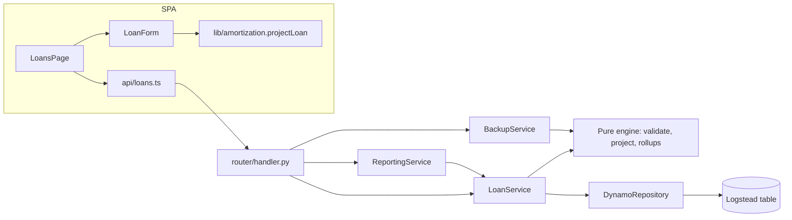
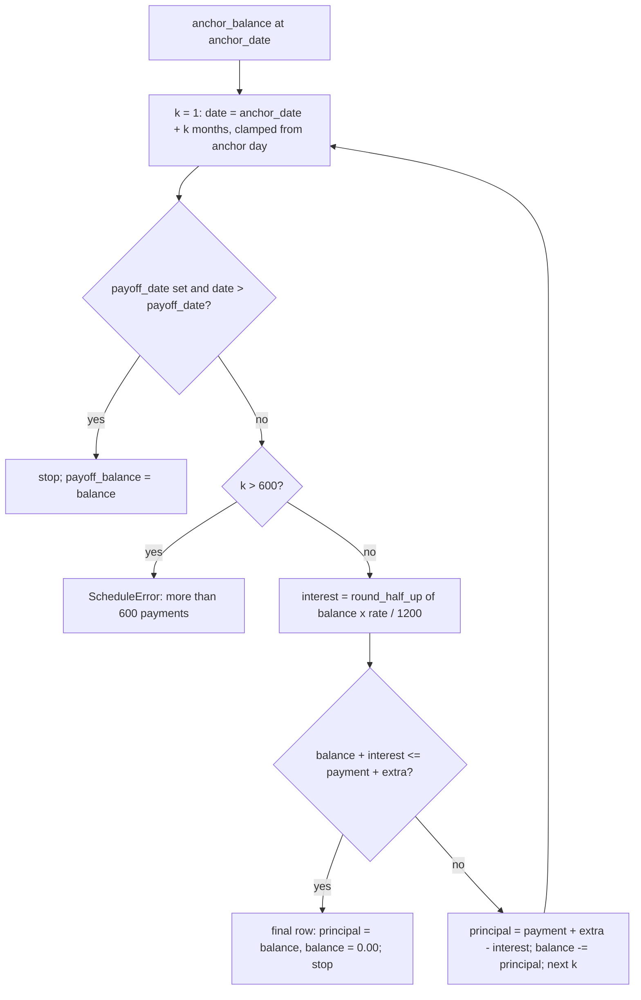

# Design Document: Loan Balance Anchor

## Overview

The mortgage-amortization feature (not yet merged or deployed) models a Loan from origination (original principal, rate, term, first payment date, optional payment override). This design replaces that input model with a **balance anchor**, in place on the same branch, before release. A Loan is an annual rate, a monthly principal-and-interest payment, and one known balance (`anchor_balance`) on one date (`anchor_date`). The engine projects forward from the anchor and derives the remaining payments, the payoff date, and a final smaller sweep payment. Because nothing was released, there are no real old-shape loans: no migration and no legacy conversion exist. Any locally created loan with the old fields must be re-entered.

Nothing else about the feature's shape changes. The key layout, `LoanService` seams, atomic rollup writes, strict readers, Line 12 precedence, `line-12-impact`, dashboard and carryforward hooks, backup flow, and the frontend page structure all stay. The changes are concentrated in:

- the pure engine (`compute_payment_rows` starts at the anchor, derives its own length, and is capped),
- validation (`validate_loan_fields`),
- rollups (a new `Override_Only_Rollup` row for years with an override but no payments),
- the Loan form, preview, and Loans page guidance.

### Key decisions

| # | Decision | Rationale |
| --- | --- | --- |
| D1 | **Anchor definition:** `anchor_balance` is the principal balance immediately after the payment made on `anchor_date`. That payment is already applied and is not in the schedule. Payment `k` (k >= 1) is dated `anchor_date` plus `k` calendar months, clamped from the **original anchor day**. The first row is the `next_payment_date`. | This is the cleanest statement the user can check against a lender statement ("balance after my Mar 1 payment"). Interest for row 1 is `anchor_balance * rate / 1200`, the same recurrence the old engine used per row, so the old row math is unchanged. |
| D2 | The user may set `anchor_date` to any date; the UI defaults it to today. | Matches the user's decision. Entering today's balance with today's date is the simplest setup. Payment dates then follow the anchor day-of-month, which may differ from the lender's due day by a few days. Only a payment near a year boundary could change tax year, and the user can set the anchor to the real payment date to avoid it. The form help text says so. |
| D3 | `original_principal` and `closing_date` are optional, informational, and validated only for format and range. `closing_date` has **no** relation check against any other date. | Informational fields must never block a save. |
| D4 | The monthly payment field is named `monthly_payment` (required). `term_months`, `first_payment_date`, and `payment_override` are removed from inputs, items, API, and backup export. | Replaces the origination model entirely. No dual mode. |
| D5 | Validation runs the engine. A loan needing more than 600 rows fails on `monthly_payment`. A row dated after year 9999 fails on `anchor_date`. | The remaining count is derived, so the cap can only be checked by projecting. The projection is at most 601 iterations of Decimal arithmetic. |
| D6 | The payment must exceed one month of interest on the anchor balance. Because every later balance is smaller, the principal portion of every non-final row is at least 0.01 and the balance strictly decreases. | Guarantees termination and makes "strictly decreasing" a true invariant. |
| D7 | **Override years:** an Interest_Override is allowed for any tax year `Y` with `1900 <= Y <= anchor_year`, and for any year with a generated row. Years without generated rows get an **Override_Only_Rollup** row (`payments = 0`, estimated interest `0.00`, principal `0.00`, total paid `0.00`, no ending balance). | The report reads Line 12 interest from one GSI2 query over rollup rows. Storing override-only rows keeps that single read path and keeps the Line 12 precedence code untouched. 1900 matches the minimum anchor date. Years after the anchor year that have no payments (after a payoff) stay rejected. |
| D9 | **Override writes always go through the full loan rewrite.** Setting or clearing an override rewrites the Loan item, all current rollup rows, and deletes stale rows in one transaction. | One write path keeps the Loan item and its rollup rows consistent. |
| D10 | `schedule_for` builds the yearly views from the Loan alone (engine plus `loan.interest_overrides`), not from stored rollup rows. | The schedule view cannot drift from the engine. Stored rows are only the report read path. |

### Findings from reading the existing code

| # | Finding | Resolution |
| --- | --- | --- |
| G1 | `_loan_from_item` is the single strict reader used by list, get, backup export, and `earliest_year`. | It parses only the anchor shape. A stored item without an anchor field raises `StoredLoanError` naming the missing field, which services map to `conflict`. |
| G2 | `set_interest_override` rejects any year not in the stored rollups (`_override_error`). | Replaced by `override_year_allowed(...)` against the engine output plus the anchor-year rule (D7). |
| G3 | `_rollup_from_item` requires `endingBalance`. | `endingBalance` becomes optional on rollup rows and `YearlyRollup.ending_balance` becomes `Decimal | None`. |
| G4 | `earliest_year` uses the first payment year of each loan. | It becomes `min(anchor_year, earliest override year)` per loan. `report_years` already derives from stored rollup rows, so override-only rows join the Data_Year set with no change. |
| G5 | The backup `_validate_loan` calls `validate_loan_fields` and recomputes rollup years from `compute_payment_rows`. | It requires the anchor fields (a loan without them is rejected with the usual property, loan, and field message) and uses `override_year_allowed`. The restore write path already emits `loan_to_item` and `rollup_to_item`. |
| G6 | `frontend/src/data/loan-payment-vectors.json` and `lib/amortization.ts` are the shared default-payment vectors. | Replaced by `loan-projection-vectors.json` and `projectLoan`. The backend `default_payment` function and the frontend `defaultMonthlyPayment` have no other callers (checked: only the old engine, `_view`, the old form preview, and their tests), so both are deleted. |
| G7 | `LoanForm` shows a default-payment preview from `defaultMonthlyPayment`. | Shows remaining payments and projected payoff date from `projectLoan`. |

## Architecture

The architecture is unchanged from mortgage-amortization. Only the engine inputs, validation, rollup builder, and the form change.



### Projection from the anchor



## Components and Interfaces

### Backend

#### `models/loan.py`

```python
@dataclass
class LoanInput:
    property_id: str | None
    description: str | None
    annual_interest_rate: Decimal | None
    monthly_payment: Decimal | None
    anchor_balance: Decimal | None
    anchor_date: str | None
    extra_principal: Decimal | None = None
    payoff_date: str | None = None
    original_principal: Decimal | None = None      # informational
    closing_date: str | None = None                # informational
    include_in_report: bool = True

@dataclass(frozen=True)
class Loan:
    id: str
    property_id: str
    description: str
    annual_interest_rate: Decimal
    monthly_payment: Decimal                       # 2 dp
    anchor_balance: Decimal                        # 2 dp
    anchor_date: str                               # YYYY-MM-DD
    extra_principal: Decimal                       # 0.00 when unset
    payoff_date: str | None
    original_principal: Decimal | None
    closing_date: str | None
    include_in_report: bool
    interest_overrides: dict[int, Decimal]
    created_at: str
    updated_at: str

@dataclass(frozen=True)
class YearlyRollup:
    # unchanged except:
    ending_balance: Decimal | None                 # None for an Override_Only_Rollup

@dataclass(frozen=True)
class LoanView:
    # Loan fields (interest_overrides as {"2024": Decimal}) plus derived:
    remaining_payments: int
    next_payment_date: str
    projected_payoff_date: str | None              # last row date when final balance is 0.00
    payoff_balance: Decimal | None
    status: Literal["active", "ended"]

@dataclass(frozen=True)
class YearlyRollupView:
    # unchanged except:
    ending_balance: Decimal | None
```

`LoanSchedule` is unchanged. `MAX_PAYMENTS = 600` and `MIN_ANCHOR_YEAR = 1900` are added to `models/loan.py`.

#### `services/loan.py` pure engine

```python
class ScheduleError(Exception):
    field: str      # "monthly_payment" or "anchor_date"
    message: str

def monthly_interest(balance, rate_pct) -> Money          # unchanged
def payment_date(anchor: date, index: int) -> date        # index >= 1; raises ScheduleError past year 9999

def compute_payment_rows(loan: Loan) -> tuple[list[PaymentRow], Money | None]:
    due = loan.monthly_payment + loan.extra_principal
    balance = loan.anchor_balance
    k = 0
    while True:
        k += 1
        d = payment_date(anchor, k)               # raises ScheduleError("anchor_date") past year 9999
        if payoff is not None and d > payoff: break
        if k > MAX_PAYMENTS: raise ScheduleError("monthly_payment", "...more than 600 payments...")
        interest = monthly_interest(balance, rate)
        if balance + interest <= due:             # Final_Payment (sweep)
            append row(k, d, interest + balance, interest, balance, 0.00); balance = 0; break
        principal = due - interest                # > 0 because payment > first-month interest
        balance -= principal
        append row(k, d, due, interest, principal, balance)
    payoff_balance = balance if (payoff is not None and balance > 0) else None
    return rows, payoff_balance
```

Notes:

- `payment_date(anchor, k)` reuses the existing month arithmetic and clamps from the anchor's own day. It must also raise `ScheduleError("anchor_date", ...)` rather than `ValueError` when the year would exceed 9999.
- The old `k == term` sweep branch and the `max(0, min(...))` clamp are gone. `balance + interest > due` implies `due - interest < balance`, and `due - interest >= payment - interest >= 0.01` by the payment-exceeds-interest rule (D6), so principal is always in `(0, balance)` for non-final rows.
- With a `payoff_date`, the loop stops at the payoff date, so a never-ending schedule is only rejected when it would still need a 601st row before the payoff date.
- The loan with `balance == 0` after row `k` ends with `balance + interest <= due` true on the last row. A zero-interest loan whose balance is an exact multiple of the payment ends with a row where `principal == due`, which is the final row (the condition `<=` makes it final).

```python
def build_yearly_rollups(loan: Loan, rows: list[PaymentRow]) -> list[YearlyRollup]
    # generated rollups (unchanged logic) + override-only rollups

def override_year_allowed(tax_year: int, anchor_year: int, generated_years: set[int]) -> bool:
    return MIN_ANCHOR_YEAR <= tax_year <= 9999 and (tax_year <= anchor_year or tax_year in generated_years)
```

`build_yearly_rollups` first groups rows by calendar year exactly as today. It then adds, for every `year` in `loan.interest_overrides` that is not a generated year, an `Override_Only_Rollup`:

```python
YearlyRollup(loan_id, property_id, tax_year=year, payments=0,
             interest=0.00, principal=0.00, total_paid=0.00, ending_balance=None,
             interest_override=value, include_in_report=loan.include_in_report)
```

and sorts by `tax_year`. `effective_interest` is unchanged (override if present else `interest`), so for an override-only row it equals the override.

#### Validation

`validate_loan_fields(loan_input) -> Result[ValidatedLoan]` keeps its collect-every-error structure:

```text
description          1..200 chars after trim                                  -> "description"
annual_interest_rate present, finite, 0..100, <= 4 dp                         -> "annual_interest_rate"
monthly_payment      present, finite, <= 2 dp, 0 < v <= MAX_MONEY             -> "monthly_payment"
anchor_balance       present, finite, <= 2 dp, 0 < v <= MAX_MONEY             -> "anchor_balance"
anchor_date          strict ^\d{4}-\d{2}-\d{2}$, real date, >= 1900-01-01     -> "anchor_date"
payment vs interest  (only when payment, balance, rate are valid)
                     monthly_payment > monthly_interest(anchor_balance, rate) -> "monthly_payment"
extra_principal      optional, <= 2 dp, 0 <= v <= MAX_MONEY                   -> "extra_principal"
payoff_date          optional, real date, >= next_payment_date                -> "payoff_date"
original_principal   optional, <= 2 dp, 0 < v <= MAX_MONEY                    -> "original_principal"
closing_date         optional, real date only                                 -> "closing_date"
projection           (only when every field above is valid) run compute_payment_rows on a
                     draft Loan; ScheduleError -> error on exc.field
```

The projection step runs last and only when nothing else failed, so it never masks a more specific error. `ValidatedLoan` carries the canonical fields (rate as a plain decimal string).

#### Strict reader

The strict reader `_loan_from_item` parses only the anchor shape:

```text
required: id, propertyId, description, annualInterestRate, monthlyPayment, anchorBalance, anchorDate,
          extraPrincipal, includeInReport, createdAt, updatedAt
optional: originalPrincipal, closingDate, payoffDate, interestOverrides
```

A missing required attribute or an unparseable value raises `StoredLoanError(field)` naming the field. A stored item without the anchor fields (for example a locally created loan in the discarded origination shape) therefore reads as invalid and the service maps it to `conflict` naming the missing field. There is no fallback shape. Such a loan must be deleted or re-entered.

#### Item builders and money sets

```python
def loan_to_item(loan: Loan) -> dict:
    {PK, SK, id, propertyId, description,
     "annualInterestRate": format(rate, "f"),            # plain decimal, not money
     "monthlyPayment": loan.monthly_payment,             # money
     "anchorBalance": loan.anchor_balance,               # money
     "anchorDate": loan.anchor_date,
     "extraPrincipal": loan.extra_principal,             # money
     "payoffDate": ..., "closingDate": ...,              # omitted when None
     "originalPrincipal": loan.original_principal,       # money, omitted when None
     "includeInReport", "interestOverrides" (map, omitted when empty), "createdAt", "updatedAt"}

_LOAN_MONEY   = {"monthlyPayment", "anchorBalance", "extraPrincipal", "originalPrincipal"}
_ROLLUP_MONEY = {"interest", "principal", "totalPaid", "endingBalance", "interestOverride", "effectiveInterest"}
```

`rollup_to_item` omits `endingBalance` when `ending_balance is None`. `_rollup_from_item` reads it with `_stored_opt_money`. Keys, GSI2 layout, and `keys.py` are unchanged.

#### `LoanService`

Public methods and signatures are unchanged. Behavior changes:

- `create_loan`, `update_loan`: validate, build, and write through `_write_loan`. `update_loan` keeps existing overrides only where `override_year_allowed(year, new_anchor_year, new_generated_years)` holds (Requirement 6.9). `_write_loan` computes `rows`, `rollups = build_yearly_rollups(...)` (generated plus override-only), and the stale-delete set `previous_years - {r.tax_year for r in rollups}`. `ScheduleError` from a stored loan maps to `conflict` with the offending field.
- `set_interest_override(property_id, loan_id, tax_year, amount)`: load the Loan, compute the generated years, require `override_year_allowed`, validate the amount (string or `Decimal`, finite, non-negative, at most two decimals, at most `MAX_MONEY`), then `_write_loan(replace(loan, interest_overrides=..., updated_at=now), previous_years)`. The returned `YearlyRollupView` is built from the engine output for that year.
- `clear_interest_override`: remove the key and rewrite through `_write_loan`. Clearing a year with no override succeeds without writing. Clearing an override on an override-only year removes the row because the year drops out of the rollup set.
- `schedule_for`: builds `rows`, generated and override-only rollups from the loaded Loan, and maps them to `YearlyRollupView` (D10). It no longer reads stored rollups.
- `_view`: computes `rows` once and fills `remaining_payments = len(rows)`, `next_payment_date = payment_date(anchor, 1).isoformat()`, `projected_payoff_date = rows[-1].date if rows and rows[-1].balance == 0 else None`, `payoff_balance`, and `status`. A `ScheduleError` while viewing a stored loan maps to `conflict` through `_corrupt`.
- `earliest_year`: for each Loan, `min(int(anchor_date[:4]), *interest_overrides)`; the minimum across loans.
- `report_years`, `property_effective_interest_for_year`: unchanged. Override-only rollups are ordinary GSI2 rows, so they contribute automatically (Requirement 7.1, 7.4).

Transaction-size guard: unchanged at 100 actions. A Loan now writes at most 52 generated rows plus one override-only row per override year, so the guard can trigger only for a Loan with roughly 48 or more override-only years. The message becomes "This loan has too many yearly interest totals to save at once. Remove some interest overrides first." with field `interest_overrides`.

#### `ReportingService`, `DashboardService`, `CarryforwardService`

No code change. `property_effective_interest_for_year` and `report_years` already return override-only rows because they are indexed under `GSI2PK = PROPERTY#<id>#YEAR#<year>` with `LOANYR#` and `includeInReport`. `derive_data_years` already caps years at `latest_tax_year()`, so pre-anchor years with overrides enter the Data_Year series and the carryforward chain (Requirement 7.4, 7.6).

Behavior notes:

- The anchor year with **no** override has partial generated interest (payments after the anchor date). If it is above 0.00 it supersedes manual Line 12 transactions for that year. The Loans page notice (Requirement 11.4) tells the user to enter the Form 1098 figure as an override for the anchor year.
- A pre-anchor year without an override has no rollup row, so Line 12 for that year is the user's manual transactions, exactly as before the feature.
- An override of `0.00` has an Effective_Interest of 0.00 and falls back to manual transactions (existing finding F15 of the earlier design).

#### Router

- `_loan_input(body, property_id)` maps `description`, `annual_interest_rate`, `monthly_payment`, `anchor_balance`, `anchor_date`, `extra_principal`, `payoff_date`, `original_principal`, `closing_date`, `include_in_report` (snake_case and camelCase). All decimal fields go through `_loan_decimal`, so JSON floats and booleans are rejected on that field. Removed keys (`term_months`, `first_payment_date`, `payment_override`) are ignored if present; they do not satisfy the required fields.
- `_set_interest_override` is unchanged. `{taxYear}` is parsed with `_int_param`; range rules live in the service.
- Route table is unchanged.

JSON shapes:

`POST /properties/{pid}/loans` request:

```json
{
  "description": "First mortgage",
  "annual_interest_rate": "6.875",
  "monthly_payment": "1970.79",
  "anchor_balance": "214500.00",
  "anchor_date": "2025-06-01",
  "extra_principal": "0.00",
  "payoff_date": null,
  "original_principal": "300000.00",
  "closing_date": "2022-02-14",
  "include_in_report": true
}
```

Response `201` (also GET and PUT; list returns an array):

```json
{
  "id": "9f1c...", "property_id": "a31b...",
  "description": "First mortgage",
  "annual_interest_rate": "6.875",
  "monthly_payment": "1970.79",
  "anchor_balance": "214500.00",
  "anchor_date": "2025-06-01",
  "extra_principal": "0.00",
  "payoff_date": null,
  "original_principal": "300000.00",
  "closing_date": "2022-02-14",
  "include_in_report": true,
  "interest_overrides": { "2023": "20650.12", "2025": "7410.55" },
  "remaining_payments": 148,
  "next_payment_date": "2025-07-01",
  "projected_payoff_date": "2037-10-01",
  "payoff_balance": null,
  "status": "active",
  "created_at": "2025-06-02T15:04:05+00:00",
  "updated_at": "2025-06-02T15:04:05+00:00"
}
```

`GET .../schedule` returns `payments` as before and `yearly` entries with `ending_balance: null` for override-only rows:

```json
{ "tax_year": 2023, "payments": 0, "interest": "20650.12", "estimated_interest": "0.00",
  "interest_override": "20650.12", "variance": "20650.12",
  "principal": "0.00", "total_paid": "0.00", "ending_balance": null }
```

`PUT .../interest-overrides/2023` with `{"interest": "20650.12"}` returns the yearly object above. `DELETE` returns the generated year's reverted object, or `null` when the year had no payments (the row is removed).

Validation failure bodies keep the existing `errors` list shape, for example `{"error":"validation","field":"monthly_payment","message":"Monthly payment must exceed the first month's interest.","errors":[...]}`.

#### Backup

`models/backup.py` `BackupLoan` becomes:

```python
@dataclass(frozen=True)
class BackupLoan:
    id: str; property_id: str; description: str
    annual_interest_rate: Decimal
    monthly_payment: Decimal
    anchor_balance: Decimal
    anchor_date: str
    extra_principal: Decimal = Decimal("0.00")
    payoff_date: str | None = None
    original_principal: Decimal | None = None
    closing_date: str | None = None
    include_in_report: bool = True
    interest_overrides: dict[int, Decimal] = field(default_factory=dict)
    created_at: str | None = None
    updated_at: str | None = None
```

- **Export** (`_list_loans`) maps each strict-read `Loan` to `BackupLoan`. Rollup rows are skipped, so override-only rows are never exported (Requirement 9.2).
- **Validation** (`_validate_loan`): every anchor field (`monthly_payment`, `anchor_balance`, `anchor_date`) is required. A loan that lacks one, including a loan in the discarded origination shape, is rejected with the usual "property, loan" label and the missing field name. There is no conversion branch. It then runs `validate_loan_fields` and the override-year check:

```text
generated_years = years of compute_payment_rows(draft loan)
for each year in interest_overrides:
    if not override_year_allowed(year, anchor_year, generated_years):
        fail(f"interest_overrides.{year}: tax year is not allowed ...")
```

  All of this stays inside the pure `validate_document` phase that runs before the clear, so an invalid loan persists nothing (Requirement 9.4).
- **Restore writes** are unchanged: build a `Loan`, `compute_payment_rows`, `build_yearly_rollups` (now including override-only rows), emit `loan_to_item` and `rollup_to_item`.
- `schema_version` stays `"1"`. A backup whose loans lack the anchor fields is rejected as invalid; this is acceptable because the previous loan shape was never released.

### Frontend

#### `lib/amortization.ts`

`defaultMonthlyPayment` is replaced by a projection that mirrors the engine with `BigInt` integers. All money is integer cents and the rate is an integer scaled by 10^4, so interest is exact integer arithmetic with no fixed-point scale:

```ts
export interface LoanProjectionInput {
  anchorBalance: string; annualInterestRate: string; monthlyPayment: string;
  extraPrincipal?: string; anchorDate: string; payoffDate?: string;
}
export interface LoanProjection {
  remainingPayments: number;
  nextPaymentDate: string;
  projectedPayoffDate: string | null;   // date of the final row when the balance reaches 0.00
  payoffBalance: string | null;         // balance left at payoffDate, two decimals
  finalPayment: string | null;          // amount of the last row
  totalInterest: string;                // sum of interest, two decimals
}
export function projectLoan(input: LoanProjectionInput): LoanProjection | null
```

- `interestCents = (2n * balanceCents * rateScaled + 12_000_000n) / (2n * 12_000_000n)` (half-up of `balance * rate / 1200` in cents, with rate scaled by 10^4).
- `paymentDate(anchor, k)` uses integer year/month arithmetic and the original anchor day, clamped to the month length (leap years included).
- Returns `null` when any input is missing or invalid under the backend grammar, when the payment does not exceed the first month's interest, when more than 600 rows are needed, when a date passes year 9999, or when `payoffDate` precedes the next payment date. The caller hides the preview on `null`.
- A shared fixture `frontend/src/data/loan-projection-vectors.json` holds about 60 vectors `{anchor_balance, annual_interest_rate, monthly_payment, extra_principal, anchor_date, payoff_date, remaining_payments, next_payment_date, projected_payoff_date, payoff_balance, final_payment, total_interest}` generated from the backend engine and spot-checked against an independent calculator. Both vitest and pytest assert against it, following the precedent of `sample-backup.json`.

#### API module `api/loans.ts`

```ts
export interface Loan {
  id: string; property_id: string; description: string;
  annual_interest_rate: string; monthly_payment: string;
  anchor_balance: string; anchor_date: string; extra_principal: string;
  payoff_date: string | null; original_principal: string | null; closing_date: string | null;
  include_in_report: boolean; interest_overrides: Record<string, string>;
  remaining_payments: number; next_payment_date: string;
  projected_payoff_date: string | null; payoff_balance: string | null;
  status: "active" | "ended"; created_at: string; updated_at: string;
}
export interface LoanInput { /* the request fields above */ }
export interface YearlyRollup { /* as before */ ending_balance: string | null; }
```

Function signatures are unchanged. `api/backup.ts` `BackupLoan` mirrors the new backup shape (origination fields removed from the type).

#### Form model `loanFormModel.ts`

`LoanFormValues` becomes `description, annualInterestRate, monthlyPayment, anchorBalance, anchorDate, extraPrincipal, payoffDate, originalPrincipal, closingDate, includeInReport` (strings except the flag). `EMPTY_LOAN_FORM` takes `anchorDate` from a `todayIso()` helper (injectable for tests). `validateLoanForm` mirrors the backend rules, then calls `projectLoan` when every individual field is valid so that "payment must exceed first month's interest" and "more than 600 payments" surface as errors on `monthlyPayment`, and a year above 9999 on `anchorDate`. `LOAN_FIELD_BY_API_NAME` maps the new API names. `toLoanInput` sends strings and canonicalizes the rate as today.

#### Components

```text
LoanForm.tsx                 new field set; anchor help text; Loan_Preview (remaining payments, projected payoff date)
LoanList.tsx                 columns: description, balance (as of anchor date), rate, monthly payment, payoff, status
YearlyRollupTable.tsx        override-only rows render a dash in principal/total/ending cells; anchor-year row hint
PaymentRowsTable.tsx         unchanged; no expandable detail for years with zero payments
AnchorYearNotice.tsx         NEW: anchor year + "generated interest covers payments after <date>" + 1098 instruction
PastYearOverrideForm.tsx     NEW: year (1900..anchor year) + amount + Save; validation; not shown for years with payments
EstimateNotice.tsx           copy updated to mention the anchor
InterestOverrideControl.tsx  unchanged behavior; reused per row (Save/Clear); clear on an override-only row removes the row
useLoans.ts, useLoanSchedule.ts, LoansPage.tsx   wired to the new fields; schedule refresh after override set/clear
```

- **Loan preview.** `LoanForm` computes `projectLoan(...)` in a `useMemo` over the current values, so the preview updates synchronously on every edit and disappears (not stale) as soon as `projectLoan` returns `null` (Requirements 10.4 to 11.6). When a `payoffDate` truncates the schedule, the preview shows the payoff balance instead of a payoff date.
- **Anchor help text** is linked to the Anchor_Balance and Anchor_Date inputs with `aria-describedby`.
- **YearlyRollupTable.** Each row's expandable payment detail is built by grouping `schedule.payments` by `date.slice(0, 4)`. A year with `payments === 0` has no expand control and shows "Override only" text next to the year. The anchor year row shows "Anchor year: payments after <anchor date> only" as text (never color alone).
- **PastYearOverrideForm** lists no years; it takes a year and an amount. Client rules: year is an integer from 1900 to the anchor year, amount is non-negative with at most two decimals. If the entered year has a generated row, the form directs the user to that row's control instead. A failed rule shows a message next to the field and does not call the API; server `interest_overrides.<year>` errors appear next to the year field.
- **Navigation, ownership, report view, line-12-impact notice** are unchanged.

## Data Models

### Loan item (anchor shape)

| Attribute | Type | Notes |
| --- | --- | --- |
| `PK` | S | `PROPERTY#<propertyId>` |
| `SK` | S | `LOAN#<loanId>` |
| `id`, `propertyId`, `description` | S | description 1 to 200 characters |
| `annualInterestRate` | S | plain decimal, at most 4 dp, never money-quantized |
| `monthlyPayment` | S | money, 2 dp, greater than 0 |
| `anchorBalance` | S | money, 2 dp, greater than 0 |
| `anchorDate` | S | `YYYY-MM-DD`, 1900-01-01 or later |
| `extraPrincipal` | S | money, `"0.00"` when unset |
| `payoffDate`, `closingDate` | S | omitted when unset |
| `originalPrincipal` | S | money, omitted when unset; informational |
| `includeInReport` | BOOL | default true |
| `interestOverrides` | M | `{"<year>": "<2dp string>"}`, years 1900 or later; omitted when empty |
| `createdAt`, `updatedAt` | S | ISO-8601 |


### Rollup item

Unchanged key layout (`SK = LOAN#<loanId>#YEAR#<year>`, `GSI2PK = PROPERTY#<propertyId>#YEAR#<year>`, `GSI2SK = LOANYR#<loanId>`). Differences:

| Attribute | Change |
| --- | --- |
| `endingBalance` | Optional. Omitted on an Override_Only_Rollup. |
| `payments` | `0` on an Override_Only_Rollup. |
| `interest`, `principal`, `totalPaid` | `"0.00"` on an Override_Only_Rollup. |
| `interestOverride`, `effectiveInterest` | Both equal the override on an Override_Only_Rollup. |

Example for a loan anchored 2025-06-01 with overrides for 2023 and 2025, no payments in 2023:

```text
PK=PROPERTY#p1  SK=LOAN#L1                  (Loan, anchor shape)
PK=PROPERTY#p1  SK=LOAN#L1#YEAR#2023        payments=0  interest=0.00  interestOverride=20650.12  effectiveInterest=20650.12   (override-only, no endingBalance)
PK=PROPERTY#p1  SK=LOAN#L1#YEAR#2025        payments=7  interest=<generated, Jul-Dec>  interestOverride=7410.55  effectiveInterest=7410.55
PK=PROPERTY#p1  SK=LOAN#L1#YEAR#2026        payments=12 ...
```

### Backup document fragment

```json
{
  "schema_version": "1",
  "properties": [
    { "id": "p1", "name": "...", "address_text": "...", "transactions": [], "assets": [],
      "loans": [
        { "id": "L1", "property_id": "p1", "description": "First mortgage",
          "annual_interest_rate": "6.875", "monthly_payment": "1970.79",
          "anchor_balance": "214500.00", "anchor_date": "2025-06-01",
          "extra_principal": "0.00", "payoff_date": null,
          "original_principal": "300000.00", "closing_date": null,
          "include_in_report": true,
          "interest_overrides": { "2023": "20650.12", "2025": "7410.55" },
          "created_at": "2025-06-02T15:04:05+00:00", "updated_at": "2025-06-02T15:04:05+00:00" }
      ] }
  ]
}
```


### Documentation updates

`docs/data-model.md`: replace the Loan entity text with the anchor-shape attributes, add **Override_Only_Rollup row**, keep **Line 12 precedence rule**, and update **Loan backup treatment**. `docs/api.md`: new request and response fields, the 1900 to anchor-year override range, the `ending_balance: null` case, and removal of `default_payment` and `scheduled_payment`. `CHANGELOG.md`: describe the anchor model under Unreleased and note that the loan input model changed before release (no migration needed; any locally created loans must be re-entered). `docs/future-improvements.md` already records multiple checkpoints and is not changed.

## Correctness Properties

*A property is a characteristic or behavior that should hold true across all valid executions of a system-essentially, a formal statement about what the system should do. Properties serve as the bridge between human-readable specifications and machine-verifiable correctness guarantees.*

Reflection on the prework merged row-level criteria (2.3, 2.4, 2.8, 2.10, 3.1) into one recurrence property, all field-level validation criteria (1.2 to 1.8, 2.14, 2.15, 3.2, 3.5, 4.2, 4.4, 8.8) into one validation property, and the override set, change, and remove clauses into three focused properties. Criteria that are UI wording, one-time setup, or infrastructure (7.3, 7.5, 8.1, 8.2, 8.5, 8.6, 9.6, 9.7, 10.1 to 10.3, 10.7, 10.8, 11.1, 11.4, 11.5, 11.7 to 11.9, 12.3 to 12.7, 13.x) are covered by example, smoke, or edge-case tests in the Testing Strategy. Properties of the earlier feature that are not affected (report precedence mechanics, combined report sums, report reproducibility, export parity, missing-versus-foreign property indistinguishability, delete exactness) keep their existing tests; only the properties below change or are new.

### Property 1: Row arithmetic and balance recurrence

*For any* valid Loan (any anchor balance, rate including 0, payment that exceeds the first month's interest, extra principal, anchor date, and optional payoff date), every Payment_Row satisfies: `interest` equals the balance before the row times the rate divided by 1200 rounded half-up to the cent, computed with an independent `Fraction` oracle; `interest + principal == payment`; `balance == previous_balance - principal` starting from the anchor balance; every non-final row has `principal == monthly_payment + extra_principal - interest` and `principal >= 0.01`; balances are strictly decreasing and never below 0.00; and every money field is a `Decimal` with exactly two decimal places.

**Validates: Requirements 2.3, 2.4, 2.8, 2.10, 2.13, 3.1**

### Property 2: Schedule shape, dates, termination, and determinism

*For any* valid Loan, rows are numbered 1..n with `n <= 600`; row `k` is dated exactly `k` calendar months after the anchor date with the day clamped to the month length from the original anchor day, so no row is dated on or before the anchor date and dates strictly ascend; `remaining_payments == n`; only the last row can be the final payment, which satisfies `balance_before + interest <= monthly_payment + extra_principal` while no earlier row does; without a payoff date the last row has balance 0.00 and the projected payoff date equals its date; and computing the schedule twice from identical inputs yields identical rows.

**Validates: Requirements 2.1, 2.2, 2.5, 2.6, 2.7, 2.11, 2.12**

### Property 3: Principal conservation

*For any* valid Loan, the sum of all row principal portions plus the payoff balance (0.00 when the loan amortizes before any payoff date or has none) equals the anchor balance exactly; without a payoff date the final balance is 0.00; and a payoff balance is reported only when a payoff date leaves a positive balance, in which case it equals the balance of the last row on or before the payoff date.

**Validates: Requirements 2.9, 3.4, 3.6**

### Property 4: Informational fields never affect results

*For any* valid Loan and any original principal (absent or any valid amount) and closing date (absent or any valid date), the Payment_Rows, Yearly_Rollups, Effective_Interest, and derived fields (remaining payments, projected payoff date, payoff balance) are identical to those of the same Loan with both informational fields absent; the informational fields round trip through create and get unchanged.

**Validates: Requirements 4.1, 4.3, 4.5**

### Property 5: Extra principal never makes a loan slower or costlier

*For any* valid Loan and any extra principal `x >= 0`, the schedule with extra principal `x` has no more rows and no greater total interest than the same Loan with extra principal 0.00, and its balance after row `k` is never above the zero-extra balance after row `k` for every `k` both schedules contain.

**Validates: Requirements 3.8**

### Property 6: Payoff date truncates the schedule to a prefix

*For any* valid Loan and any payoff date on or after the next payment date, the rows of the Loan with the payoff date are exactly the leading rows of the same Loan without it that are dated on or before the payoff date; no row is dated after the payoff date; and a row dated on the payoff date is present exactly when that date is a scheduled payment date.

**Validates: Requirements 3.3, 3.7**

### Property 7: Re-anchoring consistency

*For any* valid Loan with at least two rows and any non-final row `k`, a Loan with the same rate, payment, and extra principal anchored on the date of row `k` with the balance of row `k` produces the same payment, interest, principal, and balance for every later row, and the same dates when the original anchor day is 28 or less.

**Validates: Requirements 2.1, 2.16**

### Property 8: Yearly rollup consistency, anchor year, and override-only rows

*For any* valid Loan with any set of permitted interest overrides, the set of tax years with a rollup equals the set of calendar years of its rows united with the override years; no generated rollup exists for a year before the anchor year; the anchor year rollup contains only rows dated after the anchor date; each generated rollup's interest, principal, and total paid equal the exact sums of its rows with no proration and its ending balance equals the balance of the last row in that year; and each override-only rollup has 0 payments, estimated interest 0.00, principal 0.00, total paid 0.00, no ending balance, and an effective interest equal to the override.

**Validates: Requirements 5.1, 5.2, 5.3, 5.4, 5.5, 6.2**

### Property 9: Validation rejects every invalid field and writes nothing

*For any* Loan input in which a chosen subset of fields is invalid (missing or out-of-range description, anchor balance that is zero, negative, above 999,999,999.99, or has more than two decimals, payment with the same faults or at or below the first month's interest, rate negative, above 100, or with more than four decimals, anchor date not strict `YYYY-MM-DD`, not a real date, or before 1900-01-01, extra principal negative or over two decimals, payoff date before the next payment date, original principal zero, negative, or over two decimals, closing date not a real date, a payment so small that more than 600 rows are needed, or an anchor date so late that a row passes year 9999), create and update return a validation failure that names every field in the chosen subset, and the stored table contents are unchanged. The same holds through the router, with the response using the existing error shape plus the `errors` list.

**Validates: Requirements 1.2, 1.3, 1.4, 1.5, 1.6, 1.7, 1.8, 2.14, 2.15, 3.2, 3.5, 4.2, 4.4, 8.8**

### Property 10: Loan serialization round trips

*For any* valid Loan, serializing it to the API JSON shape and parsing that JSON back into a `LoanInput` that validates produces a Loan equal in every field, including the exact annual-rate decimal; rendering a Loan to its table item and reading it back is the identity; every money value in the API response and in the stored item is a string with exactly two decimal places and the rate is a plain decimal string; and a money or rate field sent as a JSON float is rejected with a validation failure on that field.

**Validates: Requirements 4.1, 4.3, 8.3, 8.4, 8.9, 12.1**

### Property 11: Stored rollups always equal the engine output, with none stale

*For any* sequence of valid creates, updates, override sets, and override clears of a Loan, after each step the stored rollup rows for that Loan are exactly the engine's generated and override-only rollups for the current inputs: same tax years, same values, GSI2 keys `PROPERTY#<id>#YEAR#<year>` and `LOANYR#<loanId>`, `endingBalance` omitted exactly on override-only rows, and no row for any year outside the current set. The Loan keeps its id and created timestamp across updates, its updated timestamp moves forward, and the total Effective_Interest for a property and year read by one GSI2 query equals the sum over included Loans of the engine value for that year.

**Validates: Requirements 1.1, 1.9, 5.6, 12.2**

### Property 12: Payoff set and clear is a round trip

*For any* valid Loan and any payoff date, updating the Loan with the payoff date leaves no generated rollup for a tax year after the payoff date year, and updating again with the payoff date cleared restores stored rollups identical to those stored before the payoff date was set.

**Validates: Requirements 3.9**

### Property 13: Delete and list are exact and scoped

*For any* property with several Loans and depreciable assets spread across several properties, deleting one Loan removes its Loan item, its overrides, and every one of its rollup rows (including override-only rows) in one atomic write while every other row is unchanged; listing Loans for a property returns exactly that property's Loans and no rollup rows; and listing depreciable assets returns no Loan or rollup rows.

**Validates: Requirements 1.10, 13.4**

### Property 14: An override replaces estimated interest for one year and nothing else

*For any* valid Loan and any permitted tax year (a year with a row, or a year from 1900 through the anchor year), setting an Interest_Override makes that year's Effective_Interest equal the override and leaves every other year's Effective_Interest unchanged. Every Payment_Row, balance, and principal total is identical before and after the override is set, changed, or removed.

**Validates: Requirements 6.1, 6.2, 6.5**

### Property 15: Override set then clear is a round trip with a correct variance

*For any* valid Loan, permitted tax year, and valid override amount, the schedule reports `variance == override - estimated_interest` (with estimated interest 0.00 for a year without rows) as a signed two-decimal string, and clearing the override restores the stored Loan item and rollup rows to exactly their state before it was set, deleting the override-only row when the year has no payments.

**Validates: Requirements 6.6, 6.7, 6.8**

### Property 16: Invalid overrides are rejected and storage format is fixed

*For any* override amount that is negative, has more than two decimals, or is not numeric, and *for any* tax year before 1900 or after the anchor year without a row, the set request returns a validation failure on `interest_overrides.<year>` and the previously stored override for that year (if any) and all rollup rows are unchanged. *For any* accepted override the stored value is a string with exactly two decimals, including `"0.00"`.

**Validates: Requirements 6.3, 6.4, 6.10**

### Property 17: Updates retain exactly the overrides whose year is still permitted

*For any* Loan with overrides on several years and any valid update that changes the anchor date, payment, extra principal, or payoff date, the Loan's overrides afterward are exactly the earlier overrides whose year is between 1900 and the new anchor year or has a row in the new schedule; the stored rollup rows contain an override-only row for each retained override without payments; and every dropped override has no rollup row.

**Validates: Requirements 6.9**

### Property 18: Line 12 uses loan interest or manual interest, never both, including override-only years

*For any* property and tax year, any set of Loans (several in the same year, inclusion on or off, overrides including 0.00, years before the anchor year with override-only rollups), and any set of Line 12 expense transactions: let `L` be the sum of Effective_Interest over included Loans for that year. If `L > 0.00` the Line 12 total equals `L`, the source is `loan-generated`, and the superseded figure equals the sum and count of the Line 12 transactions. Otherwise the total equals the sum of the transactions, the source is `transaction-entered`, and the superseded figure is 0.00 with count 0. The total is never the sum of both.

**Validates: Requirements 7.1, 7.2**

### Property 19: Data years and carryforward net include override-only years

*For any* set of properties, transactions, and Loans, every tax year at or before the latest completed tax year in which an included Loan has a generated or override-only rollup appears among the Data_Years even when the year has no transactions or depreciation, the earliest data year of a property is at most the smallest of its loans' anchor years and override years, and the schedule E net that carryforward uses for a year equals the sum over properties of the report net, which includes override-only interest.

**Validates: Requirements 7.4, 7.5, 7.6**

### Property 20: Backup round trip preserves anchor-shape Loans and overrides

*For any* set of Loans with overrides (including years without payments), exporting a backup, restoring it into an empty account, and exporting again yields identical Loan content (ids, timestamps, all fields, and overrides); the exported document contains no rollup or payment rows and every money value has two decimals; the restored account's stored rollup rows equal the engine output for each restored Loan; and the restore summary's loan count equals the number of Loans in the document.

**Validates: Requirements 9.1, 9.2, 9.3, 9.5**

### Property 21: An invalid Loan in a backup rejects the whole restore

*For any* backup document that is valid except for one Loan that violates a Loan validation rule (including an override for a year that is before 1900 or after the anchor year without payments, and a Loan that lacks `monthly_payment`, `anchor_balance`, or `anchor_date`, such as a Loan in the discarded origination shape), restore returns a validation failure naming the property, the Loan, and the rule, and the account's stored data is exactly what it was before the restore call.

**Validates: Requirements 9.4**

### Property 22: The preview matches the backend and is never stale

*For any* anchor balance, rate, payment, extra principal, anchor date, and optional payoff date strings, `projectLoan` returns the same remaining payments, next payment date, projected payoff date, payoff balance, final payment, and total interest as the backend oracle when all inputs are valid under the backend grammar and the schedule is accepted, and returns `null` (so the preview is hidden) otherwise. After any sequence of form edits, the displayed preview is a function of the current values only.

**Validates: Requirements 10.4, 10.5, 10.6**

### Property 23: Yearly table formatting including override-only rows

*For any* schedule response, the yearly table has exactly one row per yearly object in ascending year order; each generated row's money cells equal `formatMoneyWholeDollars` of their strings; each override-only row (zero payments) shows the interest cell in whole dollars and a text dash in the principal, total paid, and ending balance cells; and each expanded payment row's money cells equal `formatMoney` of their strings.

**Validates: Requirements 11.2, 11.3**

### Property 24: The add-override form never sends an invalid value

*For any* year text and amount text where the year is not an integer from 1900 through the anchor year, or the amount is negative, not a number, or has more than two decimals, the add-override form shows a validation message next to the invalid field and does not call the API; for valid values it calls the API exactly once with the year and the amount string unchanged.

**Validates: Requirements 11.5, 11.6**

## Error Handling

| Condition | Layer | Result | HTTP |
| --- | --- | --- | --- |
| Missing or invalid Loan field(s) | `validate_loan_fields` | `validation`, `field` = first offending field, `errors` = every offending field | 400 |
| Payment at or below first month's interest | `validate_loan_fields` | `validation`, `monthly_payment` | 400 |
| Schedule needs more than 600 rows | `ScheduleError` mapped by validation | `validation`, `monthly_payment` | 400 |
| A row would be dated after year 9999 | `ScheduleError` mapped by validation | `validation`, `anchor_date` | 400 |
| Payoff date before the next payment date | `validate_loan_fields` | `validation`, `payoff_date` | 400 |
| JSON float for a decimal field | router `_loan_decimal` | `validation` on that field | 400 |
| Override amount invalid | `set_interest_override` | `validation`, `interest_overrides.<year>`; nothing written | 400 |
| Override year before 1900 or after anchor year without a row | `set_interest_override` | `validation`, `interest_overrides.<year>`; nothing written | 400 |
| Write would exceed 100 transaction items | `LoanService._write_loan` | `validation`, `interest_overrides`, message to remove overrides | 400 |
| Property missing or not owned | router `_require_owned_property` | identical 404 | 404 |
| Loan missing | `LoanService` | `not_found`, `loan_id` | 404 |
| DynamoDB `ClientError` or `BotoCoreError` | `LoanService` | `unavailable`, "No changes were made." (single transaction) | 503 |
| Stored Loan missing an anchor attribute, or a stored value that does not parse | strict reader | `conflict` naming the field; nothing written | 409 |
| Stored schedule raises `ScheduleError` | `_view` | `conflict` naming the field | 409 |
| Invalid Loan, or Loan missing an anchor field, in a restore document | `validate_document` | `validation` naming property, Loan, and rule, before the clear | 400 |
| Preview inputs invalid in the browser | `projectLoan` returns `null` | preview hidden, field messages from `validateLoanForm` | n/a |

Frontend handling follows the existing `LoansPage`: a 400 body with `errors` or `field` maps each message to its control and keeps entered values; a body with no field or a transport failure shows a form-level `role="alert"` message; delete failures keep the row and show a toast.

Concurrency: last-writer-wins as for every other entity, unchanged.

## Testing Strategy

### Approach

Unit and property tests are both used. Property-based testing applies: the engine is pure Decimal logic over a large input space, and the override rules, and report precedence are business logic over generated data. Backend uses pytest, Hypothesis, and moto. Frontend uses vitest, React Testing Library, and fast-check (already in `package.json`). No property-based testing is written from scratch.

Configuration for every property test:

- At least 100 iterations (`@settings(max_examples=100)`; moto-backed tests use `deadline=None` and small generated data; fast-check `numRuns: 100`).
- One test function per property.
- Tag comment: `# Feature: loan-balance-anchor, Property <n>: <property text>`.
- The oracle for Properties 1 and 2 is independent of the code under test: `fractions.Fraction` for exact interest and `calendar` for month lengths.

### Backend generators

- `anchor_balance`: cents from 0.01 to 999,999,999.99, biased to round and small values.
- `rate`: 0 to 100 with 0 to 4 decimals, 0 and 6.875-like values drawn often.
- `monthly_payment`: derived as `first_month_interest + extra_cents` with a bias toward payments that give 1 to 600 rows, plus a strategy for too-small payments (Property 9).
- `anchor_date`: 1990 to 2060 with a bias toward days 28 to 31 (month-end clamping); a dedicated strategy for days 1 to 28 (Properties 7 and 18).
- `extra_principal`: absent or small. `payoff_date`: absent or inside the schedule span.
- `overrides`: random subsets of years from 1990 up to the anchor year plus generated years, amounts including 0.00.
- Report and carryforward properties generate 1 to 3 properties, 0 to 3 Loans each (some with pre-anchor overrides), inclusion flags, and 0 to 5 Line 12 transactions per year.

### Backend test files

Existing files are updated for the new input shape; new files are marked NEW.

```text
tests/services/test_loan_engine_property.py                  P1 (updated: anchor engine, Fraction oracle)
tests/services/test_loan_engine_shape_property.py            P2 (NEW)
tests/services/test_loan_engine_conservation_property.py     P3 (NEW)
tests/services/test_loan_informational_property.py           P4 (NEW)
tests/services/test_loan_engine_extra_property.py            P5 (NEW)
tests/services/test_loan_engine_payoff_property.py           P6 (NEW)
tests/services/test_loan_engine_reanchor_property.py         P7 (NEW)
tests/services/test_loan_rollup_property.py                  P8 (NEW)
tests/services/test_loan_validation_property.py              P9 (updated)
tests/services/test_loan_roundtrip_property.py               P10 (updated)
tests/services/test_loan_storage_property.py                 P11, P13 (updated)
tests/services/test_loan_payoff_roundtrip_property.py        P12 (NEW)
tests/services/test_loan_override_property.py                P14, P17 (updated)
tests/services/test_loan_override_roundtrip_property.py      P15, P16 (NEW)
tests/services/test_report_line12_property.py                P18 (updated generators)
tests/services/test_carryforward_loan_property.py            P19 (updated)
tests/services/test_backup_loan_roundtrip_property.py        P20, P21 (updated)
tests/services/test_loan_golden_vectors.py                   engine vs frontend/src/data/loan-projection-vectors.json (NEW; the old default-payment test module is deleted)
tests/services/test_loan_service.py                          CRUD examples, failure injection, 100-action guard, strict-read corruption, ScheduleError mapping, strict read of a stored loan missing an anchor field
tests/router/test_loan_routes.py                             route examples, float rejection, new field set, override years, missing-vs-foreign property
tests/router/test_loan_line12_impact_route.py                updated fixtures
tests/router/test_backup_sample_fixture.py                   sample uses anchor shape and a pre-anchor override
tests/services/test_backup_restore.py, test_backup_clear.py  updated loan fixtures; a loan missing anchor fields is rejected
tests/services/test_report_line12_impact.py, test_property_delete_loans.py   updated loan fixtures
tests/infra/test_loan_docs.py                                new required headings in docs/data-model.md
```

### Frontend tests

```text
src/lib/amortization.test.ts                                   golden vectors, edge cases (rate 0, payoff date, 600 and 601 rows, year 9999, leap day clamp)
src/lib/amortization.property.test.ts                          P22 (fast-check vs a BigInt oracle; null for any invalid input)
src/api/loans.test.ts                                          new request and response fields
src/components/loans/loanFormModel.test.ts                     client validation, payment-vs-interest and 600-row messages, anchor date default
src/components/loans/LoanForm.test.tsx                         fields and labels, help text, preview shown and hidden
src/components/loans/LoanList.test.tsx                         new columns
src/components/loans/YearlyRollupTable.property.test.tsx       P23
src/components/loans/YearlyRollupTable.test.tsx                override-only rows, anchor-year hint, expand and collapse
src/components/loans/PastYearOverrideForm.property.test.tsx    P24 (NEW)
src/components/loans/PastYearOverrideForm.test.tsx             save, server error placement (NEW)
src/components/loans/AnchorYearNotice.test.tsx                 text content (NEW)
src/pages/LoansPage.test.tsx                                   new form, errors kept, estimate and anchor notices, delete, axe
src/api/backup.test.ts, src/data/sample-backup.test.ts         anchor-shape loan and pre-anchor override
```

### Not covered by automated tests

- Real DynamoDB behavior beyond what moto reproduces, including the transaction action limit.
- Visual layout.
- Accessibility beyond what vitest-axe detects. Full WCAG validation needs manual testing with assistive technologies and expert review.
- The estimate itself is not validated against a lender's Form 1098, which is why every figure is labeled an estimate and the override exists.
