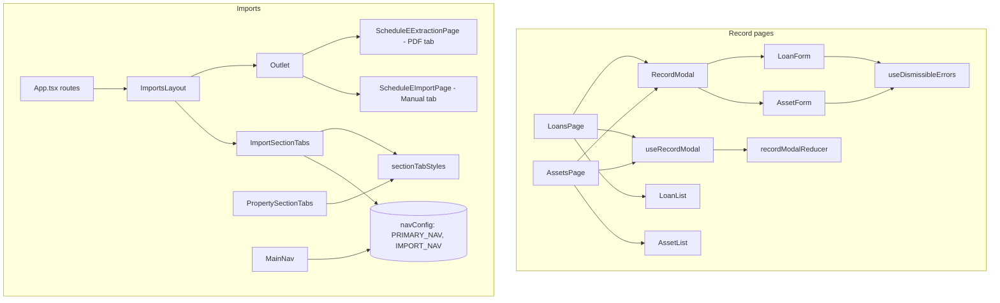
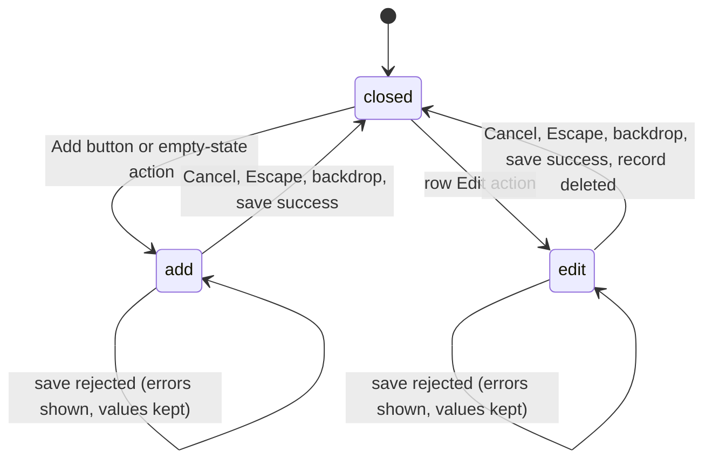

# Design Document

## Overview

This feature makes two frontend-only layout changes. No backend, API, or data-model change is involved.

1. **Modal add/edit forms.** `LoansPage` and `AssetsPage` render their add/edit form inline above the table. After this change each page shows only its table (or an empty state) and an **Add** button. Add and row **Edit** open the existing `LoanForm` / `AssetForm` inside a shared Radix-based modal.
2. **Tabbed Imports section.** The two Schedule E import pages ("Import Schedule E" at `/imports/schedule-e`, "Import from PDF" at `/imports/schedule-e/extract`) become two route-based tabs under one **Import** primary-nav entry, mirroring `PropertySectionTabs`.

### Design decisions

| # | Decision | Rationale |
| --- | --- | --- |
| D1 | Add one shared `RecordModal` in `components/ui` that wraps `@radix-ui/react-dialog`. It is not a generic replacement for `ConfirmDialog`, `AddPropertyDialog`, etc. | Requirement 8 asks for one shared primitive for the two pages. Existing dialogs are left alone to keep the change small. |
| D2 | Keep `LoanForm` and `AssetForm` as the modal content. They only gain small behavior fixes (see D5, D6). | Validation, preview, defaults, and tests stay intact (Requirements 5.6, 7). |
| D3 | Model modal state (`closed` / `add` / `edit(recordId)`) in a small pure reducer exposed through a `useRecordModal` hook. The edited record is **derived** from the loaded list by id, not copied into state. | Removes the duplicated `editing` snapshot logic in both pages, makes "add after edit shows empty defaults" and "deleted record closes the modal" structural, and gives a pure unit that suits property tests. |
| D4 | Mount the form only while the modal is open (Radix unmounts `Dialog.Content` when closed) and key it by record id. | A fresh mount resets form state, so Requirement 3.7 (no leftover values) holds without extra code. |
| D5 | Server errors are dismissible per field. A `useDismissibleErrors` helper hides a server error for a field once the user edits it, and resets when a new server-error object arrives. | `LoanForm` merges `serverErrors` with client errors and never clears the server ones, so Requirement 5.5 is not met today. `AssetForm` has the same gap. |
| D6 | `AssetForm` gains an optional `formError` prop rendered as `role="alert"` at the top, like `LoanForm`'s `errors.form`. | The Assets page currently shows the form-level error above the form, outside the future modal (Requirement 5.2). |
| D7 | While a save is in flight the modal is non-dismissible (`dismissible={false}`). | Requirement 4.6. Escape and backdrop are otherwise allowed (4.2, 4.3). |
| D8 | Focus return uses a captured trigger element with a fallback to the list heading, through Radix `onCloseAutoFocus`. | Requirements 6.4 and 6.5. Radix cannot restore focus to an element that was removed from the document. |
| D9 | `AssetsPage.reload` stops flipping `loading` to true on refreshes after the first load. | Today a refresh swaps the table for the loading block, which unmounts the row Edit button (the trigger) and would break focus return. Loans already updates its list in place. |
| D10 | Imports use a layout route `imports` with an `Outlet`, a new `ImportSectionTabs` fed by an `IMPORT_NAV` constant in `navConfig.ts`, and an index redirect to `/imports/schedule-e`. The two existing pages lose their own `<h1>`. | Keeps URLs and Back/deep-link behavior (Requirement 9) and puts the single page heading in the layout (9.1). |
| D11 | Extract the tab class logic into `sectionTabStyles.ts` and use it from both `PropertySectionTabs` and `ImportSectionTabs`. | Requirement 10.2 asks for identical styles. One source avoids drift. |

### Out of scope

Transactions, Properties, and Businesses dialogs; inline cell editors; the legacy expense-import (`ImportReviewPage`, `components/imports/ImportReview`), which stays unrouted; any backend change.

## Architecture



### Page interaction flow (Loans and Assets)



### Route table after the change

```
/imports                       -> redirect to /imports/schedule-e
/imports/schedule-e            -> ImportsLayout > ScheduleEImportPage      (Manual tab)
/imports/schedule-e/extract    -> ImportsLayout > ScheduleEExtractionPage  (PDF tab)
```

## Components and Interfaces

All paths are under `frontend/src`.

### `components/ui/RecordModal.tsx` (new)

Presentational wrapper over `@radix-ui/react-dialog`. It reuses the overlay, panel, border, and shadow classes of `EditPropertyDialog` and `ConfirmDialog` (`bg-fg/40`, `border-border bg-surface shadow-card`) and adds `max-h-[90vh] overflow-y-auto` so tall forms scroll inside the panel (Requirement 6.7).

```ts
export interface RecordModalProps {
  open: boolean;
  onOpenChange: (open: boolean) => void;
  /** Accessible name, e.g. "Add loan" or "Edit asset". */
  title: string;
  /** Accessible description shown under the title. */
  description: React.ReactNode;
  /** The form. Rendered only while open. */
  children: React.ReactNode;
  /**
   * When false, Escape and outside interaction are ignored (used while a save
   * is in flight). Default true.
   */
  dismissible?: boolean;
  /** Forwarded to Radix `Dialog.Content`; used for focus return. */
  onCloseAutoFocus?: (event: Event) => void;
}
```

Behavior:

- `Dialog.Root open onOpenChange`, `Dialog.Portal`, `Dialog.Overlay` (`fixed inset-0 z-40 bg-fg/40`), `Dialog.Content` (`fixed left-1/2 top-1/2 z-50 max-h-[90vh] w-[92vw] max-w-lg -translate-x-1/2 -translate-y-1/2 overflow-y-auto rounded-lg border border-border bg-surface p-6 shadow-card focus:outline-none`), `Dialog.Title`, `Dialog.Description`. Radix provides `role="dialog"`, focus trap, initial focus on the first focusable element, and `aria-hidden` on the background (Requirements 6.1 to 6.3, 6.6).
- When `dismissible` is false, `onEscapeKeyDown` and `onInteractOutside` call `event.preventDefault()`.
- `onInteractOutside` also calls `preventDefault()` when the event target is inside the toast viewport (`[role="region"][aria-label^="Notifications"]`). Without this, clicking a toast (for example the "Could not save" error toast) would close the modal and discard the user's entries, which conflicts with Requirement 5.4.
- No new dependency. Uses `cn` from `lib/cn`. Exported from `components/ui/index.ts` (Requirement 8.4).

### `components/ui/useRecordModal.ts` (new)

Pure reducer plus a thin hook.

```ts
export type RecordModalState =
  | { mode: "closed" }
  | { mode: "add" }
  | { mode: "edit"; recordId: string };

export type RecordModalAction =
  | { type: "open-add" }
  | { type: "open-edit"; recordId: string }
  | { type: "close" }
  | { type: "record-deleted"; recordId: string };

export function recordModalReducer(
  state: RecordModalState,
  action: RecordModalAction,
): RecordModalState;
// open-add          -> { mode: "add" }
// open-edit(id)     -> { mode: "edit", recordId: id }
// close             -> { mode: "closed" }
// record-deleted(id)-> closed if state is edit with that id, else unchanged

export interface UseRecordModalOptions {
  /** Focus target when the trigger element is gone (list heading). */
  fallbackFocusRef: React.RefObject<HTMLElement | null>;
}

export interface UseRecordModalResult<T extends { id: string }> {
  state: RecordModalState;
  /** True when the modal should render open (add, or edit with a loaded record). */
  open: boolean;
  /** The record being edited, derived from the list by id; null in add mode. */
  editing: T | null;
  openAdd: () => void;
  openEdit: (record: T) => void;
  close: () => void;
  onRecordDeleted: (recordId: string) => void;
  /** Pass to `RecordModal.onCloseAutoFocus`. */
  handleCloseAutoFocus: (event: Event) => void;
}

export function useRecordModal<T extends { id: string }>(
  records: readonly T[],
  options: UseRecordModalOptions,
): UseRecordModalResult<T>;
```

- `openAdd` / `openEdit` store `document.activeElement` in a ref before dispatching. `handleCloseAutoFocus` calls `event.preventDefault()`, then focuses the stored element if it is still connected (`isConnected`), otherwise focuses `fallbackFocusRef.current` (Requirements 6.4, 6.5).
- `editing` is `records.find(r => r.id === state.recordId)`. In edit mode with no matching record, `open` is false, so a record that disappears closes the modal even if `record-deleted` was not dispatched (Requirement 3.8).
- Known limitation: Safari and Firefox on macOS do not focus a button on click, so `document.activeElement` can be `body`. Radix has the same limitation for the existing dialogs. The fallback heading focus applies in that case.

### `lib/useDismissibleErrors.ts` (new)

```ts
/** Pure: returns `errors` without the dismissed keys. */
export function omitDismissed<K extends string>(
  errors: Partial<Record<K, string>> | undefined,
  dismissed: ReadonlySet<K>,
): Partial<Record<K, string>>;

/**
 * Tracks which server-error fields the user has edited since the errors
 * object last changed. A new `serverErrors` identity clears the dismissed set.
 */
export function useDismissibleErrors<K extends string>(
  serverErrors: Partial<Record<K, string>> | undefined,
): { errors: Partial<Record<K, string>>; dismiss: (field: K) => void };
```

The reset uses the "store previous prop in state" pattern, not an effect, so a repeated rejection of the same field re-shows its message.

### `components/loans/LoanForm.tsx` (changed)

- Replace `const errors = { ...serverErrors, ...clientErrors }` with `useDismissibleErrors(serverErrors)` merged under `clientErrors`. `setField` calls `dismiss(field)` as well as clearing the client error (Requirement 5.5). The form-level `form` key is not dismissed by editing.
- Everything else is unchanged: fields, `Loan_Preview`, anchor help text, submit label ("Add loan" / "Save changes"), Cancel button, validation, and defaults (Requirements 2.7, 5.6, 7.1 to 7.3).
- `onCancel` is now always passed by the page (the Cancel button shows in add mode too).

### `components/assets/AssetForm.tsx` (changed)

- Add `formError?: string`, rendered as `<p role="alert" className="text-sm text-danger">` above the first field.
- Route `fieldErrors` through `useDismissibleErrors`, and call `dismiss(field)` from each field's `onChange`.
- `onCancel` is always passed by the page.

### `components/assets/AssetList.tsx` (changed)

The plain-text empty message "Add one using the form above." is replaced with copy that does not refer to a form above (Requirement 1.6). The page handles the empty case before reaching `AssetList`, but the component keeps a safe fallback.

### `pages/LoansPage.tsx` (changed)

- Remove the "Add loan / Edit loan" section, `editing` state, `formHeadingRef`, and the `"form"` focus target.
- `const modal = useRecordModal(loans, { fallbackFocusRef: listHeadingRef })`.
- Heading row for "All loans": the `h2` plus an **Add loan** `Button`, shown only when `!loading && !loadError && loans.length > 0` (Requirements 1.3, 1.4, 1.7, 1.8). With zero loans, the existing `LoanList` empty state action (`onCreate`) calls `modal.openAdd()` (Requirement 1.5, 2.2).
- `LoanList.onEdit` calls `loansState.clearErrors()` then `modal.openEdit(loan)`.
- Render the modal after the page content:

```tsx
<RecordModal
  open={modal.open}
  onOpenChange={(next) => { if (!next) closeModal(); }}
  title={modal.editing ? "Edit loan" : "Add loan"}
  description="Enter the loan terms. The preview updates as you type."
  dismissible={!submitting}
  onCloseAutoFocus={modal.handleCloseAutoFocus}
>
  <LoanForm
    key={modal.editing?.id ?? "new"}
    loan={modal.editing ?? undefined}
    serverErrors={errors}
    submitting={submitting}
    onSubmit={(input) => void handleSubmit(input)}
    onCancel={closeModal}
  />
</RecordModal>
```

- `closeModal()` runs `loansState.clearErrors()` then `modal.close()` (Requirement 4.4).
- `handleSubmit` is unchanged apart from reading `modal.editing`; on success it calls `modal.close()`, refreshes impact and the selected schedule, and toasts "Loan added" / "Loan updated". On failure the modal stays open and entered values stay because the form remains mounted (Requirements 5.1, 5.4).
- Non-field failure toast (Requirement 5.3): an effect keyed on the `errors` object calls `notify({ variant: "error", title: "Could not save the loan" })` when `errors.form` is set and it is the only key. `useLoans` creates a new `errors` object per failure, so repeated failures toast each time. `notify` is read through a ref so the effect does not re-run on its identity.
- `confirmDelete` calls `modal.onRecordDeleted(loan.id)` in place of the `editing` check and keeps `setFocusTarget("list")` (Requirement 7.4).
- The estimate notice, superseded-interest notice, and yearly schedule remain outside the modal (Requirement 7.5).

### `pages/AssetsPage.tsx` (changed)

- Remove the "Add asset / Edit asset" section and `editing`. Add `listHeadingRef` on the "Assets" `h2` (`tabIndex={-1}`) and `const modal = useRecordModal(assets, { fallbackFocusRef: listHeadingRef })`.
- Heading row: `h2` plus an **Add asset** `Button` shown when `!loading && !loadError && assets.length > 0`.
- Empty state: `StateBlock` with `description="Add a depreciable asset to track its year-by-year depreciation schedule."` and `action={{ label: "Add asset", onClick: modal.openAdd }}` (Requirements 1.5, 1.6).
- `formError` now holds only save failures that carry no field error. A save failure with a field error sets only `fieldErrors`. Delete failures use a new `deleteError` state rendered under the list heading as `role="alert"`, because the modal is closed when a delete happens. This replaces today's reuse of `formError` for delete failures.
- `handleSubmit` closes with `modal.close()` on success, refreshes the open schedule when the edited asset is expanded, reloads, and toasts. Non-field failures keep the "Could not save the asset" toast (Requirement 5.3).
- `reload` sets `loading` only until the first successful load for the current `propertyId`; later refreshes update `assets` in place (D9). A ref tracks "loaded for propertyId".
- `confirmDelete` calls `modal.onRecordDeleted(asset.id)`.
- `closeModal()` resets `fieldErrors` and `formError`, then `modal.close()` (Requirement 4.4).

### `components/navConfig.ts` (changed)

```ts
export const PRIMARY_NAV: readonly NavItem[] = [
  { to: "/", label: "Dashboard", end: true },
  { to: "/properties", label: "Properties" },
  { to: "/businesses", label: "Businesses" },
  { to: "/reports", label: "Reports" },
  { to: "/carryforward", label: "Carryforward" },
  { to: "/imports/schedule-e", label: "Import" },
];

/** Tabs of the Imports section (Manual first). */
export const IMPORT_NAV: readonly NavItem[] = [
  { to: "/imports/schedule-e", label: "Enter manually", end: true },
  { to: "/imports/schedule-e/extract", label: "Upload PDF" },
];
```

- The "Import" primary entry has no `end` flag, so React Router's prefix matching marks it active on both `/imports/schedule-e` and `/imports/schedule-e/extract` (Requirement 11.3). `MainNav` already renders desktop and mobile from `PRIMARY_NAV`, so both get the same entry (11.4).
- The Manual tab has `end: true` so it is not active on the PDF route (Requirements 10.6).

### `components/sectionTabStyles.ts` (new)

```ts
export function sectionTabClassName(isActive: boolean): string;
```

Returns exactly the class string `PropertySectionTabs` builds today (`inline-block rounded-md px-3 py-1.5 text-sm font-medium`, focus-visible outline, active `bg-accent text-accent-fg`, inactive `text-fg-muted hover:bg-surface-muted`). `PropertySectionTabs` is changed to call it with no visual change.

### `components/ImportSectionTabs.tsx` (new)

Same structure as `PropertySectionTabs`: `<nav aria-label="Import methods" className="mt-4"><ul className="flex flex-wrap gap-2">` with one `<li><NavLink to end className={({isActive}) => sectionTabClassName(isActive)}>` per `IMPORT_NAV` item (Requirements 10.1 to 10.5). `NavLink` supplies `aria-current="page"` on the active tab only.

### `pages/ImportsLayout.tsx` (new)

```tsx
export default function ImportsLayout() {
  return (
    <section aria-labelledby="page-heading">
      <h1 id="page-heading" className="text-2xl font-semibold text-fg">
        Import Schedule E
      </h1>
      <ImportSectionTabs />
      <div className="mt-6"><Outlet /></div>
    </section>
  );
}
```

### `pages/ScheduleEImportPage.tsx` and `pages/ScheduleEExtractionPage.tsx` (changed)

- Replace the root `<section aria-labelledby>` and the `<h1>` with a plain `<div>`. Keep the intro paragraph, the warning note, the form slot, and (PDF tab) the two notes and the `aria-live` slot exactly as they are (Requirement 9.10, 12.1, 12.2).
- Update the file-header doc comments to say each page is a tab of the Imports section.
- No prop, API, or behavior change. `ExtractionStatus` keeps its `to="/imports/schedule-e"` links, which now land on the Manual tab inside the same layout (Requirement 11.5).

### `App.tsx` (changed)

```tsx
<Route path="imports" element={<ImportsLayout />}>
  <Route index element={<Navigate to="/imports/schedule-e" replace />} />
  <Route path="schedule-e" element={<ScheduleEImportPage />} />
  <Route path="schedule-e/extract" element={<ScheduleEExtractionPage />} />
</Route>
```

The route-table doc comment is updated to describe the Imports section (Requirement 13.4). `replace` keeps the Back button from bouncing off the redirect. Unknown paths such as `/imports/foo` still fall through to `NotFoundPage`.

## Data Models

No persisted or API data changes. The new client-side types are `RecordModalState`, `RecordModalAction`, `RecordModalProps`, `UseRecordModalResult`, and the `IMPORT_NAV` entries (reusing `NavItem`), all defined above. `AssetFormProps` gains `formError?: string`.

Tab switching unmounts the other tab (assumption confirmed in requirements). Consequences: unsaved manual entries are discarded (Requirement 9.8), and an in-progress PDF extraction poll stops when the user leaves the PDF tab. The backend job is unaffected.

## Correctness Properties

*A property is a characteristic or behavior that should hold true across all valid executions of a system-essentially, a formal statement about what the system should do. Properties serve as the bridge between human-readable specifications and machine-verifiable correctness guarantees.*

Most of this feature is UI wiring, routing, and styling, which is covered by example-based tests (see Testing Strategy). The properties below cover the two pure units where input variation matters: the modal state reducer and the server-error dismissal helper. Property reflection: "open add", "open edit", and "add after edit shows defaults" all follow from one history-independence property, so they are merged into Property 1. Close-on-success, Cancel, Escape, and backdrop all dispatch the same `close` action, so they share Property 2.

### Property 1: Opening the modal is independent of prior state

For any `RecordModalState` and any open action, `open-add` yields `{ mode: "add" }` and `open-edit(id)` yields `{ mode: "edit", recordId: id }`, and the result equals the result of applying the same action to the `closed` state.

**Validates: Requirements 2.1, 3.1, 3.7**

### Property 2: Close always ends closed and is idempotent

For any `RecordModalState`, applying `close` yields `{ mode: "closed" }`, and applying `close` a second time leaves the state unchanged.

**Validates: Requirements 2.4, 3.4, 4.1, 4.2, 4.3**

### Property 3: Deleting a record closes the modal only when that record is being edited

For any `RecordModalState` and any record id, `record-deleted(id)` yields `{ mode: "closed" }` when the state is `{ mode: "edit", recordId: id }`, and otherwise returns the state unchanged.

**Validates: Requirements 3.8**

### Property 4: Editing a field dismisses exactly that field's server error

For any map of field errors and any set of dismissed fields, `omitDismissed(errors, dismissed)` contains exactly the keys of `errors` that are not in `dismissed`, each with its original message, and does not mutate `errors`.

**Validates: Requirements 5.5**

## Error Handling

| Situation | Handling |
| --- | --- |
| Create or update rejected with a field error | Modal stays open. `LoanForm` shows the message next to the field (via `useLoans.errors`). `AssetForm` shows it via `fieldErrors`. Entered values stay because the form stays mounted (5.1, 5.4). |
| Rejected with a form-level or no-field error | Modal stays open. `LoanForm` shows `errors.form` in `role="alert"`. `AssetForm` shows `formError` in `role="alert"`. An error toast "Could not save the loan" / "Could not save the asset" also appears (5.2, 5.3). |
| User edits a field that shows an error | `useDismissibleErrors` hides that server error. Client validation errors keep their existing clearing logic (5.5). |
| Save in flight | Inputs and submit disabled by the forms. Modal is non-dismissible (`dismissible={false}`), so Escape and outside clicks are ignored (4.5, 4.6). |
| User clicks a toast while the modal is open | `onInteractOutside` ignores targets inside the toast viewport, so the modal and its values stay. |
| Modal closed without saving | `closeModal()` clears server and form errors (4.4). |
| Record deleted or no longer in the list while editing | `record-deleted` closes the modal, and `open` is false whenever the edit target is missing (3.8). |
| Trigger removed from the document before close | `handleCloseAutoFocus` focuses the list heading (6.5). |
| Delete fails (Assets) | `deleteError` shows a `role="alert"` under the list heading and an error toast. The `ConfirmDialog` stays open as today. |
| Load fails or loading | The page shows the existing loading or error block and no Add button (1.7, 1.8). |
| `/imports/<unknown>` | Falls through to `NotFoundPage`. |
| Extraction in progress when the user switches tabs | The PDF tab unmounts and its poll stops. This follows the confirmed "tab switch discards state" assumption. |

## Testing Strategy

### Approach

Frontend stack: Vitest, React Testing Library, `@testing-library/user-event`, `vitest-axe`, and `fast-check` (already in `devDependencies`; no new dependency). PBT does apply to the reducer and the dismissal helper only. Everything else is UI rendering, routing, and focus behavior, so it uses example-based tests, as the property-navigation-consistency spec does.

### Property-based tests

- Library: `fast-check` (do not hand-roll generators for state or ids beyond `fc.record`, `fc.oneof`, `fc.string`).
- Each property is one test with `{ numRuns: 100 }` minimum.
- Each test carries a tag comment in the form `Feature: modal-forms-and-tabbed-imports, Property N: <title>`.
- Files: `components/ui/useRecordModal.property.test.ts` (Properties 1 to 3) and `lib/useDismissibleErrors.property.test.ts` (Property 4).
- Generators: `RecordModalState` from `fc.oneof` over closed, add, and edit with a string id; actions from `fc.oneof` over the four action types. Property 4 uses `fc.dictionary` over a fixed field-name set and `fc.subarray` for the dismissed set.

### Unit and component tests

- `RecordModal.test.tsx` (new): role `dialog` with name and description; focus moves inside on open; Tab stays inside; background is not exposed to role queries; Escape and outside click call `onOpenChange(false)` when dismissible and do nothing when `dismissible={false}`; a click inside the toast viewport does not close it; content carries `max-h-[90vh]` and `overflow-y-auto`; `vitest-axe` has no violations.
- `useRecordModal` hook test (new): `editing` derives from the list; edit mode with a missing record reports `open` false; `handleCloseAutoFocus` focuses a connected trigger and falls back to the heading when the trigger is disconnected.
- `LoansPage.test.tsx` and `AssetsPage.test.tsx` (update and extend): empty state with action; table plus Add button with records; no form while closed; loading and load-error hide the Add button; Add opens an empty modal; Edit opens a prefilled modal; create and update success close the modal, reload, and toast; field error and form-level error keep the modal open with values retained; non-field failure toasts; Cancel, Escape, and backdrop close without a save call; errors cleared after close and reopen; inputs disabled and modal not dismissible while a save is pending; focus returns to the Add button and to the Edit button; focus falls back to the list heading after the empty-state trigger disappears; Loans preview and anchor help inside the modal; Loans delete still returns focus to "All loans". Update helpers that assume an always-visible form (for example `submitButton()` in `LoansPage.test.tsx`, which currently disambiguates the empty-state button from the inline form's submit button).
- `LoanForm.test.tsx` and `AssetForm.test.tsx` (extend): editing a field removes its server error; a new `serverErrors` object re-shows it; `AssetForm` renders `formError` in `role="alert"`.
- `AssetList.test.tsx` (extend if present): empty message does not refer to a form above.
- `navConfig.test.ts` (update): `PRIMARY_NAV` has the single "Import" entry to `/imports/schedule-e` and no "Import Schedule E" or "Import from PDF"; `IMPORT_NAV` lists "Enter manually" (`end`) then "Upload PDF".
- `ImportSectionTabs.test.tsx` (new): `nav[aria-label="Import methods"]`; two links in order; `aria-current="page"` only on the active tab for each route; keyboard Tab and Enter navigate; tab classes equal `sectionTabClassName` output. `PropertySectionTabs.test.tsx` is re-run to confirm no visual change.
- `ImportsLayout` / routing test (new, `MemoryRouter` with the real route table): `/imports` redirects to `/imports/schedule-e`; deep links to both routes show the matching tab and content; heading "Import Schedule E" above the tabs; switching tabs shows the other tab in its initial state; history back returns to the previous tab; unknown `/imports/foo` shows NotFound.
- `MainNav` / `AppLayout.test.tsx` (extend): the "Import" link is active on both import routes in the desktop and mobile navs.
- `ScheduleEExtractionPage.test.tsx` and `ExtractionStatus.test.tsx` (update): the page no longer renders its own `<h1>`; clicking "enter your Schedule E manually" inside the routed layout lands on the Manual tab. Existing `ScheduleEImportForm` and extraction flow tests must remain green unchanged (Requirement 12).

### Verification

Run `cd frontend && npm test -- --run` and `npm run build` (type-check plus build). Manual spot check in a browser for: scroll inside a short viewport, mobile nav, and Safari focus return (see the `useRecordModal` limitation).
