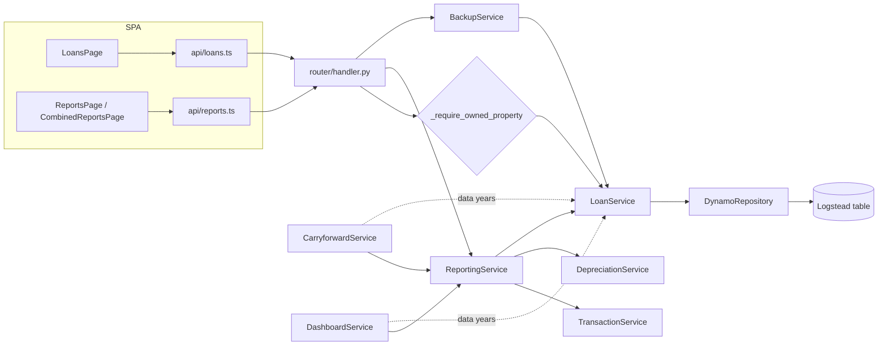
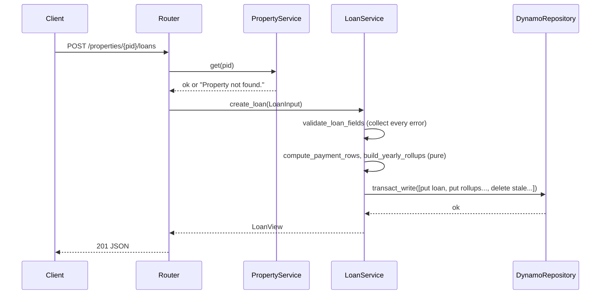
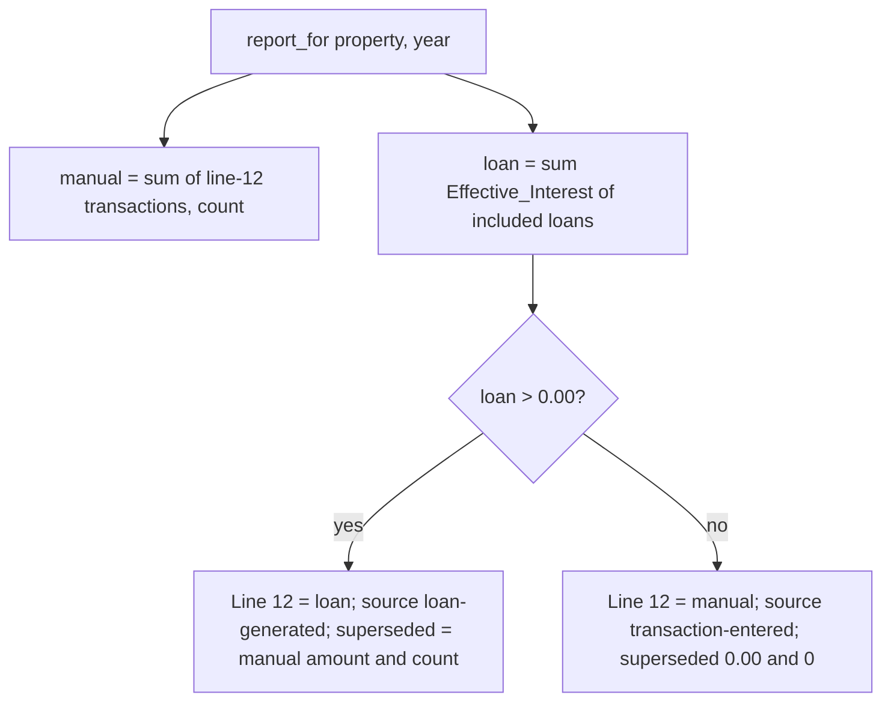

# Design Document: Mortgage Amortization

## Overview

Logstead derives Schedule E Line 12 (Mortgage interest paid to banks) only from hand-entered expense transactions. This feature mirrors the depreciation pattern for mortgages. The user records a **Loan** under a Property. Logstead generates a monthly **Amortization_Schedule**, rolls it up into one **Yearly_Rollup** per tax year, and feeds the yearly interest into Line 12 of the per-property and combined Schedule E reports. The passive-loss carryforward picks the interest up through the existing report totals.

The design follows the depreciation code paths closely:

| Concern | Depreciation (existing) | Loans (this design) |
| --- | --- | --- |
| Pure engine | `compute_schedule_rows(asset)` | `compute_payment_rows(loan)` + `build_yearly_rollups(...)` |
| Item builders | `asset_to_item`, `schedule_row_to_item` | `loan_to_item`, `rollup_to_item` (importable by backup restore) |
| Storage | `ASSET#<id>`, `ASSET#<id>#SCHED#<year>` | `LOAN#<id>`, `LOAN#<id>#YEAR#<year>` |
| Tax-year read | GSI2 `SCHED#` prefix | GSI2 `LOANYR#` prefix |
| Report hook | `property_depreciation_for_year` | `property_effective_interest_for_year` |
| Overrides | `depreciationOverrides` map on the asset item | `interestOverrides` map on the loan item |
| Service | `DepreciationService(repo)` | `LoanService(repo)` |

Payment rows are **not stored**. Only the Loan and its yearly rollups are. The payment table is recomputed on demand by the pure engine, which is cheap (at most 600 rows of Decimal arithmetic) and deterministic.

### Findings from reading the code (requirement conflicts and resolutions)

These are the places where the existing code or the requirements themselves disagree with a literal reading of the requirements. Each is resolved below and referenced again in the relevant section.

| # | Finding | Resolution |
| --- | --- | --- |
| F1 | **Requirement 6.11 is confirmed, with a gap.** `CarryforwardService._schedule_e_net_for_year` (carryforward.py, ~line 316) calls `self._reports.report_for(prop.id, tax_year)` and sums `result.value.totals.net`. So any Line 12 change in `ReportingService` flows into carryforward with no change to carryforward math. However, the Data_Year set comes from `derive_data_years` (dashboard.py), which only looks at transaction years and depreciation schedule years. A year that has loan interest but no transactions and no depreciation would never be reconciled. | Add an optional `loans` collaborator to `derive_data_years`, `earliest_data_year`, `DashboardService`, and `CarryforwardService`. Loan years (from included loans) join the Data_Year union, still capped at `latest_tax_year()`. See "Carryforward impact". |
| F2 | **Asset routes do not check property ownership.** `_create_asset`, `_list_assets`, etc. pass `propertyId` straight to `DepreciationService`. Requirements 1.11 and 8.7 require ownership scoping with identical 404s for "missing" and "not yours". | Loan routes call a new `_require_owned_property` helper (wraps `PropertyService.get`, which already returns the same `"Property not found."` for both cases). Asset routes are left unchanged; closing the same hole for assets is a recommended follow-up, not part of this feature. |
| F3 | **Depreciation create/update is not atomic.** `create_asset` does `put_item` and then a second `transact_write` for the schedule. Requirements 1.1, 1.15, 4.10 and 7.7 need all-or-nothing. | Loan create/update writes the Loan item, all rollup puts, and stale-rollup deletes in **one** `transact_write`. DynamoDB caps a transaction at 100 actions, so the service guards the count (see "Transaction size guard"). |
| F4 | **Requirement 2.7 vs 7.1.** 2.7 says the schedule "SHALL include a Payment_Row dated exactly on the Payoff_Date". 7.1 says the row on the Payoff_Date is retained "if any". Interest is monthly with no daily accrual (out of scope), so no row can exist on a date that is not a payment date. | Follow 7.1. Rows dated `<= payoff_date` are generated; a row dated exactly on the payoff date exists only when that date is a scheduled payment date. No synthetic row is invented. |
| F5 | **Requirement 4.7 vs payoff.** 4.7 says a last-year rollup whose final row is before December 1 has an ending balance of 0.00. With a Payoff_Date the final row can leave a positive balance (2.8, 3.9). | 4.7 applies to loans that fully amortize. For a loan truncated by a Payoff_Date the last rollup's ending balance is the payoff balance, consistent with 4.5 and 2.8. |
| F6 | **Error shape carries one `field`.** Requirement 1.3 says a failure identifies **each** offending field. `Error` in `models/result.py` has a single `field`. | Add an additive optional `errors` tuple of `(field, message)` pairs to `Error`. `_error_body` emits `"errors": [{"field","message"}...]` when present, and still emits the first error as `field`/`message`. Existing clients and tests are unaffected. |
| F7 | **Property deletion would orphan loans.** `PropertyService.delete` only guards on transactions and assets, then deletes META/details/note/usage rows. Loan rows would be left behind in a partition with no property. | Extend the delete guard to also query `keys.loan_list_prefix()` and return `conflict` ("remove its loans first") when any exist. |
| F8 | **JSON floats.** `_parse_body` uses plain `json.loads`, so a JSON number like `6.875` becomes a Python `float`. Requirement 8.6 forbids a float at any point between request parsing and serialization. | Loan routes accept `original_principal`, `annual_interest_rate`, `payment_override`, `extra_principal` only as JSON **strings** (the SPA already sends money as strings). A JSON float for these fields is a 400 validation error on that field. Integers are accepted for `term_months` only. |
| F9 | **Lenient ISO parsing.** Python 3.12 `date.fromisoformat` accepts forms such as `20240101`. Requirement 1.7 requires `YYYY-MM-DD`. | Validate with `^\d{4}-\d{2}-\d{2}$` first, then construct the `date`. |
| F10 | **Restore is validate, clear, rewrite.** `BackupService.restore` is not all-or-nothing after the clear. Requirement 11.6 needs "persist no data" for an invalid Loan. | Put Loan validation inside the pure `validate_document` phase, which runs before the clear. An invalid Loan therefore rejects the whole restore with no store access. Failures during the write phase keep the existing retryable `conflict` behavior. |
| F11 | **Pre-existing gap, out of scope.** `BackupAsset` does not carry `depreciation_overrides`, so asset overrides are lost on restore. | Not touched. Loan overrides are carried (Requirement 11.1). |
| F12 | **Display precision.** Requirement 10.2 wants the superseded amount with two decimals in the report view, while the report tables use whole dollars and Requirement 9.16 wants whole dollars on the Loans page. | Follow each requirement as written: superseded amount via `formatMoney` in the report view, via `formatMoneyWholeDollars` on the Loans page. |
| F13 | **Exports are client-side in the SPA.** There is no export route in `_ROUTES`; `ReportsPage` builds files with `reportToCsv` / `reportToJson` in `api/reports.ts`. The backend `export_report` / `export_combined_report` exist but are not routed. | Requirement 6.10 is implemented in both: the backend serializers and the client `reportToCsv`. JSON is the report verbatim on the client, so it carries the new fields automatically. |
| F14 | **Schedule E Import writes Line 12 transactions.** Imported line totals become transactions in `mortgage-interest-banks`. | They count as Manual_Mortgage_Interest and are superseded when a Loan produces interest. The Loans-page notice (9.16) and the report label cover this. Import is unchanged. |
| F15 | **Override of 0.00.** An override of `0.00` is valid (5.8) but an Effective_Interest of 0 does not trigger loan precedence (6.1, 6.4). | Documented behavior: if every included Loan has Effective_Interest 0.00 for a year, Line 12 falls back to Manual_Mortgage_Interest. |
| F16 | **Extra route for 9.16.** The Loans page must show superseded manual interest per year, which needs transaction data the loan service does not have. | Add `GET /properties/{propertyId}/loans/line-12-impact`, served by `ReportingService`. |
| F17 | **Date range.** Requirement 1.7 only requires a valid date. A schedule can run 600 months past the first payment and `datetime.date` stops at year 9999. | Reject a First_Payment_Date earlier than 1900-01-01 or whose last scheduled payment would pass year 9999, with a validation failure on `first_payment_date`. |

## Architecture



### Create/update flow



### Line 12 precedence



## Components and Interfaces

### Backend

#### `repository/keys.py` additions

Services never build key strings (Requirement 12.1). New helpers:

```python
LOAN_PREFIX = "LOAN#"
LOAN_YEAR_MARKER = "#YEAR#"        # separates loan id from tax year inside a rollup SK
GSI2_LOAN_YEAR_PREFIX = "LOANYR#"

def loan_sk(loan_id: str) -> str:                       # "LOAN#<id>"
def loan_list_prefix() -> str:                          # "LOAN#"
def loan_year_sk(loan_id: str, tax_year: int) -> str:   # "LOAN#<id>#YEAR#<year>"
def loan_year_list_prefix(loan_id: str) -> str:         # "LOAN#<id>#YEAR#"
def is_loan_year_sk(sk: str) -> bool:                   # True for rollup SKs; used to split Loan rows from rollup rows
def gsi2_loan_year_sk(loan_id: str) -> str:             # "LOANYR#<loanId>"
def gsi2_loan_year_prefix() -> str:                     # "LOANYR#"
```

The module docstring table gains `Loan` and `LoanYearRollup` lines, and the GSI2 list gains `LoanYearRollup  GSI2PK=PROPERTY#<id>#YEAR#<taxYear>  GSI2SK=LOANYR#<loanId>`.

Collision analysis against existing queries:

- `asset_list_prefix()` is `ASSET#`; `LOAN#...` rows never match, so listing assets returns zero Loan rows (Requirement 12.5).
- Depreciation's GSI2 query uses `begins_with(SCHED#)`, transactions use `TXN#`. `LOANYR#` matches neither.
- `BackupService.clear` queries the whole partition and classifies by `DOC#`, `PHOTO#`, `TXN#`, `ASSET#`. Loan SKs are `LOAN#<hex id>[#YEAR#<year>]`; a uuid hex id contains no `#`, so none of those classifiers match and the rows fall through to the generic child delete.

#### `models/loan.py`

```python
MAX_MONEY = Decimal("999999999.99")

@dataclass
class LoanInput:
    """Raw, unvalidated input (router maps the JSON body to this)."""
    property_id: str | None
    description: str | None
    original_principal: Decimal | None
    annual_interest_rate: Decimal | None
    term_months: int | None
    first_payment_date: str | None
    payment_override: Decimal | None = None
    extra_principal: Decimal | None = None
    closing_date: str | None = None
    payoff_date: str | None = None
    include_in_report: bool = True

@dataclass(frozen=True)
class Loan:
    id: str
    property_id: str
    description: str
    original_principal: Decimal            # exactly 2 dp
    annual_interest_rate: Decimal          # canonical, <= 4 dp, never scientific
    term_months: int
    first_payment_date: str                # YYYY-MM-DD
    payment_override: Decimal | None
    extra_principal: Decimal               # 2 dp, 0.00 when unset
    closing_date: str | None
    payoff_date: str | None
    include_in_report: bool
    interest_overrides: dict[int, Decimal]  # tax_year -> 2 dp
    created_at: str
    updated_at: str

@dataclass(frozen=True)
class PaymentRow:
    number: int
    date: str
    payment: Decimal
    interest: Decimal
    principal: Decimal
    balance: Decimal

@dataclass(frozen=True)
class YearlyRollup:
    loan_id: str
    property_id: str
    tax_year: int
    payments: int
    interest: Decimal                 # estimated (sum of row interest)
    principal: Decimal
    total_paid: Decimal
    ending_balance: Decimal
    interest_override: Decimal | None
    include_in_report: bool
    # property effective_interest -> interest_override if not None else interest

@dataclass(frozen=True)
class LoanView:
    """Flat API shape: Loan fields plus derived values."""
    # ...all Loan fields (interest_overrides rendered as {"2024": "7000.00"})...
    default_payment: Decimal          # standard level payment
    scheduled_payment: Decimal        # override if present else default
    payoff_balance: Decimal | None    # set only when a Payoff_Date leaves a positive balance
    status: Literal["active", "ended"]

@dataclass(frozen=True)
class YearlyRollupView:
    tax_year: int
    payments: int
    interest: Decimal                 # Effective_Interest (what Line 12 uses)
    estimated_interest: Decimal       # raw rollup interest
    interest_override: Decimal | None
    variance: Decimal | None          # override - estimated, signed, None without override
    principal: Decimal
    total_paid: Decimal
    ending_balance: Decimal

@dataclass(frozen=True)
class LoanSchedule:
    loan_id: str
    estimate: bool                    # always True; the UI labels the schedule as an estimate
    payments: tuple[PaymentRow, ...]
    yearly: tuple[YearlyRollupView, ...]
    payoff_balance: Decimal | None
```

`status` is `"ended"` when a Payoff_Date is on or before today, or the last scheduled row is dated before today and the final balance is `0.00`. Otherwise `"active"`. The service takes an injectable `today` callable so tests are deterministic.

#### `services/loan.py` (pure engine)

All arithmetic is `Decimal` inside `decimal.localcontext()` with `prec = 60`, rounded half-up to cents at each row via `to_money`. No `float` anywhere (Requirement 3.6).

```python
def monthly_interest(balance: Money, rate_pct: Decimal) -> Money:
    with localcontext() as ctx:
        ctx.prec = 60
        return to_money(balance * rate_pct / Decimal(1200))   # rate_pct/100/12

def default_payment(principal: Money, rate_pct: Decimal, term: int) -> Money:
    with localcontext() as ctx:
        ctx.prec = 60
        if rate_pct == 0:
            return to_money(principal / term)                  # Requirement 2.2
        r = rate_pct / Decimal(1200)
        factor = (1 + r) ** term
        return to_money(principal * r * factor / (factor - 1)) # Requirement 2.1

def payment_date(first: date, index: int) -> date:             # index is 0-based
    m0 = first.month - 1 + index
    year, month = first.year + m0 // 12, m0 % 12 + 1
    day = min(first.day, calendar.monthrange(year, month)[1])  # clamp from the ORIGINAL day
    return date(year, month, day)                              # Jan 31 -> Feb 28 -> Mar 31
```

Clamping always uses the original day-of-month, so a Jan 31 loan pays on Feb 28/29, then Mar 31. It does not drift to the 28th.

Schedule generation (Requirements 2.5, 2.7, 3.1-3.5):

```text
function compute_payment_rows(loan) -> (rows, payoff_balance):
    payment  = loan.payment_override ?? default_payment(P, rate, term)
    due      = payment + loan.extra_principal
    balance  = P
    rows     = []
    for k in 1 .. term:
        d = payment_date(first, k-1)
        if loan.payoff_date and d > loan.payoff_date: break            # 2.7
        interest = monthly_interest(balance, rate)                     # 3.2
        if k == term or balance + interest <= due:                     # 3.4, 3.5
            principal = balance
            row = (k, d, interest + principal, interest, principal, 0.00)
            rows.append(row); balance = 0.00; break
        principal = max(0.00, min(due - interest, balance))           # 3.3 (upper clamp is a no-op here)
        balance   = balance - principal
        rows.append((k, d, interest + principal, interest, principal, balance))
    payoff_balance = balance if (loan.payoff_date and balance > 0) else None   # 2.8
    return rows, payoff_balance
```

Notes on the algorithm:

- A row's payment amount is always `interest + principal`, so Requirement 3.7 holds by construction. In a normal row it equals `payment + extra_principal` unless the lower clamp bites.
- The `k == term` branch is the rounding sweep of Requirement 3.5. With a Payment_Override below the level payment it also acts as a balloon at term, which is what the requirement text produces.
- `balance` never goes negative and only decreases, so Requirement 3.10 holds by construction.
- With `payoff_date`, the loop simply stops early. The truncated schedule is a **prefix** of the untruncated one (same inputs otherwise), which is a testable metamorphic property.
- Edge: for very small principals at high rates the rounded default payment can be `0.00`. The schedule is still valid (no principal until the term row sweeps the balance). Requirement 2.1 says "rounded half-up", so no floor is applied.

Rollups (Requirements 4.1-4.8):

```text
function build_yearly_rollups(loan, rows) -> list[YearlyRollup]:
    group rows by int(row.date[0:4])                  # cash basis, calendar year (4.2)
    for each year in ascending order:                 # only years that have rows (4.1)
        interest      = sum(row.interest)
        principal     = sum(row.principal)
        total_paid    = sum(row.payment)
        ending_balance= last row's balance in the year   # 4.5
        payments      = count(rows)
        interest_override = loan.interest_overrides.get(year)
```

No proration happens for a partial first or last year (4.6, 4.7). Years with no rows have no stored rollup and read as `0.00` interest and principal wherever the API or report asks (4.8).

Validation (Requirements 1.2-1.9, 2.3, 2.4, 2.6, 2.10, 3.13):

```text
function validate_loan_fields(input) -> Result[ValidatedLoan]:    # shared with backup restore
    errors = []                                                    # collect every offending field
    description: strip(); 1..200 chars                             -> "description"
    original_principal: present, finite, exactly <= 2 dp (rejected, not rounded),
                        0 < v <= 999,999,999.99                    -> "original_principal"
    annual_interest_rate: present, finite, 0 <= v <= 100,
                          normalize() has <= 4 dp                  -> "annual_interest_rate"
    term_months: int (not bool), 1..600                            -> "term_months"
    first_payment_date: matches ^\d{4}-\d{2}-\d{2}$, valid date,
                        >= 1900-01-01, last payment year <= 9999   -> "first_payment_date"
    payment_override (optional): <= 2 dp, <= MAX_MONEY, > 0, and
                        > monthly_interest(P, rate) (first payment) -> "payment_override"
                        (only checked once principal, rate, term and first date are valid)
    extra_principal (optional): <= 2 dp, 0 <= v <= MAX_MONEY       -> "extra_principal"
    closing_date (optional): valid date, <= first_payment_date     -> "closing_date"
    payoff_date (optional): valid date, >= first_payment_date      -> "payoff_date"
    if errors: return failure("validation", first.message, field=first.field, errors=errors)
    canonicalize rate: Decimal(format(rate.normalize(), "f"))      # "6.8750" -> "6.875", never "1E+2"
```

Requirement 2.10 (payoff earlier than the first row's date) and 1.8 (payoff earlier than `first_payment_date`) are the same check, because the first row is dated `first_payment_date`.

Item builders, importable by backup restore (mirrors `asset_to_item`):

```python
def loan_to_item(loan: Loan) -> dict[str, Any]:
    return {
        "PK": keys.property_scoped_pk(loan.property_id),
        "SK": keys.loan_sk(loan.id),
        "id": loan.id, "propertyId": loan.property_id,
        "description": loan.description,
        "originalPrincipal": loan.original_principal,          # money attr
        "annualInterestRate": format(loan.annual_interest_rate, "f"),   # plain decimal string, not money
        "termMonths": loan.term_months,
        "firstPaymentDate": loan.first_payment_date,
        "paymentOverride": loan.payment_override,              # money attr, omitted when None
        "extraPrincipal": loan.extra_principal,                # money attr
        "closingDate": loan.closing_date, "payoffDate": loan.payoff_date,   # omitted when None
        "includeInReport": loan.include_in_report,
        "interestOverrides": ({str(y): money_to_str(v) for y, v in loan.interest_overrides.items()}
                              or None),
        "createdAt": loan.created_at, "updatedAt": loan.updated_at,
    }

def rollup_to_item(r: YearlyRollup) -> dict[str, Any]:
    return {
        "PK": keys.property_scoped_pk(r.property_id),
        "SK": keys.loan_year_sk(r.loan_id, r.tax_year),
        "GSI2PK": keys.gsi2_year_pk(r.property_id, r.tax_year),
        "GSI2SK": keys.gsi2_loan_year_sk(r.loan_id),
        "loanId": r.loan_id, "propertyId": r.property_id, "taxYear": r.tax_year,
        "payments": r.payments,
        "interest": r.interest, "principal": r.principal,
        "totalPaid": r.total_paid, "endingBalance": r.ending_balance,
        "interestOverride": r.interest_override,                # omitted when None
        "effectiveInterest": r.effective_interest,
        "includeInReport": r.include_in_report,
    }
```

Money attribute sets (repository takes one set per call, so a transaction uses the union; names are disjoint from non-money attributes):

```python
_LOAN_MONEY = frozenset({"originalPrincipal", "paymentOverride", "extraPrincipal"})
_ROLLUP_MONEY = frozenset({"interest", "principal", "totalPaid", "endingBalance",
                           "interestOverride", "effectiveInterest"})
_WRITE_MONEY = _LOAN_MONEY | _ROLLUP_MONEY
```

`annualInterestRate` is deliberately **not** a money attribute, so it is never quantized to two decimals (same reasoning as `recoveryPeriodYears`).

Strict reads (Requirement 12.6): `LoanService` reads with `money_attrs=set()` so values arrive as raw strings, then parses each field itself. A money value must match `^-?\d+\.\d{2}$` and the rate must parse as a finite `Decimal`. A bad value raises an internal `StoredLoanError(field)`, which the service turns into `Result.failure("conflict", "Stored loan has an invalid <field> value.", field=<field>)`. Nothing is written.

#### `LoanService`

```python
class LoanService:
    def __init__(self, repo: DynamoRepository, today: Callable[[], date] = _utc_today) -> None: ...

    def create_loan(self, data: LoanInput) -> Result[LoanView]
    def list_loans(self, property_id: str) -> Result[list[LoanView]]
    def get_loan(self, property_id: str, loan_id: str) -> Result[LoanView]
    def update_loan(self, property_id: str, loan_id: str, data: LoanInput) -> Result[LoanView]
    def delete_loan(self, property_id: str, loan_id: str) -> Result[None]
    def schedule_for(self, property_id: str, loan_id: str) -> Result[LoanSchedule]
    def set_interest_override(self, property_id, loan_id, tax_year: int, amount: Decimal | str) -> Result[YearlyRollupView]
    def clear_interest_override(self, property_id, loan_id, tax_year: int) -> Result[YearlyRollupView | None]

    # Read seams used by reports, dashboard and carryforward
    def property_effective_interest_for_year(self, property_id: str, tax_year: int) -> Money
    def report_years(self, property_id: str) -> set[int]            # years with a rollup from an included loan
    def earliest_year(self, property_id: str) -> int | None         # first payment year across loans
```

Write procedure shared by create and update:

```text
function _write_loan(loan, previous_years):
    rows, _  = compute_payment_rows(loan)
    rollups  = build_yearly_rollups(loan, rows)
    new_years = {r.tax_year for r in rollups}
    actions = [put loan_to_item(loan)]
            + [put rollup_to_item(r) for r in rollups]
            + [delete loan_year_sk(loan.id, y) for y in previous_years - new_years]
    if len(actions) > 100:  -> failure("validation", field="first_payment_date",
                                       "This change moves the loan's payment years too far in one step. Delete the loan and add it again.")
    try: repo.transact_write(actions, money_attrs=_WRITE_MONEY)
    except (ClientError, BotoCoreError): -> failure("unavailable", "Could not save the loan and its yearly interest totals. No changes were made.")
```

- **Create:** validate, build `Loan` with a fresh uuid hex and `created_at = updated_at = now`, `previous_years = {}`, write.
- **Update:** `get_loan` first (not found wins over validation, like assets), validate, keep `id` and `created_at`, set a new `updated_at`, **preserve** existing `interest_overrides` filtered to years that still have a rollup (Requirements 5.7, 7.2), `previous_years` = years of the currently stored rollup rows, write. The update body does not carry overrides; they are managed only through the override routes.
- **Delete:** query `LOAN#<id>#YEAR#` for rollup SKs, then one `transact_write` deleting the Loan item and every rollup row. Overrides live on the Loan item, so they go with it (Requirement 1.13).
- **List:** query `begins_with(LOAN#)` and drop rows where `keys.is_loan_year_sk(sk)` is true. This is the same filter idea as the asset list's `#SCHED#` check, but the predicate lives in `keys.py`.
- **Set override:** load Loan, require `tax_year` to be one of the stored rollup years (else `interest_overrides.<year>` validation failure, Requirement 5.4), validate `amount` is a string or `Decimal`, non-negative, at most two decimals (else `interest_overrides.<year>`, Requirement 5.3, previous value retained because nothing was written), then one `transact_write` of [put Loan item with the updated map and new `updatedAt`, put that year's rollup row with `interestOverride` and `effectiveInterest`]. Payment rows and balances are untouched (Requirement 5.2).
- **Clear override:** same shape, removing the key and restoring `effectiveInterest` to the estimate. Idempotent: clearing an absent override succeeds.

`property_effective_interest_for_year` runs one GSI2 query (`GSI2PK=PROPERTY#<id>#YEAR#<year>`, `begins_with(LOANYR#)`), reads raw strings, keeps rows with `includeInReport == true`, and sums `effectiveInterest` with `Decimal`. That is the "one tax-year query" of Requirement 4.9.

#### `ReportingService` changes (Line 12)

Constructor gains a trailing optional collaborator, so every existing construction (about 30 tests, plus `handler._reporting_service`) keeps working:

```python
def __init__(self, transactions, depreciation, properties, files=None, loans: "LoanService | None" = None)
```

New report data shapes in `report.py`:

```python
Line12Source = Literal["loan-generated", "transaction-entered"]

@dataclass(frozen=True)
class SupersededManualInterest:
    amount: Money     # 0.00 when nothing is superseded
    count: int        # 0 when nothing is superseded

@dataclass(frozen=True)
class Line12Detail:
    source: Line12Source
    superseded_manual_interest: SupersededManualInterest

@dataclass(frozen=True)
class Line12Portfolio:
    total: Money
    superseded_manual_interest: SupersededManualInterest
```

`ScheduleEReport` gains `line12: Line12Detail = field(default_factory=<transaction-entered, 0.00, 0>)` as its last field. `CombinedScheduleEReport` gains `line12: Line12Portfolio` as its last field with a zero default. Both defaults keep existing constructors valid.

Inside `_build_report`, the existing transaction loop already accumulates `line_totals[12]` and `line_imported[12]`. Add `manual_12_count` (transactions whose `schedule_e_line == 12`), then after the loop:

```text
manual_total = line_totals[12]
loan_total   = loans.property_effective_interest_for_year(property_id, tax_year) if loans else 0.00

if loan_total > 0.00:                                    # 6.1: >= 1 included loan with Effective_Interest > 0
    line_totals[12]   = to_money(loan_total)             # 6.1, 6.2, 6.12 (never loan + manual)
    line_imported[12] = False                            # the imported marker described the excluded transactions
    line12 = Line12Detail("loan-generated", SupersededManualInterest(to_money(manual_total), manual_12_count))   # 6.3, 6.5
else:
    line12 = Line12Detail("transaction-entered", SupersededManualInterest(0.00, 0))                              # 6.4, 6.5
```

Why a sum test is equivalent to "at least one loan above zero": every Effective_Interest is `>= 0.00`, so the sum is positive exactly when at least one term is. Loans with Report_Inclusion off never reach the sum (Requirement 6.6) because rollup rows carry `includeInReport` and the service filters on it. Toggling inclusion is a Loan update that rewrites the rollup rows in the same transaction, so the flag on the rows is always consistent with the Loan.

Everything downstream is unchanged. `_totals_from_lines` still sums expense lines, so Line 12 is in `total_expenses` and `net = income - expenses` (6.7). Line 13 is fed only by transactions (6.8). Output is a pure function of stored data (6.13).

Combined report: `combined_report` already builds each column with `report_for`, so each column's Line 12 follows the same rules (6.9). Add:

```python
Line12Portfolio(
    total = to_money(sum(col.line(12).total for col in columns)),
    superseded_manual_interest = SupersededManualInterest(
        amount = to_money(sum(col.line12.superseded_manual_interest.amount for col in columns)),
        count  = sum(col.line12.superseded_manual_interest.count for col in columns)))
```

There is no portfolio-level `source`, because Requirement 6.5 defines source per Schedule E report and a portfolio can mix both.

Serialization (Requirement 6.10), in `_report_dict`:

```json
"line12": {
  "source": "loan-generated",
  "superseded_manual_interest": { "amount": "1234.00", "count": 3 }
}
```

and in `_combined_to_json` a top-level `"line12": {"total": "...", "superseded_manual_interest": {...}}`. CSV adds, directly after the line table of each property block:

```text
Line 12 Source,loan-generated
Line 12 Superseded Manual Interest,1234.00
Line 12 Superseded Transaction Count,3
```

and in the combined CSV portfolio block: `Line 12 Total`, `Line 12 Superseded Manual Interest`, `Line 12 Superseded Transaction Count`. Money uses `money_to_str`, so on-screen and exported values agree at two decimals. The client-side `reportToCsv` writes the same rows (finding F13).

A new method serves the Loans-page notice (finding F16):

```python
def line12_impact(self, property_id: str) -> Result[list[Line12ImpactYear]]
# Line12ImpactYear(tax_year, loan_interest: Money, superseded_manual_interest: SupersededManualInterest)
```

It lists the property's transactions once (all years), groups line-12 transactions by year, reads included loan effective interest per rollup year from `LoanService`, and returns only years where loan interest is greater than 0.00 and at least one manual line-12 transaction exists. Property ownership is checked by the router before the call.

#### Carryforward and Data_Year changes

`CarryforwardService._schedule_e_net_for_year` is unchanged. It already sums `report_for(...).totals.net`, which now includes loan interest (Requirement 6.11).

To avoid missing loan-only years (finding F1):

```python
def derive_data_years(properties, transactions, depreciation, loans: "LoanService | None" = None) -> list[int]:
    ...
    if loans is not None:
        data_years |= loans.report_years(prop.id)      # years with a rollup from an included loan
    ...                                                # same cap: year <= latest_tax_year()

def earliest_data_year(property_id, transactions, depreciation, loans=None) -> int | None:
    ...
    if loans is not None:
        y = loans.earliest_year(property_id)
        if y is not None: candidates.append(y)
```

`DashboardService.__init__` and `CarryforwardService.__init__` get a trailing optional `loans=None` and forward it. `handler._dashboard_service_or_503`, `_carryforward_service_or_503`, and `_earliest_year` pass the loan service. Without it, behavior is exactly as today.

Because loan rollups run decades into the future, the existing `latest_tax_year()` cap already keeps future years out of the Data_Year series, as it does for depreciation.

#### `PropertyService.delete` change

Query `keys.loan_list_prefix()` alongside transactions and assets. If any Loan exists, return the existing `conflict` result with a message that also names loans. This closes the orphan gap (finding F7).

#### Backup and restore

`models/backup.py`:

```python
@dataclass(frozen=True)
class BackupLoan:
    id: str; property_id: str; description: str
    original_principal: Decimal; annual_interest_rate: Decimal; term_months: int
    first_payment_date: str
    payment_override: Decimal | None = None
    extra_principal: Decimal = Decimal("0.00")
    closing_date: str | None = None; payoff_date: str | None = None
    include_in_report: bool = True
    interest_overrides: dict[int, Decimal] = field(default_factory=dict)
    created_at: str | None = None; updated_at: str | None = None
```

- `BackupProperty` gains `loans: list[BackupLoan] = field(default_factory=list)`.
- `RestoreSummary` gains `loans: int = 0`; `ClearSummary` gains `loans: int = 0`.
- `schema_version` stays `"1"`. The change is additive: a document without `loans` restores as zero loans (Requirement 11.4). A document with `loans` restored by an older build would silently drop them, which is acceptable for a single-user app and noted in the docs.

Export: `_export_property` adds `loans = [BackupLoan(...) for view in loan_service.list_loans(pid).value]`, which includes `interest_overrides`. It never reads rollup rows or payment rows (Requirement 11.2). `_to_jsonable` renders Decimals as strings (`"300000.00"`, rate `"6.875"`) and int keys as strings.

Validation, inside `validate_document` (the pure phase that runs **before** the clear, finding F10):

```text
for each raw_loan in raw_prop.get("loans") or []:
    required: id, property_id, description, original_principal, annual_interest_rate,
              term_months, first_payment_date
    property_id must reference a property in the document
    money fields: _parse_money (string, exactly parseable); rate: _parse_plain_decimal
    run validate_loan_fields(...)  -> on failure return
         failure("validation", f"property {pid!r}, loan {lid!r}: {message}", field=<loan field>)
    recompute rollup years from the validated loan; every interest_overrides key must be a
         rollup year (else failure naming property, loan, and "interest_overrides.<year>")
```

Restore write path: for each loan, build a `Loan` with the document's id and timestamps, call `compute_payment_rows` and `build_yearly_rollups`, and emit `loan_to_item` and `rollup_to_item` rows into two new write groups with `_LOAN_MONEY` and `_ROLLUP_MONEY` money sets (batches of at most 100, same as the other groups). Rollups are never read from the document (Requirement 11.3). The summary reports `loans=<count>` (Requirement 11.7).

`BackupService.clear` already deletes loan and rollup rows through its generic child delete. It additionally counts rows where `sk.startswith(keys.loan_list_prefix()) and not keys.is_loan_year_sk(sk)` into `ClearSummary.loans`.

### Router

New handlers in `router/handler.py`, placed beside the asset handlers:

```python
def _loan_service(wiring) -> Any:
    from logstead.services.loan import LoanService
    return LoanService(wiring.repo)

def _require_owned_property(wiring, user, property_id) -> dict | None:
    got = _property_service(wiring, user).get(property_id)
    return None if got.is_ok else _result_response(got)       # 404 {"error":"not_found","message":"Property not found."}
```

Every loan handler starts with `denied = _require_owned_property(...)` and returns it when set. A missing property and another user's property give the same status and body (Requirement 8.7). A missing Loan gives `{"error":"not_found","message":"Loan not found.","field":"loan_id"}` (Requirement 8.8).

`_loan_input(body, property_id)` maps the body to `LoanInput`. Decimal-valued fields go through `_loan_decimal(value, field)`:

```python
def _loan_decimal(value, field):
    if value is None or value == "": return None
    if isinstance(value, (bool, float)):                 # never let a float in (8.6)
        raise _FieldError(field, "must be sent as a decimal string")
    return Decimal(str(value))                           # str or int only; bad literal -> field error
```

Because `_RouterError` carries no field, a `_FieldError` is caught inside `_loan_input`'s caller and returned as `Result.failure("validation", msg, field=field)` through `_result_response`. Both snake_case and camelCase body keys are accepted, as the asset input does.

Route table additions (all `public=False`):

```python
# Loans. The literal "line-12-impact" route is listed before /loans/{loanId}
# (same segment count), mirroring /properties/enrich before /properties/{propertyId}.
("POST",   "/properties/{propertyId}/loans",                                 _create_loan, False),
("GET",    "/properties/{propertyId}/loans",                                 _list_loans, False),
("GET",    "/properties/{propertyId}/loans/line-12-impact",                  _loan_line12_impact, False),
("GET",    "/properties/{propertyId}/loans/{loanId}",                        _get_loan, False),
("PUT",    "/properties/{propertyId}/loans/{loanId}",                        _update_loan, False),
("DELETE", "/properties/{propertyId}/loans/{loanId}",                        _delete_loan, False),
("GET",    "/properties/{propertyId}/loans/{loanId}/schedule",               _loan_schedule, False),
("PUT",    "/properties/{propertyId}/loans/{loanId}/interest-overrides/{taxYear}",    _set_interest_override, False),
("DELETE", "/properties/{propertyId}/loans/{loanId}/interest-overrides/{taxYear}",    _clear_interest_override, False),
```

`_match_path` compares segment counts and literals, so the 6-segment override route cannot collide with `/properties/{p}/transactions/{t}/receipts/{d}` (literal `transactions` vs `loans`). `{taxYear}` is parsed with `_int_param`. `infra/template.yaml` already proxies `ANY /{proxy+}`, so no infrastructure change is needed.

Wiring changes: `_reporting_service` passes `loans=_loan_service(wiring)`; `_dashboard_service_or_503`, `_carryforward_service_or_503` and `_earliest_year` pass the loan service for data-year derivation.

#### JSON shapes

`POST /properties/{pid}/loans` request:

```json
{
  "description": "First mortgage",
  "original_principal": "300000.00",
  "annual_interest_rate": "6.875",
  "term_months": 360,
  "first_payment_date": "2024-03-01",
  "payment_override": null,
  "extra_principal": "0.00",
  "closing_date": "2024-02-14",
  "payoff_date": null,
  "include_in_report": true
}
```

Response `201` (also returned by GET and PUT; the list returns an array of these):

```json
{
  "id": "9f1c...", "property_id": "a31b...",
  "description": "First mortgage",
  "original_principal": "300000.00",
  "annual_interest_rate": "6.875",
  "term_months": 360,
  "first_payment_date": "2024-03-01",
  "payment_override": null,
  "extra_principal": "0.00",
  "closing_date": "2024-02-14",
  "payoff_date": null,
  "include_in_report": true,
  "interest_overrides": { "2024": "7010.12" },
  "default_payment": "1970.79",
  "scheduled_payment": "1970.79",
  "payoff_balance": null,
  "status": "active",
  "created_at": "2024-02-20T15:04:05+00:00",
  "updated_at": "2024-02-20T15:04:05+00:00"
}
```

`GET .../loans/{loanId}/schedule`:

```json
{
  "loan_id": "9f1c...",
  "estimate": true,
  "payoff_balance": null,
  "payments": [
    { "number": 1, "date": "2024-03-01", "payment": "1970.79", "interest": "1718.75", "principal": "252.04", "balance": "299747.96" }
  ],
  "yearly": [
    { "tax_year": 2024, "payments": 10, "interest": "7010.12", "estimated_interest": "14180.30",
      "interest_override": "7010.12", "variance": "-7170.18",
      "principal": "5528.30", "total_paid": "19708.60", "ending_balance": "294471.70" }
  ]
}
```

`PUT .../interest-overrides/2024` request `{"interest": "7010.12"}` returns the updated yearly object above. `DELETE` returns the yearly object with `interest_override` and `variance` set to `null` (or `null` when the year has no rollup). `GET .../loans/line-12-impact` returns:

```json
[ { "tax_year": 2024, "loan_interest": "14180.30",
    "superseded_manual_interest": { "amount": "13900.00", "count": 12 } } ]
```

Report responses gain `line12` on each property report (and a portfolio `line12` on the combined report), as shown in the serialization section above.

Validation failure body (finding F6):

```json
{ "error": "validation", "message": "Original principal must be greater than zero.",
  "field": "original_principal",
  "errors": [ { "field": "original_principal", "message": "Original principal must be greater than zero." },
              { "field": "term_months", "message": "Term must be a whole number between 1 and 600." } ] }
```

Delete returns `200` with a `null` body, matching the asset delete.

### Frontend

#### API module `frontend/src/api/loans.ts`

Typed helpers over the shared `apiClient`, in the style of `api/assets.ts`. Money and rate stay strings.

```ts
export interface Loan { id: string; property_id: string; description: string;
  original_principal: string; annual_interest_rate: string; term_months: number;
  first_payment_date: string; payment_override: string | null; extra_principal: string;
  closing_date: string | null; payoff_date: string | null; include_in_report: boolean;
  interest_overrides: Record<string, string>; default_payment: string; scheduled_payment: string;
  payoff_balance: string | null; status: "active" | "ended"; created_at: string; updated_at: string; }
export interface LoanInput { /* the request fields above */ }
export interface PaymentRow { number: number; date: string; payment: string; interest: string; principal: string; balance: string; }
export interface YearlyRollup { tax_year: number; payments: number; interest: string; estimated_interest: string;
  interest_override: string | null; variance: string | null; principal: string; total_paid: string; ending_balance: string; }
export interface LoanSchedule { loan_id: string; estimate: boolean; payoff_balance: string | null; payments: PaymentRow[]; yearly: YearlyRollup[]; }
export interface Line12ImpactYear { tax_year: number; loan_interest: string; superseded_manual_interest: { amount: string; count: number }; }

export function listLoans(propertyId, client = apiClient): Promise<Loan[]>
export function createLoan(propertyId, input, client = apiClient): Promise<Loan>
export function getLoan(propertyId, loanId, client = apiClient): Promise<Loan>
export function updateLoan(propertyId, loanId, input, client = apiClient): Promise<Loan>
export function deleteLoan(propertyId, loanId, client = apiClient): Promise<void>
export function getLoanSchedule(propertyId, loanId, client = apiClient): Promise<LoanSchedule>
export function setInterestOverride(propertyId, loanId, taxYear, interest, client = apiClient): Promise<YearlyRollup>
export function clearInterestOverride(propertyId, loanId, taxYear, client = apiClient): Promise<YearlyRollup | null>
export function getLine12Impact(propertyId, client = apiClient): Promise<Line12ImpactYear[]>
```

`api/reports.ts` gains `Line12Source`, `Line12Detail`, `line12?: Line12Detail` on `ScheduleEReport`, and `line12?: { total: string; superseded_manual_interest: {...} }` on `CombinedScheduleEReport`. The field is optional so older payloads still type-check and the "source unavailable" path (Requirement 10.5) is reachable. `reportToCsv` writes the three Line 12 rows. `api/backup.ts` gains `BackupLoan`, `loans?: BackupLoan[]` on `BackupProperty`, and `loans?: number` on `RestoreSummary` and `ClearSummary`.

#### Client-side default payment preview `frontend/src/lib/amortization.ts`

Requirement 9.2 needs the default payment before submit, within 500 ms. A network call per keystroke is the wrong trade, and the money pipeline forbids floating point, so the preview is computed locally with `BigInt` fixed-point arithmetic:

```ts
export function defaultMonthlyPayment(principal: string, ratePct: string, termMonths: string): string | null
// Returns a two-decimal string, or null when any input is missing or invalid (Requirement 9.3).
```

It parses the inputs with the same grammar as the backend (principal at most two decimals and positive, rate 0 to 100 with at most four decimals, term a whole number 1 to 600), scales to `10^40`, computes `(1+r)^n` by repeated multiplication with truncation (error well below `10^-30` for `n <= 600`), and rounds half-up to cents. A shared fixture of golden vectors, `frontend/src/data/loan-payment-vectors.json`, is read by both vitest and pytest, following the precedent of `frontend/src/data/sample-backup.json` being read by `test_backup_sample_fixture.py`. This keeps the two implementations from drifting.

#### Pages, components, hooks

```text
src/pages/LoansPage.tsx                      route /properties/:propertyId/loans; injectable `api` prop like AssetsPage
src/components/loans/LoanForm.tsx            create/edit form; live default-payment preview
src/components/loans/loanFormModel.ts        form value types, validateLoanForm, toLoanInput (like businessForm.ts)
src/components/loans/LoanList.tsx            description, principal, rate, term, status; Select/Edit/Delete
src/components/loans/YearlyRollupTable.tsx   year, interest, principal, total paid, ending balance (whole dollars); expandable rows
src/components/loans/PaymentRowsTable.tsx    number, date, payment, interest, principal, balance (to the cent)
src/components/loans/InterestOverrideControl.tsx   per-year override input, Save, Clear, variance text
src/components/loans/EstimateNotice.tsx      "estimate; reconcile with Form 1098"
src/components/loans/SupersededInterestNotice.tsx  per-year superseded manual interest notice
src/components/loans/useLoans.ts             list + create/update/delete state, field errors, form error
src/components/loans/useLoanSchedule.ts      schedule load/refresh, override set/clear, per-year errors
src/components/loans/useLine12Impact.ts      loads line-12-impact once per property and after loan changes
```

- **Navigation (Requirement 9.19).** `PROPERTY_NAV` in `navConfig.ts` gains `{ segment: "loans", label: "Loans" }` after "Depreciable Assets". `App.tsx` adds `<Route path="loans" element={<LoansPage />} />` under the `properties/:propertyId` layout route, and the route comment lists it. `PropertySectionTabs` renders it from `PROPERTY_NAV` with no change. `navConfig.test.ts` (which asserts the order and labels) is updated.
- **`LoansPage`** renders `PropertySection title="Loans"`, then `EstimateNotice`, any `SupersededInterestNotice`s, the form, the list (with the empty state of Requirement 9.7), and, for the selected Loan, the yearly table. It reuses `StateBlock`, `ConfirmDialog`, and `useToast`, and the error-mapping approach of `AssetsPage`: a 400 with `errors` (or a single `field`) puts each message next to its field and keeps all entered values; a 400 or failure with no field shows a form-level `role="alert"` message and leaves the list unchanged (Requirements 9.4, 9.5). Delete failure keeps the Loan in the list and shows an error (9.18).
- **`LoanForm`** keeps all values as strings. `defaultMonthlyPayment` runs in a `useMemo` over principal, rate, and term, so the preview updates synchronously on each change and is removed (not stale) as soon as any of the three is invalid (9.2, 9.3). Every control has a label; errors use `aria-describedby`.
- **`YearlyRollupTable`** formats money with `formatMoneyWholeDollars` (9.9). Each year row has a button with `aria-expanded` and `aria-controls` that reveals that year's `PaymentRowsTable`, built by grouping `schedule.payments` by `date.slice(0, 4)`, formatted with `formatMoney` (9.10, 9.11). Rows show a text "Filed value" marker (never color alone) and the variance next to the year when an override exists (9.12).
- **`InterestOverrideControl`** follows the `ScheduleTable` override control but uses an explicit Save button plus Enter-to-submit, with no save-on-blur, so an accidental tab-away does not write. A value that is negative or not a number is rejected client-side with an inline message and is not sent (9.14); server `interest_overrides.<year>` errors appear next to that year. Variance text states direction in words ("$120 lower than the estimate"). Clear calls `clearInterestOverride` and removes the variance (9.13).
- **`SupersededInterestNotice`** reads `Line12ImpactYear[]` and, per year, renders the tax year, the superseded amount via `formatMoneyWholeDollars`, and the instruction to turn Report_Inclusion off to restore the manual figures (9.16).
- **Keyboard and names (9.20).** All controls are native elements or the existing Radix-based primitives. Tables use `<caption class="sr-only">` and `scope` on headers, as `ScheduleTable` does.

#### Report view changes (Requirement 10)

`ScheduleELineTable` gains an optional `line12?: Line12Detail | null` and an `line12Unavailable?: boolean` flag, passed from `ReportView` (`line12 = report.line12`). Behavior for the Line 12 row only:

- `source === "loan-generated"`: a `Badge` reading "Loan-generated" next to the label (10.1). If `superseded_manual_interest.count > 0` or `amount > 0`, the same row shows "Superseded manual interest: $X,XXX.XX (N transactions)" with `formatMoney` (10.2).
- `source === "transaction-entered"`: no badge and no superseded text, exactly as today (10.3, 10.4).
- `line12` missing or `source` not one of the two known values: the amount renders without a label and a text indication "Line 12 source unavailable" appears (10.5).

`CombinedReportView` composes `ReportView`, so each property column inherits this. It also shows a "Line 12 total" row under the portfolio totals using the combined `line12` when present.

## Data Models

### Table items

All items live in the `Logstead` table under the property partition.

**Loan item**

| Attribute | Type | Notes |
| --- | --- | --- |
| `PK` | S | `PROPERTY#<propertyId>` |
| `SK` | S | `LOAN#<loanId>` |
| `id`, `propertyId` | S | |
| `description` | S | 1 to 200 characters after trim |
| `originalPrincipal` | S | money, exactly 2 dp |
| `annualInterestRate` | S | plain decimal string, at most 4 dp, never money-quantized |
| `termMonths` | N | integer 1..600 |
| `firstPaymentDate` | S | `YYYY-MM-DD` |
| `paymentOverride` | S | money, omitted when unset |
| `extraPrincipal` | S | money, `"0.00"` when unset |
| `closingDate`, `payoffDate` | S | omitted when unset |
| `includeInReport` | BOOL | default true |
| `interestOverrides` | M | `{"<year>": "<2dp string>"}`, omitted when empty |
| `createdAt`, `updatedAt` | S | ISO-8601 |

**Loan yearly rollup item**

| Attribute | Type | Notes |
| --- | --- | --- |
| `PK` | S | `PROPERTY#<propertyId>` |
| `SK` | S | `LOAN#<loanId>#YEAR#<taxYear>` |
| `GSI2PK` | S | `PROPERTY#<propertyId>#YEAR#<taxYear>` (same helper as transactions and depreciation) |
| `GSI2SK` | S | `LOANYR#<loanId>` |
| `loanId`, `propertyId` | S | |
| `taxYear`, `payments` | N | |
| `interest`, `principal`, `totalPaid`, `endingBalance` | S | money, 2 dp |
| `interestOverride` | S | money, omitted when none |
| `effectiveInterest` | S | money; override if present else `interest` |
| `includeInReport` | BOOL | denormalized from the Loan so one GSI2 query is enough |

GSI2 uses `ProjectionType: ALL` (`infra/template.yaml`), so rollup attributes are available from the index with no extra read.

### Key layout and example

```text
PK=PROPERTY#p1  SK=LOAN#L1                 (Loan)
PK=PROPERTY#p1  SK=LOAN#L1#YEAR#2024       GSI2PK=PROPERTY#p1#YEAR#2024  GSI2SK=LOANYR#L1
PK=PROPERTY#p1  SK=LOAN#L1#YEAR#2025       GSI2PK=PROPERTY#p1#YEAR#2025  GSI2SK=LOANYR#L1
PK=PROPERTY#p1  SK=LOAN#L2                 (second Loan on the same property)
```

### Transaction size guard

`TransactWriteItems` allows at most 100 actions. A Loan has at most 600 payments, which spans at most 51 calendar years, so a create is at most 52 actions. An update touches the union of old and new years plus the Loan item. The union can reach 103 only when an edit moves a 600-month loan so far that the old and new year ranges do not overlap at all. The service counts actions before writing and, in that case, returns the validation failure described in `_write_loan` (suggesting delete and re-add) rather than splitting the write and losing atomicity. Deleting a Loan is at most 52 actions.

### Backup document fragment

```json
{
  "schema_version": "1",
  "properties": [
    { "id": "p1", "name": "...", "address_text": "...",
      "transactions": [], "assets": [],
      "loans": [
        { "id": "L1", "property_id": "p1", "description": "First mortgage",
          "original_principal": "300000.00", "annual_interest_rate": "6.875",
          "term_months": 360, "first_payment_date": "2024-03-01",
          "payment_override": null, "extra_principal": "0.00",
          "closing_date": null, "payoff_date": null, "include_in_report": true,
          "interest_overrides": { "2024": "7010.12" },
          "created_at": "2024-02-20T15:04:05+00:00", "updated_at": "2024-02-20T15:04:05+00:00" }
      ] }
  ]
}
```

Rollup rows, payment rows, `default_payment`, `scheduled_payment`, `payoff_balance` and `status` are derived and never exported.

### Documentation updates (Requirement 12.7)

`docs/data-model.md` gains four separate headings: **Loan entity**, **Loan key prefixes** (the table above, plus rows for `LOAN#` and `LOAN#..#YEAR#` in the prefix table and the GSI2 note), **Line 12 precedence rule**, and **Loan backup treatment**. `docs/api.md` gains a "Loans" route table and the `line12` report fields. `CHANGELOG.md` gets an entry.

## Correctness Properties

*A property is a characteristic or behavior that should hold true across all valid executions of a system-essentially, a formal statement about what the system should do. Properties serve as the bridge between human-readable specifications and machine-verifiable correctness guarantees.*

Reflection on the prework merged the items that were logically redundant. Row-level arithmetic (3.2, 3.3, 3.7, 3.10) became one recurrence property. The scattered validation criteria (1.2 to 1.9, 2.4, 2.6, 2.10, 3.13, 7.6, 8.9) became one validation property. The three Line 12 precedence clauses (6.1 to 6.6, 6.12) and the multi-loan clause (7.5) became one precedence property. Criteria that are UI wording, a single example, infrastructure, or a design statement (1.10, 1.14, 1.15, 2.9, 3.6, 4.6, 4.10, 7.7, 8.1, 8.3, 8.4, 8.8, 9.1, 9.4 to 9.7, 9.10, 9.12, 9.13, 9.15, 9.17 to 9.20, 10.4, 11.2, 11.4, 12.1, 12.6, 12.7) are covered by example, edge-case, integration, or smoke tests in the Testing Strategy rather than by properties.

### Property 1: Payment row arithmetic and balance recurrence

*For any* valid Loan (any principal, rate including 0, term, first payment date, optional payment override, extra principal, and optional payoff date), every Payment_Row satisfies all of: `interest` equals the balance before the row times the annual rate divided by 1200, rounded half-up to the cent; `interest + principal == payment`; `balance == previous_balance - principal` (with the original principal as the first previous balance); `principal` is at least 0.00 and at most the previous balance; and balances are non-increasing and never below 0.00. All row fields are `Decimal` values with exactly two decimal places.

**Validates: Requirements 2.3, 2.5, 3.2, 3.3, 3.6, 3.7, 3.10**

### Property 2: Schedule shape, dates, and termination

*For any* valid Loan, rows are numbered 1..n with `n <= term_months`, row `k` is dated on the first payment date plus `k - 1` calendar months with the day clamped to the month length from the original day, dates are strictly ascending, and the row that ends the schedule without a payoff date has ending balance 0.00, with the term-th row sweeping any rounding remainder into principal. If a row other than the term-th row has ending balance 0.00, then the balance before it plus its interest was at most the scheduled payment plus the extra principal.

**Validates: Requirements 3.1, 3.4, 3.5**

### Property 3: Principal conservation

*For any* valid Loan, the sum of all row principal portions plus the payoff balance (0.00 when there is no Payoff_Date or the loan amortizes before it) equals the original principal exactly; without a Payoff_Date the final balance is 0.00. The payoff balance is reported only when a Payoff_Date leaves a positive balance, and then equals the ending balance of the last row on or before the Payoff_Date.

**Validates: Requirements 2.8, 3.8, 3.9, 4.4**

### Property 4: Schedule determinism

*For any* valid Loan, computing the Amortization_Schedule twice from identical inputs yields the same number of rows and identical values in every field of every row, and identical yearly rollups.

**Validates: Requirements 3.11**

### Property 5: Default payment matches an exact oracle

*For any* principal, annual rate in 0 to 100 with at most four decimals, and term from 1 to 600, the default Scheduled_Payment equals the exact rational level payment rounded half-up to the cent, computed independently with `fractions.Fraction`. When the rate is 0 it equals principal divided by term rounded half-up, and every row's interest is 0.00.

**Validates: Requirements 2.1, 2.2, 3.12**

### Property 6: Extra principal never makes a loan slower or costlier

*For any* valid Loan and any extra principal `x >= 0`, the schedule with extra principal `x` has no more rows and no greater total interest than the same Loan with extra principal 0.00, and its balance after row `k` is never above the zero-extra balance after row `k`.

**Validates: Requirements 2.5**

### Property 7: Payoff date truncates the schedule to a prefix

*For any* valid Loan and any Payoff_Date on or after the first payment date, the rows of the Loan with the Payoff_Date are exactly the leading rows of the same Loan without it that are dated on or before the Payoff_Date; no row is dated after the Payoff_Date; and a row dated on the Payoff_Date is present exactly when that date is a scheduled payment date.

**Validates: Requirements 2.7, 7.1**

### Property 8: Yearly rollup consistency

*For any* valid Loan, the set of tax years with a Yearly_Rollup equals the set of calendar years of its rows with no duplicates; each row belongs to exactly one rollup; each rollup's interest, principal, and total paid equal the exact sums of its rows' values with no proration; each rollup's ending balance equals the balance of the last row dated in that year; and the interest and principal of any year with no rollup read as 0.00.

**Validates: Requirements 4.1, 4.2, 4.3, 4.4, 4.5, 4.8**

### Property 9: Validation rejects every invalid field and writes nothing

*For any* Loan input in which a chosen subset of fields is invalid (missing or out-of-range description, principal that is zero, negative, above 999,999,999.99, or has more than two decimals, rate that is negative, above 100, or has more than four decimals, term outside 1..600 or non-integer, first payment date that is not strict `YYYY-MM-DD` or not a real date, payoff date before the first payment date, closing date after it, payment override at or below the first payment's interest or with more than two decimals, negative extra principal), create and update return a validation failure that names every field in the chosen subset, and the stored table contents are byte-for-byte unchanged. The same holds when the request goes through the router, with the response using the existing error shape plus the `errors` list.

**Validates: Requirements 1.2, 1.3, 1.4, 1.5, 1.6, 1.7, 1.8, 1.9, 2.4, 2.6, 2.10, 3.13, 7.6, 8.9**

### Property 10: Loan serialization round trips

*For any* valid Loan, serializing it to the API JSON shape and parsing that JSON back into a `LoanInput` that validates produces a Loan equal in every field, including the exact annual-rate decimal value; rendering a Loan to its table item and reading it back is the identity; and every money value in the API response and in the stored item is a string with exactly two decimal places while the rate is a plain decimal string. A rate sent as a JSON float is rejected with a validation failure on `annual_interest_rate`.

**Validates: Requirements 8.5, 8.6, 8.10, 12.3**

### Property 11: Stored rollups always equal the engine output, with none stale

*For any* sequence of valid creates and updates of a Loan, after each step the stored rollup rows for that Loan are exactly the pure engine's rollups for the current inputs: same set of tax years, same values, GSI2 keys `PROPERTY#<id>#YEAR#<year>` and `LOANYR#<loanId>`, and no row for any year no longer in the schedule. The Loan keeps its id and created timestamp across updates and its updated timestamp moves forward. The total Effective_Interest for a property and year read by one GSI2 query equals the sum over included Loans of the engine's value for that year.

**Validates: Requirements 1.1, 1.12, 4.9, 12.2**

### Property 12: Payoff set and clear is a round trip, and later years disappear

*For any* valid Loan and any Payoff_Date, updating the Loan with the Payoff_Date leaves no rollup and no Interest_Override for a tax year after the Payoff_Date year; updating again with the Payoff_Date cleared restores rollups identical to those stored before the Payoff_Date was set.

**Validates: Requirements 7.1, 7.2, 7.3**

### Property 13: Delete removes exactly one Loan and leaves the rest alone

*For any* property with several Loans, deleting one removes its Loan item, its Interest_Overrides, and every one of its rollup rows in one atomic write, and every other Loan and rollup row under that or any other property is unchanged. Creating a new Loan never changes an existing Loan's rows.

**Validates: Requirements 1.13, 7.4**

### Property 14: Listing is scoped and typed

*For any* set of Loans and depreciable assets spread across several properties, listing Loans for a property returns exactly that property's Loans and no rollup rows, and listing depreciable assets for a property returns exactly its assets and no Loan or rollup rows.

**Validates: Requirements 1.11, 12.4, 12.5**

### Property 15: Missing and foreign properties are indistinguishable

*For any* property id that does not exist and any property id owned by a different user, every Loan route (create, list, get, update, delete, schedule, override set and clear, line-12 impact) returns the same status and the same body, and no data changes.

**Validates: Requirements 8.7**

### Property 16: An override replaces estimated interest and nothing else

*For any* valid Loan and any tax year that has a rollup, setting an Interest_Override makes that year's Effective_Interest equal the override and leaves every other year's Effective_Interest at its estimate. Every Payment_Row, every balance, and every principal total is identical before and after the override is set, changed, or removed.

**Validates: Requirements 5.1, 5.2**

### Property 17: Override set then clear is a round trip with a correct variance

*For any* valid Loan, tax year with a rollup, and valid override amount, the schedule reports `variance == override - estimated_interest` as a signed two-decimal string (negative when the override is lower), and removing the override restores the stored Loan item and rollup rows to exactly their state before it was set.

**Validates: Requirements 5.5, 5.6**

### Property 18: Invalid overrides are rejected and storage format is fixed

*For any* override amount that is negative, has more than two decimals, or is not numeric, or any tax year without a rollup, the set request returns a validation failure on `interest_overrides.<year>` and the previously stored override for that year (if any) is retained. *For any* accepted override the stored value is a string with exactly two decimals, including `"0.00"`.

**Validates: Requirements 5.3, 5.4, 5.8**

### Property 19: Updates prune only the overrides whose year disappears

*For any* Loan with overrides on several years and any valid update that changes the date span, the Loan's overrides afterward are exactly the earlier overrides whose tax year still has a rollup; the overrides for all remaining years are unchanged.

**Validates: Requirements 5.7, 7.2**

### Property 20: Line 12 uses loan interest or manual interest, never both

*For any* property and tax year, any set of Loans (including several in the same year, Report_Inclusion on or off, and Interest_Overrides including 0.00), and any set of Line 12 expense transactions: let `L` be the sum of Effective_Interest over Loans with Report_Inclusion on. If `L > 0.00` then the Line 12 total equals `L`, the source is `loan-generated`, and the superseded figure equals the sum and count of the Line 12 transactions. Otherwise the Line 12 total equals the sum of the Line 12 transactions, the source is `transaction-entered`, and the superseded figure is `0.00` with count `0`. The Line 12 total is never the sum of both, and a Loan with Report_Inclusion off has no effect on any of these outputs.

**Validates: Requirements 6.1, 6.2, 6.3, 6.4, 6.5, 6.6, 6.12, 7.5**

### Property 21: Totals include Line 12 and Line 13 is untouched

*For any* property and tax year, `net == total_income - total_expenses`, `total_expenses` includes the Line 12 total as reported, and the Line 13 total equals the sum of its transactions regardless of any Loans.

**Validates: Requirements 6.7, 6.8**

### Property 22: Combined report columns follow the same rules and the portfolio sums them

*For any* set of properties and tax year, each property column in the Combined_Report has the same Line 12 total, source, and superseded figure as that property's own Schedule_E_Report, and the portfolio Line 12 total, superseded amount, and superseded count equal the sums of the per-property values.

**Validates: Requirements 6.9**

### Property 23: Reports are reproducible

*For any* stored data, building the same Schedule_E_Report or Combined_Report twice yields equal results.

**Validates: Requirements 6.13**

### Property 24: Exports match the report

*For any* report, the Line 12 total, Line 12 source, and superseded-manual-interest amount and count found by parsing the CSV and JSON exports (backend serializers and the client-side `reportToCsv`) equal the report values at two decimals.

**Validates: Requirements 6.10**

### Property 25: Carryforward sees loan interest

*For any* set of properties, transactions, and Loans, the Schedule_E_Net the carryforward service uses for a tax year equals the sum over properties of `report_for(...).totals.net`, which includes loan-generated Line 12 interest, and every tax year at or before the latest completed tax year in which an included Loan has a rollup appears among the Data_Years even when the year has no transactions or depreciation.

**Validates: Requirements 6.11**

### Property 26: Backup round trip preserves Loans

*For any* set of Loans with Interest_Overrides, exporting a backup, restoring it into an empty account, and exporting again yields identical Loan content (ids, created and updated timestamps, inputs, and Interest_Overrides); the exported document contains no rollup or payment rows and every money value has exactly two decimals; the restored account's stored rollup rows equal the engine's output for each restored Loan; and the restore summary's loan count equals the number of Loans in the document.

**Validates: Requirements 11.1, 11.3, 11.5, 11.7**

### Property 27: An invalid Loan in a backup rejects the whole restore

*For any* backup document that is valid except for one Loan that violates a Loan validation rule (or has an override for a year with no payment), restore returns a validation failure naming the property, the Loan, and the rule, and the account's stored data is exactly what it was before the restore call.

**Validates: Requirements 11.6**

### Property 28: The default payment preview matches the backend and is never stale

*For any* principal, rate, and term strings, `defaultMonthlyPayment` returns the same two-decimal string as the backend oracle when all three are valid under the backend grammar, and returns `null` (so the preview is hidden) whenever any of them is missing or invalid. After any sequence of edits, the displayed preview is the function of the current values only.

**Validates: Requirements 9.2, 9.3**

### Property 29: Loans page money formatting

*For any* schedule response, the yearly table has exactly one row per yearly object in ascending year order with each money cell equal to `formatMoneyWholeDollars` of its string, and each expanded payment row's money cells equal `formatMoney` of their strings.

**Validates: Requirements 9.8, 9.9, 9.11**

### Property 30: Client override validation never sends a bad value

*For any* override input string that is negative, not a number, or has more than two decimals, the override control shows a validation message next to the field and does not call the API.

**Validates: Requirements 9.14**

### Property 31: Superseded-interest notice content

*For any* list of line-12 impact years, the page renders one notice per year containing that tax year, the superseded amount in whole-dollar format, and the instruction to turn Report_Inclusion off to restore the manual figures.

**Validates: Requirements 9.16**

### Property 32: Line 12 report rendering follows the source

*For any* Line 12 detail, the Line 12 row has the "Loan-generated" label if and only if the source is `loan-generated`; it shows the superseded amount with two decimals and a "superseded" label on the same row if and only if the source is `loan-generated` and the superseded count or amount is positive; a `transaction-entered` source renders identically to a report with no Loan data; and a missing or unrecognized source renders the amount with no label plus a "Line 12 source unavailable" indication.

**Validates: Requirements 10.1, 10.2, 10.3, 10.5**

## Error Handling

| Condition | Layer | Result | HTTP |
| --- | --- | --- | --- |
| Missing or invalid Loan field(s) | `validate_loan_fields` | `validation`, `field` = first offending field, `errors` = every offending field | 400 |
| JSON float for principal, rate, payment override, or extra principal | router `_loan_decimal` | `validation` on that field | 400 |
| Malformed JSON body, non-integer `taxYear` | router | existing `_RouterError` | 400 |
| Payoff date before first payment date | `validate_loan_fields` | `validation`, `payoff_date` | 400 |
| Schedule would pass year 9999, or first payment before 1900 | `validate_loan_fields` | `validation`, `first_payment_date` | 400 |
| Update would touch more than 100 items in one transaction | `LoanService._write_loan` | `validation`, `first_payment_date`, message suggests delete and re-add | 400 |
| Override invalid or tax year without a rollup | `set_interest_override` | `validation`, `interest_overrides.<year>`; nothing written, previous value kept | 400 |
| Property missing or not owned | router `_require_owned_property` | `not_found`, `"Property not found."` (identical for both) | 404 |
| Loan missing under the property | `LoanService` | `not_found`, `"Loan not found."`, `loan_id` | 404 |
| Property delete with Loans present | `PropertyService.delete` | `conflict` | 409 |
| DynamoDB `ClientError` or `BotoCoreError` on create, update, delete, override | `LoanService` | `unavailable`, "No changes were made." The single transaction guarantees the Loan, rollups, and overrides are all unchanged (1.15, 4.10, 7.7) | 503 |
| Stored money or rate value that does not parse | `LoanService._from_item` | `conflict`, `field` = the stored field; nothing written (12.6) | 409 |
| Invalid Loan in a restore document | `validate_document` | `validation` naming property, Loan, and rule; runs before the clear, so no data changes (11.6) | 400 |
| Write failure after the clear during restore | `BackupService.restore` | existing retryable `conflict` | 409 |
| Report built while a stored rollup is unparseable | `ReportingService.report_for` | `conflict` with the field. Note that carryforward and the dashboard already treat a non-ok report as a 0.00 contribution; this is existing behavior and is called out here because it would hide a corrupt row | 409 |
| Unexpected exception | router | existing generic `500` with no detail | 500 |

Frontend handling follows `AssetsPage`: a 400 body with `errors` (or a single `field`) maps each message to its control and keeps every entered value; a body with no field or a transport failure shows a form-level `role="alert"` message; delete failures keep the row and show a toast; a failed `line-12-impact` load hides the notice area without blocking the page; a report whose `line12` is missing renders the amount with "Line 12 source unavailable".

Concurrency note: the repository wrapper has no conditional writes, so two simultaneous edits to the same Loan are last-writer-wins, the same as every other entity in this app. The Loan update and override operations are read-modify-write on one item, which is acceptable for a single-user application.

## Testing Strategy

### Approach

Both unit and property tests are used. Property tests carry the correctness-critical engine, the validation space, the precedence logic, and the round trips. Example tests cover specific scenarios, error injection, UI wording, routing, and wiring. Backend tests use pytest, Hypothesis, and moto, in the same layout as the depreciation and carryforward tests. Frontend tests use vitest, React Testing Library, and fast-check 4.10.2 (already in `package.json`). Property-based testing is applicable here: the engine is pure Decimal logic over a large input space, and the report precedence is business logic over generated data. No property-based test is written from scratch; Hypothesis and fast-check are used.

### Property-based test configuration

- Every property test runs at least 100 iterations (`@settings(max_examples=100)` for pure tests; moto-backed tests may use 100 with `deadline=None` and a small generated data size).
- Each property is implemented by a single test function.
- Each test carries a tag comment: `# Feature: mortgage-amortization, Property <n>: <property text>`.
- Pure engine tests need no AWS fixtures and run against `compute_payment_rows` and `build_yearly_rollups` directly. Service-level tests build `LoanService` on the existing moto table fixture from `tests/conftest.py`.
- The oracle for Properties 1, 2, 5 is independent of the implementation: it uses `fractions.Fraction` for exact rational arithmetic and `calendar` for month lengths, never the `Decimal` code under test.

### Backend generators (Hypothesis)

- `principal`: `Decimal` cents from 0.01 to 999,999,999.99, biased toward round values and small values.
- `rate`: `Decimal` with 0 to 4 decimals from 0 to 100, with 0 and values like 6.875 drawn often.
- `term_months`: integers 1..600, biased toward 12, 180, 360.
- `first_payment_date`: any date from 1990 to 2060, biased toward days 28 to 31 to exercise month-end clamping.
- `payment_override`: either absent or a value above the first interest; `extra_principal`: 0 or a small amount; `payoff_date`: absent or a date within the schedule span.
- Invalid-field generators for Property 9: one strategy per field producing a value that violates exactly that rule, combined by choosing a random non-empty subset.
- Report and carryforward properties generate 1 to 3 properties, 0 to 3 Loans each, Report_Inclusion flags, optional overrides (including 0.00), and 0 to 5 Line 12 expense transactions per year.

### Backend test files

```text
tests/services/test_loan_engine_property.py            Properties 1, 2, 3, 4, 6, 7, 8
tests/services/test_loan_default_payment_property.py   Property 5, plus golden vectors from frontend/src/data/loan-payment-vectors.json
tests/services/test_loan_validation_property.py        Property 9
tests/services/test_loan_roundtrip_property.py         Property 10
tests/services/test_loan_service.py                    CRUD examples, atomic failure injection (fake repo raising ClientError), 100-action guard, strict-read corruption (12.6), not_found cases
tests/services/test_loan_storage_property.py           Properties 11, 12, 13, 14
tests/services/test_loan_override_property.py          Properties 16, 17, 18, 19
tests/services/test_report_line12_property.py          Properties 20, 21, 22, 23
tests/services/test_report_line12_export_property.py   Property 24 (parses the backend CSV and JSON)
tests/services/test_carryforward_loan_property.py      Property 25
tests/services/test_backup_loan_roundtrip_property.py  Properties 26, 27, plus no-loans document (11.4), extending the sample fixture check
tests/router/test_loan_routes.py                       route examples (8.1 to 8.4, 8.8), Property 15, float rejection, errors-list shape
tests/repository/test_keys.py                          loan key helpers, collision checks with asset and schedule prefixes
tests/services/test_property_service.py                delete conflict when Loans exist (F7)
tests/services/test_dashboard.py                       data years and earliest year include loans (F1)
tests/infra/test_loan_docs.py                          docs/data-model.md contains the four required headings (12.7); a source scan that services/loan.py builds no key strings (12.1)
```

Existing tests that construct `ReportingService`, `DashboardService`, `CarryforwardService`, `RestoreSummary`, or `ClearSummary` positionally continue to pass because every addition is a trailing optional argument with a default. `test_backup_sample_fixture.py` keeps passing; adding one Loan to `frontend/src/data/sample-backup.json` extends it to cover Loans end to end, and the summary assertions there are updated accordingly.

### Frontend tests (vitest, RTL, fast-check)

```text
src/lib/amortization.test.ts                 golden vectors, edge cases (rate 0, term 1, max principal)
src/lib/amortization.property.test.ts        Property 28 (fast-check vs a BigInt rational oracle; null on any invalid input)
src/api/loans.test.ts                        URLs, encoding, bodies, money stays string; fake-fetch client like api/assets
src/components/loans/loanForm.test.ts        client validation mirrors backend rules
src/components/loans/LoanForm.test.tsx       fields and labels (9.1), preview shown and hidden (9.2, 9.3)
src/components/loans/LoanList.test.tsx       description, principal, rate, term, status (9.6), empty state (9.7)
src/components/loans/YearlyRollupTable.property.test.tsx   Property 29
src/components/loans/YearlyRollupTable.test.tsx            expand/collapse, aria-expanded, keyboard (9.10, 9.20)
src/components/loans/InterestOverrideControl.property.test.tsx   Property 30
src/components/loans/InterestOverrideControl.test.tsx      save, variance text, clear (9.12, 9.13)
src/components/loans/SupersededInterestNotice.property.test.tsx  Property 31
src/pages/LoansPage.test.tsx                 field errors kept with values (9.4), form-level error (9.5), estimate notice (9.15), delete success and failure (9.17, 9.18), vitest-axe pass (9.20)
src/components/reports/ScheduleELineTable.line12.property.test.tsx  Property 32
src/components/reports/ReportView.test.tsx   existing tests plus Line 12 cases (10.1 to 10.5)
src/api/reports.test.ts                      reportToCsv Line 12 rows; shared parity check for Property 24
src/components/navConfig.test.ts             Loans entry and order (9.19)
src/App.test.tsx                             /properties/:id/loans route renders LoansPage
src/api/backup.test.ts                       loans in document and summary types
```

Fast-check properties use `fc.assert(fc.property(...), { numRuns: 100 })` and carry the tag comment `Feature: mortgage-amortization, Property <n>: <text>`. Generators produce money strings from integer cents (never floats), consistent with `lib/money.property.test.ts`.

### Cross-language fixture

`frontend/src/data/loan-payment-vectors.json` holds about 60 `{principal, rate, term, payment}` vectors, generated once from the backend engine and reviewed by hand against an independent calculator for a few rows. The pytest golden test and the vitest `amortization.test.ts` both assert against it, so the two implementations cannot drift without a test failing.

### Not covered by automated tests

- Real DynamoDB behavior beyond what moto reproduces (the 100-action transaction limit is exercised by a unit test of the counting logic, not by DynamoDB itself).
- Visual layout and print rendering of the new report row.
- Accessibility beyond what vitest-axe detects. Full WCAG validation needs manual testing with assistive technologies and expert review.
- The estimate itself is not validated against a lender's Form 1098. That is why the feature labels every figure an estimate and offers the override.

### Suggested follow-ups (outside this feature)

- Add the same `_require_owned_property` check to the existing asset routes (finding F2).
- Carry `depreciation_overrides` in the backup document (finding F11).
