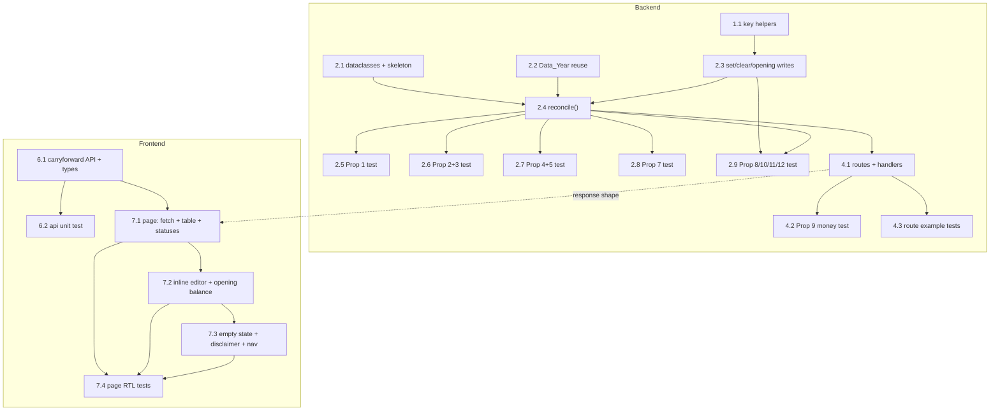

# Implementation Plan: Passive Loss Carryforward Reconciliation

## Overview

This plan adds a portfolio-level passive-loss carryforward reconciliation to Logstead. It introduces a new `CarryforwardService` that derives each Data_Year's Schedule E net by reusing `ReportingService.report_for` across the user's properties, rolls a running suspended-loss balance forward from an optional opening balance (the Expected_Carryforward), merges in user-entered Reported_Carryforward values, and classifies each year `ok` / `mismatch` / `unreported`. Four routes expose it, and a new `Carryforward_Page` renders the reconciliation table with an inline reported-value editor, an opening-balance control, and a persistent plain-language disclaimer (the feature never computes the IRC §469 limitation).

The language is **Python 3.12** (backend) and **React 19 + TypeScript** (frontend) — the design uses the real codebase, so no language selection is needed. The backend and frontend tracks proceed in parallel; only the final page-wiring task depends on the response shape being settled. Money stays an exact two-decimal `Decimal` in Python and a two-decimal **string** over the wire.

Testing reuses the project's stack: backend `pytest` + `Hypothesis` + `moto` with injected collaborators (service tests in `backend/tests/services/test_*_property.py`, route tests in `backend/tests/router/test_*_route.py`); frontend `vitest` + `fast-check` + RTL. Run via `make test` (or `cd backend && pytest`, `cd frontend && npx vitest --run`). Every property-based test runs ≥100 iterations and is tagged `# Feature: passive-loss-carryforward, Property N: ...` (`//` in TS).

## Tasks

- [x] 1. Backend: key helpers and carryforward persistence
  - [x] 1.1 Add carryforward key helpers to `backend/src/logstead/repository/keys.py`
    - Add `PLCF_PREFIX = "PLCF#"` and `PLCF_OPENING_SK = "PLCF_OPENING"` to the key prefix/constant block
    - Add `plcf_year_sk(tax_year: int) -> str` (returns `f"{PLCF_PREFIX}{tax_year}"`), `plcf_list_prefix() -> str` (returns `PLCF_PREFIX`), and `plcf_opening_sk() -> str` (returns `PLCF_OPENING_SK`), following the `usage_sk` / `property_note_sk` conventions
    - _Requirements: 3.1, 7.2_
    - _Design: Data Models (new key helpers)_

- [x] 2. Backend: `CarryforwardService` dataclasses and construction
  - [x] 2.1 Add transport dataclasses and the service skeleton in `backend/src/logstead/services/carryforward.py`
    - Add frozen dataclasses `ReconciledYear` (`tax_year: int`, `schedule_e_net: Money`, `expected_carryforward: Money`, `reported_carryforward: Money | None`, `status: Literal["ok","mismatch","unreported"]`) and `ReconciliationSummary` (`years: tuple[ReconciledYear, ...]`, `opening_balance: Money`, `has_data: bool`)
    - Define `CarryforwardService.__init__(self, repo, user, reports, properties)` storing the user id (via `user_id_of` when a `UserContext`), mirroring the user-scoping of other services; export the dataclasses + service in `__all__`
    - Keep every money field as `util.money.Money`
    - _Requirements: 1.3, 1.4, 2.6_
    - _Design: Components and Interfaces (backend); Data Models_

  - [x] 2.2 Implement the Data_Year derivation reuse
    - Derive the user's ascending, de-duplicated, gap-preserving Data_Years capped at the latest completed tax year, reusing the existing derivation used by the dashboard rather than duplicating it (extract/share the helper if needed so both call one implementation)
    - _Requirements: 1.1, 2.1_
    - _Design: Data_Year derivation (Req 1, 2)_

  - [x] 2.3 Implement `set_reported`, `clear_reported`, and `set_opening_balance`
    - `set_reported(tax_year, amount)`: validate a non-negative two-decimal money amount (reject otherwise with `Result.failure("validation", ..., field="amount")`), persist a `PLCF#<year>` item under `USER#<userId>` with the normalized amount and `taxYear`, replacing any existing entry
    - `clear_reported(tax_year)`: delete the `PLCF#<year>` item (idempotent — success when absent)
    - `set_opening_balance(amount)`: validate non-negative two-decimal, persist the single `PLCF_OPENING` item under the user partition
    - All three user-scoped; never touch another user's partition
    - _Requirements: 3.1, 3.2, 3.3, 3.4, 3.5, 7.1, 7.2, 7.3, 7.5_
    - _Design: Components and Interfaces (backend); Error Handling_

  - [x] 2.4 Implement `reconcile()`
    - List the user's properties once; read all `PLCF#` reported entries and the `PLCF_OPENING` item up front; derive the Data_Years
    - For each Data_Year ascending, sum `self._reports.report_for(pid, year).value.totals.net` across properties (a non-ok report for a user-owned id contributes `0.00`, never raising) to get the Schedule_E_Net
    - Roll the running Suspended_Loss_Balance: start from the Opening_Balance (default 0.00); a loss (`net < 0`) adds `-net`; a gain (`net >= 0`) subtracts `net` floored at 0.00; the post-apply balance is that year's Expected_Carryforward and is carried into the next year; all exact `Decimal`, never negative
    - Set each year's status: `unreported` when no reported entry; else `ok` when reported equals expected to the cent; else `mismatch`
    - Return `ReconciliationSummary(years=..., opening_balance=..., has_data=(bool(data_years) or opening_balance != 0))`; `years=()` when there are no Data_Years
    - Never apply the §469 limitation
    - _Requirements: 1.1, 1.2, 2.1, 2.2, 2.3, 2.4, 2.5, 2.6, 2.7, 4.1, 4.2, 4.3, 4.4, 6.1, 6.2_
    - _Design: Running-balance algorithm (Req 2, 4); Components and Interfaces (backend)_

  - [x]* 2.5 Property test — Schedule E net reconciles with the reports
    - **Property 1: Schedule E net reconciles with the reports**
    - **Validates: Requirements 1.1, 1.2**
    - New `backend/tests/services/test_carryforward_net_reconciliation_property.py`; Hypothesis + moto; assert each year's `schedule_e_net` equals the exact-cent sum of `report_for(pid, year).value.totals.net` across the user's properties

  - [x]* 2.6 Property test — expected is a correct, non-negative running balance
    - **Property 2: Expected is a correct running balance** and **Property 3: Expected is never negative**
    - **Validates: Requirements 2.1, 2.2, 2.3, 2.4, 2.5, 2.6**
    - `backend/tests/services/test_carryforward_running_balance_property.py`; generate per-year nets + opening balance; assert the step relation (`max(prior-net,0)` on gain, `prior+(-net)` on loss), carry-forward linkage, non-negativity, and two-decimal exactness

  - [x]* 2.7 Property test — profitable run floors at zero; pure-loss accumulation
    - **Property 4: A profitable run drives the balance to zero and holds** and **Property 5: Pure-loss accumulation**
    - **Validates: Requirements 2.3, 2.4**
    - Assert a positive opening balance followed by sufficient gains reaches and holds 0.00; and loss-only sequences accumulate to opening + cumulative loss magnitude

  - [x]* 2.8 Property test — status classification is total and correct
    - **Property 7: Status classification is total and correct**
    - **Validates: Requirements 4.1, 4.2, 4.3, 4.4**
    - Generate reported entries (present/absent, equal/unequal to expected); assert exactly one status per year with the correct rule, including the "loss year then next-year reported 0.00 → mismatch" shape

  - [x]* 2.9 Property test — reported round-trips and validates; user scoping; empty case; §469 independence
    - **Property 8: Reported round-trips and validates**, **Property 10: User scoping**, **Property 11: Empty, non-error series**, **Property 12: §469 limitation is never applied**
    - **Validates: Requirements 3.1, 3.2, 3.3, 3.4, 3.5, 6.1, 6.2, 7.5, 2.7, 8.3**
    - `backend/tests/services/test_carryforward_persistence_property.py`; assert persist/replace/validate-reject/idempotent-clear, two-user isolation over one table, empty-user `years == ()` + `has_data == false`, and that expected depends only on nets + opening balance (no allowance/phase-out influence)

- [x] 3. Checkpoint — backend service
  - Ensure the service compiles and the service property tests pass; ask the user if questions arise.

- [x] 4. Backend: routes
  - [x] 4.1 Add the carryforward handlers and route registration in `backend/src/logstead/router/handler.py`
    - Add `_carryforward_service_or_503(wiring, user)` building a `CarryforwardService` from the repo + a reporting service (503 when a dependency is unconfigured), mirroring `_dashboard_service_or_503`
    - Add handlers: `_carryforward_reconcile` (`GET /carryforward` → `_response(200, service.reconcile())`); `_set_carryforward_reported` (`PUT /carryforward/years/{taxYear}` → parse `taxYear` via `_int_param`, read `amount` from the body, map `service.set_reported(...)` via `_result_response`); `_clear_carryforward_reported` (`DELETE /carryforward/years/{taxYear}` → `service.clear_reported(...)`); `_set_carryforward_opening` (`PUT /carryforward/opening-balance` → `service.set_opening_balance(body.amount)`)
    - Register the four routes (all auth-gated); rely on existing `_to_jsonable` to serialize every `Money`/`Decimal` as a two-decimal string
    - _Requirements: 1.3, 3.1, 3.5, 4.5, 7.2_
    - _Design: Components and Interfaces (routes); Error Handling_

  - [x]* 4.2 Property test — every figure is a two-decimal money string
    - **Property 9: Every figure is a two-decimal money string**
    - **Validates: Requirements 1.4, 2.6, 3.6**
    - `backend/tests/router/test_carryforward_money_property.py`; drive the real handler over moto; assert `schedule_e_net`, `expected_carryforward`, non-null `reported_carryforward`, and `opening_balance` all match `^-?\d+\.\d{2}$`, only `tax_year` is an int, `status` a known literal

  - [x]* 4.3 Route example tests for the carryforward endpoints
    - `backend/tests/router/test_carryforward_route.py`, mirroring `test_dashboard_trends_route.py`: seed via existing POST endpoints, then assert `GET /carryforward` 200 shape (ascending years, statuses, opening balance); `PUT /carryforward/years/{year}` 200 then reflected in a subsequent GET; `PUT` with a negative/invalid amount → 400 with `field`; non-integer `{taxYear}` → 400; `DELETE` clears → year `unreported`; `PUT /carryforward/opening-balance` 200 then reflected; unauthenticated → 401; and that the year/opening routes do not shadow each other
    - _Requirements: 3.1, 3.3, 3.4, 4.5, 7.1_

- [x] 5. Checkpoint — backend endpoints
  - Ensure the route tests pass and the four endpoints dispatch correctly; ask the user if questions arise.

- [x] 6. Frontend: carryforward API transport
  - [x] 6.1 Add `frontend/src/api/carryforward.ts`
    - Add wire interfaces `ReconciledYear` (`tax_year: number`; money fields `schedule_e_net`/`expected_carryforward` as `string`; `reported_carryforward: string | null`; `status: "ok" | "mismatch" | "unreported"`) and `ReconciliationSummary` (`years: readonly ReconciledYear[]`, `opening_balance: string`, `has_data: boolean`)
    - Add `CarryforwardApi` with `getReconciliation(signal?)` (`GET /carryforward`), `setReported(taxYear, amount, signal?)` (`PUT /carryforward/years/{taxYear}` body `{ amount }`), `clearReported(taxYear, signal?)` (`DELETE ...`), `setOpeningBalance(amount, signal?)` (`PUT /carryforward/opening-balance` body `{ amount }`); inject `ApiClient`, default to the shared singleton; export free-function bindings, mirroring `api/dashboard.ts`
    - _Requirements: 1.4, 3.6, 4.1_
    - _Design: Components and Interfaces (frontend Carryforward_API); Data Models_

  - [x]* 6.2 Unit test — the API calls the right routes and types money as strings
    - `frontend/src/api/carryforward.test.ts`; injected fake `ApiClient`; assert `getReconciliation` GETs `/carryforward` with no query; `setReported`/`clearReported` hit the per-year path with the right method and body; `setOpeningBalance` PUTs `/carryforward/opening-balance`; signals pass through; money fields typed as strings
    - _Requirements: 1.4, 3.6_

- [x] 7. Frontend: carryforward page
  - [x] 7.1 Add `frontend/src/pages/CarryforwardPage.tsx` — fetch, table, and statuses
    - Fetch `getReconciliation()` on mount (ignore `AbortError`; surface a load failure as the page's error indication without wiping the disclaimer); render one row per `years` entry ascending with the four-digit year, `schedule_e_net` (loss styling via the app's `formatMoney`/`isLoss`), `expected_carryforward`, `reported_carryforward` (or an explicit not-entered indication), and a textual `status`
    - Highlight `mismatch` rows distinctly with a textual label (never color alone); show both expected and reported on a `mismatch` row
    - _Requirements: 4.5, 4.6, 5.1, 5.2, 5.3, 5.4_
    - _Design: Components and Interfaces (frontend Carryforward_Page)_

  - [x] 7.2 Add the inline reported-value editor and the opening-balance control
    - Per-row control to enter/edit/clear the Reported_Carryforward, calling `setReported`/`clearReported` then refreshing the series in place (no full reload); surface a validation error inline next to the control
    - A control to set the Opening_Balance (`setOpeningBalance`), validated as non-negative two-decimal, with inline error
    - _Requirements: 3.3, 5.5, 5.6, 7.1, 7.3_
    - _Design: Components and Interfaces (frontend Carryforward_Page)_

  - [x] 7.3 Add the empty state and the plain-language disclaimer
    - When `has_data` is false, render the Empty_State guidance (no zero-row table, no error)
    - Render the `Disclaimer_Notice` persistently: a short plain-language line plus a collapsed-by-default "What is this?" explanation of suspended carryforwards and why the app does not compute the §469 limitation; never present the expected figure or a status as a definitive tax figure or filing instruction
    - Wire the page into the app's route table / navigation like the other pages
    - _Requirements: 6.1, 6.2, 8.1, 8.2, 8.3, 8.4_
    - _Design: Components and Interfaces (frontend Carryforward_Page); Overview (§469 boundary)_

  - [x]* 7.4 RTL tests for the carryforward page
    - `frontend/src/pages/CarryforwardPage.test.tsx` with an injected fake API: table rows + ascending order, the `mismatch` textual highlight showing both figures, loss styling on a negative net, inline edit → save/clear refresh, the opening-balance control, the persistent disclaimer + its expandable explanation, the empty state, and the load-error state
    - _Requirements: 4.5, 4.6, 5.1, 5.2, 5.5, 5.6, 6.1, 8.1, 8.3_

- [x] 8. Final checkpoint — full suite
  - Run `make test` (backend `pytest` + frontend `vitest`) and the frontend production build (`make build-frontend`, i.e. `tsc -b && vite build`) to confirm no type or test regressions; ask the user if questions arise.

## Task Dependency Graph

```json
{
  "waves": [
    { "id": 0, "tasks": ["1.1", "2.1", "2.2", "6.1"] },
    { "id": 1, "tasks": ["2.3", "6.2"] },
    { "id": 2, "tasks": ["2.4"] },
    { "id": 3, "tasks": ["2.5", "2.6", "2.7", "2.8", "2.9", "4.1"] },
    { "id": 4, "tasks": ["4.2", "4.3", "7.1"] },
    { "id": 5, "tasks": ["7.2"] },
    { "id": 6, "tasks": ["7.3"] },
    { "id": 7, "tasks": ["7.4"] }
  ]
}
```

## Notes

- **Checkpoints (tasks 3, 5, 8)** are stop-and-verify gates, not code tasks: run the relevant tests (and, at task 8, the frontend production build `tsc -b && vite build`) and pause for the user if anything is unclear. Task 8's build step is deliberate — a prior feature's deploy failed on `tsc -b` catching a type error that `tsc --noEmit` had not surfaced, so the full build is part of done.
- **Optional tests** are marked `[ ]*` (the property-based and RTL/unit test tasks). They are not auto-run by "run all tasks"; dispatch them explicitly after the implementation tasks they validate.
- **The §469 boundary is a hard invariant, not a soft note.** Property 12 (task 2.9) asserts the Expected_Carryforward depends only on the nets + opening balance, and task 7.3 requires the persistent plain-language disclaimer + expandable explanation. Neither should be dropped as "nice to have."
- **No new data model beyond two tiny user-partition items** (`PLCF#<year>` reported entries and the `PLCF_OPENING` singleton). The reconciliation is otherwise fully re-derived from existing Schedule E data on every read.
- **Money contract:** `Decimal` two-decimal in Python, two-decimal strings over the wire, `string` in TypeScript — never a float, never a DynamoDB `Number`. The Suspended_Loss_Balance is a non-negative magnitude (0.00 = none); `schedule_e_net` keeps the app-wide negative-is-loss convention.
- **Parallelism:** the backend and frontend tracks are independent until task 7.1 (page wiring), which depends on the route response shape settled in task 4.1. Waves are sized for the orchestrator's 5-concurrent limit.
