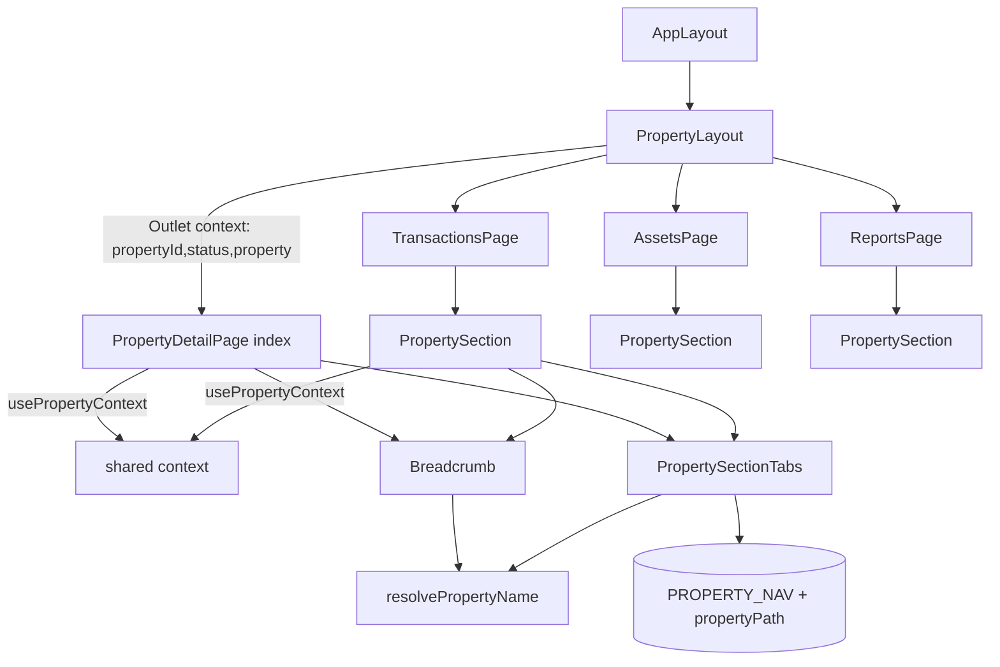

# Design Document

## Overview

The property overview page (`PropertyDetailPage`, the property index route `/properties/{propertyId}`) is the only property-scoped page that does not share the orientation machinery its siblings use. The sub-pages (Transactions, Depreciable Assets, Schedule E Report) render a `Breadcrumb` and the per-property Section Tabs through `PropertySection`, which reads the property once from the shared `PropertyLayout` context. The overview instead renders an ad-hoc `← All properties` link and its own `<h1>`, and it issues a second, redundant `getProperty` fetch for identity.

This design brings the overview into line with its siblings, frontend-only and navigation/presentation-only:

1. Add an **Overview** entry to `PROPERTY_NAV` as the first tab, targeting the property index route with exact (`end`) active matching.
2. Extract the Section Tabs rendering and the `resolvePropertyName` helper into shared, reusable pieces so both `PropertySection` and the overview render identical breadcrumb + tabs from the same source.
3. Rework `PropertyDetailPage` to read identity/orientation from `usePropertyContext()` (dropping its own property fetch and its ad-hoc link/heading) while keeping its content fetches (photos, assets, report, note).

No backend changes, no visual restyle, no changes to the global navigation, no property switcher.

### Resolved design decision (was Open Question 1)

The overview breadcrumb ends at the property name — `Properties > {Resolved Property Name}` — with **no trailing crumb** (option a). The resolved name is the current (non-link) tail crumb. This matches Requirement 1.4 and the natural reading that, on the overview, the property *is* the current page. There is no literal "Overview" trailing crumb; "Overview" exists only as a Section Tab label.

### How the overview adopts breadcrumb + Section Tabs (Decision 1)

Two sub-options were weighed:

- **(A)** Render `<PropertySection title="Overview" .../>` at the top of `PropertyDetailPage`, then the existing tiles below. Rejected: `PropertySection`'s shape is `title` as the `<h1>` + property name as a `<p>` subtitle + a breadcrumb ending at `{title}`. On the overview we want the `<h1>` to be the **property name** and the breadcrumb to end at `{name}` (not at a literal "Overview"). Forcing `title="Overview"` would (i) put the wrong text in the `<h1>`, (ii) end the breadcrumb at `> Overview` instead of `> {name}`, and (iii) duplicate the property-name display (subtitle `<p>` plus the existing header card). Resolving all that inside `PropertySection` would overload it with an "overview mode" branch for a single caller.

- **(B — chosen)** Have `PropertyDetailPage` render the `Breadcrumb` and the shared Section Tabs **directly**, reusing the exact same components, config (`PROPERTY_NAV`, `propertyPath`), and `resolvePropertyName` helper that `PropertySection` uses, with the **property name as its single `<h1>`**. This keeps one `<h1>`, a correct breadcrumb (`Properties > {name}`), the four Section Tabs with Overview exact-active, and no duplicate property-name text. The former ad-hoc `← All properties` link and the former `<h1 id="property-heading">` are removed; the existing header **card** (photo + address + type + tax-year selector) remains as content below the orientation header.

To keep "same shared machinery" literal rather than copy-pasted, the Section Tabs markup and `resolvePropertyName` are extracted into shared units (`PropertySectionTabs` and `resolvePropertyName` in a small module), and `PropertySection` is refactored to consume them. Both the sub-pages and the overview then render *the same* tab component and *the same* name resolver — satisfying Requirement 1.5 (reuse, no new navigation component).

## Architecture

All property-scoped pages render inside `AppLayout` → `PropertyLayout` (the `properties/:propertyId` layout route). `PropertyLayout` fetches the property once and provides `{ propertyId, status, property }` via `<Outlet context>`.



After this change:

- **Overview** reads orientation from the context (no own `getProperty`), renders `Breadcrumb` + `PropertySectionTabs` directly with the property name as its `<h1>`, then renders the existing header card and tile grid as content.
- **Sub-pages** are unchanged in behavior; they continue through `PropertySection`, which now renders the shared `PropertySectionTabs` (that now includes the Overview tab).
- Both paths resolve the display name via the single shared `resolvePropertyName`, so identity and orientation are consistent across every state.

## Components and Interfaces

### `navConfig.ts` (changed)

Add an optional exact-match flag to `PropertyNavItem`, add the Overview entry as the first `PROPERTY_NAV` item, and make `propertyPath` return a clean base path for the empty segment.

```ts
/** A per-property sub-section (rendered once a property is selected). */
export interface PropertyNavItem {
  /** Path segment appended to `/properties/:propertyId`. Empty = the index. */
  readonly segment: string;
  /** Human-readable label. */
  readonly label: string;
  /**
   * When true, active-state matching must be exact. Used for the Overview
   * (index) entry so it is not marked active on sub-routes. Mirrors
   * `NavItem.end`.
   */
  readonly end?: boolean;
}

/** Sub-sections available under a selected property (Overview first). */
export const PROPERTY_NAV: readonly PropertyNavItem[] = [
  { segment: "", label: "Overview", end: true },
  { segment: "transactions", label: "Transactions" },
  { segment: "assets", label: "Depreciable Assets" },
  { segment: "reports", label: "Schedule E Report" },
];

/**
 * Build the absolute path for a property sub-section. An empty segment yields
 * the clean property index path (`/properties/{id}`) with no trailing slash.
 */
export function propertyPath(propertyId: string, segment: string): string {
  return segment
    ? `/properties/${propertyId}/${segment}`
    : `/properties/${propertyId}`;
}
```

Rationale: `end: true` on the Overview entry plumbs React Router `NavLink`'s exact matching so `/properties/{id}` does not spuriously match `/properties/{id}/transactions` (Requirements 2.4, 2.5). The empty-segment base path keeps the Overview link and breadcrumb target canonical.

### `resolvePropertyName` (extracted, shared)

The existing `resolvePropertyName(status, name)` currently lives privately inside `PropertySection`. It is moved to a shared module (e.g. `components/propertyName.ts`) and exported unchanged in behavior so both `PropertySection` and `PropertyDetailPage` import the same function (Requirements 3.4, 1.3).

```ts
/** "loading" → "Loading property…"; loaded+name → name; else → "Property". */
export function resolvePropertyName(
  status: "loading" | "loaded" | "error",
  name: string | undefined,
): string {
  if (status === "loading") return "Loading property…";
  if (status === "loaded" && name) return name;
  return "Property";
}
```

### `PropertySectionTabs` (extracted, shared)

The Section Tabs `<nav>` is extracted from `PropertySection` into a small presentational component so the overview renders the exact same tabs. It builds links from `PROPERTY_NAV` with `propertyPath` and passes `end={item.end}` to each `NavLink` so the Overview tab uses exact matching.

```tsx
interface PropertySectionTabsProps {
  /** Property id used to build each tab's path. */
  propertyId: string;
}

export function PropertySectionTabs({ propertyId }: PropertySectionTabsProps) {
  return (
    <nav aria-label="Property sections" className="mt-4">
      <ul className="flex flex-wrap gap-2">
        {PROPERTY_NAV.map((item) => (
          <li key={item.segment}>
            <NavLink
              to={propertyPath(propertyId, item.segment)}
              end={item.end}
              className={({ isActive }) =>
                [
                  "inline-block rounded-md px-3 py-1.5 text-sm font-medium",
                  "focus-visible:outline focus-visible:outline-2 focus-visible:outline-offset-2 focus-visible:outline-accent",
                  isActive
                    ? "bg-accent text-accent-fg"
                    : "text-fg-muted hover:bg-surface-muted",
                ].join(" ")
              }
            >
              {item.label}
            </NavLink>
          </li>
        ))}
      </ul>
    </nav>
  );
}
```

The active `NavLink` applies `aria-current="page"` automatically (react-router default), satisfying Requirements 2.4, 5.3. The `end` flag (true only for Overview) satisfies Requirement 2.5. The `nav` accessible name "Property sections" stays distinct from "Breadcrumb" and the primary navigation (Requirements 5.2).

### `PropertySection` (refactored, same behavior)

`PropertySection` keeps its public props (`propertyId?`, `title`, `description`) and visible output, but now imports `resolvePropertyName` from the shared module and renders `<PropertySectionTabs propertyId={propertyId} />` instead of an inline `<nav>`. Its breadcrumb trail is unchanged for sub-pages: `Properties > {name} > {title}`. Because `PROPERTY_NAV` now leads with Overview, every sub-page's tab bar automatically gains the Overview tab linking to the index route (Requirement 2.3), and that tab is not active on a sub-route thanks to `end` (Requirement 2.5).

### `PropertyDetailPage` (reworked)

Changes:

- **Remove** the identity `getProperty` fetch and its `LoadState` (the `load`/`refresh`/`state` for the property itself). Identity now comes from `usePropertyContext()` (Requirements 4.1, 4.2). The `load` prop seam is removed.
- **Keep** all content fetches and seams: `loadPhotos`, `loadAssets`, `loadReport`, `loadNote`, `saveNote` (Requirement 4.3).
- **Remove** the ad-hoc `← All properties` link and the `<h1 id="property-heading">`.
- **Render** at the top, in every context state: `<Breadcrumb items={crumbs} />`, then a single `<h1 id="page-heading">` showing the resolved property name, then `<PropertySectionTabs propertyId={propertyId} />` (Requirements 1.1, 1.2, 1.4, 3.1–3.3).
- The existing **header card** (photo + address + type + `TaxYearSelector`) and the **tile grid** remain as content below the orientation header, rendered when the context is `loaded`.

Breadcrumb trail for the overview (Decision 3 / Requirement 1.4), name as the final non-link crumb:

```ts
const propertyName = resolvePropertyName(context.status, context.property?.name);
const crumbs: Crumb[] = [
  { label: "Properties", to: "/properties" },
  { label: propertyName }, // current page — no `to`, renders aria-current="page"
];
```

Resulting component shape (identity from context; content from seams):

```tsx
export default function PropertyDetailPage({
  loadReport = getReport,
  loadPhotos = listPhotos,
  loadAssets = listAssets,
  loadNote = getPropertyNote,
  saveNote = setPropertyNote,
}: PropertyDetailPageProps) {
  const context = usePropertyContext();
  const propertyId = context.propertyId;
  const propertyName = resolvePropertyName(context.status, context.property?.name);
  // ...existing content state: headerPhoto, assets, taxYear, report...

  return (
    <PageContainer>
      <section aria-labelledby="page-heading">
        <Breadcrumb items={[
          { label: "Properties", to: "/properties" },
          { label: propertyName },
        ]} />
        <h1 id="page-heading" className="mt-2 text-2xl font-semibold text-fg">
          {propertyName}
        </h1>
        <PropertySectionTabs propertyId={propertyId} />

        {context.status === "error" ? (
          /* consistent error affordance (see Error Handling) */
        ) : context.status === "loaded" ? (
          /* existing header card + tile grid, keyed off context.property */
        ) : null}
      </section>
    </PageContainer>
  );
}
```

Note the `<section>` now uses `aria-labelledby="page-heading"` (matching `PropertySection`), and the single `<h1>` carries `id="page-heading"`, so there is exactly one `<h1>` and one property-name display in the orientation header. The header card no longer renders its own `<h1>`; it shows the address/type/photo/selector only.

## Data Models

The only data-model change is the navigation model in `navConfig.ts`:

- `PropertyNavItem` gains an optional `end?: boolean` (exact-match flag), mirroring `NavItem.end`.
- `PROPERTY_NAV` gains a leading entry `{ segment: "", label: "Overview", end: true }`; the existing three entries are unchanged and keep their order, yielding the ordered set {Overview, Transactions, Depreciable Assets, Schedule E Report} (Requirement 2.2).
- `propertyPath(id, "")` returns `/properties/{id}` (base path, no trailing slash); non-empty segments are unchanged.

No API types, no backend models, and no changes to `PropertyContext` are needed — the context already carries `{ propertyId, status, property }`.

## Error Handling

- **Property identity errors** are now owned by `PropertyLayout`'s single fetch and surfaced via `context.status === "error"`. The overview no longer has its own property `LoadState` or its overview-only "Could not load this property." message (Requirement 4.4). In the error state the overview still renders the breadcrumb and Section Tabs (orientation persists), with the resolved name showing the neutral `"Property"` fallback (Requirement 3.3), and presents the error consistently with the rest of the section — a single `role="alert"` affordance in place of the loaded content. (The former 404-specific copy was tied to the removed overview fetch; identity-fetch failures are reported uniformly through the shared context, consistent with the sub-pages.)
- **Content errors** keep their existing, localized handling and do not affect orientation: the Schedule E report tile shows its own `role="alert"` on report failure; photos and assets degrade silently to empty (as today); the note tile shows its own load/save errors. These are independent of the property identity state (Requirement 4.3).
- **Loading** state renders the breadcrumb and tabs with the `"Loading property…"` placeholder name; content tiles render only once `context.status === "loaded"` (Requirement 3.1).

## Testing Strategy

This feature is navigation/presentation-only (UI rendering + route-driven active state) and reuses already-tested primitives (`Breadcrumb`, `NavLink`, `PropertyLayout` context). Per the project's testing guidance, property-based testing is **not** applicable here:

- The only candidate universal invariant — "the Overview tab is active iff the current route is the property index route" (Requirements 2.4, 2.5) — is decided by React Router `NavLink`'s `end` matching, which this feature *configures* (`end: true`) rather than implements. Its meaningful input space is the fixed, enumerable route set {index, transactions, assets, reports}; generating arbitrary routes would exercise the router library, not our code, and would surface no additional bugs.
- Everything else resolves to presence/structure assertions, pure-mapping branches (`resolvePropertyName`), static config, or accessibility scans.

Accordingly there is **no Correctness Properties section** and no property-based tests. Coverage is example-based with Vitest + React Testing Library + `vitest-axe`.

### Unit tests

- `resolvePropertyName`: `loading` → placeholder, `loaded` + name → name, `loaded` without name / `error` → `"Property"` (Requirements 1.3, 3.4).
- `navConfig`: `PROPERTY_NAV[0]` is `{ segment: "", label: "Overview", end: true }`; order is {Overview, Transactions, Depreciable Assets, Schedule E Report}; `propertyPath(id, "")` === `/properties/${id}` and `propertyPath(id, "transactions")` === `/properties/${id}/transactions` (Requirements 2.1, 2.2).

### Component tests — overview (`PropertyDetailPage`)

Render inside a `MemoryRouter` with a `PropertyLayout` providing an injected context (or the `usePropertyContext` default), at the index route:

- Renders a `nav[aria-label="Breadcrumb"]` whose crumbs are exactly `Properties` (link) then the resolved name as the current, non-link crumb (`aria-current="page"`) — i.e. `Properties > {name}` with no trailing "Overview" crumb (Requirements 1.1, 1.4, 5.1).
- Renders `nav[aria-label="Property sections"]` with the four tabs in order; the **Overview** tab has `aria-current="page"` and active styling on the index route (Requirements 1.2, 2.2, 2.4, 5.3).
- Exactly one `<h1>` is present and it shows the resolved property name; the raw `propertyId` string never appears as visible content (Requirements 1.3; single-heading check for Decision 1).
- Identity comes from context: with status `loaded`/`loading`/`error`, the resolved name is placeholder / name / `"Property"` respectively, and the breadcrumb + tabs remain present in all three states (Requirements 3.1–3.3, 4.1).
- No duplicate property fetch: no `load`/`getProperty` seam exists for identity; a spy content loader is still invoked but no identity fetch occurs (Requirements 4.2, 4.3). Assert `loadPhotos`/`loadAssets`/`loadReport`/`loadNote` are called.
- Error state: with context status `error`, a single `role="alert"` is shown in place of the loaded tiles while breadcrumb + tabs persist; the old overview-only "Could not load this property." path is gone (Requirement 4.4).

### Component tests — sub-pages (`PropertySection`)

Render a sub-page (e.g. at `/properties/{id}/transactions`):

- The four tabs render in order; the **Overview** tab links to `/properties/{id}` (the index) and is **not** active, while the current sub-tab is active (Requirements 2.3, 2.5).
- The breadcrumb still ends at the sub-page title (`Properties > {name} > {title}`), unchanged (Non-Goal: sub-page behavior preserved).

### Accessibility tests

- `getByRole("navigation", { name: "Breadcrumb" })` and `getByRole("navigation", { name: "Property sections" })` resolve to distinct landmarks, distinct from the primary navigation (Requirements 5.1, 5.2).
- `vitest-axe`: the overview renders with **no** accessibility violations in loading, loaded, and error states (Requirement 5.5). Keyboard focus order and visible focus (Requirement 5.4) rely on the existing focus-ring utilities already applied by `Breadcrumb` and the tab `NavLink`s; a light tab-order smoke check may be added, with full AT verification left to manual review.
