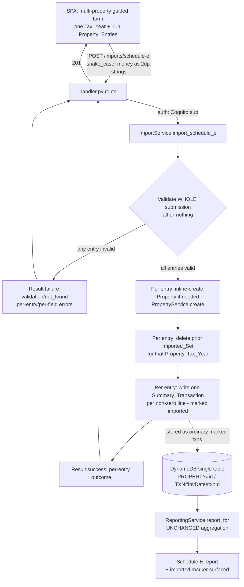

# Design Document

## Overview

Schedule E Import lets a user backfill prior-year Schedule E data for one or more rental properties in a single pass. Because Logstead **derives** Schedule E reports on demand (it never stores a report), "importing a Schedule E" means **synthesizing the backing transactions** that reproduce the line totals the user enters. This feature introduces one new backend application service — `ImportService` — plus a small, backward-compatible marker on the existing `Transaction` model and model item, two new authenticated routes, and a guided multi-property form on the SPA.

The guiding principle: **synthesized transactions are ordinary, marked transactions**. They are stored under the exact same per-property / per-tax-year keys as user-tracked transactions (`TransactionService` / `keys.py`), carry the same validated shape (amount > 0, recorded `schedule_e_line`, Line 19 description), and are therefore consumed by the existing `ReportingService` with **zero change to report computation** — the only reporting change is surfacing the imported marker so a reader can tell imported contributions apart.

### What this feature builds on (existing modules)

| Concern | Existing module it reuses |
| --- | --- |
| Transaction create/list/delete, item serialization, GSI2 tax-year keys | `services/transaction.py` (`TransactionService`, `transaction_to_item`, `_from_item`) |
| Category → Schedule E line mapping, Line 19 `requires_description` | `services/category.py` (`CATEGORY_CATALOG`), `services/transaction.py` (`category_by_id`) |
| Report derivation (unchanged) | `services/report.py` (`ReportingService.report_for` / `combined_report`) |
| Property ownership + inline create | `services/property.py` (`PropertyService.create`, `_owned_meta`, `get`) |
| Single-table keys, inverted-date SK, GSI2 tax-year partition | `repository/keys.py` |
| Atomic multi-write / delete | `repository/dynamo_repo.py` (`transact_write`, `put_item`, `delete_item`) |
| Money as two-decimal `Decimal`/string | `util/money.py` (`to_money`, `money_to_str`) |
| Result → HTTP mapping, per-request wiring, auth | `router/handler.py` (`_result_response`, route table) |
| Typed outcomes | `models/result.py` (`Result`, `Error`) |

### Scope boundary vs. the existing `/imports` PDF feature (important)

The repository already contains a **fully built and tested** PDF-expense-import feature: `services/expense_import.py` (`ExpenseImportService`), the `ImportSession` / `DraftTransaction` models, the `IMPORT#` / `DRAFT#` key helpers and the GSI1 `ImportSession` lookup in `keys.py`, the live `POST /imports`, `GET /imports/{sessionId}`, `.../drafts`, `.../confirm` routes in `handler.py`, and a matching frontend feature (`api/imports.ts`, `components/imports/ImportReview.tsx`, `DraftRow.tsx`, `pages/ImportReviewPage.tsx`). That feature parses a property-manager expense-summary PDF into draft transactions the user reviews and confirms.

This means the premise that `IMPORT#`/`DRAFT#` is inert "leftover scaffolding" is **only partly accurate**: the key helpers exist, but they are not unused — they back a shipping feature. **This design does not reuse, repurpose, or remove that scaffolding.** Doing so would break a tested feature and its routes. Schedule E Import is a separate capability that, by design, needs **no** `IMPORT#`/`DRAFT#` entity at all (see Architecture → Storage decision). The fate decision is therefore: **leave the `IMPORT#`/`DRAFT#` scaffolding exactly as it is, owned by the PDF feature, and do not touch it.** To avoid route and name collisions, Schedule E Import mounts under a distinct path (`/imports/schedule-e`) and uses a distinct service class name (`ImportService` for Schedule E vs. the existing `ExpenseImportService`); the handler's existing `_import_service` wiring is left untouched and a new `_schedule_e_import_service` constructor is added.

## Architecture

### Request flow



The SPA submits one `Import_Submission` (one `Tax_Year`, one or more `Property_Entry` rows). `ImportService` validates the entire submission before any write, then for each entry: optionally creates the property inline, deletes the prior imported set for that `(Property, Tax_Year)`, and writes one `Summary_Transaction` per non-zero line. Reports are **not stored**; `ReportingService` continues to derive them from stored transactions. The only reporting-side change is surfacing the imported marker (Req 7.4) — the aggregation math in `report.py` is untouched.

### Storage decision (no new persisted entity)

Because a `Summary_Transaction` is an ordinary transaction (amount > 0, a recorded `schedule_e_line`, a Line 19 description where needed) stored under the existing `PROPERTY#<id> / TXN#<invDate>#<txnId>` base key and the `GSI2` tax-year keys, **Schedule E Import introduces no new persisted entity.** The imported set for a `(Property, Tax_Year)` is simply "the transactions in that per-property/per-tax-year partition that carry the imported marker." This keeps v1 **stateless beyond the synthesized transactions**: there is no import session, no audit record, no draft staging.

Rationale for *not* adding an import session/audit record in v1:
- Replace-on-reimport is fully expressible by querying the existing per-property/per-tax-year partition and filtering on the marker; no session id is needed to find the prior set.
- Reports already reconstruct everything from transactions; a session record would be redundant derived state (and Logstead's stated principle is "no cached aggregates").
- The requirements explicitly make the per-user per-property per-tax-year transaction store the system of record (Req 10.2) and call for *no* report-computation change beyond the marker.

A future "layer 2" PDF/OCR extraction feature (a Non-Goal here) can pre-fill the same form; if that later wants an audit trail it can add its own record then. For v1, adding one now would be speculative.

### Compose `TransactionService.create` vs. write items directly — decision

`ImportService` **composes `TransactionService`** rather than writing transaction items directly. Specifically:

- **Synthesis uses `TransactionService.create(TransactionInput)`** for each non-zero line. This reuses, for free and in one place: amount > 0 validation (Req 6.1/9 — zero lines never reach create because we skip them, and a defensive create still rejects non-positive), the `category_id → schedule_e_line` recording (Req 4.3, 6.3/6.4), the Line 19 `requires_description` rule (Req 6.5/6.6), and correct emission of both the base-table inverted-date SK **and** the `GSI2` tax-year keys (Req 3.3, 10.2). Writing items directly would duplicate `transaction_to_item` and risk drift from the canonical create path.
- **One deviation:** the imported marker. `TransactionService.create` builds the `Transaction` internally, so `ImportService` cannot set `imported=True` through the plain `create` signature. Two options were considered:
  1. Add an optional `imported: bool = False` parameter to `TransactionService.create` (and `TransactionInput`), threaded onto the built `Transaction`. Backward compatible (defaults to the current behavior) and keeps a single create path.
  2. Have `ImportService` call `create`, then do a targeted follow-up write that sets the marker.
  **Chosen: option 1.** It keeps a single, canonical create path, is backward compatible (every existing caller omits the flag and gets `imported=False`), and avoids a second round-trip. `TransactionInput` gains `imported: bool = False`; `TransactionService.create`/`update` carry it onto the `Transaction`; `transaction_to_item` persists it (see Data Models). Existing tests that construct `TransactionInput` positionally still pass because the new field is trailing with a default, and existing stored items without the attribute read back as `imported=False`.

- **Deletion (replace-on-reimport) writes directly via the repository.** `TransactionService.delete` deletes one transaction by id *and* its receipts, and requires a prior `_find`. For replace-on-reimport we instead delete a **set** of imported rows for a `(Property, Tax_Year)` that we already hold from the GSI2 query, so `ImportService` issues `repo.transact_write([... delete by (pk, sk) ...])` (or batched deletes) directly. Synthesized transactions never have receipts, so the receipt cascade in `TransactionService.delete` is unnecessary here. This is the one place `ImportService` touches the repo directly, and it does so only for deletes of rows it already identified.

## Components and Interfaces

### `ImportService` (new — `services/schedule_e_import.py`)

Named `ImportService` and placed in a new module `services/schedule_e_import.py` to avoid any collision with the existing `services/expense_import.py` (`ExpenseImportService`).

```python
class ImportService:
    def __init__(self, repo: DynamoRepository, user: UserContext | str) -> None: ...

    # Primary entry point (Req 1.5, 3, 4, 6, 8, 9, 10, 11).
    def import_schedule_e(self, submission: ImportSubmission) -> Result[ImportOutcome]: ...

    # Undo capability: remove the imported set for one (Property, Tax_Year) (Req 8 companion).
    def remove_imported_set(self, property_id: str, tax_year: int) -> Result[RemoveOutcome]: ...
```

Collaborators (injected / constructed per request, mirroring existing wiring):
- `TransactionService` — for synthesis (`create`) and for listing a property's in-year transactions (`list_for_property`, which already uses the GSI2 tax-year partition) to find the prior imported set.
- `PropertyService` — scoped to the authenticated user, for ownership checks (`get` / `_owned_meta`) and inline property creation (`create`).
- `DynamoRepository` — only for the direct set-delete during replace-on-reimport.

The service is **scoped to the authenticated user** (Req 10.1): it holds the user id and only ever acts through a user-scoped `PropertyService`, so a `(Property, Tax_Year)` that is not owned by the user resolves to `not_found` before any write.

### Input / output shapes (service-layer models — `models/schedule_e_import.py`)

```python
@dataclass
class LineAmountInput:
    """One Schedule E line amount within a Property_Entry (Req 4.1)."""
    schedule_e_line: int           # 3,4 (income) or 5..17,19 (expense); never 18
    amount: str | Decimal | None   # money as string from the SPA; None/blank => zero (Req 4.2)
    description: str | None = None # Line 19 only; defaults applied in service (Req 6.6)

@dataclass
class PropertyEntryInput:
    """One Schedule E Part I property column (Req 1.3, 2)."""
    # Exactly one of property_id / new_property is set.
    property_id: str | None = None
    new_property: PropertyInput | None = None   # reuses models/property.PropertyInput
    lines: list[LineAmountInput] = field(default_factory=list)

@dataclass
class ImportSubmission:
    """The whole multi-property, single-year submission (Req 1, 3)."""
    tax_year: int | None
    entries: list[PropertyEntryInput]

@dataclass
class EntryOutcome:
    property_id: str                 # resolved id (existing or newly created)
    created_transaction_ids: list[str]
    deleted_prior_count: int         # imported rows replaced for this (Property, Tax_Year)
    created_inline_property: bool

@dataclass
class ImportOutcome:
    tax_year: int
    entries: list[EntryOutcome]      # per-entry outcome reported to the user (Req 1.5)

@dataclass
class RemoveOutcome:
    property_id: str
    tax_year: int
    deleted_count: int
```

### Validation error shape (so the UI can attach errors to the right entry/line)

All-or-nothing validation (Req 9) must identify *which entry and which line* is wrong. The existing `Error` carries `kind`, `message`, `field`. To preserve the existing `_result_response` contract while adding entry/line context, the offending `field` uses a **structured dotted path** the SPA can parse:

- Entry-level: `field = "entries[2]"` (e.g. all-zero entry, missing/not-found property, duplicate mapping).
- Entry + inline-property field: `field = "entries[2].new_property.name"`.
- Entry + line: `field = "entries[2].lines[14]"` where the index is the Schedule E line number (e.g. `lines[14]` = Line 14 Repairs) — unambiguous and matches how the form groups fields.
- Submission-level: `field = "tax_year"` or `field = "entries"` (e.g. no entries at all).

The message is human-readable and names the entry and line in words too (e.g. "Property column 3, Line 14 (Repairs): amount must not be negative."). The SPA splits on the first bracket to route the message to the right entry card and the right line input. This keeps the single-field `Error` contract intact (no change to `models/result.py` or `_result_response`) while giving the UI enough structure.

### Route surface + wiring (`router/handler.py`)

Two new authenticated routes (both `public=False`):

| Method | Path | Handler | Success |
| --- | --- | --- | --- |
| `POST` | `/imports/schedule-e` | `_import_schedule_e` | `201` |
| `DELETE` | `/imports/schedule-e/{propertyId}/{taxYear}` | `_remove_schedule_e_import` | `200` |

Placed in the route table **before** the existing `("GET", "/imports/{sessionId}", ...)` and sibling `/imports/...` entries. The literal `schedule-e` segment plus distinct segment counts keep them from colliding with the PDF feature's `/imports/{sessionId}` routes under `_match_path` (which disambiguates by literal segment and segment count). The DELETE path's trailing `{taxYear}` is parsed with the existing `_int_param` helper.

Request body for `POST /imports/schedule-e` (snake_case; money as two-decimal strings):

```json
{
  "tax_year": 2023,
  "entries": [
    {
      "property_id": "11111111-1111-1111-1111-111111111111",
      "lines": [
        { "schedule_e_line": 3, "amount": "24000.00" },
        { "schedule_e_line": 14, "amount": "1875.50" },
        { "schedule_e_line": 19, "amount": "320.00", "description": "HOA dues" }
      ]
    },
    {
      "new_property": { "name": "Maple Duplex B", "address_text": "12 Maple St" },
      "lines": [ { "schedule_e_line": 3, "amount": "18000.00" } ]
    }
  ]
}
```

A new per-request constructor `_schedule_e_import_service(wiring, user)` builds `ImportService(wiring.repo, user)` with a user-scoped `PropertyService` and a `TransactionService` (which needs the S3 adapter only for receipts — never used by synthesis — so it is constructed exactly as the existing `_transaction_service`, requiring files like the other transaction routes). The handlers map the request body into `ImportSubmission` (dual snake/camel tolerance, like `_transaction_input`), call the one service method, and return `_result_response(result, success_status=201)` (or `200` for delete). Status mapping is the standard table: `validation → 400` (with the structured `field`), `not_found → 404`, success `→ 201/200`.

The handler stays thin: it owns only parsing + wiring + `Result→HTTP`, with **no business rules** (consistent with the module's contract). Money strings in the body are passed through as strings to the service, which runs them through `util/money.to_money` exactly like every other money boundary.

## Data Models

### `Transaction` / `TransactionInput` — the imported marker (smallest backward-compatible change)

The marker is persisted as a single boolean attribute on the transaction, defaulting to not-imported so existing reads/writes and tests are unaffected.

```python
# models/transaction.py
@dataclass
class TransactionInput:
    property_id: str | None
    date: str | None
    amount: Decimal | None
    type: TransactionType | None
    category_id: str | None
    description: str | None = None
    imported: bool = False          # NEW — trailing, defaulted (back-compatible)

@dataclass
class Transaction:
    id: str
    property_id: str
    date: str
    amount: Decimal
    type: TransactionType
    category_id: str
    schedule_e_line: int
    description: str | None = None
    created_at: str | None = None
    updated_at: str | None = None
    imported: bool = False          # NEW — trailing, defaulted (back-compatible)
```

Round-trip through the serialization boundary (`services/transaction.py`):
- `transaction_to_item` adds `"imported": txn.imported` to the emitted item. Because it is a plain bool (not money), it needs no special serialization and `_to_jsonable` in the router renders it as a JSON bool.
- `_from_item` reads `bool(item.get("imported", False))`, so **every pre-existing stored transaction — written before this feature — reads back as `imported=False`** (Req 7.2: user-tracked transactions never carry the marker). This is the key backward-compatibility guarantee.
- `TransactionService.create` and `update` carry `data.imported` onto the built/`replace`d `Transaction`. `update` preserving the flag means editing a synthesized transaction keeps it marked unless explicitly changed (Req 7.5 — the marker survives the read/write path).

Why a boolean rather than a `source` string: the requirements model exactly two states (import-synthesized vs. user-tracked). A boolean is the smallest change that satisfies Req 7.1/7.2/7.5, keeps the item sparse-friendly, and avoids inventing an enum the rest of the system would have to interpret. (A `source` enum could be a later generalization if more origins appear; it is not needed now.)

### Report surfacing of the marker (Req 7.4)

`report.py` aggregates each transaction onto its `schedule_e_line`. To surface the marker without changing the aggregation math:
- `ReportLine` gains `includes_imported: bool` — true when **any** transaction contributing to that line carried `imported=True`. Computed during the existing single pass over `list_for_property` (OR the flag as amounts accumulate). Default false, so a line fed only by user-tracked transactions is unmarked.
- `OtherItem` (the Line 19 itemization) gains `imported: bool` so each itemized Other row shows whether it is imported.
- These are additive fields on frozen dataclasses with defaults; the router's `_to_jsonable` serializes them automatically, and no total/`net` math changes. This is the whole of the "report-computation change" — purely surfacing, as the Non-Goals require.

### Synthesis mapping (deterministic, from the catalog)

For each `(Property, Tax_Year)` entry, for each line whose amount > `0.00`:

| Line field | Source |
| --- | --- |
| `property_id` | resolved entry property (existing or inline-created) |
| `date` | **December 31 of `tax_year`** (see below) |
| `amount` | `to_money(entered amount)` for that line (Req 6.7, 11) |
| `type` | the catalog category's `kind` (income for 3-4, expense for 5-17, 19) (Req 6.3, 6.4) |
| `category_id` | the catalog category whose `schedule_e_line` equals this line (Req 4.3) |
| `schedule_e_line` | recorded by `TransactionService.create` from the category (Req 6.3/6.4) |
| `description` | Line 19: the entry's description or default `"Imported Schedule E Other"` (Req 6.5, 6.6); other lines: none |
| `imported` | `True` (Req 7.1) |

The line → category resolution reuses `CATEGORY_CATALOG`: build a `{schedule_e_line: ScheduleECategory}` index once. Line 18 is intentionally absent from the catalog, so a submission can neither map nor synthesize it (Req 5.1) — the form never offers it (Req 1.4), and a defensive check rejects any `schedule_e_line == 18` in the payload as a validation error.

### Synthesized-transaction date: **December 31 of the Tax_Year**

All synthesized transactions for a given entry are dated **`YYYY-12-31`** where `YYYY` is the submission's `Tax_Year`. Justification against the key scheme:
- The base-table SK is `TXN#<invDate>#<txnId>` with `invDate = 99999999 - YYYYMMDD`, so a December 31 date yields the **smallest** inverted-date token of the year → the synthesized rows sort **newest-first within their year** and sit at the top of a listing for that year, which reads naturally ("these are the year's summary rows"). (Jan 1 would sort them last within the year; Dec 31 is the better default for a year-summary semantics.)
- The `GSI2` tax-year partition is `PROPERTY#<id>#YEAR#<taxYear>`, and `gsi2_year_pk` derives the year from the transaction's **date year**. Dec 31 of `tax_year` is unambiguously in `tax_year`, so `list_for_property(property_id, tax_year)` returns exactly these rows (Req 3.3) — no off-by-one risk that a timezone-ish boundary could introduce (there is no time component; dates are pure `YYYY-MM-DD`).
- Determinism: the date is a pure function of `tax_year`, so re-importing the same year reproduces the same date (helps the replace path and makes tests deterministic). The per-line `txn_id` is a fresh UUID, so two lines on the same date never collide in the SK.

### Replace-on-reimport mechanism (per included `(Property, Tax_Year)` only)

For each entry in the submission (and **only** those entries — Req 8.3):
1. Resolve the property (ownership checked; inline-create if requested).
2. `prior = TransactionService.list_for_property(property_id, tax_year)` — uses the GSI2 tax-year partition, so it is already scoped to that property and year.
3. `imported_prior = [t for t in prior if t.imported]` — select **only** rows carrying the marker (Req 8.2, 8.4: user-tracked rows are never selected, never deleted).
4. Delete `imported_prior` by `(pk, sk)` where `pk = property_scoped_pk(property_id)` and `sk = transaction_sk(parse(t.date), t.id)`.
5. Write the new `Summary_Transaction`s for this entry's non-zero lines.

Ordering is **delete-then-write per `(Property, Tax_Year)` pair**, so after step 5 the only imported rows for that pair are the freshly written ones; a line that is now zero has no surviving imported row (Req 8.6). A `(Property, Tax_Year)` *not* present in the submission is never queried or touched (Req 8.3). User-tracked rows are filtered out in step 3 and never appear in a delete action (Req 8.4). Because validation is all-or-nothing and runs to completion **before** step 1 for the whole submission, no partial submission ever reaches the delete/write phase.

### Atomicity, ordering, and DynamoDB transaction limits

- **Per-pair atomicity (preferred):** for a single `(Property, Tax_Year)` the delete of the prior imported rows and the write of the new rows should be one atomic unit so a report never sees a half-replaced set (Req 8.5). `DynamoRepository.transact_write` maps to `TransactWriteItems`, which is **capped at 100 actions per transaction** (and all items must be in the same account/region/table — satisfied here). So when `deleted_prior_count + new_rows ≤ 100` for a pair, the service does the replace as a single `transact_write` for that pair (delete actions + put actions together).
- **Overflow fallback:** the modeled Schedule E lines number at most ~16 per entry (3-4, 5-17, 19), so a single entry's **writes** are always ≤ ~16. The prior imported set is normally the same small size (one row per non-zero line), so a pair's replace is almost always well under 100. If a pathological prior set ever pushed a pair over 100 actions (e.g. legacy data), the service batches: delete the prior imported rows in chunks of ≤ 100, then write the new rows (also ≤ 100). In that rare non-atomic case the ordering is still delete-then-write, so the worst transient state a concurrent reader could observe is "fewer imported rows," never duplicated/doubled totals.
- **Cross-entry ordering:** entries are processed independently and sequentially. Each pair's replace is isolated to its own partition, so one entry's failure cannot corrupt another entry's data. Because validation already guaranteed every entry is writable before any write began, mid-submission write failures are limited to infrastructure faults; the service surfaces them as an `unavailable` result and does not attempt partial rollback across entries (v1 scope — a cross-entry saga is unnecessary given validation runs first and each pair is internally atomic).

### Remove-imported-data capability (undo an import for one Property/Year)

`remove_imported_set(property_id, tax_year)` is the explicit undo that replace-on-reimport deliberately does **not** provide for omitted properties (Req 8.3 means an omitted property is never auto-wiped, so a user needs a way to clear it on purpose):
1. Ownership check via `PropertyService` → `not_found` if the property is missing/not owned (Req 10.1/10.3).
2. `imported = [t for t in TransactionService.list_for_property(property_id, tax_year) if t.imported]`.
3. Delete exactly those rows (same `(pk, sk)` delete as replace-on-reimport), batched by ≤ 100.
4. Return `RemoveOutcome(deleted_count=...)`.

It is strictly scoped to imported rows — user-tracked transactions in that year are never selected or deleted (Req 8.4). Exposed as `DELETE /imports/schedule-e/{propertyId}/{taxYear}` → `200`.

### All-or-nothing validation (runs fully before any write)

`import_schedule_e` validates the **entire** submission first and performs **no** create/delete/modify unless every check passes (Req 9.5). Validation order and rules:

1. **Tax year** (Req 1.7, 3.2): present and a valid four-digit calendar year (`1000 ≤ tax_year ≤ 9999`). Failure → `validation`, `field="tax_year"`.
2. **At least one entry** (Req 1.6): non-empty `entries`. Failure → `validation`, `field="entries"`.
3. **Per entry** (collect, do not stop at first — so the UI can show all bad spots; the service returns the first by `field` but validates all to decide pass/fail):
   - **Property mapping** (Req 2.3, 2.4, 10.3): exactly one of `property_id` / `new_property`. For `property_id`, the property must exist and be owned (`PropertyService.get`) → else `not_found`, `field="entries[i]"`. For `new_property`, required fields validated by reusing `PropertyService.create`'s rules (name + address non-blank) — but **creation is deferred** (see below) → a missing field is `validation`, `field="entries[i].new_property.<field>"`.
   - **Duplicate property mapping** (Req 2.5): no two entries map to the same resolved property. Two entries with the same `property_id`, or (conservatively) two inline-creates that would target the same property, are rejected → `validation`, `field="entries[i]"` naming the conflict.
   - **Line amounts** (Req 9.1-9.3, 11.1): each provided amount must parse as money expressible to two decimals (`util/money.to_money` without loss) and be **non-negative**. A negative amount → `validation`, `field="entries[i].lines[<line>]"`. A non-monetary value → `validation`, same field. Blank/absent → treated as `0.00` (Req 4.2), not an error. Any `schedule_e_line == 18` or a line not in {3,4,5..17,19} → `validation`.
   - **At least one non-zero line** (Req 9.4): if every line in the entry is zero/blank → `validation`, `field="entries[i]"`.

Only if **all** of the above pass does the service enter the write phase. Inline-property creation is deferred to the write phase so a later-entry validation failure never leaves an orphan property; because validation already proved the whole submission is good, the inline creates in the write phase are expected to succeed, and each is still a user-scoped `PropertyService.create`.

### Inline property create per entry (Req 2.2)

When an entry carries `new_property`, the write phase calls `PropertyService.create(new_property)` (reusing the exact existing capability, including its atomic two-row write and GSI1 keys). The returned property's id becomes that entry's mapping. The duplicate-mapping rule (Req 2.5) forbids two entries resolving to the same property; inline-created properties get fresh UUIDs so two inline creates are inherently distinct, and an inline-create cannot collide with another entry's existing `property_id`.

## Correctness Properties

*A property is a characteristic or behavior that should hold true across all valid executions of a system — essentially, a formal statement about what the system should do. Properties serve as the bridge between human-readable specifications and machine-verifiable correctness guarantees.*

Property-based testing is appropriate here: `ImportService` is primarily pure business logic (validation, synthesis mapping, replace selection) over a large, structured input space (any number of entries, any mix of lines, any money amounts), run against a `moto`-backed table so 100+ iterations are cheap. The following properties are the de-duplicated set from the prework analysis.

### Property 1: Per-user scoping isolation

*For any* two distinct authenticated users and *any* Import_Submission submitted by user A that includes a Property_Entry mapping to a Property owned by user B (or to no existing Property), the `ImportService` SHALL reject the entire submission with a `not_found` error and SHALL create, delete, or modify no transaction in either user's data scope.

**Validates: Requirements 2.3, 10.1, 10.3**

### Property 2: Round-trip reconciliation — entered lines reproduce report line totals with no drift

*For any* valid Import_Submission (one Tax_Year, one or more Property_Entries each with at least one non-zero two-decimal line amount), after `import_schedule_e`, for *each* Property_Entry and *each* Schedule_E_Line, the `ReportingService` line total for that `(Property, Tax_Year)` SHALL equal the entered amount for that line (quantized to two decimals), and the portfolio totals SHALL equal the exact sum of the per-property totals, with no precision drift.

**Validates: Requirements 1.5, 3.1, 3.3, 10.2, 11.1, 11.2, 11.3**

### Property 3: Replace-on-reimport is scoped and residue-free

*For any* initial import followed by *any* re-import for the same Tax_Year, for every `(Property, Tax_Year)` pair **present** in the re-import the resulting Imported_Set SHALL equal exactly the re-import's non-zero lines for that pair (prior imported rows for that pair removed, lines dropped to zero leaving no surviving imported row); and for every `(Property, Tax_Year)` pair **absent** from the re-import, and for *every* User_Tracked_Transaction, the stored rows SHALL be unchanged.

**Validates: Requirements 8.1, 8.2, 8.3, 8.4, 8.5, 8.6**

### Property 4: All-or-nothing validation performs no mutation on any invalid submission

*For any* Import_Submission containing at least one invalid element (a negative amount, a non-monetary amount, an all-zero entry, a missing/not-owned Property, a duplicate Property mapping, or an invalid Tax_Year), `import_schedule_e` SHALL return a failure identifying the offending entry/field, and the stored data SHALL be identical before and after the call (no transaction created, deleted, or modified, and no inline Property created).

**Validates: Requirements 9.1, 9.2, 9.3, 9.5, 10.3**

### Property 5: Depreciation / Line 18 is never written

*For any* Import_Submission (including one that attempts to supply a Line 18 amount), the `ImportService` SHALL create no transaction on Schedule E Line 18 and SHALL persist no depreciation data; consequently the derived report's Line 18 total for each imported `(Property, Tax_Year)` SHALL come solely from depreciation schedules (the zero Money_Value when none exists).

**Validates: Requirements 5.1, 5.3**

### Property 6: Synthesis structure — one correctly-mapped, marked transaction per non-zero line

*For any* valid Property_Entry, the `ImportService` SHALL create exactly one Summary_Transaction for each line whose entered amount is greater than zero and none for a zero/blank line; and *each* created Summary_Transaction SHALL carry the Imported_Marker (`imported = true`), record the Category_Catalog category and `schedule_e_line` for that line, use the catalog's income/expense kind, carry a non-blank description for Line 19 (the provided text or the default "Imported Schedule E Other"), and the marker SHALL survive the transaction read path (`_from_item(transaction_to_item(txn)).imported == txn.imported`), while a transaction created through the ordinary create path carries `imported = false`.

**Validates: Requirements 4.2, 4.3, 6.1, 6.2, 6.3, 6.4, 6.5, 6.6, 6.7, 7.1, 7.2, 7.5**

## Error Handling

Errors flow back as typed `Result` failures (`models/result.py`), mapped to HTTP by the existing `_result_response` (validation → 400, not_found → 404, conflict → 409, unavailable → 503). No new mapping is added.

- **Validation (400)** — all-or-nothing input problems (Req 9). The `field` carries the structured dotted path (`tax_year`, `entries`, `entries[i]`, `entries[i].lines[<line>]`, `entries[i].new_property.<field>`) and the `message` names the column and line in words. No write occurs. The SPA parses the `field` to attach the message to the right entry card / line input (Req 9.6).
- **Not found (404)** — an entry maps to a Property that does not exist or is not owned by the user (Req 2.3, 10.3). The whole submission is rejected with `field="entries[i]"`; nothing is written.
- **Router-shape errors (400)** — malformed JSON body or a non-integer `taxYear` path segment on the DELETE route are caught by the handler's existing `_RouterError` path, exactly like other routes.
- **Infrastructure failure (unavailable / 500)** — a DynamoDB write failure mid-submission (after validation passed) surfaces as the handler's generic guard. Because validation runs to completion before any write and each `(Property, Tax_Year)` replace is internally atomic (single `transact_write` when ≤ 100 actions), the blast radius of such a fault is limited to the entry being written; the service does not attempt a cross-entry rollback in v1 (validation-first + per-pair atomicity makes a partial, inconsistent *pair* impossible, which is the state reports could otherwise misread).
- **Secrets / safety** — this feature reads and writes only the user's own transaction and property rows; it introduces no new external calls, no file I/O, and no secret handling.

## Testing Strategy

### Backend (pytest + moto + Hypothesis)

Mirrors the existing suite: services are exercised against a `moto`-backed `DynamoRepository` with no live AWS. Both unit (example) and property tests are used.

**Property tests (Hypothesis, minimum 100 iterations each; one property-based test per correctness property).** Each test is tagged with a comment referencing the design property:

```python
# Feature: schedule-e-import, Property 1: per-user scoping isolation
# Feature: schedule-e-import, Property 2: round-trip reconciliation — entered lines reproduce report line totals with no drift
# Feature: schedule-e-import, Property 3: replace-on-reimport is scoped and residue-free
# Feature: schedule-e-import, Property 4: all-or-nothing validation performs no mutation on any invalid submission
# Feature: schedule-e-import, Property 5: depreciation / Line 18 is never written
# Feature: schedule-e-import, Property 6: synthesis structure — one correctly-mapped, marked transaction per non-zero line
```

Generators:
- A `two_decimal_money` strategy producing valid two-decimal strings (and a sibling that produces *invalid* values — negatives, >2 decimals, non-numeric — for P4), reusing the `util/money` boundary so money invariants (Req 11) are exercised directly.
- A `property_entry` strategy producing a mix of existing-property and inline-create mappings, each with a random subset of lines {3,4,5..17,19} set to non-zero amounts (and some zero/blank), with optional Line 19 descriptions.
- A `submission` strategy composing 1..n entries sharing one valid `tax_year`, with distinct property mappings (and a variant that injects a duplicate/invalid element for P4).
- For P3, a two-phase strategy: an initial submission, then a re-import that changes some lines, drops some to zero, omits some pairs, and leaves pre-seeded user-tracked transactions in place; the test snapshots the table before the re-import and asserts omitted pairs and user-tracked rows are byte-for-byte unchanged.

For P4 and P1 the "no mutation" assertion snapshots the full table (all items in the user's scope) before and after the call and asserts equality — the strongest form of "created/deleted/modified nothing."

**Unit / example tests** cover the discrete scenarios the prework classified as EXAMPLE / EDGE_CASE: empty entries (Req 1.6), missing tax_year (Req 1.7), duplicate property mapping (Req 2.5), invalid four-digit year boundaries (Req 3.2), all-zero entry (Req 9.4), the structured error `field` path (Req 9.6), Line 18 reported as 0.00 with no depreciation schedule (Req 5.3), and the mixed user+imported report line surfacing the marker (Req 7.4). A focused serialization unit test asserts the `imported` round-trip and legacy-item default (`imported` absent → `False`), protecting backward compatibility with every pre-existing stored transaction and the existing transaction/report tests.

**Money / two-decimal invariants** are asserted everywhere amounts flow: generated amounts go through `to_money`; stored amounts are checked as two-decimal strings via `money_to_str`; P2 asserts report totals equal the quantized sum of entered amounts with no drift (Req 11).

**Regression guard for the existing `/imports` PDF feature:** the existing `ExpenseImportService` tests and `/imports/{sessionId}` route tests must continue to pass unchanged — this feature adds new routes and a new service and must not alter the PDF feature's behavior, keys, or models.

### Frontend (vitest + React Testing Library + vitest-axe)

- A new `api/scheduleEImport.ts` transport module (mirroring `api/transactions.ts` / `api/properties.ts`): `importScheduleE(submission)` → `POST /imports/schedule-e`, `removeScheduleEImport(propertyId, taxYear)` → `DELETE /imports/schedule-e/{propertyId}/{taxYear}`, money as two-decimal strings, injectable `ApiClient` for tests. Unit tests assert the snake_case body shape and URL, following the pattern already used by `api/imports.test.ts`.
- Component tests for the guided multi-property form (see Frontend Components below): selecting a Tax_Year once; adding/removing entry rows; mapping each entry to an existing property or inline-creating one (reusing the `AddPropertyDialog` enrichment pattern); entering line amounts for lines 3-4, 5-17, 19 (no Line 18 field — Req 1.4); the depreciation-not-imported notice (Req 5.2); and rendering per-entry / per-line validation errors parsed from the structured `field` path (Req 9.6). Imported transactions show an "Imported" badge in the transactions list (Req 7.3) and imported report lines show an imported indicator (Req 7.4); a `vitest-axe` check asserts no accessibility violations on the form and on the badge/indicator.

## Frontend Components

A guided, multi-property import form, reusing existing conventions (`apiClient`, Radix dialogs, the `AddPropertyDialog` enrichment flow, snake_case + money-as-strings). New under `frontend/src/`:

- `pages/ScheduleEImportPage.tsx` — the page shell. **Named and routed distinctly from the existing `pages/ImportReviewPage.tsx` (PDF feature)** so the two import experiences never collide.
- `components/schedule-e-import/ScheduleEImportForm.tsx` — selects the `Tax_Year` **once** at the top; renders a list of `PropertyEntryCard`s with add/remove controls (Req 1.2, 1.3); shows the depreciation-not-imported notice prominently (Req 5.2); submits one `ImportSubmission`; on a `validation`/`not_found` failure, parses the structured `field` path and routes each message to the right card/line (Req 9.6, 1.6, 1.7, 2.5).
- `components/schedule-e-import/PropertyEntryCard.tsx` — one `Property_Entry`: a property mapping control (existing-property select **or** inline-create reusing the `AddPropertyDialog` pattern — Req 2.1, 2.2) plus money inputs for income lines 3-4, expense lines 5-17, and Line 19 Other (with a description field for Line 19), and **no** Line 18 field (Req 1.4, 4.1). Per-line error slots mirror the existing per-field error rendering in `AddPropertyDialog`.
- Marker surfacing: the transactions list (`pages/TransactionsPage.tsx`) renders an "Imported" badge when `transaction.imported` is true (Req 7.3); the report views render an imported indicator on a report line whose `includes_imported` is true and on each imported `OtherItem` (Req 7.4). These are additive and read the new backend fields.

## Non-Goals Honored

Consistent with the requirements' Non-Goals: no PDF upload or OCR/extraction is built here (the guided form is the stable v1 input surface and the future layer-2 pre-fill target); no depreciation or Line 18 is ever imported (Property 5); no itemization of a line into multiple transactions (exactly one Summary_Transaction per non-zero line — Property 6); no CSV/structured-file upload; no multi-tenant/identity change (all work is scoped to the Cognito `sub`); and **no change to report computation beyond surfacing the imported marker** (`report.py` aggregation math is untouched; only additive `includes_imported` / `imported` surfacing fields are added).
