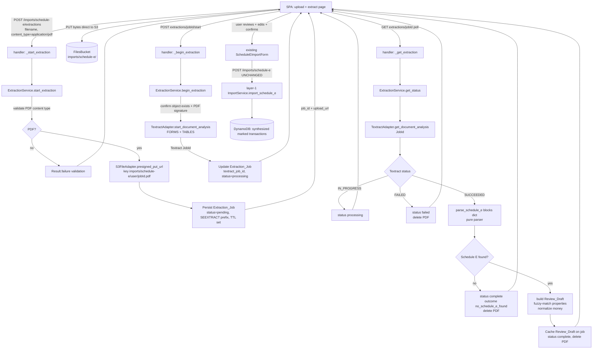

# Design Document

## Overview

Schedule E PDF Extraction ("layer 2") removes the manual typing step from the already-shipped Schedule E Import feature ("layer 1"). The user uploads a prior-year tax-return PDF; the system locates the Schedule E Part I page(s), reads each property column's line amounts and physical address, and **pre-fills the layer-1 guided form** with the extracted values and suggested property mappings. The user reviews, corrects, and confirms, and the **existing layer-1 `ImportService` write path persists the result** exactly as if the user had typed it.

The governing principle is **extraction proposes, the human confirms, layer 1 persists**. The new `ExtractionService` never creates, modifies, or deletes any `Transaction` or `Property`. Its only durable write is a transient, per-user `Extraction_Job` record (carrying the Textract job id, status, uploaded S3 key, and — once parsed — the pre-filled `Review_Draft`), and that record is itself TTL'd out of DynamoDB. The uploaded PDF is auto-deleted from S3 the moment a job reaches `complete` or `failed`, with an S3 lifecycle rule as a backstop. Only the user-confirmed numbers persist, and only via the unchanged layer-1 path.

### What this feature builds on (existing modules)

| Concern | Existing module it reuses |
| --- | --- |
| Layer-1 persistence (the confirm write path) | `services/schedule_e_import.py` (`ImportService.import_schedule_e`) + `models/schedule_e_import.py` (`ImportSubmission` / `PropertyEntryInput` / `LineAmountInput`) |
| Pre-signed PUT/GET, delete, key building, `imports/` prefix | `adapters/s3_files.py` (`S3FileAdapter.presigned_put_url` / `delete_object` / `build_key` / `import_key`, `IMPORT_PREFIX`) |
| Owned-property list + inline create (fuzzy-match source + mapping) | `services/property.py` (`PropertyService.list` / `create` / `get`) |
| Single-table key scheme | `repository/keys.py` |
| Money as a two-decimal `Decimal`/string | `util/money.py` (`to_money`, `money_to_str`) |
| Result → HTTP mapping, per-request wiring, auth, `_require_files` | `router/handler.py` (`_result_response`, `_ROUTES`, `_schedule_e_import_service`) |
| Typed outcomes | `models/result.py` (`Result`, `Error`) |
| Pre-signed upload UX precedent | `api/photos.ts` (`requestUpload` + `uploadToPresignedUrl`), `components/schedule-e-import/*` |

### Scope boundary vs. the existing `/imports` PDF-expense feature (important)

The repository already ships a PDF-**expense**-import feature: `services/expense_import.py` (`ExpenseImportService`), the `ImportSession` / `DraftTransaction` models, the `IMPORT#` / `DRAFT#` key helpers and the GSI1 `ImportSession` lookup in `keys.py`, and the live `POST /imports`, `GET /imports/{sessionId}`, `.../drafts`, `.../confirm` routes plus the frontend `api/imports.ts` / `pages/ImportReviewPage.tsx`. That feature is a useful UX precedent (upload → extract → review → confirm) but is a **separate, shipping capability**.

This design does not reuse, repurpose, modify, or remove it (Req 13.1-13.3):

- **Distinct routes**: this feature mounts under `/imports/schedule-e/extractions`, never the PDF-expense `/imports/{sessionId}` surface. Layer-1 confirm reuses the existing `POST /imports/schedule-e` route unchanged.
- **Distinct storage keys**: the `Extraction_Job` uses a new `SEEXTRACT#` prefix — never `IMPORT#` / `DRAFT#` (those stay owned by the expense feature).
- **Distinct class/module names**: `ExtractionService` in `services/schedule_e_extraction.py`, never `ExpenseImportService`.
- **Distinct output**: the output is a layer-1 `ImportSubmission` draft, never the expense feature's `DraftTransaction` entities (Req 13.3).

The handler's existing `_import_service` (expense) and `_schedule_e_import_service` (layer-1) wiring are both left untouched; a new `_extraction_service` constructor and a new Textract adapter constructor are added alongside.

## Architecture

### Async flow



The browser uploads the PDF directly to S3 via a pre-signed PUT (never through the Lambda), then starts an async Textract job against the uploaded object, then polls job status. On the first `SUCCEEDED` poll the Textract result is parsed into a `Review_Draft`, which is cached on the job. The user reviews/edits the pre-filled layer-1 form and confirms; the confirm goes to the **existing, unchanged** `POST /imports/schedule-e` layer-1 route. Extraction writes no transactions or properties.

### The async-completion mechanism — the key decision

Textract document analysis is asynchronous: `StartDocumentAnalysis` returns a `JobId` immediately and the actual OCR runs server-side at AWS; results are retrieved later with `GetDocumentAnalysis(JobId)`. There are two ways to learn when a job finishes:

**(a) Polling model (CHOSEN for v1).** The API Lambda stores the Textract `JobId` on the `Extraction_Job`. Each status poll calls `GetDocumentAnalysis(JobId)`:
- `IN_PROGRESS` → report `processing`.
- `FAILED` → report `failed`, delete the PDF.
- `SUCCEEDED` → **parse on this poll** (the pure parser turns the blocks into a `Review_Draft`), cache the draft on the job, mark `complete`, delete the PDF. Subsequent polls return the cached draft and never re-call Textract or re-parse (see caching below).

**(b) SNS + a second (completion) Lambda.** `StartDocumentAnalysis` is given an `NotificationChannel` (SNS topic + a Textract-assumable service role); Textract publishes completion to SNS, a second Lambda consumes it, calls `GetDocumentAnalysis`, parses, and writes the result back onto the job.

**Recommendation: (a) for v1.** Rationale:
- **No new infrastructure.** The existing stack is a single monolithic Python 3.12 Lambda (`logstead-api`) fronting an HTTP API, with `DynamoDBCrudPolicy` + `S3CrudPolicy` + geo-places + optional SSM. Option (b) requires a new SNS topic, a Textract service role (with `sns:Publish` and the confused-deputy conditions), and a second Lambda plus its event wiring — a materially larger change for a single-user app.
- **Fits the existing UX.** The shipping expense-import feature already uses a poll-the-status model from the SPA; mirroring it keeps the frontend pattern consistent.
- **The quick calls fit comfortably in 30s.** Both `StartDocumentAnalysis` and `GetDocumentAnalysis` are fast control-plane calls; the long OCR work happens *between* them, server-side at AWS, not inside any Lambda invocation. The Lambda never blocks on Textract. The only non-trivial in-Lambda work on a `SUCCEEDED` poll is parsing the blocks dict (pure CPU over a modest JSON structure for a few pages), well within 30s / 512MB.

Option (b) is noted as a **future option** if extraction volume grows or if parsing a very large multi-page response ever approaches the request budget; it would move parsing out of the poll path. For v1 the polling path is simpler, cheaper, and sufficient.

**Where parsing happens / caching vs re-parsing.** Parsing happens exactly once, on the **first `GetDocumentAnalysis` poll that observes `SUCCEEDED`**. The resulting `Review_Draft` is serialized and stored on the `Extraction_Job` item (`review_draft_json`), and `status` is set to `complete` (or to the `no_schedule_e_found` outcome). Every later poll sees `status in {complete, failed}` and returns the cached result immediately — it does **not** call Textract again and does **not** re-parse. (Textract async results also expire server-side after ~7 days, so caching is also correctness insurance, not just an optimization.) If a poll arrives while `status == processing`, the service calls `GetDocumentAnalysis` to check for a transition; the parse-and-cache is a one-shot transition guarded by the stored status.

### Pagination of Textract results

`GetDocumentAnalysis` returns blocks in pages (a `NextToken` when there are more). On the parsing poll the service drains all pages (looping on `NextToken`) into a single blocks list before handing it to the pure parser, so the parser always sees the complete block set for the document. A tax return is a handful of pages, so this is a small, bounded loop.

### Infra / IAM deltas (precise, so tasks can implement them)

Two additions to `infra/template.yaml`; the single-Lambda design is otherwise unchanged.

1. **Textract policy on `ApiFunction`.** Add a statement granting the two async document-analysis actions (resource `*`, since Textract async analysis is a resource-less API):
   ```yaml
   - Statement:
       - Effect: Allow
         Action:
           - textract:StartDocumentAnalysis
           - textract:GetDocumentAnalysis
         Resource: "*"
   ```
   The polling path needs **no** SNS topic and **no** Textract service role — those are only required for the `NotificationChannel` of option (b). (If option (b) were ever chosen, that is where the SNS topic + a Textract-assumable role with `sns:Publish` and `aws:SourceAccount`/`aws:SourceArn` confused-deputy conditions would be added; v1 does not add them.)

2. **S3 lifecycle rule on `FilesBucket`** for defense-in-depth PII auto-delete, in addition to the explicit `delete_object` the service performs. The bucket already carries an `ExpireExports` rule on `exports/`; add a sibling rule on the new prefix:
   ```yaml
   - Id: ExpireScheduleEImports
     Status: Enabled
     Prefix: imports/schedule-e/
     ExpirationInDays: 1
   ```
   A 1-day expiry is the shortest whole-day S3 lifecycle TTL and is the backstop for any job that neither completes nor fails (e.g. the user abandons after upload, Req 10.3). The service's explicit `delete_object` on `complete`/`failed` is the primary deletion; the lifecycle rule guarantees nothing lingers.

Keeping the uploaded objects under `imports/schedule-e/` (a sub-prefix of the existing `imports/` prefix the expense feature already uses for its own objects) scopes the lifecycle rule precisely to this feature's uploads and never touches the expense feature's objects.

## Components and Interfaces

### `TextractAdapter` (new — `adapters/textract.py`)

A thin wrapper over the boto3 `textract` client, mirroring `S3FileAdapter`'s shape: the client is injected so tests use `moto` or a fake adapter and never hit live AWS.

```python
class TextractAdapter:
    def __init__(self, textract_client: Any) -> None: ...

    def start_document_analysis(self, bucket: str, key: str) -> str:
        """StartDocumentAnalysis with FeatureTypes=['FORMS','TABLES'] against the
        S3 object; return the Textract JobId."""

    def get_document_analysis(self, job_id: str) -> TextractResult:
        """GetDocumentAnalysis(JobId), draining NextToken pages; return a small
        value object: status in {IN_PROGRESS, SUCCEEDED, FAILED, PARTIAL_SUCCESS}
        plus the aggregated blocks list and any status message."""
```

The adapter holds no policy; it only issues the two calls and aggregates pages. All "what does the result mean" logic lives in the service + the pure parser.

### `ExtractionService` (new — `services/schedule_e_extraction.py`)

Scoped to the authenticated user. Composes `S3FileAdapter` (presigned put / delete), `TextractAdapter` (start/get), the repository (job persistence), and `PropertyService` (owned-list fuzzy match + the mapping source). It performs **no** persistent domain writes — only `Extraction_Job` records and S3 deletes.

```python
class ExtractionService:
    def __init__(
        self,
        repo: DynamoRepository,
        user: UserContext | str,
        files: S3FileAdapter,
        textract: TextractAdapter,
    ) -> None: ...

    # Req 1: issue the presigned PUT + create the job (pending).
    def start_extraction(self, filename: str, content_type: str) -> Result[StartExtractionOutcome]: ...

    # Req 2: confirm the object is a PDF, start the Textract job, mark processing.
    def begin_extraction(self, job_id: str) -> Result[ExtractionJobView]: ...

    # Req 3: poll status; on first SUCCEEDED poll, parse + cache + delete PDF.
    def get_status(self, job_id: str) -> Result[ExtractionJobView]: ...
```

Design note on the two-step start (`start_extraction` then `begin_extraction`): the presigned PUT must be issued **before** the browser uploads, and Textract can only run **after** the upload lands. So `start_extraction` returns `{job_id, upload_url}` and creates the job in `pending`; the SPA PUTs the bytes, then calls `begin_extraction` to kick off Textract (Req 2.1, confirming the object exists first — Req 2.4). This matches the pre-signed-upload precedent in `api/photos.ts` (request URL → PUT bytes → record) and keeps each Lambda call fast.

Every method is user-scoped: a `job_id` that resolves to a job owned by a different user returns `not_found` (Req 11.2), identical to how `PropertyService` scopes ownership.

### Input / output shapes (service-layer models — `models/schedule_e_extraction.py`)

```python
JobStatus = Literal["pending", "processing", "complete", "failed"]
CompleteOutcome = Literal["draft", "no_schedule_e_found"]

@dataclass
class StartExtractionOutcome:
    job_id: str
    upload_url: str            # presigned S3 PUT URL

@dataclass
class ExtractedLine:
    """One pre-filled Schedule E line within an ExtractedColumn."""
    schedule_e_line: int       # 3,4 (income) or 5..17,19 (expense); NEVER 18
    amount: str                # two-decimal money string ("0.00" when unreadable)
    needs_verification: bool   # true when confidence low or unreadable (Req 5.2, 8.3)
    confidence: float | None   # Textract block confidence, when available

@dataclass
class ExtractedColumn:
    """One Schedule E Part I property column (A, B, C, ...) → one Property_Entry."""
    address_text: str | None
    address_confidence: float | None
    suggested_property_id: str | None    # fuzzy-match suggestion (Req 7), never auto-applied
    suggested_property_name: str | None
    mapping_confidence: float | None
    lines: list[ExtractedLine]

@dataclass
class ReviewDraft:
    """The transient pre-filled Import_Submission presented for review (Req 8)."""
    tax_year: int | None       # None when not confidently detected (Req 6.2)
    tax_year_needs_verification: bool
    columns: list[ExtractedColumn]

@dataclass
class ExtractionJobView:
    """What a poll returns to the SPA."""
    job_id: str
    status: JobStatus
    outcome: CompleteOutcome | None   # set only when status == complete
    message: str | None               # failure / no-Schedule-E message
    review_draft: ReviewDraft | None  # set only when outcome == "draft"
```

The `ReviewDraft`'s columns map one-to-one onto layer-1 `PropertyEntryInput`s at confirm time (handled entirely by the existing SPA form + `importScheduleE`), and each `ExtractedLine.amount` is a two-decimal money string consistent with layer-1's `LineAmountInput.amount` (Req 5.3). Line 18 never appears in `lines` (Req 4.5, 8.4).

### The parser (pure — `services/schedule_e_parser.py`)

A pure, unit-testable module: `parse_schedule_e(blocks: list[dict], *, min_confidence: float) -> ParsedExtraction`. It takes a Textract blocks list (the raw `Block` dicts from `GetDocumentAnalysis`) and returns the structured result, so tests feed canned Textract JSON fixtures and never touch AWS. It has no S3, DynamoDB, or boto3 dependency.

Textract blocks form a graph: `PAGE` → `LINE`/`WORD` (with `Geometry.BoundingBox` for position), plus `KEY_VALUE_SET` pairs (the FORMS feature) and `TABLE`/`CELL` blocks (the TABLES feature), linked by `Relationships`. The parser works as follows:

**(a) Locate Schedule E Part I.** Scan `LINE` text for the form's title/section markers ("Schedule E", "Part I", "Income or Loss From Rental Real Estate"). A title marker alone is not enough: a page is treated as Schedule E Part I only when it *also* carries Schedule-E-specific evidence — "Rents received", "Royalties received", the "Properties:" A/B/C header, or the full rental title. This co-occurrence requirement is deliberate: a Schedule C page (or any worksheet) shares generic expense labels like "Advertising", "Insurance", "Supplies", and "Taxes" with Schedule E, and an earlier title-plus-a-couple-of-labels test false-matched those pages. Pages that don't match are ignored (Req 4.1). If no page matches → the `no_schedule_e_found` outcome (Req 4, 12.2).

**(b) Read property columns A/B/C and line amounts for lines 3-4, 5-17, 19 (NEVER 18).** Schedule E Part I lays the properties out as columns to the right of the line labels, but the real IRS grid is messier than a tidy "line-label row × property column" table, so the parser derives both the columns and the per-line amounts structurally rather than by position:

- **Columns come from the printed A/B/C header letters, scoped to the located Part I page(s).** On the located page, the parser finds the property table's header-letter row (the cells whose text is exactly "A", "B", or "C") and takes each letter's column index as that property's amount-column anchor; a property's span runs from its letter column up to the next letter's. Crucially the letters sit at *non-contiguous* table columns (e.g. 4, 6, 8, with the line label in column 2 and line numbers in columns 1 and 3), so the count is **not** inferred from raw table width — an earlier `max_col - 1` width heuristic counted an unrelated wide worksheet elsewhere in the return as ~10 phantom properties. The count is capped at the structural maximum of 3 (A/B/C). When no header-letter row exists (a clean, simple grid), the parser falls back to the legacy contiguous layout (label in column 1, amounts in columns 2..N), and when TABLES is weak overall it falls back to page-scoped geometry (numeric tokens bucketed left-to-right by `Left` on a label's horizontal band).

- **Prune the form's totals column.** The blank IRS form always prints three column headers (A, B, C) even when fewer properties are used; the unused header's column then carries only the form's totals/summary roll-ups (lines 23a–26). A detected column is kept only when it looks like a genuine property — it has a readable Rents (line 3) amount, or at least two populated expense lines — so the totals column (no rents, no real per-property expenses) is dropped, while a genuine rental or an expense-bearing royalty property survives. If the test would reject every column, all columns are kept so a sparse-but-genuine return is never emptied.

- **Anchor each row to the line number the form prints, not to its label text.** Each row's Schedule E line is read from the bare line number in the row's leftmost column (confirmed by a flanking column on data rows), falling back to label matching only when no printed number is present (the clean grid). This is what keeps the dense totals rows out: their free-text labels mention other lines ("Subtract line 20 from line 3 (rents) and/or 4 (royalties)"), which a label-matching reader would wrongly map onto a real line and overwrite.

Lines are read for the **explicit allow-set {3,4,5,6,7,8,9,10,11,12,13,14,15,16,17,19}**; Line 18 is excluded from the allow-set, and because rows carrying a non-allow-set line number (18, or the 20–26 totals) are skipped, a depreciation amount can never be read or carried (Req 4.5). An absent/unreadable amount for an allowed line becomes `0.00` (Req 4.6) with `needs_verification=true`.

**(c) Read each column's physical-address box.** The "Physical address of each property" area (lines 1a/1b of the form) is read per column: the parser locates the address label via FORMS key text and reads the paired value for each column, or falls back to the address-row band geometry, bucketed into the same column positions as the amounts (Req 4.4).

**(d) Detect the tax year.** The form carries the tax year in the top-right ("20__") and often in the OMB/header text. The parser scans header `LINE`s for a four-digit year (and the "For calendar year 20YY" phrasing) and takes the single detected year (Req 6.1, 6.3). If none is confidently found, `tax_year` is left `None` and flagged (Req 6.2).

**(e) Per-value confidence.** Each `Block` carries a `Confidence` (0-100). The parser attaches the contributing block's confidence to each `ExtractedLine`/address/tax-year, and marks `needs_verification=true` when confidence is below `min_confidence` or the value couldn't be read/normalized (Req 5.2, 8.3).

**(f) No-Schedule-E outcome.** When step (a) finds no matching page, the parser returns a result flagged `no_schedule_e_found` and produces no columns (Req 3.4, 12.2); the service maps that to `status=complete, outcome="no_schedule_e_found"` with no `review_draft`.

**Honesty about heuristics.** Exact box/line geography on a scanned government form is inherently heuristic — column boundaries, OCR noise, and multi-page overflow make perfect extraction impossible. The design embraces this: every value is surfaced as an editable field with a confidence / "please verify" indicator, and nothing is persisted until the user confirms the layer-1 form. The parser's job is a *good pre-fill*, not ground truth.

### Fuzzy property matching (pure — `services/address_match.py`)

A pure function `best_match(address: str, candidates: list[Property]) -> AddressMatch | None` used by the service after it calls `PropertyService.list()` (so matching is scoped to the user's own properties — Req 7.5). It is unit-testable without AWS.

Approach: normalize both the extracted address and each candidate's `address_text` by lowercasing, collapsing whitespace, stripping punctuation, and expanding/standardizing common abbreviations (st/street, ave/avenue, apt/unit, etc.). Compute a similarity score from token-set overlap (Jaccard over normalized tokens, with the numeric street-number token weighted so "12 Maple" and "120 Maple" don't collide). Return the best candidate with a `confidence` score; when the top score is below a threshold (or there are no candidates), return `None` so the column is left **unmapped** (Req 7.3). The suggestion is attached to the `ExtractedColumn` but **never auto-applied** — the user must confirm it in the form (Req 7.2).

### Route surface + wiring (`router/handler.py`)

Three new authenticated routes (all `public=False`), on a **distinct surface** from both `/imports` (expense) and the plain `/imports/schedule-e` (layer-1 confirm):

| Method | Path | Handler | Success |
| --- | --- | --- | --- |
| `POST` | `/imports/schedule-e/extractions` | `_start_extraction` | `201` |
| `POST` | `/imports/schedule-e/extractions/{jobId}/start` | `_begin_extraction` | `200` |
| `GET` | `/imports/schedule-e/extractions/{jobId}` | `_get_extraction` | `200` |

Confirm is **not** a new route: the SPA submits the reviewed draft to the **existing** `POST /imports/schedule-e` (layer-1) via the existing `importScheduleE` api. No new write path is added (Req 9.2).

Placement in `_ROUTES`: these entries are listed with the existing Schedule E entries, **before** the expense `/imports` entries. The literal `schedule-e` + `extractions` segments and distinct segment counts (3, 5, and 4) disambiguate them from `/imports/schedule-e` (2-seg, layer-1), `/imports/schedule-e/{propertyId}/{taxYear}` (4-seg, layer-1 undo), and the expense `/imports/{sessionId}` (2-seg) under `_match_path`. Because `_match_path` compares segment count first and literal segments next, `/imports/schedule-e/extractions` (3 literal segments) never collides with `/imports/schedule-e/{propertyId}/{taxYear}` (4 segments) or `/imports/{sessionId}` (2 segments). The `{jobId}` and `{taxYear}` path params are parsed exactly like the existing handlers (`_int_param` for the taxYear on the layer-1 route; `jobId` is a plain string).

Request/response shapes (snake_case; money as two-decimal strings):

```jsonc
// POST /imports/schedule-e/extractions
// request
{ "filename": "2023-return.pdf", "content_type": "application/pdf" }
// 201 response
{ "job_id": "7b1f...", "upload_url": "https://s3...signed-PUT..." }

// POST /imports/schedule-e/extractions/{jobId}/start  → 200
{ "job_id": "7b1f...", "status": "processing" }

// GET /imports/schedule-e/extractions/{jobId}  → 200 (while running)
{ "job_id": "7b1f...", "status": "processing", "outcome": null, "review_draft": null }

// GET ... → 200 (complete with a draft)
{
  "job_id": "7b1f...", "status": "complete", "outcome": "draft",
  "review_draft": {
    "tax_year": 2023, "tax_year_needs_verification": false,
    "columns": [
      {
        "address_text": "12 Maple St", "address_confidence": 97.1,
        "suggested_property_id": "1111...", "suggested_property_name": "Maple Duplex",
        "mapping_confidence": 0.86,
        "lines": [
          { "schedule_e_line": 3, "amount": "24000.00", "needs_verification": false, "confidence": 98.3 },
          { "schedule_e_line": 14, "amount": "1875.50", "needs_verification": true, "confidence": 42.0 }
        ]
      }
    ]
  }
}

// GET ... → 200 (complete, no Schedule E found)
{ "job_id": "7b1f...", "status": "complete", "outcome": "no_schedule_e_found",
  "message": "No Schedule E was located in the uploaded document.", "review_draft": null }

// GET ... → 200 (failed)
{ "job_id": "7b1f...", "status": "failed", "message": "The document could not be read; a valid PDF is required.", "review_draft": null }
```

Status mapping follows the standard `_result_response` table: `validation → 400` (non-PDF content type on `start_extraction`, Req 1.4), `not_found → 404` (job/object not in the user's scope, Req 2.4/3.6/11.2), `unavailable → 503` (Textract adapter or files bucket unconfigured), success `200`/`201`. A failed/no-Schedule-E job is itself a **successful** poll (HTTP `200`) whose body carries `status: "failed"` / `outcome: "no_schedule_e_found"` — the job ran; the outcome is just negative (Req 3.4, 3.5).

**Per-request wiring.** A new constructor builds the Textract adapter once per container from `_build_wiring_from_env` (lazily, like the S3 client), stored on `_Wiring` as `wiring.textract`. A new `_extraction_service(wiring, user)` constructs `ExtractionService(wiring.repo, user, files=_require_files(wiring), textract=_require_textract(wiring))`, with `_require_textract` surfacing a clean `503` when Textract is unconfigured (mirroring `_require_files`). The existing `_import_service` (expense) and `_schedule_e_import_service` (layer-1) constructors are **left untouched** (Req 13.2).

Handlers stay thin (parse + wire + `Result→HTTP`, no business rules), exactly like `_import_schedule_e`.

## Data Models

### `Extraction_Job` — a new transient DynamoDB entity (distinct keys + TTL)

The job **must** persist, because the Textract `JobId`, the uploaded S3 key, the status, and (once parsed) the `Review_Draft` have to survive between the separate `start` call and the later `poll` calls, scoped per user. It is a transient entity: it carries only extraction state, never domain data, and it TTLs out.

**Single-table keys (distinct prefix — no collision with `IMPORT#`/`DRAFT#`).**

```
Extraction_Job   PK=USER#<userId>   SK=SEEXTRACT#<jobId>
```

Keyed under the user's own `USER#<userId>` partition (so listing/scoping is per-user and ownership is a partition-level fact — Req 11.1), with a `SEEXTRACT#` sort-key prefix. New `keys.py` helpers: `extraction_job_sk(job_id)` → `"SEEXTRACT#<jobId>"` and `extraction_job_list_prefix()` → `"SEEXTRACT#"`, plus the `SEEXTRACT_PREFIX = "SEEXTRACT#"` constant.

**Why `SEEXTRACT#` and why under `USER#`:** the expense feature's `IMPORT#` is a *top-level partition* (`PK=IMPORT#<sessionId>`), so reusing it would collide and would also lose per-user scoping (the expense session has no user in its key — it relies on property ownership). Choosing a brand-new prefix guarantees zero overlap with `IMPORT#`/`DRAFT#` (Req 13.2), and keying under `USER#<userId>` makes per-user ownership intrinsic to the key (a mismatched user simply never finds the item — Req 11.2). The alternative name `SCHEDULE_E_IMPORT_JOB#` is more self-documenting but verbose; `SEEXTRACT#` is chosen because it is short, unambiguous ("Schedule E extract"), consistent with the terse existing prefixes (`TXN#`, `ASSET#`, `SCHED#`), and already distinct from every current prefix.

**Item shape.**

```python
{
  "PK": "USER#<userId>",
  "SK": "SEEXTRACT#<jobId>",
  "id": "<jobId>",
  "userId": "<userId>",
  "status": "pending|processing|complete|failed",
  "outcome": "draft|no_schedule_e_found|null",
  "uploadedKey": "imports/schedule-e/<userId>/<jobId>.pdf",
  "textractJobId": "<textract-job-id-or-null>",
  "message": "<failure/no-schedule-e message or null>",
  "reviewDraftJson": "<serialized ReviewDraft or null>",   # cached parse result
  "createdAt": "<iso>",
  "ttl": 1719792000      # epoch seconds; DynamoDB TTL attribute (short-lived)
}
```

- The **uploaded PDF is not retained** — it is auto-deleted on `complete`/`failed` (and the S3 lifecycle rule is the backstop). `uploadedKey` is kept on the job only so the delete can target it; after deletion the key still names a now-absent object (S3 delete is idempotent).
- The **`Review_Draft` is transient**: it lives only in `reviewDraftJson` on this job item and is never copied into any domain record. The job item carries a DynamoDB **TTL attribute `ttl`** (epoch seconds), set at creation to a short lifetime (e.g. 24 hours), so the draft and all extraction state are reaped automatically — consistent with the PII posture (nothing extracted lingers). Enabling DynamoDB TTL on the `Logstead` table's `ttl` attribute is a one-line table property addition (`TimeToLiveSpecification: { AttributeName: ttl, Enabled: true }`); it is sparse, so items without `ttl` (every existing entity) are unaffected.
- `reviewDraftJson` stores extracted line amounts as **two-decimal money strings** and the suggested-mapping property id/name + confidence (Req 5.1, 5.3, 7.1), serialized with the same `_to_jsonable`/money conventions used elsewhere.

Money is normalized through `util/money.to_money` at parse time (Req 5.1): a readable amount becomes a two-decimal `Decimal` rendered as a string; an amount that cannot be normalized is stored as `"0.00"` with `needs_verification=true` rather than discarding the column (Req 5.2).

### Relationship to the layer-1 shapes (no change to layer 1)

The `ReviewDraft` deliberately mirrors the layer-1 `ImportSubmission` structure (one `tax_year`, one column per property) so the SPA can seed the existing `ScheduleEImportForm` directly: each `ExtractedColumn` → one `PropertyEntryInput` (its `suggested_property_id` → `property_id`, or an inline `new_property` the user fills in), each `ExtractedLine` → one `LineAmountInput`. No layer-1 model or service changes (Req 9.3, 12 Non-Goals). The confirm is byte-for-byte the layer-1 submission the typed form already produces.

### Frontend components (SPA)

Distinct from the existing `pages/ImportReviewPage.tsx` (the PDF-expense review). New/extended surfaces:

- **Upload + extract page** (new, e.g. `pages/ScheduleEExtractionPage.tsx`, mounted at `/imports/schedule-e/extract`): a file input that accepts a PDF, reusing the pre-signed-upload pattern from `api/photos.ts` (`requestUpload` → PUT bytes to the signed URL → confirm). Here the flow is: call the new `scheduleEExtraction.startExtraction(filename, "application/pdf")` → `uploadToPresignedUrl(upload_url, file)` (reuse the existing helper verbatim) → `beginExtraction(job_id)`. Client-side it rejects non-PDF files before requesting a URL (mirroring the photo content-type guard), matching the backend's `application/pdf` binding (Req 1.3, 1.4).
- **New api module** `api/scheduleEExtraction.ts` (transport-only, snake_case wire types mirroring `ExtractionJobView`): `startExtraction`, `beginExtraction`, `getExtraction`, plus the reused `uploadToPresignedUrl`. Separate from `api/imports.ts` (expense) and `api/scheduleEImport.ts` (layer-1), which are untouched.
- **Job-status poller** (a small hook, e.g. `useExtractionJob(jobId)`): polls `GET /imports/schedule-e/extractions/{jobId}` on an interval while `status in {pending, processing}`, stops on `complete`/`failed`, and exposes `{status, outcome, reviewDraft, message}`. It uses an `AbortController` and clears the timer on unmount, consistent with the existing data-loading patterns.
- **Review screen** (reuses layer-1 components): on `status=complete, outcome=draft`, it renders the **existing** `ScheduleEImportForm` / `PropertyEntryCard`, **seeded** from the `ReviewDraft` (one `EntryState` per `ExtractedColumn`: `amounts` pre-filled from the extracted lines, `propertyId` pre-selected to `suggested_property_id` when present, `otherDescription` from the Line 19 extract). To seed the form, `ScheduleEImportForm` gains an optional `initialTaxYear` / `initialEntries` prop (additive, defaulted so the existing manual-entry mount in `pages/ScheduleEImportPage.tsx` is unchanged). Confirm uses the **existing** `importScheduleE` (`POST /imports/schedule-e`) with no change — extraction hands off to the unchanged layer-1 write path (Req 9.2, 9.4).
- **Confidence / "please verify" surfacing.** Each pre-filled line input shows a subtle "verify" indicator when `needs_verification` is true (low confidence or unreadable → shown as `0.00` flagged for review); the suggested mapping shows the suggested property name with its confidence and requires an explicit confirm (never auto-applied, Req 7.2, 8.3). The existing `EntryErrors`/`aria-invalid` affordances in `PropertyEntryCard` are complemented by an informational "verify" badge (distinct from an error) so screen-reader users hear which values to double-check (Req 8.3). The Line 18 field is never rendered (Req 8.4), inherited directly from the layer-1 form which already omits it.

## Error Handling

| Case | Behavior | Requirements |
| --- | --- | --- |
| Non-PDF declared on upload request | `start_extraction` returns `validation` (`field="file"`), no job started, no URL issued | 1.4 |
| Uploaded object missing / not in user scope at `begin_extraction` | `not_found`; no Textract job started | 2.4, 11.2 |
| Object present but not a readable PDF (no `%PDF-` signature / content type) | job → `failed`, message "a valid PDF is required", delete the PDF | 1.5, 12.1 |
| Textract returns `FAILED`/`PARTIAL_SUCCESS` with no usable blocks | job → `failed` with the failure message, **delete the PDF** | 3.5, 12.3 |
| Job completes but parser finds no Schedule E Part I | `status=complete`, `outcome="no_schedule_e_found"`, no `review_draft`, delete the PDF | 3.4, 12.2 |
| Poll for a job id not in the user's scope | `not_found` | 3.6, 11.2 |
| Textract adapter / files bucket unconfigured | `unavailable` (503) via `_require_textract` / `_require_files` | — |

On any `failed` or `no_schedule_e_found` outcome, the SPA offers a one-click path to the **layer-1 manual guided form** (`pages/ScheduleEImportPage.tsx`) with no pre-fill, so the user can still import by typing (Req 12.4). In all failure/no-Schedule-E paths the `ExtractionService` creates, modifies, and deletes **no** transaction or Property (Req 5.5 of layer-1 posture, Req 12.5) — its only side effects are the job-status update and the S3 delete.

A late Textract failure discovered on a poll (job was `processing`, now `FAILED`) is a normal transition: the service deletes the PDF, records `failed` + message, and the poll returns `200` with `status:"failed"`. The uploaded PDF deletion is idempotent, so a redundant delete (explicit + lifecycle) is harmless.

## Auto-delete of the uploaded PDF

Deletion is layered for a strong PII posture:

1. **Explicit `delete_object(uploadedKey)`** performed by `ExtractionService` the instant a job transitions to `complete` (draft or no-Schedule-E) **or** `failed` (Req 10.1, 10.2, 12.3). This is the primary mechanism and happens on the same `get_status` poll that observes the terminal Textract state.
2. **S3 lifecycle backstop** (`ExpireScheduleEImports`, `imports/schedule-e/` prefix, 1-day expiry) guarantees any object whose job never reached a terminal state (abandoned uploads) is still deleted within the bounded TTL (Req 10.3).

Only the user-confirmed line amounts persist, and only as layer-1 imported transactions written by the unchanged `ImportService` on confirm (Req 10.5). No copy of the original PDF is retained anywhere (Req 10.4), and the `Review_Draft` itself is reaped from DynamoDB by the job item's `ttl` attribute.

## Correctness Properties

*A property is a characteristic or behavior that should hold true across all valid executions of a system — essentially, a formal statement about what the system should do. Properties serve as the bridge between human-readable specifications and machine-verifiable correctness guarantees.*

Property-based testing is appropriate for the testable core of this feature: the money normalization, the per-user key scoping, the Line-18 exclusion, the write-isolation invariant, and the pure parser are all logic over a large, structured input space, exercisable with `moto`-backed S3/DynamoDB and a **fake Textract adapter** (plus canned Textract-shaped block fixtures for the parser) so 100+ iterations are cheap and no live AWS is called. The Textract engine itself, the exact `StartDocumentAnalysis`/`GetDocumentAnalysis` wiring, and the UI rendering are covered by example/integration/RTL tests instead (see Testing Strategy). The following five are the de-duplicated, highest-value properties from the prework analysis.

### Property 1: Extraction never writes a transaction or property

*For any* sequence of extraction operations (`start_extraction` → upload → `begin_extraction` → one or more `get_status` polls) over *any* uploaded document and *any* Textract outcome (`SUCCEEDED` with a draft, `SUCCEEDED` with no Schedule E, or `FAILED`), the set of `Transaction` and `Property` rows in the user's data scope SHALL be exactly what it was before extraction began — extraction creates, modifies, and deletes no transaction or property on its own; only the layer-1 confirm path (`POST /imports/schedule-e`) ever writes.

**Validates: Requirements 9.1, 7.2, 12.5**

### Property 2: The uploaded PDF is always deleted on a terminal state

*For any* extraction job that reaches a terminal `Job_Status` (`complete` — whether a draft or `no_schedule_e_found` — or `failed`), the uploaded `Tax_Return_PDF` object SHALL be absent from S3 after the terminal transition, so no uploaded return is retained past completion or failure.

**Validates: Requirements 10.1, 10.2, 10.4, 12.3**

### Property 3: Extracted amounts normalize to two-decimal money with no drift, and unreadable values are flagged, not dropped

*For any* amount token read from a column, the pre-filled `Review_Draft` line amount SHALL equal `to_money(token)` rendered as a fixed two-decimal string (no precision drift); and *for any* amount that cannot be normalized to a two-decimal `Money_Value`, the draft SHALL carry `"0.00"` with `needs_verification` set and SHALL still include that column rather than discarding it.

**Validates: Requirements 5.1, 5.2, 5.3, 4.6**

### Property 4: Per-user scoping isolates jobs, drafts, and uploaded objects

*For any* two distinct authenticated users A and B, an `Extraction_Job` (and its cached `Review_Draft`) and uploaded object created by A SHALL be scoped to A's `USER#<subA>` key and SHALL never be readable, pollable, deletable, or fuzzy-matched-against by B — a reference by B resolves to `not_found`, and the suggested-mapping candidates for A's columns are drawn only from A's own `PropertyService.list()`.

**Validates: Requirements 11.1, 11.2, 1.1, 1.2, 2.2, 3.6, 7.5**

### Property 5: No Line 18 (Depreciation) ever appears in a Review_Draft

*For any* uploaded document — including one whose Schedule E Part I contains a Line 18 depreciation amount — the produced `Review_Draft` SHALL contain no `ExtractedLine` with `schedule_e_line == 18`; the parser reads only the allow-set {3, 4, 5-17, 19}, so depreciation is never read, carried, or pre-filled.

**Validates: Requirements 4.5, 8.4**

## Testing Strategy

The strategy mirrors the repository's conventions: backend `pytest` with `moto` for S3/DynamoDB and a **fake/stub `TextractAdapter`** (never live Textract), `Hypothesis` for the property tests, and canned Textract-response JSON fixtures for the pure parser. Frontend uses `vitest` + React Testing Library + `vitest-axe`. **Live Amazon Textract is never called in any test** — the adapter seam is always a `moto` client or an in-memory fake returning canned block fixtures.

### Unit and example tests (specific behaviors, edge cases, error conditions)

- **`ExtractionService`** (moto S3/DynamoDB + fake Textract): `start_extraction` presigns with `application/pdf` and creates a `pending` job (Req 1.3, 2.3); non-PDF content type → `validation(field="file")` (Req 1.4); `begin_extraction` on an absent/other-user object → `not_found`, Textract never called (Req 2.4); object without `%PDF-` → `failed` + "valid PDF required" (Req 1.5, 12.1); `get_status` maps fake Textract `IN_PROGRESS`→`processing`, `FAILED`→`failed` + message (Req 3.2, 3.5, 12.3), `SUCCEEDED` with a Schedule E fixture → `complete`/`draft` (Req 3.3), `SUCCEEDED` with a non-Schedule-E fixture → `complete`/`no_schedule_e_found`, no draft (Req 3.4, 12.2); the parse-and-cache runs once and later polls return the cached draft without re-calling Textract.
- **Pure parser** (`services/schedule_e_parser.py`, canned Textract block fixtures): locates Part I and ignores other pages (Req 4.1); one column per property column (Req 4.2); reads lines 3-4/5-17/19 and the address box (Req 4.3, 4.4); detects the tax year, and leaves it unset+flagged when absent (Req 6.1, 6.2); unreadable cell → `0.00` + verify (Req 4.6).
- **Fuzzy matcher** (`services/address_match.py`, pure): low/no-confidence → `None` (unmapped) (Req 7.3).
- **Routing**: `/imports/schedule-e/extractions` resolves to the extraction handlers while `/imports/{sessionId}` still resolves to the untouched expense handler and `/imports/schedule-e` to the layer-1 handler (Req 13.1); a key test asserts `SEEXTRACT#` is distinct from `IMPORT#`/`DRAFT#` (Req 13.2).
- **Confirm hand-off** (example/integration): confirming a reviewed draft posts to the existing `POST /imports/schedule-e` and layer-1 writes marked transactions (Req 9.2, 9.3); a bad entry → `400` with the structured field and nothing persisted (Req 9.4); a not-owned property → `404` (Req 11.3).
- **Infra assertion**: `FilesBucket` carries the `ExpireScheduleEImports` lifecycle rule on `imports/schedule-e/` (Req 10.3), and the `Logstead` table enables DynamoDB TTL on `ttl`.

### Property tests (universal properties, 100+ iterations each)

Each of the five Correctness Properties is implemented as a **single** property-based test using `Hypothesis`, configured for a **minimum of 100 iterations**, backed by `moto` + the fake Textract adapter / generated Textract-shaped block fixtures (no live AWS). Each test is tagged with a comment referencing its design property, in the repository's convention:

```
# Feature: schedule-e-pdf-extraction, Property 1: Extraction never writes a transaction or property
# Feature: schedule-e-pdf-extraction, Property 2: The uploaded PDF is always deleted on a terminal state
# Feature: schedule-e-pdf-extraction, Property 3: Extracted amounts normalize to two-decimal money with no drift, and unreadable values are flagged, not dropped
# Feature: schedule-e-pdf-extraction, Property 4: Per-user scoping isolates jobs, drafts, and uploaded objects
# Feature: schedule-e-pdf-extraction, Property 5: No Line 18 (Depreciation) ever appears in a Review_Draft
```

- **P3 and P5** are driven by a Hypothesis generator that builds a Schedule E Part I **Textract-shaped block fixture** from a randomly generated layout (random column count, random per-line amounts including blanks/garbled cells, optionally a Line 18 value, a random year, random addresses). This generator doubles as a **parser round-trip** check (the amounts/addresses/year generated in are recovered out), covering the parser-location/column/line/address/year criteria (Req 4.1-4.4, 6.1) within P3/P5's generators.
- **P4** generates two users and asserts cross-user `not_found` on every read/poll/delete and that `best_match` candidates come only from the acting user's list (folding in the matcher's happy path: a candidate whose normalized address equals the extracted address is returned with high confidence).
- **P1 and P2** generate arbitrary start→upload→poll sequences across all three Textract outcomes and assert, respectively, the unchanged transaction/property tables and the deleted uploaded object.

### Frontend tests (vitest + RTL + vitest-axe)

- Upload page rejects non-PDF files client-side and drives the presign→PUT→begin flow against a fake api (Req 1.4).
- The status poller transitions pending/processing→complete/failed and stops polling on a terminal state.
- The review screen seeds the **existing** `ScheduleEImportForm`/`PropertyEntryCard` from a draft: one card per column with pre-filled amounts and the suggested mapping shown (never auto-applied) (Req 8.1, 7.2); each amount is editable and an edit flows into the submitted `ImportSubmission` (Req 8.2, 8.5); a low-confidence value shows an accessible "verify" badge (Req 8.3); no Line 18 field is rendered (Req 8.4); `vitest-axe` has no violations.
- `failed`/`no_schedule_e_found` states offer a link to the manual layer-1 form (Req 12.4).

### Regression note

The existing `/imports` PDF-expense feature (`ExpenseImportService`, its `IMPORT#`/`DRAFT#` storage, its routes, `api/imports.ts`, `pages/ImportReviewPage.tsx`) and the layer-1 `/imports/schedule-e` feature must **stay green**. This feature adds only new modules, a new `SEEXTRACT#` key, new routes, and additive, defaulted props/wiring; the full existing backend and frontend suites are run unchanged to confirm no regression (Req 13.2).
