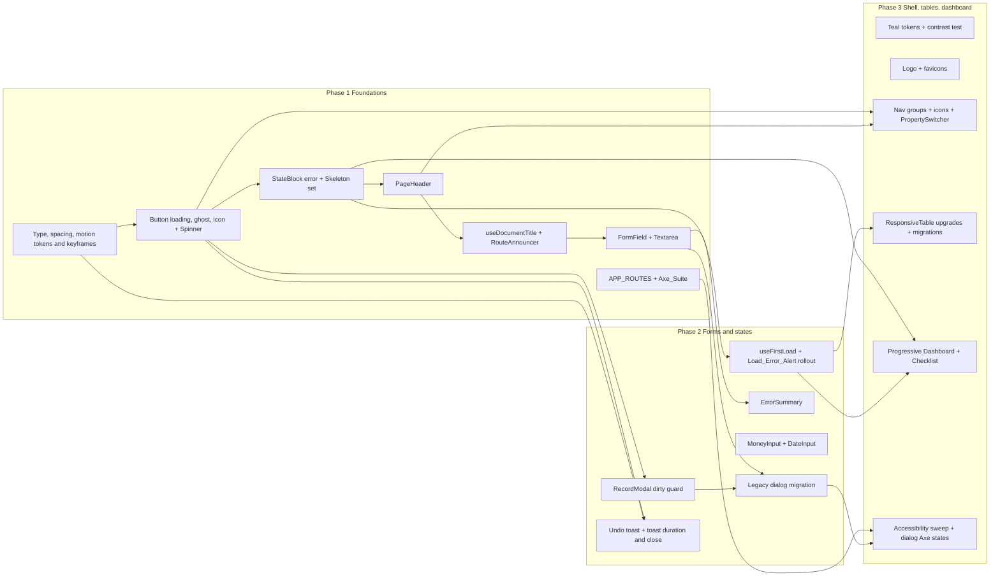
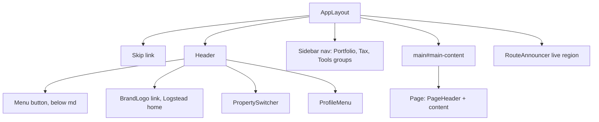
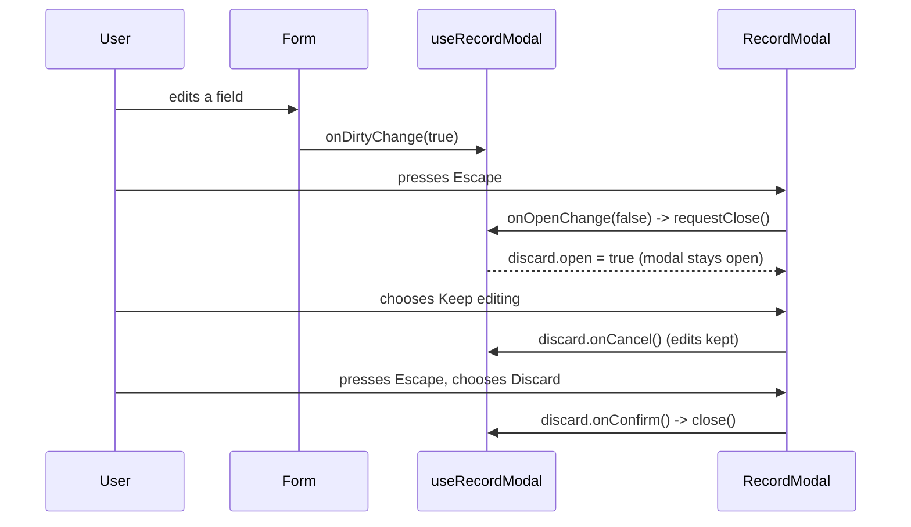
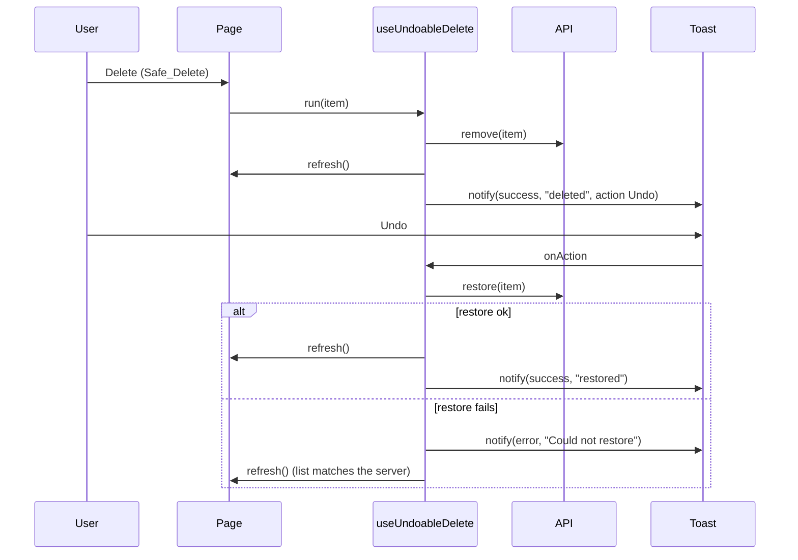

# Design Document

## Overview

This design delivers the UI polish and consistency feature in three phases that each ship on their own. It is grounded in the current `frontend/` code (React 19, Vite, Tailwind 3.4, Radix primitives, react-router 7 in declarative `BrowserRouter` mode, vitest, fast-check 4.10.2, vitest-axe).

| Phase | Scope | Requirements |
|-------|-------|--------------|
| 1 Foundations | Type scale, spacing and motion tokens, Reduced_Motion_Rule, Toast animation fix, Button loading/ghost/icon, Spinner, PageHeader, useDocumentTitle, route focus and announcer, FormField, StateBlock error variant, Skeletons, route table and first Axe_Suite | 1 to 8 |
| 2 Forms and states | Legacy_Dialog migration to RecordModal, dirty-state discard guard, Error_Summary, Money_Input and Date_Input, first-load helper, Load_Error_Alert rollout, Undo_Toast, toast duration and close button | 9 to 14 |
| 3 Shell, tables, dashboard | Teal tokens and contrast fixes, Logo and favicons, grouped navigation with icons, Property_Switcher, ResponsiveTable upgrades, Transactions search, table migrations, progressive Dashboard and Checklist_Card, accessibility sweep, full Axe_Suite | 15 to 25 |

### Findings in the current code that shape this design

1. `tailwindcss-animate` is not in `frontend/package.json` or `node_modules`. `ToastProvider` uses `animate-in` and `animate-out`, which generate no CSS today.
2. No icon library is installed, and `frontend/public/` does not exist. There is no favicon.
3. The five Legacy_Dialogs differ. `AddPropertyDialog` and `AddBusinessDialog` own their trigger button and open state. `EditPropertyDialog` and `EditBusinessDialog` are controlled. The Transactions dialog is inline in `TransactionsPage.tsx` with its own `Dialog.Root`, a hand-built close button, and `TransactionForm` inside.
4. Forms keep their values in internal state (`LoanForm`, `TransactionForm`, `AssetForm`, the dialogs). `useRecordModal` only tracks open, add, and edit mode, so dirty state must be reported up from the forms.
5. `ResponsiveTable` has a flat row model with no sorting, expansion, row headers, or sticky header. `YearlyRollupTable` needs an expandable detail row and `th scope="row"` cells. `ScheduleTable` hosts form controls with fixed ids (`override-${year}`), and `ResponsiveTable` renders each cell twice in the DOM (table and card list), so ids must come from `useId`.
6. `ScheduleTable` uses a class `bg-bg` that is not a defined token. It has no effect today and is replaced by the shared `Input` during migration.
7. `fg-subtle` fails WCAG_AA today: 2.56:1 on `surface` and 2.45:1 on `canvas` in light, 3.07:1 on `surface` in dark. It is used as `text-fg-subtle` about 80 times across 45 files, mostly for body-size text, so fixing the token is more effective than restricting it.
8. The only hard-coded color in components is `outline-white` on the skip link in `AppLayout.tsx`.
9. `BusinessDocuments` and `PropertyPhotos` delete files behind `window.confirm`, not `ConfirmDialog`.
10. Server-side deletes cascade: `TransactionService.delete` removes the transaction's receipt documents and S3 objects, and `LoanService.delete_loan` removes the loan's yearly interest rollups. This drives the conditional Safe_Delete rules in Requirement 13.
11. Routes are declared as inline JSX in `App.tsx`, so the Axe_Suite has no list to iterate. `BrowserRouter` is a declarative router, so `useBlocker` is not available.
12. Toast variants are only `success` and `error`. Requirement 14.10 also names `info`.
13. `jsdom` cannot compute layout or resolve the stylesheet in tests (`index.css` is not imported by tests). axe's `color-contrast` rule cannot give a verdict there, and touch-target sizes cannot be measured. Contrast is therefore guarded by a token-level test, and touch targets by class-contract tests.

### Decisions

| ID | Decision | Rationale |
|----|----------|-----------|
| D1 | Teal accent. Light `#0F766E`, dark `#2DD4BF`. Exact values and measured ratios are in "Color tokens and contrast". | Matches the logo teal and passes WCAG_AA in both themes. |
| D2 | Raise `fg-subtle` to pass 4.5:1 (Requirement 25.3, first option). Raise dark `fg-muted` so the muted to subtle hierarchy remains. | One token edit repairs about 80 call sites. |
| D3 | Add a `border-strong` token for form control boundaries (3:1). Ordinary card and table borders stay on `border`. | WCAG 1.4.11 needs 3:1 for input boundaries. Approved. Requirement 17.2 lists it, and it goes beyond the pairs in Requirement 25.1. |
| D4 | Do not add `tailwindcss-animate`. Define Toast keyframes from the Motion_Tokens in `tailwind.config.js` (allowed by Requirement 2.5). | The Toast needs two animations. A plugin adds a dependency for no other use. |
| D5 | Icons are small hand-authored inline SVG components in `components/ui/icons.tsx` (24px grid, 1.75 stroke, `currentColor`). | No dependency, tree-shakable, about 15 icons are needed. |
| D6 | Logo is an inline SVG React component with the text converted to outlined paths. The source file moves to `docs/brand/logo-source.svg` and the root `logo.svg` is removed. | Inline keeps `currentColor` and CSS variable fills working. Outlining removes the dependence on `system-ui`, which renders differently on each OS. |
| D7 | The tagline renders only on the sign-in splash screens at 640px and wider, never in the header. | At header size the tagline would be about 3px tall. See "Brand". |
| D8 | Forms report dirty state with `onDirtyChange`. `useRecordModal` owns the discard guard. Imports tab switching is intercepted by a click handler, not `useBlocker`. | Forms own their values, and the app uses a declarative router. |
| D9 | `AddPropertyDialog` and `AddBusinessDialog` gain optional controlled props (`open`, `onOpenChange`). Without them they behave as today, including the built-in trigger. | Keeps existing call sites and tests, and lets the pages show exactly one "Add property" button in the empty state. |
| D10 | Undo applies to asset deletes always, and to transaction and loan deletes only when no dependent data exists. | See the delete classification table. |
| D11 | Routes move to an exported `APP_ROUTES` array rendered with `useRoutes`. | Gives the Axe_Suite a list to iterate (Requirement 25.7). Behavior is unchanged. |
| D12 | Dashboard errors are shown once per data source, not once per visual tile. | Most tiles are derived from the single `getTrends()` response. See "Progressive Dashboard". |
| D13 | Native `<select>` for Property_Switcher. | Keyboard operable and mobile friendly with no new code, consistent with `CategorySelect`. |
| D14 | Checklist step 3 uses depreciation in the trends series, then falls back to loan and asset lists for at most the first 5 properties. | The trends series has no loan data and the backend cannot change. |

### Items for your review

All five items below were reviewed and approved.

1. Requirement 18.9 was amended to match Requirement 5.3. Escape returns focus to the menu button, and selecting a destination lets the route change move focus to the new page `h1`.
2. The outlined wordmark uses Inter Bold (SIL OFL). The user still approves the generated asset visually (a task covers this).
3. D3 (`border-strong`) is kept. Requirement 17.2 now lists it, and the token contrast test covers it.
4. D12 (one error per data source) is approved as a deliberate reading of Requirement 23.4.
5. The tagline shows on the sign-in splash at 640px and wider only, never in the header (Requirement 15.4, D7).

## Architecture

### Phase ordering and cross-phase dependencies



Dependencies that cross phases:

- Phase 2 needs from Phase 1: `Button` `loading` (submit buttons), `FormField` (every migrated form), `StateBlock` error and `Skeleton` (first-load rollout), Motion_Tokens (Toast animation), and the route table (so Phase 2 can add Axe coverage for the routes it changed).
- Phase 3 needs from Phase 2: `useFirstLoad` (Dashboard tiles, switcher), and the migrated dialogs (dialog Axe states, Requirement 25.8).
- Phase 3 needs from Phase 1: `Button` ghost and icon sizes (drawer close, sort headers), `Skeleton` (switcher, tiles), and `PageHeader` (every page).
- Phases 1 and 2 contain no color decisions. Every new component uses Semantic_Tokens only, so the teal change in Phase 3 recolors them with no edits.
- Phase gating (Requirement "Phase gating"): the Axe_Suite is created in Phase 1, so every phase can assert coverage for the routes it changed. Phase 3 adds the dialog states and the token contrast test.

### New and changed files by phase

```
frontend/
  index.html                                  (P3) favicon links, title
  public/                                     (P3) favicon.svg, favicon-32.png, apple-touch-icon.png, logo.svg, logo-mark.svg, favicon-monogram.svg
  scripts/generate-brand-icons.mjs            (P3) one-off, dev only
  tailwind.config.js                          (P1 tokens, P3 colors)
  src/index.css                               (P1 motion vars + reduced motion, P3 color values)
  src/routes.tsx                              (P1) APP_ROUTES, leafPaths
  src/App.tsx                                 (P1) useRoutes(APP_ROUTES)
  src/assets/brand/                           (P3) logo.svg, logo-mark.svg, brand-paths.ts
  src/components/ui/
    Button.tsx Spinner.tsx PageHeader.tsx Skeleton.tsx StateBlock.tsx     (P1)
    FormField.tsx Textarea.tsx                                           (P1)
    ErrorSummary.tsx MoneyInput.tsx DateInput.tsx RecordModal.tsx
    useRecordModal.ts useDiscardGuard.ts useFirstLoad.ts                 (P2)
    toast/ToastProvider.tsx toast/useUndoableDelete.ts                   (P2)
    icons.tsx ResponsiveTable.tsx tableSort.ts                           (P3)
  src/components/RouteAnnouncer.tsx                                      (P1)
  src/components/brand/ Logo.tsx WordmarkFallback.tsx BrandLogo.tsx BrandSplash.tsx   (P3)
  src/components/PropertySwitcher.tsx propertySwitch.ts MainNav.tsx navConfig.ts AppLayout.tsx   (P3)
  src/components/dashboard/ ChecklistCard.tsx checklist.ts DataTile.tsx    (P3)
  src/lib/ useDocumentTitle.ts (P1)  moneyInput.ts dateInput.ts formErrors.ts dirty.ts transactionFilter.ts undoMappers.ts (P2/P3)  contrast.ts (P3)
  src/test/ axeRoutes.test.tsx apiStub.ts fixtures.ts                      (P1; dialogs added P3)
docs/brand/logo-source.svg                    (P3) moved from repo root
```

### Shell structure after Phase 3



## Components and Interfaces

## Phase 1 - Foundations

### C1.1 Type scale, spacing, motion tokens (Requirements 1, 2)

Added to `frontend/tailwind.config.js` under `theme.extend`, with the documentation comment block that Requirement 1.5 asks for.

Type scale (named levels, each a fixed size, weight, line height). Body is 14px because the app already uses `text-sm` as its body size.

| Level | Class | Size / line height / weight | Replaces |
|-------|-------|-----------------------------|----------|
| Page title | `text-page-title` | 1.5rem / 2rem / 600 | `text-2xl font-semibold` on every `h1` |
| Section title | `text-section-title` | 1.125rem / 1.75rem / 600 | `text-lg font-semibold` on `h2` |
| Card title | `text-card-title` | 1rem / 1.5rem / 600 | ad hoc card headings |
| Body | `text-body` | 0.875rem / 1.25rem / 400 | `text-sm` |
| Small | `text-small` | 0.8125rem / 1.125rem / 400 | `text-xs` used for notes |
| Caption | `text-caption` | 0.75rem / 1rem / 500 | badges, group labels |

Spacing convention (Tailwind `spacing` entries, so `p-card`, `space-y-section`, and so on):

| Token | Value | Used for |
|-------|-------|----------|
| `page-x` | 1rem | horizontal page padding (matches `px-4` today) |
| `page-y` | 1.5rem | vertical page padding (matches `py-6`) |
| `section` | 1.5rem | gap between page sections (`PageContainer` uses `space-y-section`) |
| `card` | 1rem | card padding (`Card`, `Tile`) |
| `card-lg` | 1.5rem | modal and dialog padding (`p-6` today) |

Motion tokens are CSS variables on `:root` in `index.css`, exposed through Tailwind:

```css
:root {
  --motion-fast: 100ms;
  --motion-base: 180ms;
  --motion-slow: 300ms;
  --motion-ease: cubic-bezier(0.2, 0, 0, 1);
}
@media (prefers-reduced-motion: reduce) {
  *, ::before, ::after {
    animation-duration: 1ms !important;
    animation-iteration-count: 1 !important;
    transition-duration: 1ms !important;
    scroll-behavior: auto !important;
  }
}
```

```js
// tailwind.config.js (additions)
transitionDuration: { fast: "var(--motion-fast)", base: "var(--motion-base)", slow: "var(--motion-slow)" },
transitionTimingFunction: { standard: "var(--motion-ease)" },
keyframes: {
  "toast-in":  { from: { opacity: "0", transform: "translateX(calc(100% + 1rem))" }, to: { opacity: "1", transform: "translateX(0)" } },
  "toast-out": { from: { opacity: "1" }, to: { opacity: "0" } },
  "toast-swipe-out": { from: { transform: "translateX(var(--radix-toast-swipe-end-x))" }, to: { transform: "translateX(calc(100% + 1rem))" } },
  "fade-in": { from: { opacity: "0" }, to: { opacity: "1" } },
},
animation: {
  "toast-in": "toast-in var(--motion-slow) var(--motion-ease)",
  "toast-out": "toast-out var(--motion-base) var(--motion-ease) forwards",
  "toast-swipe-out": "toast-swipe-out var(--motion-base) var(--motion-ease) forwards",
  "fade-in": "fade-in var(--motion-base) var(--motion-ease)",
},
```

The reduced-motion rule keeps `animation-duration` at 1ms rather than removing animations, so Radix `Presence` still receives `animationend` and unmounts closing Toasts. Spinners freeze on a static arc, so the spinner is always paired with a text or `aria-busy` cue.

`ToastProvider` replaces `data-[state=open]:animate-in data-[state=closed]:animate-out` with `data-[state=open]:animate-toast-in data-[state=closed]:animate-toast-out data-[swipe=end]:animate-toast-swipe-out data-[swipe=move]:translate-x-[var(--radix-toast-swipe-move-x)]`.

A config test (Testing Strategy) runs the real PostCSS and Tailwind pipeline on the `ToastProvider` source and asserts that `.animate-toast-in`, `@keyframes toast-in`, and the reduced-motion media query appear in the output (Requirements 2.3, 2.4, 2.2).

### C1.2 Spinner and Button (Requirement 3)

```tsx
// ui/Spinner.tsx
export function Spinner({ className }: { className?: string }): JSX.Element
// <svg aria-hidden="true" focusable="false" className={cn("h-4 w-4 animate-spin", className)} />
```

```tsx
// ui/Button.tsx
export type ButtonVariant = "primary" | "secondary" | "danger" | "ghost";
export type ButtonSize = "sm" | "md" | "icon";
export interface ButtonProps extends React.ButtonHTMLAttributes<HTMLButtonElement> {
  variant?: ButtonVariant;      // default "secondary"
  size?: ButtonSize;            // default "md"
  asChild?: boolean;
  loading?: boolean;            // new
}
```

Behavior:

- `ghost`: `bg-transparent text-fg-muted hover:bg-accent-subtle hover:text-accent`.
- `icon`: `h-9 w-9 p-0 max-md:h-11 max-md:w-11` (44px below 768px, Requirement 3.7). `sm` and `md` gain `max-md:min-h-11`.
- `loading`: the button gets `relative` and `aria-busy="true"`. Children stay in normal flow wrapped in `<span className="opacity-0 inline-flex items-center gap-2">`, so the width does not change (Requirement 3.3) and screen readers still read the label (`opacity-0`, not `invisible`). A `<Spinner>` is centered with `absolute inset-0 grid place-items-center` and `aria-hidden`.
- Click suppression (Requirement 3.2): while `loading`, the click handler calls `event.preventDefault()` and does not call the caller's `onClick`. This also blocks form submit for `type="submit"`. The button is not `disabled`, so focus stays on it. `loading` with `asChild` is not supported (Radix `Slot` needs one child); a development warning is logged.
- Development warning (Requirement 3.6): a `useEffect` calls `console.warn` once per mount when `size="icon"` and none of `aria-label`, `aria-labelledby`, or `title` is present. It is guarded by `import.meta.env.DEV`.
- Existing call sites compile and render unchanged (Requirement 3.8). Class additions are additive.

### C1.3 PageHeader (Requirement 4)

```tsx
// ui/PageHeader.tsx
export interface PageHeaderProps {
  title: string;
  description?: React.ReactNode;   // muted text under the title
  meta?: React.ReactNode;          // small line under the title, e.g. the property name
  actions?: React.ReactNode;       // end aligned from sm up, below the title on narrow viewports
  breadcrumb?: Crumb[];            // renders <Breadcrumb> above the title
  children?: React.ReactNode;      // slot under the header block, used for section tabs
  headingId?: string;              // default "page-heading"
}
```

It renders a `div` (not `header`, to avoid a second banner landmark inside `main`) with an `h1` that has `id`, `tabIndex={-1}`, and `className="text-page-title text-fg focus:outline-none"`. The layout is `flex flex-col gap-3 sm:flex-row sm:items-start sm:justify-between`.

Pages keep their wrapper `<section aria-labelledby="page-heading">`, so existing landmark names continue to resolve.

`PropertySection` becomes a thin wrapper: `PageHeader` with the breadcrumb, `title`, `meta={propertyName}`, and the tabs as children, followed by the existing description paragraph. `ImportsLayout`, `PropertyDetailPage`, `BusinessDetailPage`, `ProfilePage`, `NotFoundPage`, `ImportReviewPage`, and the other pages replace their hand-built `h1` markup with `PageHeader` (migration table below).

Page migration table (Requirements 4.5, 5.8, 14.6):

| Page file | PageHeader actions | `useDocumentTitle` | Current hand-rolled load error |
|-----------|--------------------|--------------------|-------------------------------|
| `DashboardPage` | none | "Dashboard" | yes |
| `PropertiesPage` | Add property (only when properties exist) | "Properties" | yes, banner style |
| `PropertyDetailPage` | none (uses `PageHeader` with breadcrumb, tabs) | "Overview - {property}" | yes |
| `BusinessesPage` | Add business (only when businesses exist) | "Businesses" | yes, banner style |
| `BusinessDetailPage` | edit and delete | "{business name}" | yes |
| `TransactionsPage` | Add transaction | via `PropertySection` | yes |
| `AssetsPage` | Add asset | via `PropertySection` | yes |
| `LoansPage` | Add loan | via `PropertySection` | yes |
| `ReportsPage` | none | via `PropertySection` | yes |
| `CombinedReportsPage` | none | "Reports" | yes |
| `CarryforwardPage` | none | "Passive loss carryforward" | yes |
| `ProfilePage` | none | "Profile & settings" | no |
| `ImportsLayout` | none | "Import Schedule E" | no |
| `ImportReviewPage` (not routed today, still in `pages/`) | none | "Import" | no |
| `NotFoundPage` | none | "Page not found" | no |

`ScheduleEImportPage` and `ScheduleEExtractionPage` render inside `ImportsLayout` and have no `h1` (unchanged). A source-scan conformance test asserts that no file in `pages/` contains `<h1` or `text-2xl`, and that every page except those two imports `PageHeader` (or `PropertySection`) and calls `useDocumentTitle`.

### C1.4 Document title, route focus, announcer (Requirement 5)

```ts
// lib/useDocumentTitle.ts
export function formatDocumentTitle(page: string | null | undefined): string; // "{page} - Logstead", or "Logstead"
export function useDocumentTitle(title: string | null | undefined): void;
```

Two effects, in this order: the first stores `document.title` in a ref at mount and restores it on unmount (Requirement 5.2); the second sets `formatDocumentTitle(title)` whenever `title` changes. Splitting them keeps the restored value the pre-page title even when the page title changes while mounted.

```tsx
// components/RouteAnnouncer.tsx, rendered once by AppLayout
export function shouldHandleRouteChange(prevPath: string, nextPath: string, isInitial: boolean): boolean;
// true iff !isInitial && prevPath !== nextPath  (hash-only and search-only changes return false)
export function RouteAnnouncer(): JSX.Element;
```

`RouteAnnouncer` uses `useLocation()`. On a pathname change that passes `shouldHandleRouteChange`:

1. Focus `main h1` if present, otherwise `#main-content` (which already has `tabIndex={-1}`), satisfying Requirements 5.3 and 5.6.
2. Set the live region text to the page title (the `document.title` minus the ` - Logstead` suffix). The text is cleared and set again on the next animation frame so two consecutive identical titles are still announced.

The live region is `<div role="status" aria-live="polite" aria-atomic="true" className="sr-only">`. The first run never moves focus (Requirement 5.7). Child effects (`useDocumentTitle`) run before this parent effect, so the title is already updated when it is read. Every page renders `PageHeader` unconditionally (before data loads), so the `h1` exists when the effect runs.

### C1.5 FormField and Textarea (Requirement 6)

```tsx
// ui/FormField.tsx
export interface FieldControlProps {
  id: string;
  invalid?: boolean;                 // consumed by Input, Select, Textarea, MoneyInput, DateInput
  "aria-describedby"?: string;
  "aria-invalid"?: true;
  "aria-required"?: true;
}
export interface FormFieldProps {
  label: React.ReactNode;
  children: (control: FieldControlProps) => React.ReactNode;
  hint?: React.ReactNode;
  error?: string | null;
  required?: boolean;
  id?: string; hintId?: string; errorId?: string;   // generated with useId when omitted
  className?: string;
}
```

Rendering rules:

- `<label htmlFor={id}>` with the label text. When `required`, a `<span aria-hidden="true" className="text-danger"> *</span>` follows, and the control receives `aria-required="true"`.
- The hint is `<p id={hintId} className="text-small text-fg-muted">`.
- The error is `<p id={errorId} role="alert" className="text-small text-danger">`, and the control receives `aria-invalid="true"` and `invalid`. When `error` is empty, `aria-invalid` is not set at all (Requirement 6.5).
- `aria-describedby` is the space-joined list of the hint id and the error id that are present, or `undefined`.

Usage: `<FormField label="Amount" required error={e.amount}>{(c) => <MoneyInput {...c} value={v} onChange={set} />}</FormField>`. The render-prop spreads `invalid` and so is for the shared primitives only. For a native element, pick `id` and the ARIA fields explicitly.

`ui/Textarea.tsx` mirrors `Input` (same classes, `invalid`, `FOCUS_RING`) for the raw `<textarea>` elements in `TransactionForm` and `BusinessFormFields`.

`AddressAutocomplete` already takes `id`, `invalid`, and `errorId`. It is wrapped as `{(c) => <AddressAutocomplete id={c.id} invalid={c.invalid} errorId={...} />}` and keeps its own behavior.

Radio groups (`TransactionForm` type) keep `fieldset` and `legend` and are not FormField consumers (they have no error state). `ProfilePage` has one field, the backup file input, which is wrapped in `FormField` with a hint listing the accepted file type.

### C1.6 StateBlock error variant and Skeleton (Requirements 7, 8)

```tsx
// ui/StateBlock.tsx
export interface StateBlockProps {
  kind: "loading" | "empty" | "error";
  title: string;
  description?: string;                       // the message for kind="error"
  action?: StateBlockAction;                  // unchanged
  onRetry?: () => void | Promise<void>;       // error only
  retrying?: boolean;                         // error only, external control
  compact?: boolean;                          // error only: inline banner for stale content
}
```

- `error` renders a `div role="alert"` with a danger icon, title, message, and, when `onRetry` is given, a secondary `Button` labelled "Retry". The block uses `border-danger bg-danger-subtle` with `text-fg` for the title and `text-fg-muted` for the message, both of which are checked on `danger-subtle` in the contrast test.
- The retry button is `loading` while `retrying` is true, or while a promise returned by `onRetry` is unresolved (internal state, cleared in `finally`).
- `loading` now shows `Spinner` plus the title, still `role="status"`. `empty` keeps its markup, and its action uses `Button` (`asChild` for `to`).
- `compact` renders the same content as a single row (`flex items-center gap-3 rounded-md border`) for the "refresh failed over stale content" case (Requirement 14.8).
- Existing `loading` and `empty` call sites are unchanged (Requirement 7.6).

```tsx
// ui/Skeleton.tsx
export function Skeleton({ className }: { className?: string }): JSX.Element;  // aria-hidden, bg-surface-muted animate-pulse motion-reduce:animate-none
export function LoadingRegion(props: { label: string; children: React.ReactNode; className?: string }): JSX.Element;
// <div role="status" aria-busy="true" aria-label={label}>{children}</div>
export function TableSkeleton(props: { rows?: number; columns: number }): JSX.Element;   // default 5 rows
export function TileSkeleton(props: { className?: string }): JSX.Element;               // Card p-card with a title bar and a value block
export function ChartSkeleton(): JSX.Element;                                           // Card with h-64 block
```

The Skeleton shapes are decorative placeholders and are exempt from contrast checks. `ResponsiveTable` gets `loading?: boolean` and renders `TableSkeleton` in place of rows (Requirement 8.6).

### C1.7 Route table and Axe_Suite (Requirements 25.6, 25.7; created in Phase 1)

```tsx
// routes.tsx
export const APP_ROUTES: RouteObject[] = [{ element: <AppLayout />, children: [ /* same routes as today */ ] }];
export function leafPaths(routes: RouteObject[], base?: string): string[];  // skips routes with handle.redirect
// App.tsx
export default function App() { return useRoutes(APP_ROUTES); }
```

The `imports` index route (a `Navigate`) gets `handle: { redirect: true }` and is skipped. The Axe_Suite (`src/test/axeRoutes.test.tsx`) is described in the Testing Strategy.

## Phase 2 - Forms and States

### C2.1 Dirty state and discard confirmation (Requirement 10)

Pure helper (`lib/dirty.ts`):

```ts
export type FormValues = Readonly<Record<string, string | boolean | number | null>>;
export function isDirty(initial: FormValues, current: FormValues): boolean; // true iff some key differs (strict equality, same key set)
export function useDirtyReporter(initial: FormValues, current: FormValues, onDirtyChange?: (dirty: boolean) => void): void;
// calls onDirtyChange when the derived value changes, and with false on unmount
```

There is no trimming or normalization in `isDirty`, so restoring the exact initial text returns to clean (Requirement 10.7).

```ts
// ui/useDiscardGuard.ts
export interface DiscardGuard {
  requestClose(): void;                       // closes immediately when clean, else opens the confirmation
  discard: { open: boolean; onConfirm(): void; onCancel(): void };
}
export function useDiscardGuard(opts: { dirty: boolean; onClose: () => void }): DiscardGuard;
```

`useRecordModal` is extended (existing members unchanged):

```ts
export interface UseRecordModalResult<T> {
  /* existing: state, open, editing, openAdd, openEdit, close, onRecordDeleted, handleCloseAutoFocus */
  dirty: boolean;
  setDirty(dirty: boolean): void;             // forms call this via onDirtyChange
  requestClose(): void;                       // user initiated close: Escape, backdrop, close icon, Cancel
  discard: DiscardGuard["discard"];
}
```

- `close()` stays a force close (used after a successful save, so the Discard_Confirmation never shows then, Requirement 10.6). It also resets `dirty` to false. `openAdd` and `openEdit` reset `dirty` to false.
- `RecordModal` gets an optional `discard` prop. When given, it renders a `ConfirmDialog` as a sibling inside its `Dialog.Root`: title "Discard changes?", description "You have unsaved changes. If you leave now they will be lost.", confirm label "Discard", cancel label "Keep editing", destructive. Pages wire `onOpenChange={(next) => { if (!next) modal.requestClose(); }}` and `discard={modal.discard}`, and forms' `onCancel={modal.requestClose}`.
- While a save is in flight, `dismissible={false}` still blocks Escape and outside clicks, so the guard is not reached.
- `LoanForm`, `AssetForm`, and `TransactionForm` gain `onDirtyChange?: (dirty: boolean) => void` and call `useDirtyReporter` with their string values. Add and edit dialogs for properties and businesses compute the same inside the dialog and use `useDiscardGuard` directly because they are not list-record based.



The stacked `ConfirmDialog` over the `RecordModal` relies on Radix layering. A test covers focus return after Keep editing and that the toast viewport guard in `RecordModal.onInteractOutside` still works.

Imports tabs (Requirements 10.8 to 10.10):

- `ImportsLayout` provides `ImportsDirtyContext` (`{ dirty: boolean; setDirty(d: boolean): void }`, default no-op so standalone renders are unaffected).
- `ScheduleEImportForm` calls `useDirtyReporter` against a snapshot of `{ taxYear, entries }` taken at mount (so an extraction-seeded form is clean until the user edits), and reports through the context.
- `ImportSectionTabs` reads the context. Its `NavLink` `onClick` calls `event.preventDefault()` and opens the same Discard_Confirmation when `dirty` is true and the target differs from the current route. Confirming sets `dirty` false and navigates. This is a click intercept because `useBlocker` needs a data router. Back and forward buttons and primary-nav clicks are not intercepted (known gap, noted for a later router migration).
- `useBeforeUnloadWhen(dirty)` adds a `beforeunload` listener (calling `preventDefault()` and setting `returnValue`) while `dirty` is true and removes it when it becomes false or on unmount (Requirement 10.10).

### C2.2 Legacy_Dialog migration (Requirement 9)

| Dialog | Today | After |
|--------|-------|-------|
| Transactions dialog (`TransactionsPage.tsx`) | inline `Dialog.Root`, own close button, `TransactionForm` | `RecordModal` driven by `useRecordModal(transactions, ...)`. The hand-built close button is removed. Title "Add transaction" or "Edit transaction". `TransactionForm` is unchanged apart from `FormField`, `MoneyInput`, `Textarea`, `onDirtyChange`. |
| `AddPropertyDialog` | owns trigger and `open` | `RecordModal` inside. Props `open?` and `onOpenChange?` added; when `open` is undefined it renders the built-in trigger exactly as today (D9). All seams stay: `enrich`, `create`, `fetchSuggestions`, `fetchUnits`. |
| `EditPropertyDialog` | controlled `Dialog.Root` | `RecordModal`, same props. |
| `AddBusinessDialog` | owns trigger and `open` | same pattern as `AddPropertyDialog`. |
| `EditBusinessDialog` | controlled `Dialog.Root` | `RecordModal`, same props. |

- Address autocomplete and enrichment (Requirements 9.3 to 9.5): the `handleSelectAddress`, `runEnrich`, and `handleSelectUnit` functions and the `EnrichPhase` state machine are not touched. Only the container changes from `Dialog.Root/Content` to `RecordModal`. Enrichment failure still sets `enrichPhase` to `unavailable` and leaves the form editable. A regression test drives suggestion selection, enrichment found, not found, and thrown, with values retained.
- `PropertiesPage` and `BusinessesPage` hold the open state (`useState`) and render the dialog in controlled mode. The header `PageHeader.actions` button is rendered only when the list is non-empty, and the empty state `StateBlock` carries the single "Add property" or "Add business" action (Requirement 14.13).
- Success closes the dialog and refreshes the list; failure keeps the dialog open with the error inside it and values retained (Requirements 9.6, 9.7). This is the existing behavior of each handler and is kept.
- Focus on open goes to the first field and on close returns to the opener (Requirement 9.9). `RecordModal` and Radix already provide this. For the self-triggering dialogs the opener is the trigger button; in controlled mode the page passes its button ref through `handleCloseAutoFocus`, as `LoansPage` does.

### C2.3 Error_Summary and focus first invalid field (Requirement 11)

```ts
// lib/formErrors.ts
export interface ErrorSummaryItem { field?: string; message: string }
export function orderedErrors<K extends string>(errors: Partial<Record<K, string>>, order: readonly K[]): { field: K; message: string }[];
// only entries with a non-empty message, in `order`
export function firstInvalidField<K extends string>(errors: Partial<Record<K, string>>, order: readonly K[]): K | null;
```

```tsx
// ui/ErrorSummary.tsx
export interface ErrorSummaryProps {
  items: ErrorSummaryItem[];                 // field errors first, then form level messages without a field
  idFor: (field: string) => string;          // control id for the link target
  headingId?: string;
}
```

- Renders nothing when `items` is empty (Requirement 11.5). Otherwise `div role="alert"` with an `h2` "There is 1 problem with this form" or "There are N problems with this form" (Requirement 11.4), then a list. A field item is a `button` styled as a link that focuses `document.getElementById(idFor(field))` (Requirement 11.3). An item without a `field` is plain text (Requirement 11.7).
- `useFocusFirstInvalid({ errors, order, idFor, attempt })` focuses the first invalid field in document order when `attempt` changes and at least one field error exists. `attempt` is a counter each form increments on a failed client validation, and when a server field error arrives (new `serverErrors` identity). Form level only errors do not move focus.
- Field errors still render inline through `FormField` as well (Requirement 11.6).
- Applied to: `LoanForm`, `AssetForm`, `TransactionForm`, `BusinessFormFields` (via both business dialogs), `AddPropertyDialog`, `EditPropertyDialog`. Each already holds a `FieldErrors` object plus a `form` message, so the wiring is `items = [...orderedErrors(fieldErrors, ORDER), ...(form ? [{ message: form }] : [])]`.

### C2.4 MoneyInput and DateInput (Requirement 12)

```ts
// lib/moneyInput.ts  (pure)
export function sanitizeMoneyInput(raw: string, opts?: { allowNegative?: boolean }): string;
// strips everything except digits, one ".", and a leading "-" (only when allowed); keeps at most 2 decimal digits
export function formatMoneyDisplay(canonical: string): string;   // "1250.5" -> "1,250.50", "" -> ""
export function parseMoneyDisplay(display: string, opts?: { allowNegative?: boolean }): string; // sanitize
```

```tsx
// ui/MoneyInput.tsx
export interface MoneyInputProps extends Omit<InputProps, "value" | "onChange" | "type" | "inputMode"> {
  value: string;                              // canonical text, e.g. "1250.50" or "1250.5" while typing
  onValueChange: (value: string) => void;     // always sanitized canonical text
  allowNegative?: boolean;
}
```

- A relative wrapper holds a `$` prefix (`aria-hidden`, absolutely positioned) and the `Input` with `pl-7`, `type="text"`, `inputMode="decimal"`, `autoComplete="off"` (Requirement 12.1, 12.2).
- On change and paste the raw text goes through `sanitizeMoneyInput`, so letters are rejected, a pasted `$1,250.00` becomes `1250.00`, and decimals stop at two digits (12.3 to 12.5).
- While focused the field shows the sanitized canonical text (no commas, so the caret never jumps). On blur it shows `formatMoneyDisplay` and emits the two-decimal canonical value. On focus it returns to canonical text.
- The form value is the canonical string, which is what `isPositiveAmount`, `toMoneyString`, and the API layer already consume, so validators are unchanged and the parsed value is independent of the display (Requirement 12.6).
- Used for: `TransactionForm` amount; `LoanForm` monthly payment, anchor balance, extra principal, original principal; `AssetForm` cost basis. The annual interest rate (a percentage), the inline override inputs, and the Schedule E import line amounts are not in RecordModal forms or are not currency, so they are unchanged.

```ts
// lib/dateInput.ts
export function todayLocal(now?: Date): string;  // "YYYY-MM-DD" from local getFullYear/getMonth/getDate, never toISOString
```

```tsx
// ui/DateInput.tsx
export interface DateInputProps extends Omit<InputProps, "type"> { onValueChange: (value: string) => void; showToday?: boolean }
```

An `Input type="date"` with a ghost `Button size="sm"` "Today" beside it. Activating it calls `onValueChange(todayLocal())` and focuses the input via a ref (Requirements 12.8, 12.9). Used for loan anchor, payoff, and closing dates, the asset in-service date, and the business formation date.

### C2.5 First load, refresh, and load errors (Requirement 14.1 to 14.8)

```ts
// ui/useFirstLoad.ts
export interface LoadView {
  showSkeleton: boolean;   // never loaded and no error
  showContent: boolean;    // has loaded once (stays true on refresh and on refresh error)
  refreshing: boolean;     // hasLoaded && loading
  showError: boolean;      // error present
  errorIsStale: boolean;   // error present while content is shown
}
export function deriveLoadView(input: { hasLoaded: boolean; loading: boolean; error: string | null }): LoadView;
export function useFirstLoad(input: { loading: boolean; error: string | null; resetKey?: unknown }): LoadView;
```

`useFirstLoad` keeps a sticky `hasLoaded` state. It becomes true the first time `loading` is false and `error` is null, using the same set-state-during-render pattern as `useDismissibleErrors`. It resets to false when `resetKey` changes (for example `propertyId`), so data from another property is never shown as stale content.

Rendering pattern for a page:

```tsx
const view = useFirstLoad({ loading, error, resetKey: propertyId });
{view.showError && !view.showContent && <StateBlock kind="error" title="Could not load transactions" description={error} onRetry={reload} />}
{view.showError && view.showContent && <StateBlock kind="error" compact title="Could not refresh transactions" description={error} onRetry={reload} />}
{view.showSkeleton && <LoadingRegion label="Loading transactions"><TableSkeleton columns={6} /></LoadingRegion>}
{view.showContent && <div aria-busy={view.refreshing} className={view.refreshing ? "opacity-60 transition-opacity duration-base" : undefined}>...</div>}
```

`refreshing` also shows a small "Refreshing" status next to the header actions (a `Spinner` with `role="status"` text), which does not unmount anything (Requirement 14.3). A tax-year change on Transactions deliberately does not reset the hook, so the previous rows stay (dimmed) while the new year loads.

Rollout, one row per hand-rolled error today (Requirement 14.6):

| Page | State source | Loading pattern | Retry calls |
|------|--------------|-----------------|-------------|
| `PropertiesPage` | `LoadState` union | table skeleton, then content. `refresh()` stops setting `{status: "loading"}` once loaded | `refresh()` |
| `BusinessesPage` | `LoadState` union | same | `refresh()` |
| `BusinessDetailPage` | `state` union | skeleton tiles | existing loader |
| `PropertyDetailPage` | `report` and `assets` states, `PropertyLayout.status` | per tile skeleton | per tile loader |
| `TransactionsPage` | `loading`, `listError` | table skeleton | `loadTransactions()` |
| `AssetsPage` | `loading`, `loadError`, `scheduleError` | table skeleton | existing loaders |
| `LoansPage` | `useLoans`, `useLoanSchedule` | table skeleton | `refresh` of each hook |
| `ReportsPage` | `loading`, `error` | `LoadingRegion` | report loader |
| `CombinedReportsPage` | `loading`, `error` | `LoadingRegion` | report loader |
| `CarryforwardPage` | `error` | `LoadingRegion` | reconciliation loader |
| `DashboardPage` | see Phase 3 | tile skeletons | per source |

`PropertyLayout` keeps its single fetch. Its error state is shown by the page using `StateBlock kind="error"` with `onRetry` (a new `reload` is added to the `PropertyContext`, default no-op for standalone renders).

### C2.6 Toast improvements and Undo_Toast (Requirements 13, 14.9 to 14.12)

```ts
// toast/ToastProvider.tsx
export type ToastVariant = "success" | "error" | "info";
export interface ToastAction { label: string; onAction: () => void | Promise<void>; altText?: string }
export interface ToastMessage {
  id: string; variant: ToastVariant; title: string; description?: string;
  action?: ToastAction;
  duration?: number;          // ms override
}
export function toastDurationMs(t: Pick<ToastMessage, "variant" | "action" | "duration">): number;
// duration ?? (action ? 10000 : variant === "error" ? 10000 : 5000)
```

- Each `Toast.Root` gets `duration={toastDurationMs(t)}`. Success and info toasts last 5s, error toasts 10s, and any toast with an action 10s, which satisfies the 8s minimum for Undo (Requirements 13.5, 14.10, 14.11).
- A close button: `<Toast.Close aria-label="Dismiss notification" asChild><Button variant="ghost" size="icon"><XIcon /></Button></Toast.Close>` (Requirement 14.9).
- The action renders as `<Toast.Action altText={action.altText ?? `${action.label}: ${title}`} asChild><Button size="sm">{label}</Button></Toast.Action>`. `Toast.Action` closes the toast when pressed, so Undo cannot be activated twice.
- Pause on hover and focus (Requirements 13.6, 14.12) is provided by the Radix viewport. A test verifies it with fake timers.
- `info` uses `border-accent bg-accent-subtle text-fg`.
- Position is bottom right on wide screens and full width above the bottom edge below 640px (`max-sm:inset-x-0`).

```ts
// toast/useUndoableDelete.ts
export interface UndoableDeleteOptions<T> {
  remove: (item: T) => Promise<void>;
  restore: (item: T) => Promise<unknown>;         // re-creates through the existing create API
  refresh: () => Promise<void> | void;
  deletedTitle: (item: T) => string;              // e.g. "Transaction deleted"
  restoredTitle: string;                          // e.g. "Transaction restored"
  restoreFailedTitle: string;                     // e.g. "Could not restore the transaction"
  deleteFailedTitle: string;
}
export function useUndoableDelete<T>(opts: UndoableDeleteOptions<T>): (item: T) => Promise<boolean>;
```



The re-created record has a new id and server timestamps. Selection state keyed by the old id (for example the selected loan in `LoansPage`) is not restored. `restore` captures `propertyId` and the retained fields when the delete happens, so Undo still works after the user navigates away (the Toast lives in the provider above the routes), and a refresh of an unmounted page is a harmless no-op.

Pure mappers and classifiers live in `lib/undoMappers.ts` so they can be property tested:

```ts
export function isTransactionSafeDelete(t: Transaction, receiptCount: number | null): boolean; // !t.imported && receiptCount === 0
export function isLoanSafeDelete(l: Loan): boolean;                                            // Object.keys(l.interest_overrides).length === 0
export function transactionToInput(t: Transaction): TransactionInput;
export function assetToInput(a: DepreciableAsset): CreateAssetInput;
export function loanToInput(l: Loan): LoanInput;
```

### Delete classification (Requirement 13.8)

| Delete | Where | Remove / restore API | Class | Reason |
|--------|-------|----------------------|-------|--------|
| Depreciable asset | `AssetsPage` | `deleteAsset` / `createAsset(assetToInput)` | Safe_Delete | All fields (including `depreciation_overrides`) are in the list record. The schedule is computed server side from them. |
| Transaction | `TransactionsPage` | `deleteTransaction` / `createTransaction(transactionToInput)` | Conditional Safe_Delete | Safe only when the row is not `imported` (the create API cannot set that flag) and `listReceipts` returns zero receipts. The page calls `listReceipts` when Delete is pressed. If the row is imported, has receipts, or the call fails, the existing ConfirmDialog opens (its text now mentions receipts when any exist). |
| Loan | `LoansPage` | `deleteLoan` / `createLoan(loanToInput)` | Conditional Safe_Delete | Safe only when `interest_overrides` is empty. Overrides are child rollup rows that the delete removes and that would need one call per year to restore, with a risk of partial failure. Otherwise ConfirmDialog. |
| Receipt document | `ReceiptList` | `deleteReceipt` | ConfirmDialog-only | Attached file in S3. |
| Property | `PropertyList` | `deleteProperty` | ConfirmDialog-only | Has dependent child records; the delete is guarded and can return 409. |
| Business | `DeleteBusinessConfirm` | `deleteBusiness` | ConfirmDialog-only | Has attached documents. |
| Business document | `BusinessDocuments` | `deleteDocument` | Confirm-only (kept as `window.confirm`) | Attached file. Replacing `window.confirm` is out of scope. |
| Property photo | `PropertyPhotos` | `deletePhoto` | Confirm-only (kept as `window.confirm`) | Attached file. Same note. |
| Clear all data, restore backup | `ProfilePage` | backup API | ConfirmDialog-only | Bulk operations. |
| Inline field clears (loan interest override, depreciation override, allowed loss, reported carryforward, import draft row) | various | various | Unchanged | Not record deletes with a confirmation today. No Undo is added. |

## Phase 3 - Shell, Tables, Dashboard

### C3.1 Color tokens and contrast (Requirements 17, 25)

Token values change in `index.css` only (Requirement 17.1), plus three new variables and their Tailwind entries.

| Token | Light | Dark | Notes |
|-------|-------|------|-------|
| `canvas` | 248 250 252 (`#F8FAFC`) | 15 23 42 (`#0F172A`) | unchanged |
| `surface` | 255 255 255 | 30 41 59 (`#1E293B`) | unchanged |
| `surface-muted` | 241 245 249 | 51 65 85 | unchanged |
| `border` | 226 232 240 | 51 65 85 | unchanged, decorative dividers |
| `border-strong` (new) | 122 138 160 (`#7A8AA0`) | 107 124 147 (`#6B7C93`) | control boundaries |
| `fg` | 15 23 42 | 241 245 249 | unchanged |
| `fg-muted` | 71 85 105 | 203 213 225 (`#CBD5E1`, was 148 163 184) | dark raised |
| `fg-subtle` | 90 106 127 (`#5A6A7F`, was 148 163 184) | 163 177 196 (`#A3B1C4`, was 100 116 139) | now passes 4.5:1 |
| `accent` | 15 118 110 (`#0F766E`) | 45 212 191 (`#2DD4BF`) | was indigo |
| `accent-hover` | 17 94 89 (`#115E59`) | 94 234 212 (`#5EEAD4`) | |
| `accent-fg` | 255 255 255 | 15 23 42 | |
| `accent-subtle` | 240 253 250 (`#F0FDFA`) | 19 78 74 (`#134E4A`) | |
| `success`, `danger`, `warning` and their subtle fills | unchanged | unchanged | |
| `brand-tagline` (new) | 15 118 110 | 94 234 212 | logo tagline fill |
| `brand-orange` (new) | 234 88 12 (`#EA580C`) | 251 146 60 (`#FB923C`) | decorative and chart series only |

Tailwind additions: `colors["border-strong"]`, `colors["brand-orange"]`, and `fill["brand-tagline"]` (so the SVG uses `className="fill-brand-tagline"`). `Input`, `Select`, `Textarea`, `MoneyInput`, and `DateInput` use `border-border-strong`. The skip link's `focus-visible:outline-white` becomes `focus-visible:outline-accent-fg`. Orange is not used for text anywhere; `brand-orange` is available to charts as a second series color and is not wired into existing charts in this feature.

Measured contrast ratios, computed from the hex values above with the WCAG 2.x relative luminance formula (see `lib/contrast.ts`):

| Foreground on background | Min | Light | Dark | Result |
|--------------------------|-----|-------|------|--------|
| `fg` on `canvas` | 4.5 | 17.06 | 16.30 | pass |
| `fg` on `surface` | 4.5 | 17.85 | 13.35 | pass |
| `fg-muted` on `canvas` | 4.5 | 7.24 | 12.02 | pass |
| `fg-muted` on `surface` | 4.5 | 7.58 | 9.85 | pass |
| `fg-muted` on `surface-muted` | 4.5 | 6.92 | 6.97 | pass |
| `fg-subtle` on `canvas` | 4.5 | 5.28 | 8.20 | pass |
| `fg-subtle` on `surface` | 4.5 | 5.52 | 6.72 | pass |
| `fg-subtle` on `surface-muted` | 4.5 | 5.04 | 4.75 | pass |
| `accent-fg` on `accent` | 4.5 | 5.47 | 9.59 | pass |
| `accent-fg` on `accent-hover` | 4.5 | 7.58 | 12.07 | pass |
| `accent` text on `canvas` | 4.5 | 5.23 | 9.59 | pass |
| `accent` text on `surface` | 4.5 | 5.47 | 7.86 | pass |
| `accent` on `accent-subtle` (nav active, Badge) | 4.5 | 5.25 | 5.09 | pass |
| `accent` focus ring / boundary on `canvas` | 3 | 5.23 | 9.59 | pass |
| `accent` focus ring / boundary on `surface` | 3 | 5.47 | 7.86 | pass |
| `success` on `success-subtle` | 4.5 | 4.79 | 8.80 | pass |
| `danger` on `danger-subtle` | 4.5 | 5.91 | 5.91 | pass |
| `warning` on `warning-subtle` | 4.5 | 6.84 | 8.83 | pass |
| `border-strong` on `canvas` | 3 | 3.36 | 4.19 | pass |
| `border-strong` on `surface` | 3 | 3.52 | 3.43 | pass |
| `brand-tagline` on `canvas` | 4.5 | 5.23 | 12.07 | pass |
| `brand-tagline` on `surface` | 4.5 | 5.47 | 9.89 | pass |
| `brand-orange` on `canvas` (graphic) | 3 | 3.40 | 7.89 | pass |
| `brand-orange` on `surface` (graphic) | 3 | 3.56 | 6.46 | pass |

For comparison, the values being replaced: `fg-subtle` on `surface` was 2.56 (light) and 3.07 (dark), on `canvas` 2.45 and 3.75. Both fail 4.5:1.

Usage rules the test and review enforce:

- `fg-subtle` is not used on `accent-subtle` (dark ratio there is 4.35, below 4.5). It is used on `canvas`, `surface`, and `surface-muted` only.
- `brand-orange` is a graphic color (3:1) and never a text color. Amber and gold are not used for text.
- The logo artwork itself (gradients) is a logotype and is exempt from contrast requirements. The tagline text is held to 4.5:1 through `brand-tagline`.
- Skeleton fills (`surface-muted` on `surface`, 1.10 light and 1.41 dark) are decorative loading placeholders and are `aria-hidden`.

```ts
// lib/contrast.ts (pure)
export function parseRgbChannels(value: string): [number, number, number];      // "15 118 110"
export function relativeLuminance(rgb: readonly [number, number, number]): number;
export function contrastRatio(a: readonly number[], b: readonly number[]): number;
export function readTokens(css: string): { light: Record<string, string>; dark: Record<string, string> };  // parses :root and .dark blocks
export const TOKEN_PAIRS: { fg: string; bg: string; min: 3 | 4.5; usage: string }[];  // the table above, a superset of Requirement 25.1
```

### C3.2 Brand: Logo, favicons, splash (Requirements 15, 16)

Asset pipeline:

1. `git mv logo.svg docs/brand/logo-source.svg` keeps the editable source with live text. The repo root copy is removed.
2. The wordmark and tagline text are converted once to outlined paths using Inter Bold (700) and Inter SemiBold (600) at the artwork's sizes and letter spacing (62px, spacing -1.5; 13px, spacing 2). This can be done in Inkscape (Object to Path) or with a small script using `opentype.js`. Nothing about fonts remains at runtime.
3. The result is stored as path data in `src/assets/brand/brand-paths.ts` (house, chimney, three bars, `WORDMARK_PATH`, `TAGLINE_PATH`, and viewBox constants) and as `src/assets/brand/logo.svg` and `logo-mark.svg`. The lockup viewBox is cropped from the original 540 wide to the wordmark's right edge plus padding (about `0 0 440 160`, finalized after outlining).
4. `public/logo.svg` and `public/logo-mark.svg` are copies with colors baked in (wordmark `#0F172A`, tagline `#0F766E`) because `currentColor` inside an `` resolves to black.
5. The square icon-only SVG uses the mark bounds. The mark spans about x 39 to 151 and y 36 to 146 in the original coordinates, so the icon viewBox is `25 21 140 140` (mark centered with 14 units of padding). It is saved as `public/favicon.svg`.
6. `scripts/generate-brand-icons.mjs` rasterizes `favicon.svg` to `public/favicon-32.png` and to `public/apple-touch-icon.png` (180 by 180, white background, mark at about 64% of the width). It uses a pinned dev-only rasterizer (resvg-js or sharp, chosen at implementation) and is not part of `npm run build`. The PNG outputs are committed.

`public/favicon-monogram.svg` (the letter L in teal on a rounded square) is committed as the Monogram_Favicon for Requirement 16.4.

`index.html`:

```html
<title>Logstead</title>
<link rel="icon" href="/favicon.svg" type="image/svg+xml" />
<link rel="icon" href="/favicon-32.png" type="image/png" sizes="32x32" />
<link rel="apple-touch-icon" href="/apple-touch-icon.png" />
```

Components:

```tsx
// brand/Logo.tsx
export interface LogoProps { tagline?: boolean; decorative?: boolean; className?: string }
// Inline <svg viewBox={LOCKUP_VIEWBOX} role={decorative ? undefined : "img"} aria-label={decorative ? undefined : "Logstead"} aria-hidden={decorative || undefined}
//   style={{ aspectRatio: "440 / 160" }}>
//   gradient ids are prefixed with useId() so multiple instances never collide
//   wordmark path: fill="currentColor"; the svg root carries text-fg so it inherits the theme
//   tagline path: className="fill-brand-tagline", rendered only when `tagline` is true
```

```tsx
// brand/WordmarkFallback.tsx
export function WordmarkFallback(): JSX.Element;  // <span aria-label="Logstead" className="text-xl font-semibold tracking-tight text-fg">logstead</span>
// brand/BrandLogo.tsx
export function BrandLogo(props: LogoProps): JSX.Element; // the single switch: renders <Logo>, or <WordmarkFallback> if Logo throws (small error boundary) or its import is swapped
```

Placements:

- Header: `<Link to="/" aria-label="Logstead home" className="... FOCUS_RING"><BrandLogo decorative className="h-8 sm:h-10 w-auto" /></Link>`. No tagline. At 40px tall the wordmark is about 15px and the 13px tagline would be about 3px, which is not legible; at 32px on mobile it is smaller still. The `aspect-ratio` style and inline SVG reserve the box with no network fetch, so there is no layout shift (Requirement 15.7).
- Sign-in splash: `BrandSplash` renders the logo above the status text on `RequireAuth` ("Redirecting to sign in…") and `AuthCallback` ("Completing sign in…" and the failure state). At 640px and wider it uses `<Logo tagline className="h-40" />`, which is the artwork's natural 160px height where the 13px tagline renders at 13px. Below 640px it renders without the tagline at `h-20` (Requirement 15.4). The existing status text, roles, and the retry button are unchanged.
- Dark theme: the wordmark follows `text-fg` (light slate in dark). The tagline uses `brand-tagline` (`#5EEAD4` in dark, 9.89:1 on `surface` and 12.07:1 on `canvas`).

### C3.3 Icons and grouped navigation (Requirement 18)

`ui/icons.tsx` exports small components with a shared base (`<svg viewBox="0 0 24 24" fill="none" stroke="currentColor" strokeWidth={1.75} strokeLinecap="round" strokeLinejoin="round" aria-hidden="true" focusable="false" className="h-5 w-5">`): `DashboardIcon`, `BuildingIcon` (properties), `BriefcaseIcon` (businesses), `ReportIcon`, `CarryforwardIcon`, `UploadIcon`, `MenuIcon`, `XIcon`, `CheckIcon`, `ChevronUpIcon`, `ChevronDownIcon`, `SortIcon`, `AlertIcon`, `SearchIcon`, `PlusIcon`. A test asserts every icon renders `aria-hidden="true"` and `focusable="false"`.

```ts
// navConfig.ts
export type NavIconName = "dashboard" | "properties" | "businesses" | "reports" | "carryforward" | "import";
export interface NavItem { to: string; label: string; end?: boolean; icon?: NavIconName }
export interface NavGroup { id: "portfolio" | "tax" | "tools"; label: string; items: readonly NavItem[] }
export const NAV_GROUPS: readonly NavGroup[] = [
  { id: "portfolio", label: "Portfolio", items: [Dashboard "/", Properties "/properties", Businesses "/businesses"] },
  { id: "tax",       label: "Tax",       items: [Reports "/reports", Carryforward "/carryforward"] },
  { id: "tools",     label: "Tools",     items: [Import "/imports/schedule-e"] },
];
export const PRIMARY_NAV: readonly NavItem[] = NAV_GROUPS.flatMap((g) => g.items);  // same order as today
```

`navConfig.test.ts` stays valid except the `toContainEqual({ to, label })` assertion for Carryforward, which gains `icon` (markup-level update).

`MainNav` renders, per group, `<div role="group" aria-labelledby={labelId}>` holding a `<p id={labelId} className="px-3 text-caption uppercase tracking-wide text-fg-subtle">` and a `<ul>` of `NavLink`s. Each link is `relative flex items-center gap-3 rounded-md px-3 py-2 max-md:min-h-11` with the icon (`aria-hidden`) and label. Active (via `isActive`): `bg-accent-subtle text-accent font-medium` plus an accent bar `before:absolute before:inset-y-1.5 before:left-0 before:w-1 before:rounded-full before:bg-accent`. `NavLink` sets `aria-current="page"`. The active item is not a solid accent block (Requirement 18.6). The desktop sidebar and the mobile drawer render the same `MainNav` (Requirement 18.7).

Mobile drawer (`AppLayout`):

- Open button: `Button variant="ghost" size="icon"` with `MenuIcon`, `aria-label="Open navigation menu"` (kept), `aria-controls`, `aria-expanded`.
- Close button: `Button variant="ghost" size="icon"` with `XIcon`, `aria-label="Close menu"` (44px below `md`).
- Escape closes and Radix returns focus to the menu button (Requirement 18.9, first half). Selecting a destination closes the drawer and calls `onCloseAutoFocus={(e) => e.preventDefault()} ` for that case so the route-change focus on the page `h1` is not overridden (Requirement 18.9, amended to match Requirement 5.3).

### C3.4 Property_Switcher (Requirement 19)

```ts
// components/propertySwitch.ts (pure)
export function sectionFromPath(pathname: string): string | null;
// "/properties/p1" -> "" ; "/properties/p1/loans" -> "loans" ; unknown segment under a property -> "" ; non-property path -> null
export function propertyIdFromPath(pathname: string): string | null;
export function switchPropertyPath(pathname: string, search: string, nextPropertyId: string): string;
// section = sectionFromPath(pathname) ?? ""; result = propertyPath(nextPropertyId, section) + ("?year=" + year if present in search)
```

`PropertySwitcher` is a labelled native `Select` (`<label className="sr-only">Switch property</label>`). Options are the property names; the current property (from `propertyIdFromPath(location.pathname)`) is selected, and on non-property routes a placeholder option "Switch property" is selected. Choosing a property calls `navigate(switchPropertyPath(...))` (Requirements 19.2 to 19.5). Only the `year` search parameter is carried over (19.7).

Data: `AppLayout` provides a `ShellPropertiesContext` with `{ status, properties, refresh }`, loaded once with `listProperties`. While loading it renders `<Skeleton className="h-9 w-40" />`; on error or with zero properties it renders nothing and the rest of the shell is unaffected (19.1, 19.9). `PropertiesPage` calls `refresh()` after create, update, and delete so the switcher is not stale (the context default is a no-op for standalone renders). The control is hidden below `sm` in the header and shown in the drawer, to avoid crowding the 320px header.

### C3.5 ResponsiveTable upgrades (Requirement 20)

```ts
// ui/tableSort.ts (pure)
export type SortDirection = "asc" | "desc";
export type SortState = { key: string; direction: SortDirection } | null;
export type SortType = "text" | "number" | "date";
export function nextSortState(current: SortState, key: string): SortState; // other key -> asc; asc -> desc; desc -> null
export function sortRows<R>(rows: readonly R[], state: SortState, get: (row: R, key: string) => string | number | null | undefined, type: (key: string) => SortType): R[];
```

Sorting rules: `none` returns the input order (new array). Numbers compare numerically, dates compare as ISO strings (`YYYY-MM-DD` sorts chronologically) with `Date.parse` as a fallback, text uses `a.localeCompare(b, undefined, { numeric: true, sensitivity: "base" })`. Missing values (`null` or `undefined`) always sort last in both directions. The sort is stable by construction: rows are decorated with their original index, and ties break on that index (it does not depend on engine behavior). Descending compares with the sign flipped, so ties keep their original order.

```ts
export interface ResponsiveTableColumn {
  key: string; header: string; align?: "left" | "right";
  numeric?: boolean;        // right aligned and tabular-nums, in header and body
  sortable?: boolean; sortType?: SortType;     // default "text"
  rowHeader?: boolean;      // body cells render <th scope="row" className="font-normal">
}
export interface ResponsiveTableRow {
  id: string; cells: Record<string, ReactNode>;
  sortValues?: Record<string, string | number | null>;   // raw values; falls back to string or number cells
  detail?: ReactNode; detailId?: string; detailOpen?: boolean;   // optional expandable row
}
export interface ResponsiveTableProps {
  caption: string; columns: ResponsiveTableColumn[]; rows: ResponsiveTableRow[];
  stickyHeader?: boolean; maxHeightClass?: string;     // default "max-h-[70vh]"
  defaultSort?: SortState; sort?: SortState; onSortChange?: (s: SortState) => void;
  loading?: boolean;                                   // first load: TableSkeleton in place of rows
}
```

Rendering:

- Sortable header: `<th scope="col" aria-sort="ascending|descending">` (attribute only on the sorted column) containing a `<button>` with the header text and a `SortIcon`/`ChevronUpIcon`/`ChevronDownIcon` (`aria-hidden`). Buttons have `max-md:min-h-11` (Requirement 25.4).
- Sticky header: the scroll wrapper becomes `overflow-auto` with the max-height class, and header cells are `sticky top-0 z-10 bg-surface shadow-[inset_0_-1px_0_rgb(var(--color-border))]` (an inset shadow, because collapsed borders do not travel with sticky cells).
- Hover and focus highlight: `tr` gets `hover:bg-surface-muted focus-within:bg-surface-muted`. Text pairs on `surface-muted` are in the contrast table.
- Detail row: after a row that has `detail`, a `<tr id={detailId} hidden={!detailOpen}><td colSpan={columns.length}>…</td></tr>` (table layout) or a block under the card (card layout).
- Existing behavior preserved (Requirements 20.10, 20.11): without sortable columns, markup and classes are as before; the `hidden overflow-x-auto sm:block` table wrapper and the `ul.sm:hidden` card list stay, so the existing `ResponsiveTable` tests remain valid. The card layout shows rows in the current sort order; there is no sort control below `sm`.
- Each cell is rendered once in the table and once in the card list. Any cell that contains an element with an id must use `useId`-based ids (see `ScheduleTable` below).

### C3.6 Table migrations (Requirement 22)

| Component | Columns | Notes |
|-----------|---------|-------|
| `PaymentRowsTable` | Payment number (`rowHeader`), Date, Payment, Interest, Principal, Balance (the last four `numeric`) | `stickyHeader`, `maxHeightClass="max-h-96"`. Empty state paragraph unchanged. Not sortable, because payment order is meaningful. |
| `YearlyRollupTable` | Tax year (`rowHeader`, keeps the "Override only" badge and anchor-year note), Interest, Principal, Total paid, Ending balance (`numeric`), Payments (toggle button), Interest override (only with `renderOverrideControl`) | Row `detail` is the nested `PaymentRowsTable`, with `detailId` `loan-{id}-year-{year}-payments` and `detailOpen` bound to the existing `expanded` set, so `aria-controls` and `aria-expanded` keep working. Values keep `formatMoneyWholeDollars` and `formatMoney`. |
| `ScheduleTable` (assets) | Tax year (`rowHeader`), Depreciation amount, Remaining basis (`numeric`), Override (only when `editable`) | `OverrideControl` replaces the fixed ids `override-${year}` and `override-error-${year}` with `useId()`-based ids, and swaps the dead `bg-bg` class for the shared `Input`. |

Existing tests for these three components are kept and updated only where queries must now be scoped (for example `within(screen.getByRole("table"))`, because the card list repeats the cell text).

### C3.7 Transactions search and filters (Requirement 21)

```ts
// lib/transactionFilter.ts (pure)
export interface TransactionFilter { query: string; categoryId: string | null }
export function filterTransactions(
  transactions: readonly Transaction[], categories: readonly Category[], filter: TransactionFilter,
): Transaction[];
```

A transaction matches the query when the lower-cased query (trimmed) is a substring of its description, its category label, or its amount text (the raw two-decimal amount and the `formatMoney` text, so both `1250` and `$1,250.00` match). It matches the category filter when `categoryId` is null or equals its `category_id`. Order is preserved. Everything runs on the already loaded list (Requirement 21.10).

`TransactionsPage` adds, next to `TaxYearFilter`: an `Input` with `aria-label="Search transactions"` (and `SearchIcon`), and a category `Select` listing only categories present in the loaded transactions. Below the controls a `<p aria-live="polite" role="status">` shows "Showing {n} of {total} transactions" while any filter is active (Requirement 21.9). With no match, an empty `StateBlock` "No transactions match your filters" with a "Clear filters" action is shown (21.8). The filter state is local to the page and independent of the tax-year fetch.

### C3.8 Progressive Dashboard and Checklist_Card (Requirements 23, 24)

The Dashboard has two requests today, `getDashboard()` (summary, `has_properties`, `empty_state_prompt`) and `getTrends()`. Almost every tile is derived from the trends series, so independence is per data source.

| Region | Source | While loading | On error |
|--------|--------|---------------|----------|
| Header, description | none | rendered immediately | n/a |
| `ChecklistCard` | summary, trends, optional loans and assets lists, local flags | `TileSkeleton` | card hidden (Requirement 24.9) |
| Add-first-property empty state | summary | tile skeletons | `StateBlock` error with Retry in the content area, trends tiles hidden |
| Headline, 3 charts, Depreciation, Needs attention, Properties launchpad | trends | `TileSkeleton` or `ChartSkeleton` per tile | one `StateBlock` error with Retry spanning the trends region (D12) |
| Quick actions | none (static links) | rendered immediately | n/a |

- `DashboardPage` uses two `useFirstLoad` instances (summary, trends), each with its own retry (`loadDashboard`, `loadTrends`). A failed trends request no longer shows a single page-level alert line; the existing `ChartErrorBoundary` and `LazyChart` behavior is untouched (Requirement 23.6).
- `DashboardLoading` (the blocking spinner) is removed. Its inline spinner SVG is replaced by `Spinner`.
- `DataTile` is a small wrapper: `{ status, error, onRetry, skeleton, children }` that picks skeleton, error, or children.

Checklist (`dashboard/checklist.ts`, pure):

```ts
export interface ChecklistFlags { hasProperty: boolean; hasTransactions: boolean; hasLoanOrAsset: boolean; visitedReport: boolean }
export interface ChecklistView { steps: { id: StepId; done: boolean }[]; completed: number; total: 4; visible: boolean }
export function computeChecklist(flags: ChecklistFlags, dismissed: boolean): ChecklistView;
// completed = number of true flags; visible = !dismissed && completed < total
export function hasTransactionData(trends: TrendsSeries): boolean;   // any year with total_income or total_expenses not zero (via toCents)
```

Data for the flags (no backend change):

1. `hasProperty` = `summary.has_properties`.
2. `hasTransactions` = `hasTransactionData(trends)`. Transaction amounts must be greater than zero, so any transaction shows as non-zero income or expense in its year.
3. `hasLoanOrAsset` = true when any year has non-zero `depreciation_total`. Otherwise, only when the card is still visible and there is at least one property, `listLoans` and `listAssets` are fetched for the first 5 properties (`Promise.all`), and the flag is true if any list is non-empty. Known limit: a user with more than 5 properties whose first 5 have neither, and whose other properties do, sees step 3 as open until depreciation appears. This card targets new users and can be dismissed.
4. `visitedReport` = the local flag.

Local flags (`lib/checklistStorage.ts`):

```ts
export function checklistKeys(userId?: string | null): { visited: string; dismissed: string };
// "logstead.checklist.visitedReport.{sub}" / "logstead.checklist.dismissed.{sub}"; without a user id, the keys have no suffix
export function readFlag(key: string): boolean;     // try/catch around localStorage; false on any error
export function writeFlag(key: string): void;      // try/catch; no-op on error (Requirement 24.8)
export function useMarkReportVisited(): void;      // effect: writeFlag(visited key); called by ReportsPage and CombinedReportsPage
```

The user id comes from `getUserProfile()?.sub`. No backend call is made for either flag.

`ChecklistCard` (a `Card` with `aria-labelledby`): heading "Get set up", progress text "{completed} of {total} done" (Requirement 24.10), and an ordered list. An incomplete step is a `Link` (property step to `/properties`; transactions step to `/properties/{firstId}/transactions`; loan or asset step to `/properties/{firstId}/assets`; report step to `/reports`; steps 2 to 4 fall back to `/properties` when there is no property). A complete step shows `CheckIcon` (`aria-hidden`) plus `<span className="sr-only">Completed</span>` (24.4). A ghost icon `Button` with `aria-label="Dismiss setup checklist"` writes the dismissed flag. The card renders nothing when `visible` is false.

### C3.9 Accessibility sweep (Requirement 25)

- Tokens: C3.1. The contrast test covers the Requirement 25.1 pairs plus the extras in the table.
- Touch targets below 768px (25.4, 25.5): the shared primitives carry `max-md:min-h-11` (Button, Input, Select, Textarea, MoneyInput, DateInput, nav links, sort header buttons, tab links through `sectionTabClassName`, icon buttons at `max-md:h-11 max-md:w-11`). Small visual controls (table text buttons such as Edit, Delete, Documents) extend the hit area with `relative before:absolute before:-inset-2 before:content-['']` instead of growing, so layout is unchanged. jsdom has no layout, so a class-contract test asserts the classes; actual pixel sizes are a manual check on a 375px viewport.
- Focus indicator (25.9): all controls keep `FOCUS_RING` (`outline-accent`, measured above at 5.23 to 9.59 on canvas and surface and 5.09 to 5.25 on `accent-subtle`).
- Dialog Axe states (25.8): see Testing Strategy.

## Data Models

```ts
// Sorting (ui/tableSort.ts)
type SortDirection = "asc" | "desc";
type SortState = { key: string; direction: SortDirection } | null;

// First load (ui/useFirstLoad.ts)
interface LoadView { showSkeleton: boolean; showContent: boolean; refreshing: boolean; showError: boolean; errorIsStale: boolean }

// Dirty state (lib/dirty.ts)
type FormValues = Readonly<Record<string, string | boolean | number | null>>;

// Discard guard (ui/useDiscardGuard.ts)
interface DiscardGuard { requestClose(): void; discard: { open: boolean; onConfirm(): void; onCancel(): void } }

// Error summary (lib/formErrors.ts)
interface ErrorSummaryItem { field?: string; message: string }

// Toast (toast/ToastProvider.tsx)
type ToastVariant = "success" | "error" | "info";
interface ToastAction { label: string; onAction: () => void | Promise<void>; altText?: string }
interface ToastMessage { id: string; variant: ToastVariant; title: string; description?: string; action?: ToastAction; duration?: number }

// Navigation (navConfig.ts)
interface NavGroup { id: "portfolio" | "tax" | "tools"; label: string; items: readonly NavItem[] }

// Property switcher (propertySwitch.ts)
// sectionFromPath(pathname) -> segment | "" | null ; switchPropertyPath(pathname, search, id) -> string

// Transaction filter (lib/transactionFilter.ts)
interface TransactionFilter { query: string; categoryId: string | null }

// Checklist (dashboard/checklist.ts)
type StepId = "property" | "transactions" | "loanOrAsset" | "report";
interface ChecklistFlags { hasProperty: boolean; hasTransactions: boolean; hasLoanOrAsset: boolean; visitedReport: boolean }
interface ChecklistView { steps: { id: StepId; done: boolean }[]; completed: number; total: 4; visible: boolean }
// localStorage keys: logstead.checklist.visitedReport[.{sub}], logstead.checklist.dismissed[.{sub}] ; value "1"

// Token contrast (lib/contrast.ts)
interface TokenPair { fg: string; bg: string; min: 3 | 4.5; usage: string }

// Routes (routes.tsx)
type AppRoute = RouteObject & { handle?: { redirect?: boolean } };

// Brand (assets/brand/brand-paths.ts)
// LOCKUP_VIEWBOX: string, MARK_VIEWBOX: "25 21 140 140", HOUSE_PATH, CHIMNEY_PATH, BARS: {x,y,width,height,rx,gradient}[], WORDMARK_PATH, TAGLINE_PATH
```

## Correctness Properties

_A property is a characteristic or behavior that should hold true across all valid executions of a system, a formal statement about what the system should do. Properties serve as the bridge between human-readable specifications and machine-verifiable correctness guarantees._

Testing with generated inputs applies to the pure logic in this feature: dirty derivation, sorting, filtering, money parsing and formatting, path building, checklist derivation, load-state derivation, error ordering, and contrast math. It does not apply to rendering, layout, Radix focus behavior, the logo artwork, or the Tailwind and CSS configuration. Those use example, smoke, and integration tests (see Testing Strategy).

Reflection notes. The prework marked 5.1 (title format), 8.2 (skeleton dimensions), and the "none shows original order" case as separate properties. Title format and skeleton dimensions are trivial, finite renderings and are covered by example tests. "None returns the input order" is merged into the sort ordering property. The filter requirements (21.2 to 21.7) reduce to two properties: one that checks the result against an independently written containment predicate, and one that checks metamorphic relations (conjunction, identity, order). 14.1, 14.2, 14.8, and 23.5 are one sequence property.

### Property 1: Dirty state is exactly "values differ"

*For any* two form value records `initial` and `current` with the same keys, `isDirty(initial, current)` is true if and only if at least one key has a different value, and `isDirty(v, v)` is false for every `v`.

**Validates: Requirements 10.1**

### Property 2: Editing and then restoring returns to clean

*For any* initial form value record and *for any* sequence of edits to its fields that ends with every edited field set back to its initial value, the last value reported by `useDirtyReporter` is false.

**Validates: Requirements 10.7**

### Property 3: Route changes are handled only for pathname changes after the first render

*For any* pair of locations `(prev, next)` and any `isInitial` flag, `shouldHandleRouteChange(prev.pathname, next.pathname, isInitial)` is true if and only if `isInitial` is false and the pathnames differ. In particular, *for any* pair of locations with equal pathnames and different search or hash, the result is false, and *for any* locations when `isInitial` is true, the result is false.

**Validates: Requirements 5.5, 5.7**

### Property 4: Error ordering and first invalid field

*For any* error map keyed by a subset of an ordered field list, `orderedErrors(errors, order)` returns exactly the entries whose message is non-empty, in the order of `order`, with no duplicates, and `firstInvalidField(errors, order)` equals the field of the first returned entry, or null when there are none.

**Validates: Requirements 11.1, 11.2**

### Property 5: Error summary heading states the count

*For any* non-empty list of error summary items of length `n`, the rendered heading states `n` and uses the singular form if and only if `n` is 1, and *for any* empty list nothing is rendered.

**Validates: Requirements 11.4, 11.5**

### Property 6: Sanitized money text always fits the grammar

*For any* input string `s` and either value of `allowNegative`, `sanitizeMoneyInput(s)` matches `^-?\d*(\.\d{0,2})?$` (with the leading minus possible only when `allowNegative` is true), contains no characters outside digits, one decimal point, and the optional minus sign, and is idempotent: sanitizing the result again returns the same string.

**Validates: Requirements 12.3, 12.5**

### Property 7: Pasted decorated amounts keep their numeric value

*For any* canonical amount `c` (an optional minus, digits, and exactly two decimals), inserting a `$` prefix and thousands separators into `c` and sanitizing it returns `c`.

**Validates: Requirements 12.4**

### Property 8: Money format and parse round trip

*For any* integer number of cents, with `c = centsToMoney(cents)`, `parseMoneyDisplay(formatMoneyDisplay(c)) === c`.

**Validates: Requirements 12.6, 12.7**

### Property 9: Today is the local calendar date

*For any* `Date` value `d`, `todayLocal(d)` matches `^\d{4}-\d{2}-\d{2}$`, and its year, month, and day equal `d.getFullYear()`, `d.getMonth() + 1`, and `d.getDate()`.

**Validates: Requirements 12.9**

### Property 10: Safe_Delete classification

*For any* transaction `t` and receipt count `n` (a non-negative integer or null for an unknown count), `isTransactionSafeDelete(t, n)` is true if and only if `t.imported` is not true and `n === 0`. *For any* loan `l`, `isLoanSafeDelete(l)` is true if and only if `l.interest_overrides` has no keys.

**Validates: Requirements 13.1, 13.7**

### Property 11: Undo mappers reproduce the retained fields

*For any* transaction, asset, or loan record, the corresponding `transactionToInput`, `assetToInput`, or `loanToInput` returns an object whose keys are exactly the create-input keys and whose values equal the record's values for those keys (absent optional values stay absent), and ignores server-only fields such as `id`, `created_at`, and `updated_at`.

**Validates: Requirements 13.3**

### Property 12: Content stays mounted once loaded

*For any* finite sequence of `(loading, error)` observations fed to `useFirstLoad` without a `resetKey` change: the skeleton is shown if and only if no observation has yet been `(false, null)` and the current error is null; after the first `(false, null)` observation, `showContent` is true for every later observation; and when the current observation has an error after content was shown, `errorIsStale` is true and `showContent` remains true. A `resetKey` change returns the view to the never-loaded state.

**Validates: Requirements 14.1, 14.2, 14.8, 23.5**

### Property 13: Contrast ratio is a well-formed metric

*For any* two colors `a` and `b` (RGB channels 0 to 255), `contrastRatio(a, b) === contrastRatio(b, a)`, the ratio lies in `[1, 21]`, `contrastRatio(a, a) === 1`, and `contrastRatio([0,0,0], [255,255,255])` is 21.

**Validates: Requirements 17.7**

### Property 14: Switching property keeps the section

*For any* property id and *for any* `PROPERTY_NAV` segment, if the current pathname is `propertyPath(oldId, segment)` then `sectionFromPath(switchPropertyPath(pathname, search, newId))` equals `segment`, and `propertyIdFromPath` of the result equals `newId`.

**Validates: Requirements 19.3, 19.6**

### Property 15: Switching from a non-property route goes to the overview

*For any* pathname that is not under `/properties/{id}` and any property id, `switchPropertyPath` returns `propertyPath(id, "")`.

**Validates: Requirements 19.4**

### Property 16: Only the year parameter is carried over

*For any* search string made of arbitrary parameters, the result of `switchPropertyPath` contains `year=<value>` if and only if the search string has a `year` parameter, with the same value, and contains no other query parameter.

**Validates: Requirements 19.7**

### Property 17: Sort state cycles through three states

*For any* column key `k` and any current state, `nextSortState(null, k)` is `{k, asc}`, `nextSortState({k, asc}, k)` is `{k, desc}`, `nextSortState({k, desc}, k)` is null, and `nextSortState` with a different key than the current one returns `{k, asc}`. Applying it three times on the same key from null returns null.

**Validates: Requirements 20.1**

### Property 18: Sorting orders rows and preserves them

*For any* list of rows, sortable column, type (text, number, or date), and direction, `sortRows` returns a permutation of the input (same length and same multiset of rows), the non-missing keys are in non-decreasing order for `asc` and non-increasing order for `desc` under the type's comparator, rows with missing keys come last in both directions, and `sortRows(rows, null, ...)` returns the rows in their input order.

**Validates: Requirements 20.3, 20.4, 20.6**

### Property 19: Sorting is stable

*For any* list of rows with repeated keys and any direction, rows with equal keys appear in the same relative order as in the input.

**Validates: Requirements 20.5**

### Property 20: Descending reverses ascending when keys are distinct

*For any* list of rows whose sort keys are all distinct and non-missing, sorting descending returns the reverse of sorting ascending.

**Validates: Requirements 20.6**

### Property 21: Filter results are exactly the matching transactions

*For any* list of transactions with categories, *for any* query and category selection, every returned transaction has a category that matches the selection and contains the lower-cased trimmed query in its description, category label, or amount text, and every input transaction that satisfies both conditions is returned.

**Validates: Requirements 21.2, 21.4, 21.7**

### Property 22: Filters compose and never reorder

*For any* list of transactions, query `q`, and category `c`: filtering by both equals the intersection of filtering by `q` alone and filtering by `c` alone; filtering with an empty query and no category returns every transaction; and the result is always a subsequence of the input (relative order preserved).

**Validates: Requirements 21.5, 21.6**

### Property 23: Checklist count and visibility

*For any* combination of the four completion flags and any dismissed flag, `computeChecklist(flags, dismissed)` reports `completed` equal to the number of true flags, `total` equal to 4, a progress text equal to `"{completed} of 4 done"`, and `visible` true if and only if at least one flag is false and `dismissed` is false.

**Validates: Requirements 24.5, 24.10, 24.11**

### Property 24: Transaction data is detected from the trends series

*For any* trends series, `hasTransactionData(series)` is true if and only if at least one year has a `total_income` or `total_expenses` whose value in cents is not zero.

**Validates: Requirements 24.2**

### Property 25: Checklist storage keys are per user

*For any* two distinct user ids, `checklistKeys(idA)` and `checklistKeys(idB)` share no key, each key contains its user id, and the `visited` and `dismissed` keys of one user differ from each other. With no user id, the keys equal the unsuffixed names.

**Validates: Requirements 24.7**

## Error Handling

**Load failures (Requirement 14).** Each page maps its failure to a message and passes it to `StateBlock kind="error"` with `onRetry`. The retry re-runs the same loader. A second Retry press while a retry is in flight is ignored because the button is `loading`. Aborted requests (`AbortError` on unmount or on key change) are never shown as errors, as in the current pages. A failed refresh after a successful first load keeps the stale content and shows the compact alert above it.

**Form submission failures (Requirements 9, 11).** Client validation produces a field error map; a 400 with `field` produces a field error; anything else produces a form level message. The Error_Summary lists both kinds. Only field errors move focus. A form level error also raises the existing error Toast where one exists today (for example `LoansPage` and `TransactionsPage`), so behavior there does not change. The dialog stays open with values kept. Each field error uses `role="alert"` (Requirement 6.4) and the summary does too (Requirement 11.4), so a failed submit can announce more than once. The summary heading is the first thing announced and the field messages repeat the same sentences; this is accepted as the specified behavior.

**Dirty close paths.** While `dismissible` is false (a save is in flight) Escape and outside clicks are ignored, so the discard guard cannot fire mid-save. Closing after success uses `close()` and skips the guard. If the record being edited is deleted elsewhere (`record-deleted`), the modal closes without a prompt, as today. Browser back, forward, and primary-nav clicks away from a dirty Imports form are not intercepted (declarative router); a refresh or tab close is covered by `beforeunload`.

**Undo.** If `remove` fails, no Undo toast is shown; an error toast "Could not delete" appears and the list is unchanged. If `restore` fails (validation, network), an error toast appears and `refresh` runs so the list matches the server. The ConfirmDialog path is used whenever classification inputs are unknown: a `listReceipts` failure for a transaction is treated as "has receipts". A restored record has a new id, and anything keyed to the old id on the page (selection, expanded row) is cleared.

**Local storage.** All checklist flag reads and writes are wrapped in `try/catch`. An unavailable or throwing store means "not visited" and "not dismissed", never an error (Requirement 24.8). The theme script in `index.html` already follows this pattern.

**Tagline, logo, and icons.** If the `Logo` component throws, `BrandLogo` renders `WordmarkFallback`. A missing favicon file only costs the tab icon. The sign-in splash does not depend on any API call.

**Route announcer.** If no `h1` exists after a route change, focus moves to `#main-content`. If `document.title` is empty, the announcement falls back to "Logstead".

**Money and date inputs.** Any pasted or typed text is sanitized, never rejected with an error. An empty input yields an empty canonical string so the existing "required" validators still report the problem. `todayLocal` uses local date parts, so users near midnight UTC do not get the previous or next day.

**Sorting and filtering.** Missing or unparsable sort values sort last in both directions and never throw. A date value that does not parse falls back to string comparison. A transaction whose category id is unknown matches the category filter only when that filter is not set.

**Property switcher.** A failed property list hides the control and leaves the shell working (Requirement 19.9). Route params from an unknown property fall through to the existing `PropertyLayout` error state.

**Dashboard.** A failed `getDashboard()` shows one error with Retry in the content area. A failed `getTrends()` shows one error with Retry across the trends region. Static tiles (Quick actions) and the header never wait on either request. Checklist data failures hide the card instead of showing an error, because the card is optional help.

**Axe_Suite setup failures.** A route with a path parameter that has no entry in the sample parameter table fails the test with a message naming the route (Requirement 25.7).

## Testing Strategy

### Approach

Unit and example tests (vitest and React Testing Library) cover rendering, wiring, and edge cases. Property tests (fast-check, already pinned at 4.10.2 in `devDependencies`) cover the 25 properties above. Both are needed: examples catch wiring errors that properties on pure functions cannot, and properties find boundary cases that hand-picked examples miss. Property-based testing is not used for rendering, CSS configuration, Radix focus behavior, or the logo.

### Property tests

- Library: `fast-check`. No custom property framework.
- Every property test uses `fc.assert(fc.property(...), { numRuns: 100 })` or more.
- Every property test carries a tag comment: `// Feature: ui-polish-and-consistency, Property {n}: {title}`.
- Each of the 25 properties is implemented by exactly one property test.

| Property | Test file |
|----------|-----------|
| 1, 2 | `lib/dirty.property.test.tsx` (2 renders a tiny harness for `useDirtyReporter`) |
| 3 | `components/RouteAnnouncer.property.test.ts` |
| 4, 5 | `lib/formErrors.property.test.tsx` |
| 6, 7, 8 | `lib/moneyInput.property.test.ts` |
| 9 | `lib/dateInput.property.test.ts` |
| 10, 11 | `lib/undoMappers.property.test.ts` |
| 12 | `components/ui/useFirstLoad.property.test.tsx` |
| 13 | `lib/contrast.property.test.ts` |
| 14, 15, 16 | `components/propertySwitch.property.test.ts` |
| 17, 18, 19, 20 | `components/ui/tableSort.property.test.ts` |
| 21, 22 | `lib/transactionFilter.property.test.ts` |
| 23, 24, 25 | `components/dashboard/checklist.property.test.ts` |

Generators: money amounts come from integer cents through `centsToMoney`, never from floats; property ids from `fc.uuid()`; trends series from small arrays of years with cent-based amount strings; Property 21 plants the query inside a randomly chosen field of a randomly chosen transaction so the test does not mirror the implementation's predicate.

### Example, component, and smoke tests

- Phase 1: `Button` (loading, ghost, icon, warning, width contract), `Spinner`, `PageHeader`, `useDocumentTitle` (format, restore on unmount, change while mounted), `RouteAnnouncer` (focus the `h1`, fall back to main, no move on first render, announce), `FormField` (all of Requirement 6, unique ids), `Textarea`, `StateBlock` error (Retry, pending retry, `role="alert"`, compact), `Skeleton` set (aria, motion-reduce class, row and column counts), Toast animation classes.
- Phase 2: `RecordModal` and `useRecordModal` discard flow (all four close paths, confirm, keep editing, clean close, success close), each Legacy_Dialog (opens as `dialog`, no hand-built close button, success, failure keeps values, focus return), `AddPropertyDialog` autocomplete and enrichment found, not found, and thrown, Imports tab guard and `beforeunload`, `ErrorSummary` (links focus fields, non-field message, focus first invalid), `MoneyInput` and `DateInput` (prefix, `inputMode`, Today button focus), `useUndoableDelete` (success, restore success, restore failure refresh), the delete classification per page (imported transaction, transaction with receipts, `listReceipts` failure, loan with overrides all open ConfirmDialog), Toast (`toastDurationMs` table, close button name, pause on hover and focus with fake timers, action closes the toast), one test per migrated page for first load, refresh without unmount, and stale content with a compact error.
- Phase 3: `NAV_GROUPS` data, `MainNav` (groups, labels, icons hidden, active state, desktop and drawer parity), drawer (close name, Escape focus return, destination selection moves focus to the page `h1`), `PropertySwitcher` (loading, error, empty, selected, navigation, name), `ResponsiveTable` (sort header cycle, `aria-sort`, sticky classes, hover classes, numeric alignment, detail row, loading skeleton, no-sort rendering identical to before), migrated `PaymentRowsTable`, `YearlyRollupTable`, and `ScheduleTable` (same columns, values, formatting; existing tests updated only to scope queries inside the `table` role), Transactions search and filters (names, counts, live region, empty state, Clear filters, no extra API call), Dashboard progressive loading with staggered promises, one error per data source, `ChecklistCard` (order, links, Completed text, dismissal, storage failure, skeleton, hidden on error), `Logo` placements (header has no tagline; splash tagline only at wide widths), `BrandLogo` fallback.
- Configuration and smoke tests: Tailwind output contains `animate-toast-in`, `animate-toast-out`, their keyframes, and the `prefers-reduced-motion` rule with `1ms` (processed through PostCSS and Tailwind with the real config); the type scale and spacing entries exist; `index.html` has the title, icon links, and apple-touch-icon; `public/` contains the icon files and the PNGs have the expected dimensions (read from the PNG header); no component contains a hard-coded palette color or `text-brand-orange`; `index.css` contains no indigo values; every file in `pages/` follows the conformance rule (no `<h1`, no `text-2xl`, uses `PageHeader` and `useDocumentTitle`, no hand-rolled `role="alert"` load line with `text-danger`).

### Token contrast test

`lib/contrast.test.ts` reads `src/index.css`, parses the `:root` and `.dark` blocks with `readTokens`, and asserts every row of `TOKEN_PAIRS` against its minimum in both themes. The pairs are the 25.1 list plus the extra rows in the contrast table (muted and subtle on `surface-muted`, accent on `accent-subtle`, `border-strong`, `brand-tagline`, `brand-orange`). A second assertion fails if `fg-subtle` is used on `accent-subtle` anywhere in the source. This test, not axe, is the guard for theme contrast, because axe's `color-contrast` rule cannot return a verdict in jsdom.

### Axe_Suite

`src/test/axeRoutes.test.tsx`:

1. Collect paths with `leafPaths(APP_ROUTES)`. Fill path parameters from a `SAMPLE_PARAMS` table (`propertyId`, `businessId`); a parameter with no sample fails the test (Requirement 25.7). The `*` route is rendered at `/no-such-page`.
2. `src/test/apiStub.ts` replaces `fetch` with a table of path patterns to canned JSON from `src/test/fixtures.ts`: one property, one business, one transaction with categories, one asset, one loan with a schedule, a dashboard summary, a trends series, reports, and a carryforward reconciliation. Unmatched paths return an empty array so a missing fixture shows as an empty state, not a crash.
3. For each route and for each theme (`light`, `dark`), render `ToastProvider`, `ThemeProvider`, and `MemoryRouter` around the app, wait for the page `h1`, assert exactly one `h1` (Requirement 4.6), and run `axe` with `color-contrast` disabled (as the existing `ResponsiveTable` test does). The theme is applied by toggling the `dark` class on `document.documentElement`, which exercises dark-only class paths such as the logo and the icons.
4. Dialog states (Phase 3, Requirement 25.8): open each migrated dialog (Transactions, Add and Edit property, Add and Edit business) in both themes and run `axe` on `document.body`.

Limits: this suite proves structure, names, roles, landmarks, and duplicate ids in both themes. It does not prove pixel contrast (the token test does), nor touch-target sizes (class-contract tests do), nor real screen reader output.

### Existing tests that change because markup intentionally changes

`navConfig.test.ts` (Carryforward entry gains `icon`), `AppLayout.test.tsx` (close button name "Close menu", brand link), `Button.test.tsx`, `StateBlock.test.tsx`, `ToastProvider.test.tsx` (animation classes, close button), `ResponsiveTable.test.tsx` (additions only), the tests for `YearlyRollupTable`, `PaymentRowsTable`, `ScheduleTable` (scoped queries), the five dialog tests (RecordModal markup, built-in trigger kept), `RecordModal.test.tsx` and `useRecordModal` tests (additions only), and the `h1` queries in page tests that relied on the old heading markup.

### What cannot be verified by the automated suite

Real layout and sizing (44px touch targets, sticky header scrolling, logo legibility at 32px and 40px, the 640px tagline breakpoint), screen reader announcements, keyboard behavior of stacked Radix dialogs in a real browser, and rendered-pixel contrast. These need a manual pass on a 375px and a 1440px viewport in both themes, with a screen reader, at the end of Phase 3.

### Phase gates

- Phase 1 ships when the full suite passes, the Axe_Suite passes for all routes in both themes, and the Tailwind configuration test passes.
- Phase 2 ships when the full suite passes, the Axe_Suite still passes, and each migrated dialog test and delete classification test passes.
- Phase 3 ships when the full suite passes, the Axe_Suite (now including dialog states) passes, the token contrast test passes, and the manual pass above is done.
