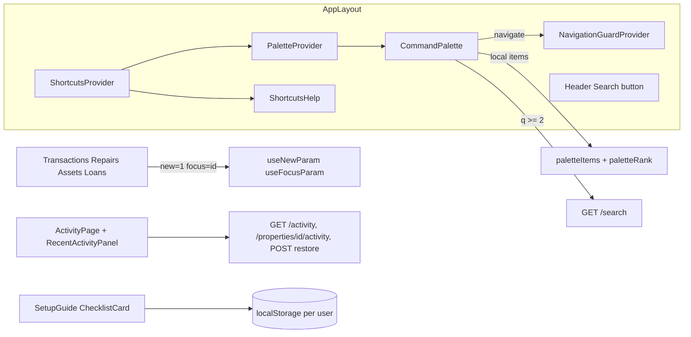
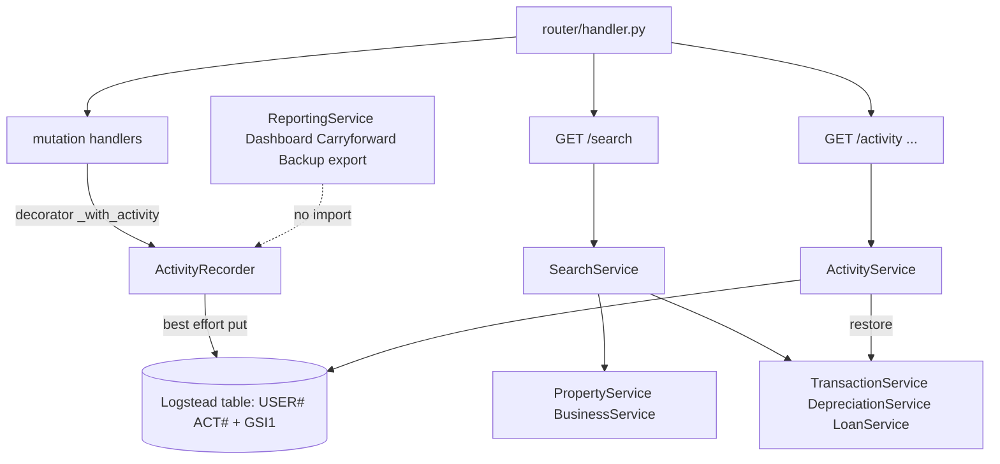

# Design Document

## Overview

UI polish delivers five independently shippable areas on top of the existing SPA and Lambda: a command palette with keyboard shortcuts (A), a global search (B), an activity history with a narrow restore (C), a responsive pattern for the property tabs plus a small-screen pass (D), and onboarding (E). No tax computation changes. Reports, the dashboard, carryforward and backups never read the history.

Each area has its own routes, files and tests. The only shared pieces are the palette (A shows search results from B, and "Show setup guide" from E), the Activity page link in navigation (C), and the `new=1` and `focus` query parameters that pages honor (A and B). Area D and E can ship with no backend change. Area A ships alone. B needs the `/search` route. C needs four routes and a new item type.

### Verified facts the design relies on

These were read from the code while writing this design.

| Fact | Source |
| --- | --- |
| Property tabs are one `ul.flex.flex-wrap` of `NavLink`s inside `nav[aria-label="Property sections"]`, six entries today. | `components/PropertySectionTabs.tsx`, `components/navConfig.ts` |
| Main content is about 488px wide at 768px because the 224px sidebar shows at `md`. Seven tabs therefore wrap to two rows on a tablet. | `AppLayout.tsx` (`w-56` aside, `px-4`, `gap-6`) |
| `RecordModal` content is `max-h-[90vh] w-[92vw] max-w-lg p-6` with no pinned footer. | `components/ui/RecordModal.tsx` |
| `Input` uses `text-sm` (14px); browsers that zoom on focus below 16px will zoom. | `components/ui/Input.tsx` |
| The Imports dirty state lives in `ImportsLayout` (a child route), so a component in `AppLayout` cannot read it. The sidebar links did not consult it; Requirement 30 routes them through the guard. | `pages/ImportsLayout.tsx`, `lib/importsDirty.ts`, `components/ImportSectionTabs.tsx`, `MainNav.tsx` |
| No `useBlocker` is used anywhere. | `grep useBlocker frontend/src` |
| Radix dialogs set `data-state="open"` on `role="dialog"` content, and the mobile drawer is a Radix `Dialog.Content`. | `AppLayout.tsx`, `RecordModal.tsx`, `ConfirmDialog.tsx` |
| `RouteAnnouncer` moves focus to the heading and announces only when the pathname changes. | `components/RouteAnnouncer.tsx` |
| Every existing query on the `USER#<id>` partition uses a sort-key prefix (`PROP#`, `BUSINESS#`, `PLCF#`, `SEEXTRACT#`). The prefix `ACT#` is new. | `services/property.py`, `business.py`, `carryforward.py`, `schedule_e_extraction.py` |
| `DynamoRepository.query` supports `limit` and `ascending`, but has no start key and no conditional write. | `repository/dynamo_repo.py` |
| The table has a sparse TTL on `ttl`, `PAY_PER_REQUEST`, GSI1 (`GSI1PK`/`GSI1SK`, projection ALL) and point-in-time recovery. | `infra/template.yaml` |
| Property-scoped handlers go through `_property_scoped`, which returns the identical 404 for a missing and a foreign property. | `router/handler.py` |
| `ImportService` returns `deleted_prior_count`; `ExpenseImportService.confirm` returns a `ConfirmOutcome`; `BackupService.restore` returns a `RestoreSummary`. | `services/schedule_e_import.py`, `expense_import.py`, `backup.py` |
| `Sample data` restores the bundled JSON through the normal restore flow and replaces all data. | `pages/ProfilePage.tsx` |
| The API stage default throttle is 10 req/s, burst 20, with explicit per-route entries. | `infra/template.yaml` |

### Key design decisions

**A. Palette: build on Radix Dialog, no library.**

| Option | Verdict |
| --- | --- |
| Add `cmdk` | Rejected. A new runtime dependency (plus Renovate churn) for roughly 200 lines of logic that this spec needs to test by property anyway. |
| Radix `Dialog` plus an ARIA combobox/listbox | Chosen. `@radix-ui/react-dialog` is already a dependency and gives the focus trap, `aria-hidden` on the background, Escape and focus return. The ranking and eligibility logic are pure functions. |

**B. Search: server route over existing services.**

| Option | Data volume | Verdict |
| --- | --- | --- |
| Client index over data already loaded | Only properties and (per page) one year of transactions are in memory. Loading every transaction, asset, loan and itemized entry on first search sends the whole dataset (thousands of rows) to the browser each session. | Rejected for records. Kept for pages, properties and tax years. |
| `GET /search` reading through existing services | One partition query per kind per property. About 5,000 transactions at about 0.5 KB is 2.5 MB, roughly 320 eventually consistent read units, a fraction of a cent. Latency is bounded by the scan cap. | Chosen. |
| Search index items (n-gram or token rows) | Doubles writes on every transaction edit, needs a backfill, and breaks the "system of record is what reproduces a report" principle. | Rejected. |
| Scan with `FilterExpression` | Reads the whole table for every search, including other users. | Rejected. |

The route is user-scoped by construction: it starts from the authenticated user's property list and business list and never takes a property id from the request without the ownership check. Money is returned as stored strings and never computed on.

**C. Activity history: scope and storage.**

| Question | Decision | Rationale |
| --- | --- | --- |
| View-only or restore? | View-only for updates. Restore only for a delete the toast Undo would allow. | Reverting an update can conflict with later edits, the `imported` and `itemized` markers, Schedule E re-import and receipts. Restoring a clean delete is one create call and is already accepted behavior (new id). |
| Where to record | At the router layer, around the mutation handlers. | Domain services and the report path stay untouched, which makes Requirement 19 (reports unchanged) true by construction and keeps existing service tests unchanged. |
| Atomic with the change? | No. Best effort after success. | Making every mutation a `transact_write` is invasive. A lost log line is cheaper than a failed save. The restore claim is the one place that needs a conditional write. |
| Key design | `PK=USER#<id>`, `SK=ACT#<invMillis>#<eventId>`; `GSI1PK=PROPERTY#<id>`, `GSI1SK=<SK>` when the event has a property. | One query for the global view, one GSI1 query for a property view, both newest first, both paginated. A property partition would lose the history when the property is deleted, and would need a GSI for the global view. |
| Retention | `ttl` = `at` + 730 days. | A tax return can be amended for three years, but the history is a convenience; the records and reports are the record. 24 months covers the current and prior filing season. A constant, so a change needs no migration. |
| Backup | Excluded. | Same rule as receipts and import sessions. `schema_version` stays `"1"`. |
| Bulk operations | One event. | A Schedule E import can replace dozens of rows. One summary event keeps cost and noise bounded. |
| Cost | About 1 write unit plus 1 GSI write per user operation, 1 to 4 KB per event. 10,000 events a year is about 20 MB, under $0.01 a month at `$0.25` per GB-month; writes about `$1.25` per million. | Negligible for a single-user app. |

**D. Tabs: a disclosure below 768px.**

| Option | Verdict |
| --- | --- |
| Keep wrapping | Rejected for phones: seven pills at 375px take three rows and push the page content down. Kept at 768px and wider. |
| Horizontal scroll strip | Rejected. Hidden tabs are not discoverable, and a horizontally scrolling region is a gray area under WCAG 1.4.10 Reflow. |
| Native `select` that navigates | Rejected. Navigating on `change` is an accessibility anti-pattern, and links lose their semantics. |
| Radix `DropdownMenu` | Rejected for links. `role="menu"` is meant for actions, and the nav landmark would be lost. |
| Disclosure button plus the same `ul` of links | Chosen. It follows the WAI-ARIA disclosure navigation pattern, keeps real links inside one `nav`, needs no new dependency, and works for any number of tabs. |

**E. Onboarding: inline, per browser.**

A modal tour or spotlight overlay would trap focus, conflict with the dialogs and shortcuts in area A, and need a library. The setup guide extends the existing card in place. Progress is derived from data, so only "dismissed" and "collapsed" are stored.

## Architecture





```mermaid
sequenceDiagram
  participant U as User
  participant H as Handler (_property_scoped, _with_activity)
  participant S as Domain service
  participant A as ActivityRecorder
  U->>H: PUT /properties/{id}/transactions/{tid}
  H->>S: get(before) (best effort, only when recording)
  H->>S: update(...)
  S-->>H: Result
  alt success
    H->>A: complete(before, after body)
    A->>A: diff allow-listed fields; skip if empty
    A-->>H: ok or logged warning
  end
  H-->>U: same response as before
```

## Components and Interfaces

### Area A: command palette and shortcuts (frontend only)

**`lib/shortcuts/eligibility.ts`** (pure)

```ts
export type TargetKind = "editable" | "interactive" | "other";
export interface KeyEventInfo {
  key: string; keyCode: number; target: TargetKind;
  alt: boolean; ctrl: boolean; meta: boolean; shift: boolean;
  isComposing: boolean; repeat: boolean; defaultPrevented: boolean;
  blockingDialogOpen: boolean;
}
export function classifyTarget(el: EventTarget | null): TargetKind;     // input/textarea/select/contenteditable -> editable; button, a, summary, role menuitem|tab|option|treeitem -> interactive
export function isEligiblePlainKey(e: KeyEventInfo): boolean;            // Requirement 7.10
export function isPaletteChord(e: KeyEventInfo, platform: Platform): boolean; // mod+k; allowed from editable targets, blocked by dialogs
```

Shift is not a blocking modifier (`?` needs Shift on US layouts). `isEligiblePlainKey` returns true only when the target is not `editable`, no dialog is open, no Alt/Ctrl/Meta, not composing (`isComposing` or `keyCode === 229`), not `repeat`, and not `defaultPrevented`. A plain key on an `interactive` target is eligible except Space and Enter, which no Shortcut uses.

**`lib/shortcuts/registry.ts`**

```ts
export interface ShortcutDef {
  id: string; label: string; group: "General" | "Go to";
  keys: readonly string[];            // ["mod","k"] | ["/"] | ["?"] | ["g","d"]
  run: ShortcutActionId;              // resolved to a handler by the provider
}
export const SHORTCUTS: readonly ShortcutDef[];
export function formatKeys(def: ShortcutDef, platform: Platform): string[];  // "mod" -> "Cmd" | "Ctrl"
export function findDuplicates(defs: readonly ShortcutDef[]): string[];       // empty for SHORTCUTS
```

**`lib/shortcuts/sequence.ts`** (pure state machine)

```ts
export interface SequenceState { pending: string | null; at: number }
export function stepSequence(
  state: SequenceState, key: string, now: number,
  defs: readonly ShortcutDef[], timeoutMs: number,
): { state: SequenceState; fired: ShortcutDef | null };
```

A press of `g` sets `pending="g"`. A second key that completes a registered sequence fires it. A timeout, or any key that does not complete a sequence, clears `pending` and, if that key is itself a sequence starter, starts a new sequence. `SEQUENCE_TIMEOUT_MS = 1000`.

**`components/shortcuts/ShortcutsProvider.tsx`**

Owns the single `document` `keydown` listener (removed on unmount). It builds a `KeyEventInfo`, calls `isPaletteChord` first, then `isEligiblePlainKey`, then `stepSequence`, and runs the handler. `blockingDialogOpen` is computed by `hasBlockingDialog(document)`:

```ts
document.querySelector(
  '[role="dialog"][data-state="open"]:not([data-palette]), [role="alertdialog"][data-state="open"]:not([data-palette])',
) !== null
```

The palette and the help dialog set `data-palette` on their content, so they do not count as blocking themselves. Context value: `{ openPalette(initial?: string), closePalette(), openHelp() }`. The provider sits inside `Router` and inside `ShellPropertiesProvider` in `AppLayout`.

**`components/shortcuts/ShortcutsHelp.tsx`**: a Radix `Dialog` ("Keyboard shortcuts") with a `dl` per group, keys in `kbd`, Close button, focus return through `useOpenerFocusReturn`.

**`lib/navigationGuard.tsx`** (new, fixes a verified gap)

`NavigationGuardProvider` (in `AppLayout`) keeps a map of dirty flags. `useRegisterDirty(key, dirty)` registers a flag, and `ImportsLayout` calls `useRegisterDirty("imports", dirty)` in addition to its existing context. `useGuardedNavigate()` returns `go(to)`: when any flag is set it opens a `ConfirmDialog` ("Discard changes?"), and only a confirm calls `navigate(to)`. The palette, the shortcuts and the header button use `go`. `MainNav` also uses `go` (Requirement 30): each sidebar `NavLink` keeps its `href`, `aria-current` and accessible name, and its `onClick` calls `event.preventDefault()` and `go(to)` only for a plain primary-button click (no modifier key, `button === 0`, `event.defaultPrevented` not already set); a modified or non-primary click keeps the browser default and shows no confirm. When no flag is set, `go` calls `navigate(to)` at once, which matches today's `NavLink` behavior. In the mobile drawer, the existing `onNavigate` prop (which closes the drawer) runs only once navigation proceeds, so a cancelled confirm leaves the drawer open. This is a deliberate change to existing behavior: before it, a sidebar click left a dirty Imports form with no prompt. The `ImportSectionTabs` links keep their existing guard. A `RecordModal` with a dirty form is a Blocking_Dialog, so the palette cannot open on top of it and bypass `useDiscardGuard`.

**`components/palette/`**

| File | Responsibility |
| --- | --- |
| `PaletteProvider.tsx` | Open state, `initialQuery`, step (`root` or `pickProperty`), opener element capture. Wraps `Dialog.Root`. |
| `CommandPalette.tsx` | Dialog content, combobox input, listbox, live region, busy state. `data-palette` on the content. |
| `paletteItems.ts` | `buildLocalItems({ properties, years, currentPropertyId, platform, hasProperty }): PaletteItem[]` (pure). |
| `paletteRank.ts` | `normalize(text)`, `tokenize(q)`, `rankLocal(items, q, limit): PaletteItem[]` (pure, deterministic). |
| `useGlobalSearch.ts` | Debounced (250 ms) `searchApi.search`, abort on change, returns `{ groups, status, truncated, retry }`. |
| `PaletteList.tsx` | Groups, options, `aria-activedescendant` ids, "See all results". |

```ts
export type PaletteItem =
  | { kind: "destination"; id: string; label: string; keywords: string[]; to: string; group: "Pages" | "Properties" | "Tax years" | "Property sections"; hint?: string }
  | { kind: "action"; id: ActionId; label: string; keywords: string[]; needsProperty: boolean; hint?: string };
```

Actions resolve as follows: property-scoped add actions build `/properties/{id}/{segment}?new=1` with `segment` in `transactions | repairs | assets | loans`. "Add property" goes to `/properties?new=1`. "Import Schedule E" goes to `/imports/schedule-e`. "Switch theme" uses the existing theme toggle hook. "Keyboard shortcuts" calls `openHelp`. "Show setup guide" calls `showSetupGuide()` (area E). "Download backup" goes to `/profile?focus=backup`.

**`lib/useNewParam.ts`**

```ts
export function useNewParam(open: () => void, ready: boolean): void
```

When `ready` and `new=1` is present, call `open()` once and `setSearchParams(next, { replace: true })` with `new` removed. A `useRef` guard stops a double open under React StrictMode. Wired into `TransactionsPage`, `ItemizedExpensesPage` (opens the add-entry dialog), `AssetsPage`, `LoansPage`, and `PropertiesPage` (add property).

**`lib/useFocusParam.ts`**

```ts
export function useFocusParam(rows: readonly { id: string }[], ready: boolean, selector: (id: string) => string): void
```

When `ready` and `focus` is present, find `document.querySelector(selector(id))`, call `scrollIntoView({ block: "center", behavior: reducedMotion ? "auto" : "smooth" })` and `focus()`, once. Rows get `id="row-{id}"` and `tabIndex={-1}` where they do not already carry a focusable control.

**Edits to existing files**

| File | Change |
| --- | --- |
| `MainNav.tsx` | Sidebar links call `useGuardedNavigate().go` on a plain click (Requirement 30). This is the one deliberate change to existing behavior in this feature. |
| `AppLayout.tsx` | Wrap the shell in `ShortcutsProvider` and `NavigationGuardProvider`; add a header `Button` "Search" (`SearchIcon`, `aria-label="Search"`, `aria-keyshortcuts="Control+K Meta+K"`). |
| `ProfileMenu.tsx` | Add "Keyboard shortcuts" and "Show setup guide" items. |
| `navConfig.ts` | Add `{ to: "/activity", label: "Activity", icon: "activity" }` to the `tools` group; add `"activity"` to `NavIconName` and `MainNav` ICONS (a new `HistoryIcon`). |
| `CombinedReportsPage.tsx` | Initialize the year from `parseYearParam(searchParams.get("year"))` (adds `parseYearParam` in `lib/taxYears.ts` only if the year-end-checklist work has not already added it, and reuses it otherwise; see Decisions recorded). |
| `ProfilePage.tsx` | On `focus=backup`, focus the `#backup-heading` (add `tabIndex={-1}`). |
| `ImportsLayout.tsx` | `useRegisterDirty("imports", dirty)`. |

### Area B: search

**Backend**

`services/search_config.py`

```python
@dataclass(frozen=True)
class SearchConfig:
    min_query_length: int = 2
    max_query_length: int = 100
    max_tokens: int = 5
    default_limit: int = 5
    max_limit: int = 25
    scan_cap: int = 20_000
SEARCH_CONFIG = SearchConfig()
```

`services/search_match.py` (pure)

```python
def normalize(text: str) -> str            # NFKC, casefold, collapse whitespace
def tokenize(query: str, max_tokens: int) -> list[str]
def match_rank(tokens: Sequence[str], fields: Sequence[tuple[str, str]]) -> tuple[int, str] | None
    # fields = [(name, raw_text)]; every token must occur in the joined normalized text.
    # returns (rank, matched_field): 0 whole-field equals query, 1 word-prefix for every token, 2 substring.
def sort_key(hit) -> tuple                 # rank, -date ordinal, title, id
def link_for(kind, property_id, record_id, year) -> str   # builds from validated ids only
```

`services/search.py`

```python
@dataclass(frozen=True)
class SearchHit: kind: str; id: str; property_id: str | None; title: str; subtitle: str | None
                 matched_field: str; link: str; amount: Money | None; date: str | None
@dataclass(frozen=True)
class SearchGroup: kind: str; total: int; hits: tuple[SearchHit, ...]
@dataclass(frozen=True)
class SearchResult: query: str; groups: tuple[SearchGroup, ...]; truncated: bool; scanned: int

class SearchService:
    def __init__(self, properties, transactions, depreciation, loans, businesses, config=SEARCH_CONFIG) -> None
    def search(self, q: str, *, limit: int | None = None, property_id: str | None = None) -> Result[SearchResult]
```

Flow: validate `q` (400, field `q`) and `limit` (400, field `limit`); list the user's properties through `PropertyService.list()` (already user-scoped); when `property_id` is given it must be in that list, otherwise the router has already returned the 404. For each property read `transactions.list_for_property(pid)`, `depreciation.list_assets(pid)` and `loans.list_loans(pid)`, adding the item count to `scanned`; stop when `scanned >= scan_cap` and set `truncated`. Itemized entries are the transactions whose `itemized` flag is set and are searched on `description` and `notes`. Other transactions are searched on `description` only. Amounts, dates, and category labels are never part of the searchable text (see Decisions recorded). Businesses come from `BusinessService.list()` unless `property_id` is given. Money values are passed through without arithmetic.

Router: `_search` is not `@_property_scoped` (no path id). When `propertyId` is present, it calls `_require_owned_property` first, so the 404 is byte-identical to the property routes. `_check_path_ids`-style validation applies to `propertyId` through the existing id validator.

`GET /search` response:

```json
{
  "query": "water",
  "truncated": false,
  "scanned": 412,
  "groups": [
    { "kind": "transaction", "total": 7, "hits": [
      { "kind": "transaction", "id": "…", "property_id": "…", "title": "Water bill",
        "subtitle": "Oak St · 2024-03-07", "matched_field": "description",
        "link": "/properties/…/transactions?year=2024&focus=…", "amount": "125.00", "date": "2024-03-07" } ] }
  ]
}
```

**Frontend**

| File | Responsibility |
| --- | --- |
| `api/search.ts` | `SearchApi` with an injectable `ApiClient`; `search(q, { limit, propertyId, signal })`. Types for the response. |
| `lib/highlight.ts` | `highlightSegments(text, tokens): { text: string; match: boolean }[]` (pure; concatenation equals the input). |
| `components/search/HighlightedText.tsx` | Renders segments as text nodes and `mark` elements. |
| `components/search/SearchResults.tsx` | Groups, hit rows (`Link`), counts, truncation notice; shared by the palette and the page. |
| `pages/SearchPage.tsx` | `/search?q=`; field, live region, groups up to 25 hits; replace-navigation of `q`. |
| `lib/safeLink.ts` | `isSafeAppLink(link)`: starts with `/`, not `//`, no backslash, no control characters. |

### Area C: activity history

**Storage**: see Data Models. **Backend**

`services/activity_config.py`

```python
@dataclass(frozen=True)
class ActivityConfig:
    retention_days: int = 730
    summary_max_chars: int = 200
    value_max_chars: int = 200
    json_max_bytes: int = 2048
    default_page: int = 50
    max_page: int = 100
ACTIVITY_CONFIG = ActivityConfig()
```

`services/activity_events.py` (pure)

```python
FIELDS: Mapping[str, tuple[str, ...]]                   # allow-lists per entity (Requirement 14.3)
def project(entity: str, record: Mapping[str, Any]) -> dict[str, str | bool | None]   # allow-listed, money as strings
def diff(entity, before, after) -> tuple[dict, dict]    # only changed fields; empty when unchanged
def bound(values: dict, cfg) -> tuple[dict, bool]       # truncate text, enforce json_max_bytes; (values, truncated)
def summarize(action, entity, before, after, extra) -> str   # <= summary_max_chars
def inverted_millis(at: datetime) -> str                # 14 digits
def event_sk(at, event_id) -> str                       # "ACT#<inv>#<id>"
def encode_cursor(sk: str) -> str; def decode_cursor(raw: str) -> str | None
def is_restorable(entity, action, record, receipt_count) -> bool
```

`services/activity.py`

```python
class ActivityRecorder:                       # best effort; never raises
    def __init__(self, repo, user_id, clock=utcnow, config=ACTIVITY_CONFIG, log=logger) -> None
    def record(self, event: NewEvent) -> None
    def purge_user(self) -> int               # deletes the user's ACT# items (batched by 25 via transact_write or delete_item)
    def purge_property(self, property_id) -> int  # GSI1 query then deletes

class ActivityService:
    def __init__(self, repo, user_id, transactions, itemized, depreciation, loans, recorder, clock) -> None
    def list_user(self, *, limit, cursor, entity, action, property_id=None) -> Result[ActivityPage]
    def list_property(self, property_id, *, limit, cursor, entity, action) -> Result[ActivityPage]
    def restore(self, property_id, event_id) -> Result[RestoreOutcome]
```

`list_*` queries `PK=USER#<id>` (or GSI1 `PROPERTY#<id>`), `sk_begins_with="ACT#"`, newest first, with a start key from the cursor, reading `limit + 1` items per round. `entity` and `action` filters are applied in the service, and the loop continues until `limit` matching items are found or the partition is exhausted, with a read cap of 2,000 items per request. Expired items (`ttl <= now`) are skipped.

`restore` sequence: load the event (`get_item` by `PK=USER#<id>`, `SK` from `eventId`; the id must match `ACT#`-shaped validation) and require its `property_id` to equal the route's property (otherwise the same 404). Check `restorable`, `action == "delete"` and no `restoredAt`. Claim with a conditional put that sets `restoredAt` and `restoredAs="pending"` when `attribute_not_exists(restoredAt)`. Re-create through `TransactionService.create` (transaction), `ItemizedExpenseService.create_entry` (itemized entry), `DepreciationService.create_asset` (asset) or `LoanService.create_loan` (loan) using the stored payload. On success, update the event with `restoredAs=<new id>`; on failure, delete the claim (a conditional put that removes `restoredAt`) and return the service's error. Then record one `restore` event.

Repository additions (additive, existing calls unchanged):

```python
def query(..., start_key: Mapping[str, Any] | None = None) -> list[dict]      # ExclusiveStartKey for the first page only
def put_item(..., condition: str | None = None, names: Mapping | None = None, values: Mapping | None = None) -> None
class ConditionFailed(Exception)                                              # mapped from ConditionalCheckFailedException
```

Router wiring (`router/handler.py`):

```python
def _with_activity(spec: ActivitySpec):    # decorator for mutation handlers
    # before: spec.read_before(...) best effort (a GET through the same service); after: on 200/201/204 call recorder.record(...)
```

| Handler | Spec |
| --- | --- |
| `_create_transaction`, `_update_transaction`, `_delete_transaction` | entity `transaction`, `before` from `TransactionService.get`, receipt count from `list_receipts` for restorable. |
| itemized `create_entry`, `update_entry`, `delete_entry`, `set_total`, `remove_total` | `itemized_entry` for entries, `transaction` for totals. |
| asset create, update, delete (and override set/remove) | `asset`. |
| loan create, update, delete, interest override set/remove | `loan`. |
| property create, update, delete | `property`. On delete the wrapper calls `purge_property` before recording the property `delete` event. |
| Schedule E import handlers (manual and extraction confirm) | `import` / `schedule_e`, counts from the result. |
| expense import `confirm` | `import` / `transaction`, count from `ConfirmOutcome`. |
| backup `restore` | after success: `purge_user()` then one `import` / `backup` event. |
| backup `clear` | after success: `purge_user()`. No event. |

The wrapper sits inside `_property_scoped` (`@_property_scoped` outermost), so a 404 or 400 never records. The recorder is built per request from `wiring.repo` and `user`, like the services.

**Frontend**: `api/activity.ts` (`list`, `listForProperty`, `restore`), `pages/ActivityPage.tsx`, `components/activity/ActivityList.tsx`, `ActivityEventRow.tsx` (Badge, `time`, `dl` details, Restore button with `ConfirmDialog`), `RecentActivityPanel.tsx` (property Overview), `lib/activityText.ts` (labels: `actionLabel`, `entityLabel`, `eventLink`). Routes: `{ path: "activity", element: <ActivityPage /> }` and `{ path: "search", element: <SearchPage /> }` in `routes.tsx`.

### Area D: responsive layout

**`lib/propertySections.ts`** (pure)

```ts
export function currentSection(pathname: string, propertyId: string): PropertyNavItem | null
```

It compares `pathname` (without a trailing slash) with `propertyPath(propertyId, item.segment)` for each `PROPERTY_NAV` entry, preferring the longest match and treating the empty segment as an exact match only.

**`PropertySectionTabs.tsx`** (rewritten, same exports and the same `nav` landmark)

```tsx
<nav aria-label="Property sections" className="mt-4" onKeyDown={escapeToClose} onBlur={closeOnFocusLeave}>
  <button type="button" aria-expanded={open} aria-controls={listId} className="md:hidden …">
    Property sections: {current?.label ?? "Overview"}
  </button>
  <ul id={listId} className={open ? "mt-2 flex flex-col gap-1 md:mt-0 md:flex-row md:flex-wrap md:gap-2" : "hidden md:flex md:flex-wrap md:gap-2"}>
    {PROPERTY_NAV.map(… NavLink with sectionTabClassName …)}
  </ul>
</nav>
```

One landmark and one list at every width, so existing role queries keep working in jsdom (where Tailwind classes do not apply). `onClick` on a link closes the list. The button and links use the 44px target classes. Under Reduced_Motion there is no transition because none is added.

**Breakpoint and fallback.** The disclosure switches to the wrapping row at `md` (768px). The Playwright check in `e2e/responsive.spec.ts` counts the rows of the seven-tab set at 768 and 1023 pixels. If the count at 768 is more than two, change `md:` to `lg:` on the button, the list and the closed-list classes in `PropertySectionTabs` (the only place the breakpoint appears), update the Narrow_Viewport and Tablet_Viewport definitions and the viewport tests, and record the change in `docs/developer-guide.md` (Requirement 21.13).

**Responsive pass** (task D2): the audit starts from a list of findings, and the fixes below are the ones verified in the code.

| Finding | Fix |
| --- | --- |
| `RecordModal` uses `max-h-[90vh]` and `p-6` and has no pinned footer, so Save can scroll away on a short screen with the keyboard open. | `max-h-[90dvh]`, `p-4 sm:p-6`, `w-[calc(100vw-1.5rem)]` on narrow screens, and an optional `footer` slot rendered in a sticky bottom bar. Forms keep working without the slot. |
| `Input` uses `text-sm` (14px), which makes iOS Safari zoom on focus. | Add `max-md:text-base` to `Input`, `Select`, `Textarea`, `MoneyInput` and `DateInput` base classes. |
| Form grids may use multi-column layouts. | Audit `TransactionForm`, `ItemizedEntryForm`, `AssetForm`, `LoanForm`, property forms; switch to `grid-cols-1 sm:grid-cols-2`. |
| Toolbars (tax year select, buttons) may overflow. | `flex-wrap gap-2` on toolbars and year-selector groups. |
| Sticky table header scroll area (`max-h-[70vh]`) in `ResponsiveTable`. | `max-h-[70dvh]`; confirmed stacked rows are already covered by `a11y.spec.ts`. |

**Playwright** (`e2e/responsive.spec.ts`): `test.use({ viewport })` blocks for 320x640, 375x800, 768x1024 and 1024x768. Each checks `scrollWidth <= innerWidth` for the primary routes and runs axe in light and dark. Separate tests cover the tab disclosure and the modal Save button.

### Area E: onboarding

**`lib/onboardingStorage.ts`**

```ts
export interface SetupState { dismissed: boolean; collapsed: boolean }
export const DEFAULT_SETUP_STATE: SetupState;
export function setupKeys(userId?: string | null): { dismissed: string; collapsed: string };  // dismissed reuses checklistKeys().dismissed
export function readSetupState(userId?: string | null): SetupState;     // defaults on any error
export function writeSetupState(userId: string | null | undefined, patch: Partial<SetupState>): void;
export function clearSetupState(userId?: string | null): void;
export function serializeSetupState(s: SetupState): string;            // JSON for the collapsed key payload
export function parseSetupState(raw: string | null): SetupState;       // round trip with serialize; defaults on invalid
```

The dismissed flag keeps its current key and `"1"` value (`checklistStorage.ts`), so existing dismissals keep working. The collapsed flag is a new key `logstead.checklist.collapsed[.userId]` with value `"1"`.

**`components/dashboard/checklist.ts`** gains a pure `nextStep(view): StepId | null` and `stepReason(id): string`. `computeChecklist` and its return type stay unchanged, so existing tests pass.

**`ChecklistCard.tsx`** changes:

- "Next" badge text and a reason sentence under the first incomplete step.
- Collapse and Expand button (`aria-expanded`, `aria-controls="checklist-steps"`).
- All-done state: "You're set up" and a "Dismiss" button.
- A polite live region (`role="status"`) announcing a newly completed step.
- Sample data link when `summary.has_properties` is false.
- An exported `showSetupGuide()` (also in a small `SetupGuideContext`) that clears the stored state and navigates to `/` with focus on `#checklist-heading`.

**Empty states**: a shared `components/ui/EmptyGuide.tsx` wrapper over `StateBlock kind="empty"` taking `title`, `description`, `primary: { label, onClick | to }`, and `secondary?`. Pages: Transactions, Repairs, Assets, Loans, Properties, Reports and Combined Reports. Copy lives in `lib/emptyCopy.ts`, one entry per page, so tests can assert it without tax advice phrases.

## Data Models

### Activity_Event item (new)

| Attribute | Type | Notes |
| --- | --- | --- |
| `PK` | S | `USER#<userId>` |
| `SK` | S | `ACT#<14-digit inverted ms>#<eventId>` where inverted = `99999999999999 - epoch_ms` |
| `GSI1PK` | S | `PROPERTY#<propertyId>`; omitted for `backup` events |
| `GSI1SK` | S | Same as `SK`; omitted with `GSI1PK` |
| `entityType` | S | `ACTIVITY` |
| `eventId` | S | uuid4 |
| `at` | S | UTC ISO with milliseconds, `YYYY-MM-DDTHH:MM:SS.mmmZ` |
| `action` | S | `create` `update` `delete` `restore` `import` |
| `entity` | S | `transaction` `itemized_entry` `asset` `loan` `property` `backup` `schedule_e` |
| `recordId` | S | omitted for `backup` and `schedule_e` |
| `propertyId` | S | omitted for `backup` |
| `propertyName` | S | name at the time of the event, at most 200 characters |
| `summary` | S | at most 200 characters |
| `beforeJson`, `afterJson` | S | JSON objects of allow-listed fields, money as two-decimal strings, at most 2,048 bytes each |
| `truncated` | BOOL | stored only when true |
| `restorable` | BOOL | stored only when true |
| `restorePayload` | S | JSON create payload, stored only when `restorable`; at most 2,048 bytes |
| `restoredAt`, `restoredAs` | S | set by the restore claim and completion |
| `ttl` | N | epoch seconds, `at` + 730 days (the existing sparse TTL attribute) |

The repository's money serializer applies to top-level attribute names only. No top-level attribute is named `amount`, so no money coercion happens, and nested money stays inside the JSON strings (the same technique as `detailsJson`).

Key helpers added to `repository/keys.py`: `ACT_PREFIX = "ACT#"`, `activity_sk(at, event_id)`, `activity_list_prefix()`, `activity_gsi1_pk(property_id)` (equal to `property_scoped_pk`).

Existing key and query checks: every query on `USER#<id>` uses a prefix, so `ACT#` items cannot appear in the property, business, carryforward or extraction lists. Property delete and `BackupService.clear` list a property partition (`PROPERTY#<id>`), which never contains `ACT#` items.

### Access patterns

| Need | Query |
| --- | --- |
| Global history, newest first | `PK = USER#<id>`, `SK begins_with ACT#`, `ScanIndexForward=true` (inverted ms makes ascending newest first), `Limit` |
| Property history | `GSI1PK = PROPERTY#<id>`, `GSI1SK begins_with ACT#` |
| Purge user history | the global query, then batched deletes |
| Purge property history | the GSI1 query, then batched deletes |
| One event by id | `GetItem` with `SK` derived from the cursor-style lookup: `get` needs the full SK, so the restore request carries `eventId` equal to the SK suffix `<inv>#<id>` encoded as one path segment `<inv>.<id>`, validated by a regex |

The restore path segment is the opaque `eventId` returned in the list (`"<inv>.<uuid>"`), which maps to `SK=ACT#<inv>#<uuid>` with no scan.

### Wire types (frontend)

```ts
type ActivityAction = "create" | "update" | "delete" | "restore" | "import";
type ActivityEntity = "transaction" | "itemized_entry" | "asset" | "loan" | "property" | "backup" | "schedule_e";
interface ActivityEvent {
  id: string; at: string; action: ActivityAction; entity: ActivityEntity;
  record_id: string | null; property_id: string | null; property_name: string | null;
  summary: string; before: Record<string, string | boolean | null> | null;
  after: Record<string, string | boolean | null> | null;
  truncated: boolean; restorable: boolean; restored_as: string | null;
}
interface ActivityPage { events: ActivityEvent[]; next_cursor: string | null }
```

### Search wire types: see Components (Area B).

### Setup state: see Components (Area E).

## Correctness Properties

*A property is a characteristic or behavior that should hold true across all valid executions of a system-essentially, a formal statement about what the system should do. Properties serve as the bridge between human-readable specifications and machine-verifiable correctness guarantees.*

Redundancy review: the plain-key eligibility cases (7.1 to 7.7) are all instances of the universal predicate in 7.10, so they share Property 1. The palette chord (1.7, 1.8) is a separate predicate (Property 2). Search matching, totals and special-character handling (9.2, 9.6, 9.9) are one property because they are checked against the same oracle. Event projection, diff, round trip and money exactness (13.10, 14.4, 14.5, 14.9) are one property. Pagination order and completeness (15.4, 15.5) are one property. The restore round trip and the single-claim rule (17.4, 17.5, 17.12) are two properties because they fail for different reasons.

### Property 1: Plain-key shortcut eligibility

For all key events described by (target kind, Alt, Ctrl, Meta, Shift, composing, keyCode, repeat, defaultPrevented, blocking dialog open), `isEligiblePlainKey` returns true if and only if the target is not editable, no blocking dialog is open, none of Alt, Ctrl and Meta is held, the event is not composing and its `keyCode` is not 229, the event is not a repeat, and `defaultPrevented` is false, regardless of Shift.

**Validates: Requirements 7.1, 7.2, 7.3, 7.4, 7.5, 7.6, 7.10**

### Property 2: Palette chord eligibility

For all key events, `isPaletteChord` returns true if and only if the key is `k` (any case) with Meta held on macOS or Ctrl held elsewhere, no blocking dialog is open, and the event is not composing; the target kind has no effect.

**Validates: Requirements 1.1, 1.7, 1.8**

### Property 3: Sequence matcher

For all key streams with non-decreasing timestamps, `stepSequence` fires a registered sequence if and only if its first key was the previous accepted key, the second key arrives within `SEQUENCE_TIMEOUT_MS`, and no other key intervened; it never fires an unregistered sequence, and a timeout or non-matching key leaves no pending key.

**Validates: Requirements 6.3, 6.4**

### Property 4: Palette ranking and filtering

For all candidate lists and queries, every item returned by `rankLocal` contains every Search_Token in its normalized label or keywords; the result is identical for identical inputs; items whose label equals the query precede items with a word-prefix match, which precede substring matches, with ties broken by the fixed item order and then by label; and the result length is at most the limit.

**Validates: Requirements 5.1, 5.2, 5.3, 5.4, 5.5**

### Property 5: Highlight index wraps

For all list lengths greater than zero, current indexes in range, and directions, `moveHighlight` returns an index in `[0, length)`, and moving forward then backward returns the starting index.

**Validates: Requirements 4.4, 4.5**

### Property 6: Year parameter parsing

For all strings, `parseYearParam` returns an integer if and only if the string is the canonical decimal form of an integer from 1900 through 2200; otherwise it returns `null`, and the page then uses the latest completed tax year.

**Validates: Requirements 2.5, 2.6**

### Property 7: Action targets

For all property lists, current-property choices and add actions, `resolveActionTarget` returns the path `/properties/{id}/{segment}?new=1` for the chosen property when exactly one property applies (the current property, or the only property), requests a property picker when more than one applies, and reports "unavailable" when the user owns none; the `segment` is `transactions`, `repairs`, `assets` or `loans` for the matching action.

**Validates: Requirements 3.2, 3.3, 3.4, 3.5**

### Property 8: Search matching

For all stored states and queries of 2 to 100 characters, a record appears in the response if and only if each Search_Token occurs in its normalized searchable text, where the searchable text is built only from the text fields of Requirement 8.2 (a record whose amount, date, or category label contains a token but whose text fields do not is not returned); every returned hit satisfies this; each group's `total` equals the number of matching records and does not change with `limit`; each group returns at most `limit` hits; and pattern characters in `q` (`*`, `%`, `\`, `.`, `?`, `[`) match only as literal text.

**Validates: Requirements 8.2, 9.2, 9.5, 9.6, 9.9, 9.10**

### Property 9: Query normalization is idempotent

For all strings, `normalize(normalize(s))` equals `normalize(s)`, and `tokenize` returns at most 5 tokens, none empty, each equal to its own normalization.

**Validates: Requirements 9.1, 9.8**

### Property 10: Search order and determinism

For all stored states and queries, two identical requests return identical responses, and within a group the hits are ordered by rank tier, then most recent date, then title, then id.

**Validates: Requirements 9.4, 9.7**

### Property 11: Search is user-scoped and shaped

For all pairs of users with arbitrary data, a search by one user returns only records of that user's properties and businesses, always returns the six groups in the fixed order (an empty group has `total` 0 and no hits), and performs no repository write and no S3 call.

**Validates: Requirements 8.3, 8.5, 10.1**

### Property 12: Money and links pass through unchanged

For all stored records with arbitrary two-decimal amounts, each hit's `amount` equals the stored Money_String character for character, and each hit's `link` is built only from validated ids and the record's year, satisfies `isSafeAppLink`, and matches the pattern for its kind.

**Validates: Requirements 8.7, 8.8, 8.9, 11.5**

### Property 13: Scan cap and truncation

For all stored states and scan caps, when the number of available stored items is at most the cap the response has `truncated` false and is complete; when `truncated` is true the number of items read is at least the cap; and `scanned` is never negative.

**Validates: Requirements 12.2, 12.3, 12.5**

### Property 14: Highlight segments preserve the text

For all strings and token lists, concatenating the segments returned by `highlightSegments` equals the input string, and every segment marked as a match contains a token when compared after normalization.

**Validates: Requirements 11.9**

### Property 15: Safe link check

For all strings, `isSafeAppLink` returns true if and only if the string starts with a single `/`, does not start with `//`, and contains no backslash and no control character.

**Validates: Requirements 11.5**

### Property 16: Event projection, diff and round trip

For all pairs of allow-listed field maps (including unicode text, empty strings, and two-decimal money strings), `diff` returns only fields whose values differ, returns two empty maps when no field differs (so no event is written), keeps every money value character for character, applying the `after` map over the `before` map yields the allow-listed projection of the new record, and `diff(b, a)` is the inverse of `diff(a, b)`.

**Validates: Requirements 13.10, 14.2, 14.3, 14.4, 14.5, 14.9**

### Property 17: Event bounds

For all field maps, `bound` returns a map whose serialized JSON is at most 2,048 bytes and whose text values are at most 200 characters, sets `truncated` if and only if a value was cut, never raises, and is idempotent (`bound(bound(m))` equals `bound(m)`); `summarize` returns at most 200 characters.

**Validates: Requirements 14.1, 14.6**

### Property 18: Event serialization round trip

For all events, writing an event item and reading it back through the Activity_Service returns `before` and `after` objects equal to the stored maps, with money values still Money_Strings and no receipt, S3 or credential field present.

**Validates: Requirements 14.7, 14.8, 14.10**

### Property 19: Event keys and retention

For all pairs of timestamps `t1 < t2` and event ids, `event_sk(t2, a)` sorts before `event_sk(t1, b)` as a string; for equal timestamps the order is by event id; every SK matches `^ACT#\d{14}#[0-9a-f-]{36}$`; and the stored `ttl` equals the epoch seconds of `at` plus `ACTIVITY_CONFIG.retention_days` days (730 by default, defined once).

**Validates: Requirements 18.1, 18.2**

### Property 20: Pagination completeness

For all sets of events, page sizes from 1 to 100, and optional entity and action filters, following `next_cursor` from the first page returns every matching, unexpired event exactly once, in newest-first order, and `next_cursor` is `null` on the last page only.

**Validates: Requirements 15.4, 15.5, 15.9**

### Property 21: Restorable classification

For all (entity, action, record, receipt count) tuples, `is_restorable` is true if and only if the action is `delete` and the record is a transaction that is not imported, not itemized and has no receipt, an itemized entry with no receipt, an asset, or a loan with no interest override; the result agrees with `undoMappers.ts` for the same records.

**Validates: Requirements 17.1, 17.2**

### Property 22: Restore round trip

For all restorable records, creating the record, deleting it, and restoring it from the history yields a record equal to the original in every allow-listed field, with a new id, and the event is marked restored with that id.

**Validates: Requirements 17.4, 17.9, 17.12**

### Property 23: Restore is claimed once

For all restorable delete events and any number of restore requests (one to five), exactly one request succeeds, the others return `409`, and exactly one record is created.

**Validates: Requirements 17.5, 17.6**

### Property 24: Reports do not depend on activity

For all stored states, the Schedule E report, the combined report, the dashboard summary, the carryforward reconciliation and the backup export are identical whether the user has no Activity_Events or any number of them, and the stored transaction, asset, loan and property items after a mutation are identical whether the recorder is enabled or disabled.

**Validates: Requirements 19.2, 19.3, 19.4, 13.12**

### Property 25: Recording failure does not change the response

For all mutation requests, the status code and body are identical whether the Activity_Recorder write succeeds or raises, and a failed recorder write leaves the stored records exactly as a successful one would.

**Validates: Requirements 20.1, 20.2**

### Property 26: Purge on clear, restore and property delete

For all sets of events and properties, after "Clear all data" the user has no events; after a backup restore the user has exactly one event (the restore event); after a property delete none of the deleted property's earlier events remain and one `delete` event for the property exists; and other users' events are never touched.

**Validates: Requirements 18.5, 18.6, 18.7, 13.8**

### Property 27: Section resolver round trip

For all property ids and all entries of `PROPERTY_NAV`, `currentSection(propertyPath(id, segment), id)` returns that entry, and for any path outside the property it returns `null`.

**Validates: Requirements 21.8, 21.9**

### Property 28: Setup guide derivation

For all flag combinations and dismissed values, `nextStep` returns the first step in the fixed order whose flag is false (or `null` when all are true), the guide is visible if and only if it is not dismissed and fewer than four steps are complete, and setting any flag to true never decreases `completed`.

**Validates: Requirements 24.1, 24.2, 24.6, 24.8**

### Property 29: Setup state round trip

For all setup states, `parseSetupState(serializeSetupState(s))` equals `s`, and for all strings that are not a serialization produced by `serializeSetupState`, `parseSetupState` returns the defaults without throwing.

**Validates: Requirements 26.5, 26.7**

## Error Handling

| Condition | Response | UI behavior |
| --- | --- | --- |
| `GET /search` with `q` shorter than 2 or longer than 100 characters, or `limit` not an integer from 1 to 25 | `400`, `field` `q` or `limit` | The palette and page send no request below 2 characters; a server `400` shows the generic search error |
| `GET /search` with a malformed `propertyId` | The same `400` the property routes return | Search page ignores a bad filter and shows an error |
| `GET /search` with `propertyId` of a missing or foreign property | Byte-identical `Property not found.` `404` | The Search page shows "Property not found." and clears the filter |
| Corrupt stored loan or other collaborator failure during search | The existing error mapping, no partial body | Palette keeps local items and shows "Search is unavailable. Try again." |
| Scan cap reached | `200` with `truncated: true` | Notice "Results may be incomplete because your data is large. Narrow your search." |
| Search request aborted or superseded | None (client abort) | Previous results stay |
| `GET /activity` with a bad `cursor`, `limit`, `entity` or `action` | `400` with the field name | Activity page shows an error with retry; the first page reloads without a cursor |
| `GET /properties/{id}/activity` or `POST .../restore` for a missing or foreign property | Byte-identical `Property not found.` `404` | Activity page shows the not-found state |
| Restore of an unknown event, or an event of another property | `404` `Activity event not found.` (the property check runs first) | Toast "That history entry no longer exists." and the list reloads |
| Restore of an event that is not restorable, not a delete, or already restored | `409` with a message naming the reason | Toast with the message; the row refreshes and the button disappears |
| Restore whose re-create fails validation (for example the category was removed) | The service validation error; the claim is released | Toast "Could not restore: {message}". The row keeps its button |
| Two simultaneous restores | One succeeds, the other `409` | Second click shows the same toast as an already-restored row |
| Activity write fails (throttling, timeout) | The mutation response is unchanged; a structured warning is logged | No visible effect; the event is missing from the list |
| Activity read fails | The standard `503` or `500` mapping | Error `StateBlock` with retry |
| Expired event not yet reaped by TTL | Filtered out of every response | Not shown |
| `new=1` on a page whose add dialog cannot open (data not loaded) | None | The page waits for `ready` and opens once; the parameter is removed after opening |
| `focus` id not on the page | None | Ignored |
| `localStorage` unavailable or corrupt | None | Setup guide uses defaults for the page view and shows no error |
| Dirty Imports form when the palette navigates | None | `ConfirmDialog` "Discard changes?"; Keep editing leaves the page as it was |
| A Blocking_Dialog is open and the user presses the chord | None | Nothing opens; the dialog keeps focus |

Partial-write risk: the activity feature adds one write per user operation and no multi-item transaction except the purge batches, which are idempotent and safe to retry. The restore claim is a conditional write and is released on failure, so a crash between the claim and the create can leave an event marked `pending`. The Activity_Service treats `restoredAs = "pending"` older than 5 minutes as unclaimed and lets a new restore request re-claim it with the same conditional write.

Before-state reads for update and delete recording are not atomic with the mutation. A concurrent edit by another browser tab between the read and the write can record a stale `before`. The app is single-user, the record itself is always correct, and no write depends on the history.

## Testing Strategy

PBT applies to the pure logic in every area: shortcut eligibility and sequences, ranking and highlighting, query normalization and matching, event projection, bounding, keys and pagination, restore eligibility, the section resolver, and the setup state. It also applies to service-level invariants (user isolation, reports unchanged, restore single claim, failure isolation, purge) using moto with small generated state. PBT does not apply to ARIA structure, focus return, layout and the SAM template. Those use example tests, axe and Playwright.

**Libraries and configuration**

- Backend: pytest, Hypothesis, moto (already used). Each property test runs at least 100 examples (`@settings(max_examples=100)`). Tag format in a comment: `# Feature: ui-polish, Property N: {text}`.
- Frontend: vitest, fast-check (already a dev dependency), React Testing Library, `vitest-axe`. Each property test runs at least 100 runs (`{ numRuns: 100 }`). Tag format: `// Feature: ui-polish, Property N: {text}`.
- Playwright (already a dev dependency), using the existing `e2e/fixtures.ts` stubs, with `GET /search`, `GET /activity` and the restore route stubbed. No real endpoint is called.
- No library is implemented from scratch, and no dependency is added.

**Backend tests (new)**

| File | Covers |
| --- | --- |
| `tests/services/test_search_match_property.py` | Properties 8 (pure part), 9, 10 |
| `tests/services/test_search_service_property.py` | Properties 8, 10, 11, 12, 13 over moto |
| `tests/router/test_search_routes.py` | Methods, `400`s, byte-identical `404`, no `q` logging |
| `tests/services/test_activity_events_property.py` | Properties 16, 17, 18, 19, 21 |
| `tests/services/test_activity_service_property.py` | Properties 20, 22, 23, 26 |
| `tests/services/test_activity_isolation_property.py` | Properties 24, 25 |
| `tests/router/test_activity_routes.py` | List, filters, pagination, restore, `400`/`404`/`409`, throttle entry present in the template |
| `tests/repository/test_activity_keys.py` | `ACT#` prefix does not collide; every `USER#` query uses a prefix; start-key and conditional-write additions |
| `tests/infra/test_template_throttles.py` (extend) | `GET /search` throttle entry exists |
| existing `tests/router/test_cross_user_authorization.py` (extend) | Search, activity and restore as another user |
| existing backup tests (extend) | Export excludes `ACT#` items; `schema_version` stays `"1"`; clear and restore purge |

**Frontend tests (new)**

| File | Covers |
| --- | --- |
| `lib/shortcuts/eligibility.property.test.ts` | Properties 1, 2 |
| `lib/shortcuts/sequence.property.test.ts` | Property 3 |
| `components/palette/paletteRank.property.test.ts` | Properties 4, 5 |
| `components/palette/paletteItems.property.test.ts` | Properties 6, 7 |
| `lib/highlight.property.test.ts`, `lib/safeLink.property.test.ts` | Properties 14, 15 |
| `lib/propertySections.property.test.ts` | Property 27 |
| `components/dashboard/checklist.property.test.ts` (extend), `lib/onboardingStorage.property.test.ts` | Properties 28, 29 |
| `components/palette/CommandPalette.test.tsx` | Open, close, focus return, ARIA, keyboard, live region, busy and error states, debounce with fake timers |
| `components/shortcuts/ShortcutsProvider.test.tsx` | One listener, removal on unmount, no firing in inputs or with a `RecordModal` open |
| `lib/navigationGuard.test.tsx` | Dirty Imports form triggers the confirm; clean form navigates |
| `components/MainNav.test.tsx` (extend) | Sidebar link with a dirty guard shows the confirm (Keep editing stays, Discard navigates); clean guard navigates directly; modifier click and non-primary click show no confirm; the drawer stays open when the confirm is cancelled |
| `pages/SearchPage.test.tsx`, `pages/ActivityPage.test.tsx`, `components/activity/*.test.tsx` | States, filters, restore confirm, announcements |
| `components/PropertySectionTabs.test.tsx` (extend) | Disclosure open, Escape, focus leave, link choice, one nav and one list, current label |
| `components/dashboard/ChecklistCard.test.tsx` (extend) | Next step, collapse, all-done, sample link only with no property, live region |
| `pages/*Page.test.tsx` (extend) | `new=1` opens once and removes the parameter; `focus` scroll; empty-state guidance |
| `test/axeRoutes.test.tsx` (extend) | `/search`, `/activity`, palette open, shortcuts help open |
| `components/ui/touchTargets.test.tsx` (extend) | New buttons |
| `test/noNewDependencies.test.ts` | `package.json` dependency names equal the committed list; no external URLs in new sources |

**Playwright (new and extended)**

| File | Covers |
| --- | --- |
| `e2e/palette.spec.ts` | Chord opens, typing filters, arrow and Enter navigate, Escape returns focus, shortcuts ignored in a field and with a modal open, help dialog, in both Themes |
| `e2e/responsive.spec.ts` | Viewports 320x640, 375x800, 768x1024, 1024x768: no horizontal scroll, axe, tab disclosure, seven-tab row count at 768 and 1023, add-transaction modal Save inside the viewport at 320 |
| `e2e/a11y.spec.ts` (extend) | `/search?q=oak`, `/activity` routes in both Themes; the setup guide on the dashboard of an empty account |
| `e2e/smoke.spec.ts` (extend) | Delete a transaction, open Activity, restore it |

**Unit and integration balance**: examples cover UI states, ARIA structure, copy, each handler recording, error mapping, and template entries. Properties cover the logic above. The checks that touch real layout (reflow, row counts, modal footer) run in Playwright because jsdom does not apply Tailwind CSS.

**Definition of done**: backend `pytest`, frontend `vitest`, `npm run lint`, `npm run build`, the type check, and `npm run e2e` all pass; the docs listed in Requirement 29.4 are updated; no deploy is part of this work, and the SAM template changes only by the added throttle entries.

## Decisions recorded

The review defaults were accepted. Each former open point is decided.

- **Search server-side, palette client-side.** Records are searched by `GET /search`; pages, properties and tax years are matched in the browser. Revisit only if the account grows past the scan cap in practice.
- **Search matches text fields only.** Descriptions, notes, names and addresses (Requirement 8.2) are searched. Amounts, dates, and category labels are never matched, so a search for `1250` does not match an amount. Adding amount matching is a small extension of `match_rank` (match the stored string) and is left for a later change.
- **Search page included.** The palette caps each group at 5 hits, so a `/search` page provides "See all results". It is the only new top-level page besides Activity.
- **Activity is a page, not a tab.** `/activity` sits in the "Tools" nav group and has a property filter, plus a "Recent activity" panel on the property Overview. An eighth tab was rejected because it worsens the problem area D solves.
- **Retention is 24 months, in one constant.** `retention_days = 730` is defined once in `activity_config.py` (Requirement 18.12). Raising it needs no migration; shortening it takes effect for new events only.
- **History is purged by "Clear all data" and by restore from backup.** A restore leaves exactly one event ("Restored from backup"). History is not part of backups.
- **Restore keeps the toast Undo rules and gives a new id.** Updates are never reverted. Restoring with the original id and `created_at` would need new create paths that bypass the services, so it goes to `docs/future-improvements.md` in the docs task.
- **Toast Undo stays client-side and unchanged.** An Undo through the toast is recorded as a `create` event (and the delete as a `delete` event) like any other change, and the history does not link the two (Requirement 17.14). Routing Undo through the restore route would make the history tidier but changes existing, tested behavior.
- **Recording at the router layer.** This keeps services and reports untouched. The cost is one extra `get` before an update or delete (about 0.5 read units) and slightly more handler wiring. Per-service recording would avoid the extra read but would touch every service.
- **Best-effort recording.** A throttled history write can leave a gap. Making recording atomic would need `transact_write` on every mutation; recommended only if the history is later used for compliance.
- **Sidebar links use the same navigation guard as the palette.** Decided (deliberate behavior change, Requirement 30). `MainNav` links go through `useGuardedNavigate`, so a dirty import form prompts before discard from the sidebar too. It has a requirement, a test, and a `CHANGELOG.md` note.
- **Shortcut set is deliberately small.** `g`-sequences, `/`, `?` and Cmd/Ctrl+K only. There are no single-key "create" shortcuts (such as `n`) because they would depend on the page and are easy to trigger by accident.
- **Onboarding state is per browser.** A user who signs in on a second device sees the guide again unless the steps are complete. A server-side preference store would fix this and is out of scope.
- **Sample data is offered only to an account with no property**, because loading it replaces all data. The link goes to the Profile page and uses the existing confirm dialog; the dashboard never loads sample data directly.
- **`?year=` parsing is shared with the year-end-checklist spec.** The shared `parseYearParam` in `lib/taxYears.ts` and the `?year=` initializers on Transactions, per-property Reports, and Combined Reports are conditional: add if absent, reuse if present. Whichever spec lands first adds them, the other reuses them, and the two specs do not conflict (the helper has one contract: a canonical decimal integer from 1900 through 2200, else `null`).
- **Seven-tab fit at tablet width is checked, not assumed.** The disclosure breakpoint stays `md` and the wrapping row is kept at 768px and wider. The Playwright check stays. If it shows more than two rows at 768px, the breakpoint moves from `md` to `lg`, a one-class change in `PropertySectionTabs` (Requirement 21.13).
- **Responsive pass fixes are limited to what was verified in code** (`RecordModal`, input font size, `dvh`, form grids and toolbars found by the audit task). The audit task may add small fixes, and anything larger goes to `docs/future-improvements.md`.
