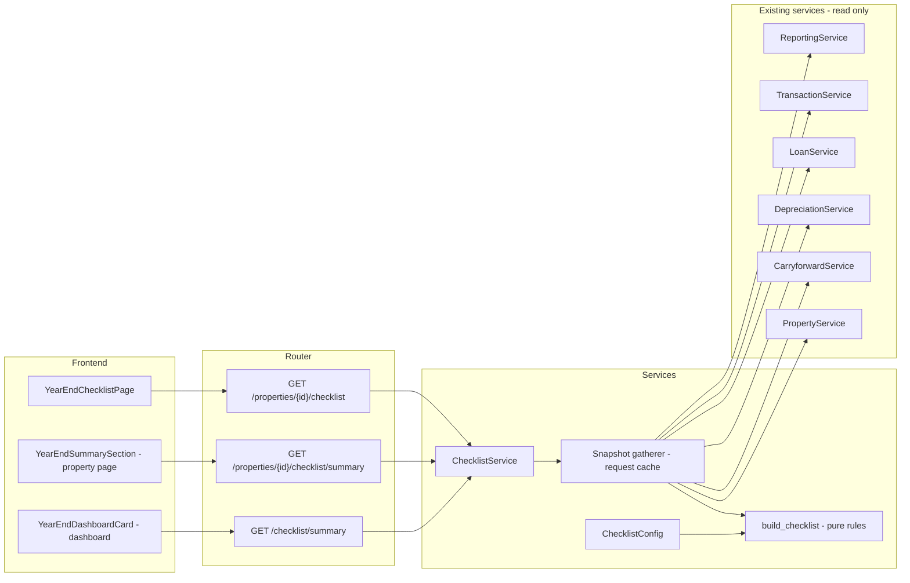
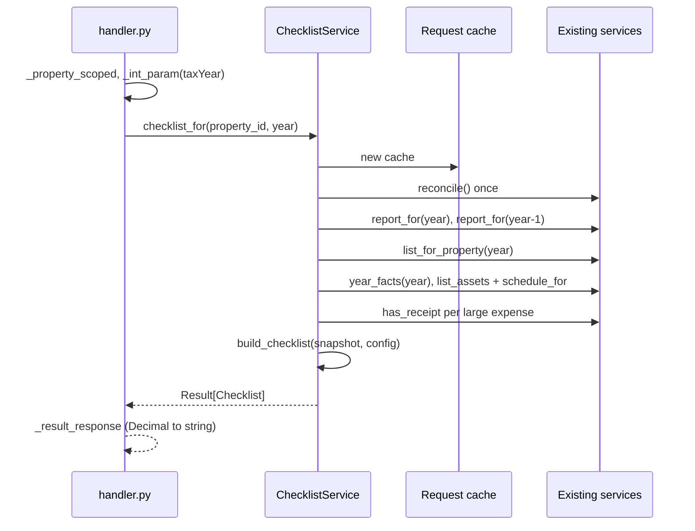

# Design Document

## Overview

The Year-end checklist answers "am I ready to file?" for one property and one tax year. It reads data Logstead already holds, evaluates eleven fixed checks, and returns each check as `done`, `needs_attention`, or `not_applicable` with a one-sentence reason and a link to the page that fixes it. It writes nothing and stores nothing.

The design rests on three rules.

1. **Rules are pure functions of a snapshot.** A thin gatherer reads existing services once per request and builds an immutable `YearSnapshot`. Eleven pure rule functions turn the snapshot and the `ChecklistConfig` into `ChecklistItem`s. All status logic, thresholds and reason text live in the pure layer, so it can be tested with generated data and no database.
2. **One builder serves every route.** The Checklist route, the property summary route and the dashboard summary route all call the same builder. Counts therefore agree by construction (Requirement 15.5).
3. **No rule is restated.** Line totals come from `ReportingService.report_for`. The entered-total versus itemized comparison comes from `LineAccumulator`. Carryforward status comes from `CarryforwardService.reconcile`. Loan facts come from `LoanService`. The checklist compares and counts; it never recomputes a precedence or tolerance rule.

### Design decisions and rationale

1. **Pure rules plus a snapshot gatherer.** Alternative: let each rule call its service. That would make every rule need a database to test, would read the same upstream data several times, and would make the "read once per request" requirement (4.8) a matter of discipline. The snapshot makes it structural.
2. **Three small read seams on existing services, one extracted pure function.** The public APIs do not expose what three items need (see "Reuse and the seams added"). Each seam is a read, has no side effect, and is covered by the existing service tests plus new ones.
3. **Frontend files use a `YearEnd` prefix.** The dashboard already has an unrelated onboarding "Get set up" card whose files are `ChecklistCard.tsx`, `components/dashboard/checklist.ts` and `lib/checklistStorage.ts`. New files are named `YearEnd*` or live in `components/year-end-checklist/`, and the new dashboard card has the heading "Year-end checklist", so nothing collides by name or by accessible name.
4. **Query parameter is `taxYear`.** Every existing route reads `taxYear` (`_list_transactions`, `_itemized_summary`, `_dashboard_*`), and `_int_param` applies the 1900 to 2200 range check only when the name is `"taxYear"` (`handler.py` line 349). Requirements 15.1, 15.3, 15.4 and 16.4 use `taxYear` for this reason. Response bodies keep `tax_year`, as the itemized summary does.
5. **Swing percent is compared after rounding to one decimal.** Requirement 13.6 quantizes the percentage to one decimal place. The comparison uses the quantized value, so the number the user sees is the number that was compared. An exact comparison would list a line as "49.9%" at a 50% threshold, or show "50.0%" without flagging it.
6. **The dashboard card uses the dashboard's displayed year.** The dashboard has no tax-year selector today. It shows the latest Data_Year from the trends series (`latestYear` in `DashboardPage.tsx`). The card takes a `taxYear` prop with that value and reloads when it changes. No new year selector is added (approved).
7. **`year` is honored by the pages the links open.** Only the Repairs page reads a `year` search parameter today. `TransactionsPage` and `ReportsPage` initialize their year state to the latest completed year and ignore the URL. Links to those pages would land on the wrong year, so both pages gain a small initializer that reads a valid `?year=`. The shared `parseYearParam` and the two initializers are added by whichever of this spec or `ui-polish` lands first; the other reuses them (add if absent, reuse if present). Assets, Loans and Carryforward are not year-scoped views, so their links carry no year.
8. **Receipt presence is one limited query per candidate.** `TransactionService.list_receipts` calls S3 (`purge_if_oversized`) and issues presigned URLs, so it cannot be used (Requirement 2.4). A new `has_receipt` seam runs one `Limit=1` query on the `#DOC#` prefix, the same prefix `_receipt_items` uses.
9. **Portfolio carryforward is read once per request.** `reconcile()` derives every year for every property, so it is the most expensive upstream read. Each public service method reads it once and passes it into every per-property build.
10. **Per-request memo of reports.** A property summary over five years needs six reports (each year plus the prior year of the oldest), because the prior-year report of year Y is the current-year report of year Y-1. A request-scoped dictionary keyed by `(property_id, year)` removes the duplicates.
11. **A public hook for the accountant package.** The `accountant-package` spec imports `logstead.services.checklist.provider_for(wiring, user)` at run time. The function lives next to `ChecklistService`, builds the service through a new public alias `build_checklist_service` of the router's `_checklist_service` (imported lazily inside the function to avoid an import cycle), and returns the service as a `ChecklistProvider`. The exact name and parameters match `.kiro/specs/accountant-package/design.md`, so that design needed no signature change. The alternative of having the package build `ChecklistService` itself would make it depend on the checklist's constructor and on router internals.

### Research notes (grounded in the codebase)

- **Report is the single total path.** `ReportingService.report_for(property_id, tax_year)` returns `ScheduleEReport` with `lines` (every Schedule E line 3 to 19 including 18, each `ReportLine` carrying `kind` of `"income"` or `"expense"`, `total`, `includes_imported`) and `line12: Line12Detail(source, superseded_manual_interest(amount, count))`. It catches `StoredLoanError` and returns a `conflict` `Result` (`report.py` lines 521 to 564). Line 12 source is `"loan-generated"` only when included-loan effective interest is greater than `0.00` (`report.py` lines 835 to 851).
- **Itemized rule.** `LineAccumulator.resolve()` yields `LineResolution(line_total, source, entered_total, entered_total_rows, itemized_sum, itemized_count, remainder, total_imported)`. `remainder` is `None` without an entered total and negative when entries exceed it. `ItemizedExpenseService.summary` already assembles this for one category but re-reads transactions; the checklist needs the same result from its already-loaded list.
- **Transactions.** `TransactionService.list_for_property(property_id, tax_year)` reads the GSI2 year partition and drops `#DOC#` rows. Receipt rows carry no GSI2 keys (`document_to_item`), so a year listing never contains receipts. `Transaction` has `imported`, `itemized`, `created_at`, `updated_at`, all optional-safe in `_from_item`.
- **Timestamps.** `create` sets `created_at = updated_at = now`. `update` uses `replace(existing, ...)`, so `created_at` is preserved and `updated_at` is refreshed; `imported` and `itemized` come from the stored row (`transaction.py` lines 286 to 303). Schedule E import creates its rows through `TransactionService.create` (`schedule_e_import.py` line 289), so an untouched imported row has equal timestamps. `attach_receipt` writes only the document row, so attaching a receipt does not change `updated_at`.
- **Carryforward.** `reconcile()` returns `ReconciliationSummary(years, opening_balance, has_data, next_year, next_year_expected_carry_in, status_tolerance)`. Each `ReconciledYear` has `status` in `ok | mismatch | carried | unreported`, `reported_carryforward`, `expected_carry_in`, `drift`, `carried_from_year`. It sums `report_for` over all properties per Data_Year and treats a failed report as `0.00`.
- **Loans.** `LoanService.list_loans` returns `LoanView`s and projects every schedule. The cheap per-year facts (effective interest, whether an override exists, anchor date, `include_in_report`) live in rollup rows and loan items but are only exposed through private helpers (`_included_rollups`) and through `property_effective_interest_for_year` (a sum). Strict readers raise `StoredLoanError`.
- **Data_Years.** `derive_data_years(properties, transactions, depreciation, loans)` returns ascending years capped at `latest_tax_year()` (the prior calendar year). The summary route reuses it with a one-element property list.
- **Routing.** `_property_scoped` proves ownership before the handler runs and returns the same 404 for a missing and a foreign property. `_check_path_ids` runs before the handler for every route. `/properties/{propertyId}/checklist` (3 segments), `/properties/{propertyId}/checklist/summary` (4 segments) and `/checklist/summary` (2 segments) have a literal `checklist` segment, so they cannot be captured by an existing template. The SAM template routes everything through `ANY /{proxy+}`, so infrastructure needs no change.
- **Frontend.** `PropertySection` (breadcrumb, `PageHeader`, `PropertySectionTabs` from `PROPERTY_NAV`), `useAsyncResource` (`resetKeys`, `deps`, `reload`), `useFirstLoad`, `StateBlock`, `Badge`, `ResponsiveTable`, `usePropertyYearRange`. `sectionFromPath` derives known sections from `PROPERTY_NAV`, so the property switcher keeps the Checklist section once the nav entry exists. `pages/pageConformance.test.ts` scans every file in `pages/` for `PageHeader` or `PropertySection`, a document title, and `useFirstLoad` plus `StateBlock` for load errors.

### Reuse and the seams added

| Need | Existing source | Gap | Seam added |
| --- | --- | --- | --- |
| Line totals, Line 12 source, superseded manual interest | `ReportingService.report_for` | none | none |
| Entered total, itemized sum, remainder for Repairs | `LineAccumulator` and `LineResolution` | `summary` re-reads transactions | `resolve_category_rows(transactions, category_id)` in `services/itemized.py`; `summary` calls it |
| Carryforward status and figures | `CarryforwardService.reconcile` | none | none |
| Loans: per-loan interest for the year, override present, anchor date, include flag | `LoanService` private rollup helpers | not public, `list_loans` projects schedules | `LoanService.year_facts(property_id, tax_year)` |
| Depreciation rows for the year | `DepreciationService.list_assets` and `schedule_for` | none | none |
| Receipt exists for a transaction, no S3 | `TransactionService._receipt_items` (private, unlimited) | `list_receipts` calls S3 | `TransactionService.has_receipt(property_id, transaction)` |
| Data_Years of one property | `derive_data_years` | none | none |

## Architecture



### Request flow for one Checklist



### The eleven items and their rules

The order below is the fixed response order. "Source" names the existing output each rule reads.

| # | Item_Id | Title | Source | `done` | `needs_attention` | `not_applicable` | Link |
| --- | --- | --- | --- | --- | --- | --- | --- |
| 1 | `income_entered` | Income entered | report lines with `kind == "income"` | sum of income totals > 0.00 | sum = 0.00 | never | Transactions, year |
| 2 | `expenses_entered` | Expenses entered | report expense lines except 18 | any total > 0.00 | all 0.00 | never | Transactions, year |
| 3 | `depreciation_present` | Depreciation reflected | assets with a schedule row in the year; report line 18 | rows exist and line 18 > 0.00 | rows exist and line 18 = 0.00 | no asset has a row | Assets |
| 4 | `line12_source` | Mortgage interest source | `report.line12` and `report.line(12)`; Applicable_Loan count | loan-generated with 0 superseded, or entered with line 12 > 0.00 | loan-generated with superseded > 0, or entered with 0.00 and at least one Applicable_Loan | entered with 0.00 and no Applicable_Loan | Loans if loan-generated or an Applicable_Loan exists, else Transactions, year |
| 5 | `loan_interest_confirmed` | Loan interest confirmed | `LoanYearFact`s | every evaluated loan has an override or a recent anchor | at least one evaluated loan has neither | line 12 source is not loan-generated | Loans |
| 6 | `carryforward_reconciled` | Carryforward reconciled | `ReconciledYear` | status `ok` | `mismatch`, `carried`, or `unreported` with expected carry-in > 0.00 | no row for the year, or `unreported` with expected carry-in 0.00 | Carryforward |
| 7 | `repairs_exceed_total` | Itemized repairs within the entered total | `resolve_category_rows(txns, "repairs")` | entered total and at least one entry and remainder >= 0.00 | entered total and remainder < 0.00 | no entry or no entered total | Repairs, year |
| 8 | `repairs_capital_candidates` | Large repairs to review | Repairs entries | entries exist, none >= Capital_Candidate_Amount | at least one entry >= Capital_Candidate_Amount | no entries | Assets (details link to Repairs, year) |
| 9 | `receipts_missing` | Receipts on large expenses | expense transactions, not imported, amount >= Large_Entry_Amount | all evaluated have a receipt | at least one lacks a receipt | none evaluated | Transactions, year |
| 10 | `yoy_swings` | Year-over-year changes | report and prior-year report | prior year has data and no swing line | at least one swing line | every prior-year line total is 0.00 | Reports, year |
| 11 | `imported_values_edited` | Imported values unchanged | imported transactions in the year | imported rows exist and none edited | at least one edited | no imported row | Transactions, year |

Details of rules whose wording in the requirements leaves a choice:

- **Anchor window (item 5).** For tax year `Y`, the window is the closed date range from the date `N` months before December 31 of `Y` through December 31 of `Y`, where `N` is Anchor_Max_Age_Months. With `N = 12` the window starts on December 31 of `Y-1`. Month subtraction clamps the day to the target month's length. An anchor dated after December 31 of `Y` is outside the window; such a loan can only have interest for `Y` through an override, which already counts as confirmed. A loan is *evaluated* when `include_in_report` is true and its effective interest for the year is greater than `0.00`.
- **Edited-after-import (item 11).** A transaction is edited when `updated_at` and `created_at` both parse with `datetime.fromisoformat` and `updated_at > created_at`. A missing, unparseable, or naive-versus-aware pair counts as not edited. Strings are not compared directly, because `datetime.isoformat()` omits the fraction when microseconds are zero.
- **Swing (item 10).** For each line with prior total `p` and current total `c`: `change = c - p`; `pct = quantize(abs(change) * 100 / p, 0.1, ROUND_HALF_UP)` when `p > 0`, else `None`. The line is a swing when `abs(change) >= Swing_Minimum_Amount` and (`p == 0` or `pct >= Swing_Percent`).
- **Receipts (item 9).** Candidates are transactions with `type == "expense"`, `imported == False`, and `amount >= Large_Entry_Amount`. Itemized entries qualify because they are ordinary expense rows. `has_receipt` runs once per candidate.
- **Applicable loans (item 4).** An Applicable_Loan is a `LoanFact` with `include_in_report` true and `anchor_date` on or before December 31 of the tax year (ISO date strings compare correctly). A `transaction-entered` Line 12 of `0.00` is flagged only when at least one Applicable_Loan exists. A loan anchored after the tax year or excluded from the report neither flags the item nor makes it a Loans link. `applicable_loan_count` is a pure function of the snapshot's `loans` and the tax year.

### Backup restore and Undo re-create and the edited-after-import check

The edited-after-import item depends on `created_at` and `updated_at`. Both flows were checked against the code.

| Flow | What happens to `imported`, `created_at`, `updated_at` | Effect on item 11 |
| --- | --- | --- |
| Backup export then restore | `BackupService` copies `created_at`, `updated_at` and `imported` from the stored transaction into the document (`backup.py` lines 892 to 895) and writes them back verbatim on restore (lines 1160 to 1163). | An edited imported row stays edited and an untouched one stays untouched. Property 15 asserts this. |
| Restore of a document without timestamps or without `imported` | Missing timestamps restore as `None`. A missing `imported` restores as `False`. | Rows without both timestamps count as not edited (false negative). Rows restored as `imported = False` are not evaluated at all. Both cases pre-date the markers and cannot be recovered. |
| Undo of a delete (`useUndoableDelete`) | The create API re-creates the row with a new id, `created_at = updated_at = now`, and `imported = False` (the generic router never reads `imported`). `isTransactionSafeDelete` returns false for `imported` rows (`undoMappers.ts` line 23), so an imported row is never offered Undo. | No imported row can be re-created with fresh timestamps by Undo. A re-created user row is not evaluated by item 11. |
| Undo on the Repairs page (sync or set total) | `setTotal(previousAmount)` calls `TransactionService.update`, which keeps `imported` and `created_at` and sets a new `updated_at`. | An imported total that was edited stays edited, even if the amount is set back to the filed figure. The original filed amount is not stored, so the checklist cannot compare amounts. |
| Remove of an imported total | The Repairs page uses a confirm dialog and offers no Undo for imported rows. | Not applicable. |
| Schedule E re-import | `ImportService` deletes the imported rows for the (property, year) and creates new ones. | The new rows have equal timestamps, so the item returns to `done`. The Reason text says so (Requirement 14.7). |
| Receipt attach or delete | Writes only `#DOC#` rows. | No effect on `updated_at`. |

## Components and Interfaces

### Backend

**`services/checklist_config.py`** (new)

```python
@dataclass(frozen=True)
class ChecklistConfig:
    large_entry_amount: Decimal = Decimal("250.00")
    capital_candidate_amount: Decimal = Decimal("2500.00")
    swing_percent: Decimal = Decimal("50")
    swing_minimum_amount: Decimal = Decimal("500.00")
    anchor_max_age_months: int = 12
    summary_year_count: int = 5
    def __post_init__(self) -> None: ...   # raises ChecklistConfigError

class ChecklistConfigError(ValueError): ...

CHECKLIST_CONFIG = ChecklistConfig()      # constructed at import: invalid defaults fail on load
```

`__post_init__` rejects a non-`Decimal` money or percent value (including `float`), a money threshold below `0.00`, a `swing_percent` of `0` or less, and a month or year count below `1`. The money thresholds are quantized to two places. `ChecklistConfig.applied()` returns the echo object used in the response (money as `Decimal` with two places, `swing_percent` as given). It is the only place the six numbers appear in backend code; a source-scan test checks that no other `services/` module contains them as literals.

**`services/checklist.py`** (new)

```python
ItemId = Literal["income_entered", "expenses_entered", "depreciation_present",
                 "line12_source", "loan_interest_confirmed", "carryforward_reconciled",
                 "repairs_exceed_total", "repairs_capital_candidates", "receipts_missing",
                 "yoy_swings", "imported_values_edited"]
ITEM_IDS: tuple[ItemId, ...]                       # fixed response order
Status = Literal["done", "needs_attention", "not_applicable"]

@dataclass(frozen=True)
class ChecklistItem:
    id: ItemId; title: str; status: Status; reason: str; link: str
    details: dict[str, Any] | None = None

@dataclass(frozen=True)
class ChecklistCounts:
    done: int; needs_attention: int; not_applicable: int; total: int

@dataclass(frozen=True)
class Checklist:
    property_id: str; tax_year: int
    items: tuple[ChecklistItem, ...]; counts: ChecklistCounts
    thresholds: AppliedThresholds

@dataclass(frozen=True)
class ChecklistSummary:           # one year
    tax_year: int; counts: ChecklistCounts

@dataclass(frozen=True)
class PropertyChecklistSummary:   # property page
    property_id: str; years: tuple[ChecklistSummary, ...]       # newest first

@dataclass(frozen=True)
class PropertyChecklistRow:       # dashboard card row
    property_id: str; property_name: str; counts: ChecklistCounts

@dataclass(frozen=True)
class PortfolioChecklistSummary:
    tax_year: int; properties: tuple[PropertyChecklistRow, ...]
```

Pure layer, no I/O:

```python
@dataclass(frozen=True)
class LoanFact:                    # mirrors LoanYearFact, kept separate so rules import no service
    loan_id: str; description: str; anchor_date: str
    include_in_report: bool; interest: Money; has_override: bool

@dataclass(frozen=True)
class YearSnapshot:
    property_id: str
    tax_year: int
    report: ScheduleEReport
    prior_report: ScheduleEReport
    transactions: tuple[Transaction, ...]
    repairs: CategoryRows
    assets_with_rows: int
    loans: tuple[LoanFact, ...]
    carryforward: ReconciledYear | None
    status_tolerance: Money
    receipt_present: Mapping[str, bool]     # transaction id -> has a receipt, candidates only

def receipt_candidates(txns, config) -> list[Transaction]: ...   # used by gatherer and rule
def is_large_entry(amount, config) -> bool: ...                  # amount >= large_entry_amount
def is_capital_candidate(amount, config) -> bool: ...
def swing_for(prior: Money, current: Money, config) -> SwingLine | None: ...
def anchor_is_recent(anchor_date: str, tax_year: int, config) -> bool: ...
def recent_years(data_years: Iterable[int], count: int) -> list[int]: ...
def is_edited(txn: Transaction) -> bool: ...
def build_counts(items) -> ChecklistCounts: ...
def build_checklist(snapshot: YearSnapshot, config: ChecklistConfig) -> Checklist: ...
```

`build_checklist` calls eleven private rule functions in `ITEM_IDS` order. Each is `_rule_<id>(snapshot, config) -> ChecklistItem`. Adding a twelfth item is one function plus one entry in `ITEM_IDS`.

Reason text conventions:

- Money is formatted `$1,250.00` (two decimals). Percent is written without trailing zeros (`50`, `62.5`).
- Every threshold-dependent Reason interpolates the value from the `ChecklistConfig` argument, never a literal.
- Reasons for items 8 and 10 are worded as "review" prompts. Item 8 says "You decide whether each is a repair or an improvement." Item 10 says "Review these changes for a typing error or a missing entry." Neither says an entry is or is not a capital improvement or that a change is wrong.
- The carryforward Reason always ends with "This item covers all properties and is the same on every property's checklist. Status tolerance: $2.00." The `$2.00` is read from `ReconciliationSummary.status_tolerance`, not from the config.
- The edited-imports Reason always includes "Re-importing a Schedule E for this year replaces imported values."

Gatherer and service:

```python
class ChecklistService:
    def __init__(self, reports: ReportingService, transactions: TransactionService,
                 depreciation: DepreciationService, loans: LoanService,
                 properties: PropertyService, carryforward: CarryforwardService,
                 config: ChecklistConfig = CHECKLIST_CONFIG) -> None: ...

    def checklist_for(self, property_id: str, tax_year: int | None) -> Result[Checklist]: ...
    def property_summary(self, property_id: str) -> Result[PropertyChecklistSummary]: ...
    def portfolio_summary(self, tax_year: int | None) -> Result[PortfolioChecklistSummary]: ...
```

The hook for the accountant package (Requirement 24):

```python
class ChecklistProvider(Protocol):
    def checklist_for(self, property_id: str, tax_year: int) -> Result[Checklist]: ...

def provider_for(wiring: Any, user: UserContext | str) -> ChecklistProvider:
    """Return a read-only provider for ``user``. Raises when a collaborator cannot be built."""
    from logstead.router.handler import build_checklist_service   # lazy: avoids a router import cycle
    return build_checklist_service(wiring, user)
```

`ChecklistService` already satisfies the `ChecklistProvider` protocol, so the hook returns it directly. `provider_for` reads nothing until `checklist_for` runs. `build_checklist_service` is a public alias of `_checklist_service` in `router/handler.py`, added next to the other public wiring aliases that the accountant package introduces (`get_wiring`, `to_jsonable`, `build_package_service`); whichever spec lands first creates the alias, and the other reuses it.

Each public method creates a `_RequestCache` and passes it down:

```python
class _RequestCache:
    reconciliation: ReconciliationSummary | None     # filled on first use
    reports: dict[tuple[str, int], ScheduleEReport]  # (property_id, year)
    def report(self, property_id, year) -> Result[ScheduleEReport]: ...   # calls report_for once
    def reconcile(self) -> ReconciliationSummary: ...                     # calls reconcile once
```

Behavior of the gatherer for `(property_id, year)`:

1. `report` and `prior_report` through the cache. A failed `Result` is returned unchanged (Requirement 15.8). A corrupt stored loan surfaces here first as the existing `conflict`.
2. `transactions = list_for_property(property_id, year)` once; `repairs = resolve_category_rows(transactions, "repairs")`.
3. `candidates = receipt_candidates(transactions, config)`; `receipt_present = {t.id: transactions_service.has_receipt(property_id, t) for t in candidates}`.
4. `assets_with_rows` counts assets from `list_assets` that have a `schedule_for` row with `tax_year == year`.
5. `loans = year_facts(property_id, year)`; a `StoredLoanError` becomes `Result.failure("conflict", "Stored loan has an invalid {field} value.", field)`, identical to `report_for`.
6. `carryforward` is the `ReconciledYear` for `year` from the cached reconciliation, or `None`.
7. `build_checklist(snapshot, config)`.

`property_summary` derives the property's Data_Years with `derive_data_years([prop], transactions, depreciation, loans)`, takes `recent_years(years, config.summary_year_count)` (newest first), and builds each year's checklist through the shared cache, keeping only `counts`. `portfolio_summary` lists the user's properties once, defaults `tax_year` to `latest_tax_year()`, reads the reconciliation once, and builds one checklist per property. A property whose build fails fails the whole request (Requirement 15.8: no partial result).

**`services/itemized.py`** (modified, behavior-preserving)

```python
@dataclass(frozen=True)
class CategoryRows:
    resolution: LineResolution
    entries: tuple[Transaction, ...]
    total_rows: tuple[Transaction, ...]

def resolve_category_rows(transactions: Iterable[Transaction], category_id: str) -> CategoryRows: ...
```

It holds the loop currently inside `ItemizedExpenseService.summary` (filter by category, classify with `_is_entry`, feed `LineAccumulator`). `summary` calls it and keeps its response shape. The existing itemized property tests cover the equivalence.

**`services/loan.py`** (modified, additive)

```python
@dataclass(frozen=True)
class LoanYearFact:
    loan_id: str; description: str; anchor_date: str
    include_in_report: bool
    interest: Money            # Effective_Interest for the year, 0.00 when no rollup
    has_override: bool         # rollup carries an interest override

def year_facts(self, property_id: str, tax_year: int) -> list[LoanYearFact]: ...
```

`year_facts` reads the loan items (`loan_list_prefix`, skipping year rows) and the year's rollups (GSI2, all rollups, not only included ones), joins on loan id, and raises `StoredLoanError` through the existing strict parsers. It projects no schedule and writes nothing. It returns every loan, so the rules can answer "does the property have a loan" (item 4) and "which included loans have interest" (item 5) from one list.

**`services/transaction.py`** (modified, additive)

```python
def has_receipt(self, property_id: str, transaction: Transaction) -> bool:
    """True when at least one receipt metadata row exists. One Limit=1 query, no S3."""
```

It builds the same prefix as `_receipt_items` and calls `self._repo.query(pk, sk_begins_with=prefix, limit=1)`.

**`router/handler.py`** (modified)

- `build_checklist_service = _checklist_service` is a public alias used by `provider_for`.
- `_checklist_service(wiring, user)` builds `ChecklistService` from the same collaborators `_carryforward_service_or_503` and `_reporting_service` use, so the three upstream services share one wiring path.
- `_year_param(query)` returns `_int_param(query["taxYear"], "taxYear")` when present and `None` otherwise.
- Three handlers, two of them `@_property_scoped`:

| Method and path | Handler | Guard | Success |
| --- | --- | --- | --- |
| `GET /properties/{propertyId}/checklist?taxYear=YYYY` | `_property_checklist` | `_property_scoped` | 200 `Checklist` |
| `GET /properties/{propertyId}/checklist/summary` | `_property_checklist_summary` | `_property_scoped` | 200 `PropertyChecklistSummary` |
| `GET /checklist/summary?taxYear=YYYY` | `_portfolio_checklist_summary` | user scope through `PropertyService.list()` | 200 `PortfolioChecklistSummary` |

- `taxYear` omitted: the service uses `latest_tax_year()`.
- The 2-segment `/checklist/summary` route has no `{...}` segment. It is added next to the dashboard routes.
- Link construction happens in the service from the validated property id and year only: `/properties/{property_id}/{segment}` plus `?year={year}` for year-aware segments (`transactions`, `repairs`, `reports`), and `/carryforward` for item 6.

**Not changed:** `ReportingService`, `LineAccumulator`, `CarryforwardService`, the loan schedule engine, the Schedule E parser, the SAM template, the DynamoDB key design.

### Frontend

**Navigation and routing**

- `navConfig.ts`: append `{ segment: "checklist", label: "Checklist" }` to `PROPERTY_NAV`. `sectionFromPath` and the property switcher then keep the section and carry `year` (`propertySwitch.ts` needs no change). `navConfig.test.ts`, `PropertySectionTabs.test.tsx` and `propertySwitch` tests that list the nav entries are updated.
- `routes.tsx`: add `{ path: "checklist", element: <YearEndChecklistPage /> }` under `properties/:propertyId` and add the path to the route comment.

**API module `api/yearEndChecklist.ts`** (new): `YearEndChecklistApi` with an injectable `ApiClient`, like `ItemizedApi`: `getChecklist(propertyId, taxYear, signal?)`, `getPropertySummary(propertyId, signal?)`, `getPortfolioSummary(taxYear, signal?)`, and a shared `yearEndChecklistApi` instance. Query parameter `taxYear`. Types mirror the response shapes under "Data Models".

**Pure helpers `components/year-end-checklist/yearEndText.ts`** (new)

| Function | Behavior |
| --- | --- |
| `orderItems(items)` | Stable partition: `needs_attention` first, then the rest, each group in server order. |
| `countsText(counts)` | `"3 need attention, 6 done, 2 not applicable"`; singular `"1 needs attention"`. |
| `summaryHeadline(counts)` | `"3 need attention"`, or `"All clear"` when `needs_attention == 0` and `done >= 1`, or `"Nothing to check"` when `done == 0` and `needs_attention == 0`. |
| `statusLabel(status)` | `"Done"`, `"Needs attention"`, `"Not applicable"`. |
| `linkLabel(link)` | Destination name from the link path: the matching `PROPERTY_NAV` label for a property segment, `"Carryforward"` for `/carryforward`. |

**Components `components/year-end-checklist/`** (new)

| Unit | Responsibility |
| --- | --- |
| `YearEndStatusBadge.tsx` | `Badge` with an icon from `components/ui/icons` and the status text. Color comes from semantic tokens and is never the only cue. |
| `YearEndItemRow.tsx` | One list item: title, status badge, reason, destination link with `aria-label` `"{linkLabel}: {title}"`, and a `<details>` disclosure for `details`. |
| `YearEndItemDetails.tsx` | Renders `details` by `item.id`: a `ResponsiveTable` for row lists (loans, flagged entries, swing lines, edited rows), a `dl` for scalar details. Money goes through `formatMoney`. |
| `YearEndSummarySection.tsx` | Property page section. Loads `getPropertySummary` through `useAsyncResource`, one row per year with `summaryHeadline`, the done and not-applicable counts, and a link to `/properties/{id}/checklist?year={year}`. Skeleton on first load, previous content kept on reload, `StateBlock` error with retry, empty state linking to Transactions. |
| `YearEndDashboardCard.tsx` | Dashboard card titled "Year-end checklist". Props: `taxYear: number | null`. Loads `getPortfolioSummary(taxYear)` on its own `useAsyncResource`, omitted when the user has no property, error state with retry inside the card. |
| `YearEndDisclaimer.tsx` | `role="note"` block in the style of `DisclaimerNotice`: "This checklist is a reminder aid, not tax advice. It checks that your records in Logstead are complete and consistent. It does not tell you what to report." |

**Page `pages/YearEndChecklistPage.tsx`** (new): `PropertySection` with title "Year-end checklist", then the disclaimer, a year `Select` (`id="year-end-year"`, label "Tax year") fed by `usePropertyYearRange(propertyId, [])`, the counts text in a `role="status"` `aria-live="polite"` region, a `StateBlock` for loading and error, and a `<ul>` of `YearEndItemRow`s ordered by `orderItems`. The year defaults to `parseYearParam(searchParams.get("year")) ?? latestCompletedTaxYear()` when that year is in the offered range, and is written back to the `year` search parameter on change. The page has no mutating control. It uses `useFirstLoad` with the property id as `resetKey`.

**Existing pages changed**

- `PropertyDetailPage.tsx`: render `<YearEndSummarySection propertyId={propertyId} />` as a section below the tile grid. A failure inside it does not affect the tiles.
- `DashboardPage.tsx`: render `<YearEndDashboardCard taxYear={...} />` in the card grid. `taxYear` is `latestYear?.tax_year` once trends have loaded, `latestCompletedTaxYear()` when trends failed, and `null` while trends are loading (the card shows its own skeleton). The card's load does not depend on the trends or summary requests (Requirement 18.6).
- `TransactionsPage.tsx` and `ReportsPage.tsx`: initialize `taxYear` from a valid `?year=` through `parseYearParam` in `lib/taxYears.ts` (a canonical decimal integer from 1900 through 2200, else `null`), falling back to `latestCompletedTaxYear()`. The helper and the initializers are conditional: add them if absent, reuse them if the `ui-polish` work already added them. The `ui-polish` spec states the same rule. The page does not write the parameter back.
- `e2e/a11y.spec.ts` and `e2e/fixtures.ts`: add the route and API stubs.
- `docs/api.md`, `docs/data-model.md`, `docs/developer-guide.md`, `CHANGELOG.md` per Requirement 23.

## Data Models

### Stored data

None. No new item type, key, GSI, attribute, or table. The checklist reads existing items: transactions (`TXN#` rows through GSI2 and `#DOC#` prefix queries), loans and loan-year rollups, assets and schedule rows, carryforward entries (inside `reconcile`), and properties. `docs/data-model.md` gets one paragraph stating this and listing the reads per item.

### Response shapes (wire)

```json
// GET /properties/{id}/checklist?taxYear=2023
{
  "property_id": "7c1e...",
  "tax_year": 2023,
  "thresholds": {
    "large_entry_amount": "250.00",
    "capital_candidate_amount": "2500.00",
    "swing_percent": "50",
    "swing_minimum_amount": "500.00",
    "anchor_max_age_months": 12,
    "summary_year_count": 5
  },
  "counts": { "done": 6, "needs_attention": 3, "not_applicable": 2, "total": 11 },
  "items": [
    { "id": "income_entered", "title": "Income entered", "status": "done",
      "reason": "Income of $24,000.00 is entered for 2023.",
      "link": "/properties/7c1e.../transactions?year=2023",
      "details": { "income_total": "24000.00" } },
    { "id": "receipts_missing", "title": "Receipts on large expenses", "status": "needs_attention",
      "reason": "2 of 9 expenses of $250.00 or more have no receipt attached.",
      "link": "/properties/7c1e.../transactions?year=2023",
      "details": { "missing_count": 2, "evaluated_count": 9, "shown_count": 2,
                   "transactions": [ { "id": "t9", "date": "2023-08-02", "category": "Insurance",
                                       "description": "Policy renewal", "amount": "1200.00" } ] } }
  ]
}
```

```json
// GET /properties/{id}/checklist/summary
{ "property_id": "7c1e...",
  "years": [ { "tax_year": 2023, "counts": { "done": 6, "needs_attention": 3, "not_applicable": 2, "total": 11 } },
             { "tax_year": 2022, "counts": { "done": 8, "needs_attention": 0, "not_applicable": 3, "total": 11 } } ] }

// GET /checklist/summary?taxYear=2023
{ "tax_year": 2023,
  "properties": [ { "property_id": "7c1e...", "property_name": "12 Oak St",
                    "counts": { "done": 6, "needs_attention": 3, "not_applicable": 2, "total": 11 } } ] }
```

`swing_percent` is a non-money `Decimal`, serialized by `_to_jsonable` as its plain string. Every money value is a two-decimal string because it passes through `to_money` before it enters a response object.

### `details` by item

| Item_Id | `details` keys |
| --- | --- |
| `income_entered` | `income_total` |
| `expenses_entered` | `expense_total` (excludes line 18) |
| `depreciation_present` | `assets_with_schedule_rows` (int), `line_18_total` |
| `line12_source` | `source`, `line_12_total`, `superseded_count` (int), `superseded_amount` |
| `loan_interest_confirmed` | `loans`: list of `{ loan_id, name, confirmed (bool), anchor_date, interest }` for each evaluated loan |
| `carryforward_reconciled` | `status`, `reported_carry_in` (nullable), `expected_carry_in`, `drift` (nullable), `carried_from_year` (nullable int), `status_tolerance` |
| `repairs_exceed_total` | `entered_total` (nullable), `itemized_sum`, `remainder` (nullable), `line_source` |
| `repairs_capital_candidates` | `flagged_count`, `entries`: list of `{ id, date, description, amount, link }` where `link` is the Repairs page for the year |
| `receipts_missing` | `missing_count`, `evaluated_count`, `shown_count`, `transactions` (at most 25: `{ id, date, category, description, amount }`) |
| `yoy_swings` | `swing_count`, `lines`: list of `{ line, label, prior_total, current_total, change (signed), percent (null when the prior total is 0.00) }`, swing lines only |
| `imported_values_edited` | `edited_count`, `edited`: list of `{ id, schedule_e_line, amount, updated_at }` |

The 25-entry cap on `receipts_missing.transactions` is a display limit (`MAX_RECEIPT_DETAILS`, a module constant of `checklist.py`), not a threshold, so it is not part of the `ChecklistConfig`. `missing_count` always carries the full count.

### Frontend types

```ts
type ChecklistStatus = "done" | "needs_attention" | "not_applicable";
interface ChecklistCounts { done: number; needs_attention: number; not_applicable: number; total: number }
interface ChecklistItem { id: string; title: string; status: ChecklistStatus; reason: string; link: string; details?: Record<string, unknown> | null }
interface YearEndChecklist { property_id: string; tax_year: number; thresholds: Record<string, string | number>; counts: ChecklistCounts; items: ChecklistItem[] }
interface PropertyChecklistSummary { property_id: string; years: { tax_year: number; counts: ChecklistCounts }[] }
interface PortfolioChecklistSummary { tax_year: number; properties: { property_id: string; property_name: string; counts: ChecklistCounts }[] }
```

`details` stays loosely typed on the wire. `YearEndItemDetails` narrows it per `item.id` with small type guards and renders nothing for a shape it does not recognize, so an unknown `details` can never break the page.

## Correctness Properties

*A property is a characteristic or behavior that should hold true across all valid executions of a system-essentially, a formal statement about what the system should do. Properties serve as the bridge between human-readable specifications and machine-verifiable correctness guarantees.*

Reflection note: the prework produced one property per rule group instead of one per criterion. Criteria 1.1 to 1.5 became the shape property. Criteria 5.1 to 5.5, 6.1 to 6.5, 7.1 to 7.7, 8.1 to 8.8, 9.1 to 9.10, 10.1 to 10.5, 11.1 to 11.6, 12.1 to 12.6, 13.1 to 13.8 and 14.1 to 14.6 each became one decision-table property, because each group states one function from inputs to a status. Criteria 15.9, 21.1 and 21.4 became the money-form property, and 2.1 and 2.4 became the read-only property. Threshold inclusivity (3.7) stays separate because Requirement 22.3 asks for it across three thresholds. The pure-rule properties run on generated `YearSnapshot`s and need no database. Properties 16 to 20 run the real services over moto. Route wiring, UI states, accessibility, documentation and the test-suite requirements (22, 23) are covered by example, smoke and integration tests in the Testing Strategy, not by properties.

### Property 1: Checklist shape, counts, and determinism

For any `YearSnapshot` (including snapshots with empty reports, no transactions, no loans and no assets) and any valid `ChecklistConfig`, `build_checklist` returns exactly one item per Item_Id in the fixed order, each with a non-empty `title`, `reason` and `link`, a `status` that is one of `done`, `needs_attention`, `not_applicable`, and `counts` whose three status counts equal the tallies of the items and sum to `total`. Building twice from the same snapshot and config yields equal results.

**Validates: Requirements 1.1, 1.2, 1.3, 1.4, 1.5, 1.6**

### Property 2: Applied thresholds are echoed and interpolated

For any valid `ChecklistConfig` and any snapshot, the response's `thresholds` equal the config values, and every Reason that depends on a threshold contains that threshold's value formatted as `$x,xxx.xx` (money) or without trailing zeros (percent, months). Specifically the receipts Reason contains the Large_Entry_Amount, the capital-candidate Reason contains the Capital_Candidate_Amount, and the swing Reason contains the Swing_Percent and Swing_Minimum_Amount.

**Validates: Requirements 1.7, 3.4**

### Property 3: Config validation

For any combination of values, constructing a `ChecklistConfig` succeeds if and only if every money threshold is a `Decimal` at or above `0.00`, `swing_percent` is a `Decimal` above `0`, and `anchor_max_age_months` and `summary_year_count` are integers at or above `1`; otherwise it raises `ChecklistConfigError`. Money thresholds are stored with two decimal places.

**Validates: Requirements 3.3, 3.6**

### Property 4: Threshold comparison is inclusive

For any threshold `T` of at least `0.01` and any amount `A` drawn from `T`, `T - 0.01`, `T + 0.01` and arbitrary two-decimal values, `is_large_entry(A)`, `is_capital_candidate(A)` and the Swing_Minimum_Amount test each return true if and only if `A >= T` for the matching configured threshold.

**Validates: Requirements 3.7, 11.2, 12.1, 13.3**

### Property 5: Income and expenses entered

For any set of report line totals (two-decimal, non-negative, including line 18), `income_entered` is `done` if and only if the sum of the `income` lines is greater than `0.00`, and `expenses_entered` is `done` if and only if at least one expense line other than line 18 is greater than `0.00`; otherwise each is `needs_attention`. A report whose only non-zero expense is line 18 yields `expenses_entered = needs_attention`. The `details` totals equal the exact `Decimal` sums, with the expense total excluding line 18.

**Validates: Requirements 5.1, 5.2, 5.3, 5.4, 5.5**

### Property 6: Depreciation present

For any count of assets with a schedule row and any line 18 total, `depreciation_present` is `not_applicable` when the count is `0`, `done` when the count is at least `1` and line 18 is greater than `0.00`, and `needs_attention` when the count is at least `1` and line 18 is `0.00`. `details` carry the count and the line 18 total.

**Validates: Requirements 6.1, 6.2, 6.3, 6.5**

### Property 7: Line 12 source

For any Line 12 source, superseded count and amount, line 12 total, and set of loans (each with an include flag and an anchor date), `line12_source` follows the decision table: loan-generated with count `0` is `done`; loan-generated with count above `0` is `needs_attention` and its Reason contains the count and the superseded amount; transaction-entered with a total above `0.00` is `done`; transaction-entered with `0.00` and no Applicable_Loan is `not_applicable`; transaction-entered with `0.00` and at least one Applicable_Loan is `needs_attention`. An Applicable_Loan has `include_in_report` true and an anchor date on or before December 31 of the tax year, so a loan anchored after the tax year or excluded from the report never changes the status. The link is Loans when the source is loan-generated or an Applicable_Loan exists, and Transactions otherwise. `details` carry the source, total, superseded count and superseded amount.

**Validates: Requirements 7.1, 7.2, 7.3, 7.4, 7.5, 7.6, 7.7**

### Property 8: Loan interest confirmed

For any Line 12 source, tax year, anchor-window length `N`, and set of loans (each with an include flag, effective interest, override flag and anchor date): the item is `not_applicable` when the source is not loan-generated. Otherwise the evaluated loans are exactly those with `include_in_report` true and interest above `0.00`, and the item is `done` if and only if every evaluated loan has an override or an anchor date in the closed window from `N` months before December 31 of the tax year through December 31 of the tax year; otherwise it is `needs_attention` and its Reason contains the number of unconfirmed loans. `details.loans` lists exactly the evaluated loans. An anchor exactly `N` months before year end is inside the window, and one day earlier is outside, including when the target month is shorter than the anchor day.

**Validates: Requirements 8.1, 8.2, 8.3, 8.4, 8.5, 8.6, 8.8**

### Property 9: Carryforward mapping

For any `ReconciledYear` (or `None`) and any status tolerance, `carryforward_reconciled` is `not_applicable` for `None`; `done` for `ok`; `not_applicable` for `unreported` with expected carry-in `0.00`; `needs_attention` for `unreported` with expected carry-in above `0.00`, for `mismatch`, and for `carried`. The Reason contains the expected carry-in (unreported), the reported carry-in, expected carry-in and drift (mismatch), or the `carried_from_year` (carried); it always states that the item is portfolio-level and contains the supplied tolerance. `details` carry the status and the amounts unchanged from the input. The rule performs no comparison of reported and expected amounts.

**Validates: Requirements 4.3, 9.1, 9.2, 9.3, 9.4, 9.5, 9.6, 9.7, 9.8, 9.10**

### Property 10: Itemized repairs versus the entered total

For any set of Repairs transactions (unmarked total rows and itemized entries with two-decimal amounts), `repairs_exceed_total` is `needs_attention` when a total exists and its remainder (entered total minus itemized sum) is below `0.00`, `done` when a total and at least one entry exist and the remainder is `0.00` or more, and `not_applicable` when there is no entry or no total. `details` carry the entered total, itemized sum, remainder and line source exactly as `LineAccumulator` resolves them, and the needs-attention Reason contains the overage `itemized sum - entered total`.

**Validates: Requirements 4.2, 10.1, 10.2, 10.3, 10.5**

### Property 11: Large Repairs entries to review

For any set of itemized Repairs entries and any `Capital_Candidate_Amount`, `repairs_capital_candidates` is `not_applicable` with no entries, `needs_attention` when at least one entry amount is at or above the threshold, and `done` otherwise. `details.flagged_count` and the `details.entries` ids equal exactly the entries at or above the threshold, and the Reason never states that an entry is or is not a capital improvement.

**Validates: Requirements 11.1, 11.2, 11.3, 11.4, 11.6**

### Property 12: Receipts on large expenses

For any list of transactions (income and expense, imported and not, with arbitrary amounts) and any receipt-presence map, the evaluated set is exactly the expense transactions that are not imported and have an amount at or above Large_Entry_Amount. `receipts_missing` is `not_applicable` when the evaluated set is empty, `needs_attention` when at least one evaluated transaction has no receipt, and `done` otherwise. `details.missing_count` equals the number lacking a receipt, `details.evaluated_count` equals the evaluated set size, and `details.transactions` holds at most 25 entries, all lacking a receipt.

**Validates: Requirements 12.1, 12.2, 12.3, 12.4, 12.5, 12.6**

### Property 13: Year-over-year swings

For any two sets of line totals (prior and current) and any config, a line is a swing if and only if `abs(current - prior) >= Swing_Minimum_Amount` and (`prior == 0.00` or the percentage `abs(change) * 100 / prior`, rounded half-up to one decimal place, is at or above `Swing_Percent`). `yoy_swings` is `not_applicable` when every prior total is `0.00`, `needs_attention` when at least one line is a swing, and `done` otherwise. `details.lines` lists exactly the swing lines with `change = current - prior` (signed), the one-decimal percentage, and `null` for the percentage when the prior total is `0.00`.

**Validates: Requirements 13.1, 13.2, 13.3, 13.4, 13.5, 13.6, 13.7, 21.3**

### Property 14: Imported values later edited

For any set of transactions with arbitrary `imported` flags and arbitrary `created_at` and `updated_at` values (valid, equal, reversed, missing, unparseable, naive and aware), the evaluated set is the imported transactions, and a transaction is edited if and only if both timestamps parse to comparable datetimes and `updated_at > created_at`. `imported_values_edited` is `not_applicable` with no imported transaction, `needs_attention` when at least one is edited, and `done` otherwise. `details.rows` lists exactly the edited transactions.

**Validates: Requirements 14.1, 14.2, 14.3, 14.4, 14.5**

### Property 15: Edited classification survives backup and restore

For any set of imported transactions with arbitrary valid timestamp pairs, exporting a backup and restoring it yields transactions whose edited classification (Property 14) is the same as before the export, for every row.

**Validates: Requirements 14.3, 14.4**

### Property 16: Details line totals equal the report

For any generated stored data (transactions across categories, loans, assets, itemized entries) for a property and tax year, run through the real `ReportingService` over moto, every line total that appears in any item's `details` (income total, expense total, line 18, line 12, the current-year totals of swing lines) equals the corresponding `ReportingService.report_for` line total, and the swing lines' prior totals equal the prior-year report's totals.

**Validates: Requirements 4.1, 4.7**

### Property 17: Counts agree across the three routes

For any generated stored data and any (property, tax year), the counts in the Checklist for that property and year equal the counts for that year in the property summary (when the year is among its Data_Years) and the counts for that property in the dashboard summary for that year.

**Validates: Requirements 15.5**

### Property 18: Upstream reads are shared within a request

For any request (single Checklist, property summary over any number of years, dashboard summary over any number of properties), `CarryforwardService.reconcile` is called exactly once, `ReportingService.report_for` is called at most once per (property, year), and `TransactionService.has_receipt` is called at most once per evaluated transaction and never for a transaction outside the evaluated set.

**Validates: Requirements 4.8, 12.7**

### Property 19: The checklist is read-only

For any generated stored data, running the Checklist, the property summary and the dashboard summary performs zero repository writes (`put_item`, `delete_item`, `transact_write`) and zero S3 calls of any kind, and the stored items are identical before and after.

**Validates: Requirements 2.1, 2.4**

### Property 20: Money values have the wire form

For any generated response, every money value (in `details` and in `thresholds`) matches `^-?\d+\.\d{2}$` after serialization, no money value is a JSON number, and every dollar amount written in a Reason has exactly two decimal places.

**Validates: Requirements 15.9, 21.1, 21.4**

### Property 21: Recent-year selection

For any set of Data_Years (including the empty set and sets with gaps) and any count `N >= 1`, `recent_years` returns `min(N, len(set))` distinct years in descending order, and every returned year is greater than or equal to every omitted year. An empty set returns an empty list.

**Validates: Requirements 15.2, 15.6**

### Property 22: Links embed only validated ids and the year

For any property id accepted by `_check_path_ids` and any tax year in range, every item link and every details link matches exactly one of `/properties/{id}/{segment}`, `/properties/{id}/{segment}?year={year}` with a segment from `transactions`, `repairs`, `reports`, `assets`, `loans`, or the literal `/carryforward`, and contains no other characters from the input.

**Validates: Requirements 10.4, 13.8, 14.6, 16.5**

### Property 23: Needs-attention items come first

For any list of checklist items, `orderItems` returns a permutation of the list in which every `needs_attention` item precedes every other item, and the relative order inside each group equals the input order.

**Validates: Requirements 19.5**

### Property 24: Counts text and headline

For any non-negative counts, `countsText` contains the three counts and the words "need attention", "done" and "not applicable", and `summaryHeadline` is "All clear" if and only if `needs_attention == 0` and `done >= 1`, and contains the needs-attention count otherwise.

**Validates: Requirements 17.2, 19.4**

## Error Handling

| Condition | Response | UI behavior |
| --- | --- | --- |
| Unknown property, or another user's property, on a property route | 404, identical body (`_property_scoped`) | Standard not-found state from `PropertyLayout`. |
| Malformed `propertyId` in the path | 404 (`_check_path_ids`) | Not reachable from the UI. |
| `taxYear` not an integer, or outside 1900 to 2200 | 400 with `field: "taxYear"` | Not reachable from the UI, which offers a fixed range. |
| `taxYear` omitted | Not an error: latest completed tax year | Not applicable. |
| Stored loan is corrupt (`StoredLoanError`) | 409 `conflict`, `field` names the attribute, same text as `report_for`; no partial Checklist | Error `StateBlock` with retry. |
| `report_for` fails for the property or a prior year | The failure `Result` is returned unchanged | Error `StateBlock` with retry. |
| `reconcile` finds a property whose report fails | Not an error: that property contributes `0.00`, as the Carryforward page shows | The item matches the Carryforward page. |
| S3 adapter not configured | 503, from `_require_files` in `_transaction_service` (same as report and transaction routes) | Error `StateBlock` with retry. |
| Property summary loads but one year's build fails | The whole request fails (no partial list) | Error `StateBlock` inside the summary section; the rest of the property page works. |
| Dashboard summary fails | The whole request fails | Error state inside the card; the rest of the dashboard is unchanged. |
| Unrecognized `details` shape in the UI | Item renders without a disclosure | Reason and link still show. |
| Link opened for a page that ignores `year` (Assets, Loans, Carryforward) | Not an error | Page opens at its own default. |

The feature has no partial-write risk because it writes nothing. Reads are not taken from one snapshot of DynamoDB (several queries run in sequence), so a concurrent edit between two reads can produce a Checklist that mixes old and new data. The app is single-user, the next load corrects it, and no write depends on it.

## Testing Strategy

PBT applies to the rule layer: the status decision tables, threshold comparison, swing arithmetic, anchor window, timestamp classification, year selection, link construction, and the frontend ordering and text helpers are pure functions over large input spaces. It also applies to the service-level invariants (agreement with the report, count agreement, read sharing, read-only) using moto with small generated state. Route wiring, UI states, accessibility and documentation use example, smoke and integration tests.

Libraries: Hypothesis on the backend (`max_examples=100` through the existing profile in `tests/conftest.py`), fast-check on the frontend (`numRuns: 100`). No property-based testing is hand-rolled. Each property is one test, tagged `# Feature: year-end-checklist, Property N: <title>` (`//` in TypeScript).

### Property-based tests (backend)

| Property | File | Notes |
| --- | --- | --- |
| 1, 2 | `tests/services/test_checklist_shape_property.py` | Strategies build `YearSnapshot`s from generated `ScheduleEReport`s, transactions, `LoanFact`s and `ReconciledYear`s. |
| 3 | `tests/services/test_checklist_config_property.py` | Valid and invalid value strategies. |
| 4 | `tests/services/test_checklist_thresholds_property.py` | Boundary values `T`, `T - 0.01`, `T + 0.01` for all three predicates. |
| 5, 6, 7 | `tests/services/test_checklist_report_rules_property.py` | Pure; decision tables over line totals, counts and source. |
| 8 | `tests/services/test_checklist_loan_rule_property.py` | Independent date oracle for the anchor window, including month-end clamping and leap years. |
| 9, 10, 11 | `tests/services/test_checklist_rules_property.py` | Repairs rows go through the real `resolve_category_rows`. |
| 12, 13 | `tests/services/test_checklist_receipts_swings_property.py` | An independent `Decimal` oracle for swings. |
| 14 | `tests/services/test_checklist_edited_import_property.py` | Timestamp strategy includes equal, reversed, `None`, garbage, naive and aware values. |
| 15 | `tests/services/test_checklist_backup_property.py` | Extends the existing backup round-trip strategies with imported rows and timestamp pairs. |
| 16, 17 | `tests/services/test_checklist_agreement_property.py` | Moto-backed real services; small generated state; compares details with `report_for` and compares the three entry points. |
| 18 | `tests/services/test_checklist_read_sharing_property.py` | Wrapper objects count `reconcile`, `report_for` and `has_receipt` calls. |
| 19 | `tests/services/test_checklist_read_only_property.py` | Recording repository and S3 stub; item snapshots compared before and after. |
| 20 | `tests/services/test_checklist_money_property.py` | Serializes through `_to_jsonable` and walks the JSON. |
| 21, 22 | `tests/services/test_checklist_helpers_property.py` | `recent_years`; link builder with ids from the `_ID_RE` alphabet. |

### Property-based tests (frontend, fast-check)

| Property | File |
| --- | --- |
| 23, 24 | `src/components/year-end-checklist/yearEndText.property.test.ts` |

### Unit and example tests

- **Rules** (`tests/services/test_checklist_rules.py`): every `done`, `needs_attention` and `not_applicable` branch of items 1 to 11 with concrete amounts and the exact Reason text; for item 4, a loan anchored after the tax year and a loan excluded from the report each leave a zero Line 12 `not_applicable`, and an included loan anchored on December 31 of the tax year flags it; the review-prompt wording of items 8 and 10; the carryforward and edited-import fixed sentences; the 25-entry cap with 30 missing receipts.
- **Gatherer over moto** (`tests/services/test_checklist_service.py`): `year_facts` against stored loans, overrides and excluded loans; `has_receipt` with and without a `#DOC#` row and with a receipt on a different transaction; `resolve_category_rows` equals the pre-change `summary` output; a year with no data; a corrupt loan item returns `conflict` and no items; `reconcile` is called once for a dashboard summary over three properties; default year equals `latest_tax_year()` with a frozen clock.
- **Edited-import flows** (`tests/services/test_checklist_edited_import.py`): import a Schedule E, confirm `done`; edit the imported total through `TransactionService.update` and through `ItemizedExpenseService.set_total`, confirm `needs_attention`; set the amount back, confirm it stays `needs_attention`; re-import, confirm `done`; attach a receipt to an imported row, confirm no change; export and restore a backup, confirm the classification is unchanged; restore a document whose transaction lacks timestamps, confirm `done` for that row; confirm a row re-created through the generic create route has `imported == False`.
- **Config** (`tests/services/test_checklist_config.py`): defaults equal the six proposed values; each invalid value raises `ChecklistConfigError`; a source scan finds none of the six default numbers as literals in `services/*.py` other than `checklist_config.py`; a source scan finds no `STATUS_TOLERANCE` comparison and no sum over `schedule_e_line` in `checklist.py`.
- **Routes** (`tests/router/test_checklist_routes.py`): success for the three routes; `400` with `field == "taxYear"` for `abc`, `1899` and `2201`; `PUT`, `POST` and `DELETE` on the three paths resolve to no route; the property summary returns the most recent Data_Years descending; an empty property returns an empty year list; a user with no property returns an empty list; the Checklist, property summary and dashboard summary agree on counts (Requirement 22.7); route resolution of existing `/properties/{propertyId}/...` routes is unchanged.
- **Provider contract** (`tests/services/test_checklist_provider_contract.py`): `provider_for` accepts `(wiring, user)` with a `UserContext` and with a user id string; the returned object's `checklist_for(property_id, tax_year)` equals `ChecklistService.checklist_for` for the same data and no write is recorded; a wiring that cannot build a collaborator makes `provider_for` raise; and the accountant package's optional import contract holds: with `logstead.services.accountant_package` importable, `default_checklist_provider(wiring, user)` returns the provider and a built package contains `checklist/year-end-checklist-<year>.json`; with the module hidden from `importlib` (monkeypatched `sys.modules` and import hook) the package builder still completes and records the reason; when the accountant package code is not yet present the test checks only the `importlib.import_module` and `provider_for` shape and skips the package assertions. This is an example-based contract test, so no new correctness property is added and Properties 1 to 24 are unchanged.
- **Cross-user** (`tests/router/test_cross_user_authorization.py`): user B requests user A's `/properties/{id}/checklist` and `/checklist/summary` and gets a body byte-identical to a missing id, with no repository reads after the ownership check; user B's dashboard summary omits user A's property.
- **Frontend**:
  - `YearEndChecklistPage`: loading skeleton, error with retry, all clear, mixed statuses, empty year, needs-attention-first ordering, disclaimer in every state, no mutating button, year selector default and `year` parameter, item list role, polite live region, link accessible names.
  - `YearEndSummarySection`: skeleton then retained content, error with retry, empty state linking to Transactions, year links.
  - `YearEndDashboardCard`: rows and links, reload on `taxYear` change, omitted without a property, error inside the card, renders while the trends request is pending or failed.
  - Navigation: `PROPERTY_NAV` contains Checklist, the route is in `APP_ROUTES`, the property switcher keeps the section and the `year` parameter.
  - `TransactionsPage` and `ReportsPage`: a valid `?year=` initializes the year; an invalid or absent value falls back to the latest completed year.
  - Source scan: no numeric literal other than `0`, `1` and `-1` appears in non-string code of the new feature files, so no threshold is hard-coded (Requirement 22.12).
  - `pageConformance.test.ts` picks up `YearEndChecklistPage` with no allowlist entry.
- **Accessibility and end to end**: add `["checklist", `${P}/checklist`]` to `ROUTES` in `e2e/a11y.spec.ts` and the three API stubs to `e2e/fixtures.ts`; the axe suite runs the page in light and dark themes with one `h1`.

### Done criteria

Backend `pytest`, frontend `vitest`, `npm run lint`, `npm run build` and the type check all pass. `docs/api.md`, `docs/data-model.md`, `docs/developer-guide.md` and `CHANGELOG.md` are updated. No deploy is part of this work, and the SAM template does not change.

## Decisions recorded

The review defaults were accepted. Each former open point is decided.

- **Query parameter name.** `taxYear` is used everywhere, and Requirements 15.1, 15.3, 15.4, and 16.4 match.
- **Dashboard year.** The card uses the latest Data_Year from the trends headline. No year selector is added to the dashboard.
- **Loan rule for item 4.** The item counts only Applicable_Loans (included in the report and anchored on or before the tax year).
- **Year-aware links need two small page changes.** Decided: `TransactionsPage` and `ReportsPage` read `?year=` through `parseYearParam`. The task is conditional (add if absent, reuse if present) because the `ui-polish` spec needs the same helper and whichever spec lands first adds it. Without it, checklist links would open those pages on the latest completed year.
- **Cost of the carryforward read.** Accepted. `reconcile()` computes a report per property per Data_Year and every Checklist request pays that cost once, because item 6 is portfolio-level. This is acceptable for a single-user portfolio. If it becomes slow, the per-request cache is the place to add a longer-lived cache.
- **Edited-after-import is timestamp-based.** Accepted. Setting an edited imported amount back to the filed figure does not clear the item, because the filed figure is not stored. Only a Schedule E re-import clears it.
- **The accountant package hook.** Decided: `provider_for(wiring, user)` in `logstead.services.checklist` (Requirement 24), with the contract test described under Testing Strategy.
